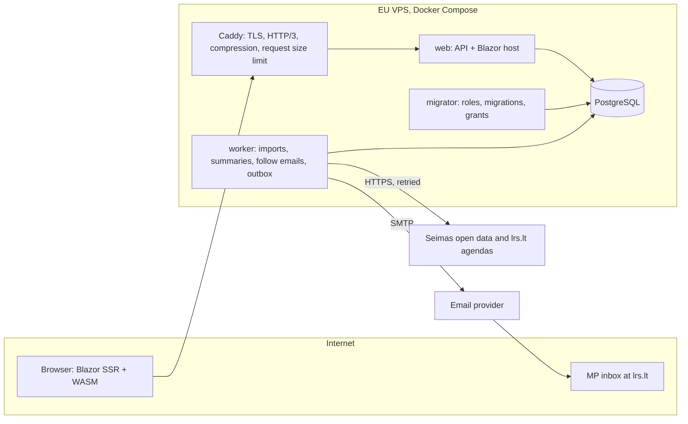

# 2. Architecture

A **modular monolith**: one deployable web application, one background worker, one PostgreSQL database. The team is small,
the load is modest (hundreds of thousands of rows a year, traffic in bursts from social networks), and the hard parts are
correctness, privacy and trust, not scale. Module boundaries are enforced in code (`Lt2.ArchitectureTests`) so a module
can be split out if that ever becomes necessary.

Modules and what each owns:

| Module | Owns | Database schema |
|---|---|---|
| **Identity** | Accounts, sign-in, known browsers, verification level, roles, consents, sessions, invitations, feedback, members' public profiles and their reports, party support, data export and deletion, the link between an account and a politician. | `identity` |
| **Parliament** | Terms, sessions, sittings, MPs, mandates, factions, committees, bills, agenda items, votes and ballots, derived statistics, the open-data import. | `parliament` |
| **Appeals** | Bills' records, positions, reasons, endorsements, MPs' responses, organisations and their statements, comments, reports, moderation, writing restrictions, descriptions and the AI summaries of bills. | `appeals` |
| **Notifications** | Outbox, email transport, templates, summaries (digests), MP mail and its preferences, suppression list, follows, members' email switches and rhythm. | `notify` |
| **Audit** | Append-only log of administrative and moderation actions; the runtime settings (5.6). | `audit`, `config` |
| **Usage** | The site's own usage statistics (8.27). | `usage` |

The worker's Hangfire storage is in the schema `hangfire`.

Rules between modules: a module exposes a small public interface (queries and commands) and integration events; nobody
reads another module's tables. Cross-module reads for pages go through query interfaces, cross-module effects through
events written to the outbox in the same transaction as the change that caused them.
