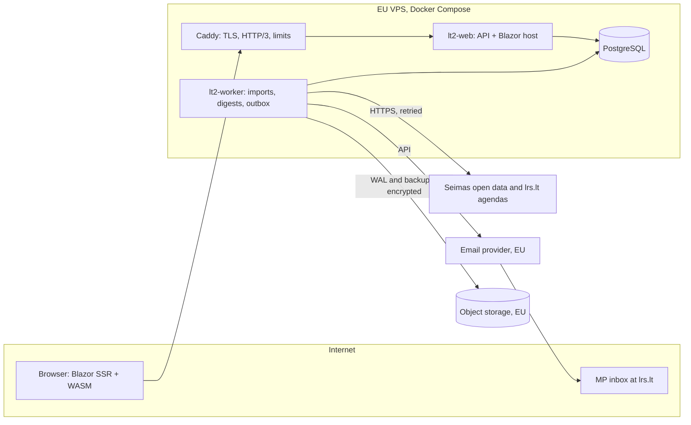

# 2. Architecture

A **modular monolith**: one deployable web application, one background worker, one PostgreSQL database. The team is small,
the load is modest (hundreds of thousands of rows a year, traffic in bursts from social networks), and the hard parts are
correctness, privacy and trust, not scale. Module boundaries are enforced in code so a module can be split out later if
that ever becomes necessary.

Modules and what each owns:

| Module | Owns | Database schema |
|---|---|---|
| **Identity** | Accounts, sign-in, verification level, roles, consents, sessions, data export and deletion, the link between an account and a politician. | `identity` |
| **Parliament** | Terms, sessions, sittings, MPs, mandates, factions, committees, bills, agenda items, votes and ballots, derived statistics, the open-data import. | `parliament` |
| **Appeals** | Appeals, positions, reasons, endorsements, MP responses, reports, moderation; comments (8.23, proposed). | `appeals` |
| **Notifications** | Outbox, email transport, templates, digests, MP email preferences, suppression list, user notification settings. | `notify` |
| **Audit** | Append-only log of administrative and moderation actions. | `audit` |

Rules between modules: a module exposes a small public interface (queries and commands) and integration events; nobody
reads another module's tables. Cross-module reads for pages go through query interfaces, cross-module effects through
events written to the outbox in the same transaction as the change that caused them.

