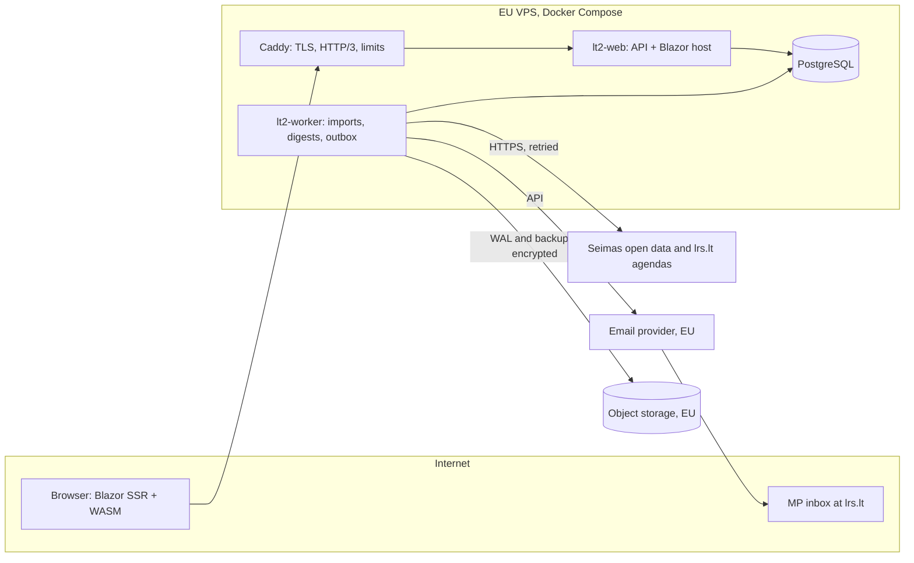

# LT2 system design

Detailed design for building Lietuva 2.0 as a production system. Written 2026-11-12 from the concept pages and
`discovery/design-notes.md` on the `docs` branch and the owner's answers the same day. English, for the team; nothing
here is published.

This is the maintained copy. Paths such as `../docs/` and `design-notes.md`, and the rules and fictional example data
this document cites from the documents-era `AGENTS.md`, are on the `docs` branch, where the concept website and the
discovery notes live.

**Status: agreed with the owner on 2026-11-12** as the basis for implementation; decisions made that day are marked
**[decided]**. Section 12 lists what is still to be chosen before the stage that needs it. All names, bills and numbers in
examples are the fictional ones from `AGENTS.md`.

## 1. Scope and build order

### 1.1 What changes compared with the public concept

The public pages describe a first version (voting with delegation) and a second version (posts, topics, answers).
This design builds in a different order **[decided]**:

| Stage | What | Source in the concept |
|---|---|---|
| **0. Foundation** | Solution skeleton, sign-in, security plumbing, deployment, monitoring. | – |
| **1. MP profiles** | Every MP of the current term imported from Seimas open data: mandate, faction, committees, contacts, voting record, statistics. | Chapter 06, the "unjoined MP" profile |
| **2. Appeals** | People take a side on a Seimas bill and give reasons; MPs receive summary emails instead of hundreds of separate ones; MPs can answer once for everyone. | A trimmed second version, section 1.2 |
| **3. Voting and delegation** | Bill pages with AI summaries, delegation, LT2 result, analytics, election mode. | The documented first version |

Stage 3 is not designed here. Stage 2 is shaped so that stage 3 extends it: a person's side on a bill is stored so that it
can become their direct LT2 vote, and an MP's published position can become the MP's LT2 vote with its explanation.

**Following is the predecessor of delegation [owner, 2026-11-16: "if we're planning on voice delegation later on, that
will probably break this rule anyway. So let's have the following to be like a predecessor of delegating."].** A member
already chooses whom to hear from by following an MP, an organisation or a member with a public profile, and each shows
how many follow it (8.11.2). That number shows whom people choose to hear from, which is the ground delegation would later
stand on; how a choice to hear becomes a choice to be represented is stage 3's question. **A follow never becomes a
delegation by itself [the designer's proposal, awaiting the owner; no alternative recommended]:** when delegation is
designed it is its own explicit act, and follows that exist then are not converted, because people follow those they
disagree with in order to watch them, and nobody who followed was asked to be represented. It is a constraint on stage
3's design, not a feature of stage 2.

The public pages still say "first version = voting". They are **not** changed by this document; section 12 lists what
would need rewording once this order is agreed.

### 1.2 The problem stage 2 solves

Before a contested vote, people send MPs large numbers of near-identical emails. For the senders it is slow and they never
learn whether anyone read them; MPs and their offices cannot tell how many distinct people stand behind the flood, and the
other side of the argument is invisible.

Stage 2 replaces the flood with one object per bill, an **appeal** (*kreipimasis*):

- it is always tied to one Seimas bill **[decided]**;
- it has two sides: "asks to vote for" and "asks to vote against";
- a person joins one side (their **position**) and may add or endorse **reasons**;
- every sitting MP receives a **summary email** with the numbers for both sides and the most endorsed reasons
  **[decided: all MPs, automatically; nobody picks recipients]**;
- an MP (or the MP's office) can publish one **response** that everyone who took a side is told about.

One appeal per bill, not one per author: every active bill is open on its own page, and nobody proposes, opens or approves
an appeal first; everyone who takes part on a bill joins the same one **[decided by the owner on 2026-11-14, 8.12; it
replaced several proposals per bill, decided 2026-11-13]**. This is the same rule as "one vote per bill" in chapter 04 of
the concept, and it is what makes one summary per bill possible.

### 1.3 What is kept from the second version and what is trimmed

| Second-version feature | In stage 2 | Why |
|---|---|---|
| Free-form posts and questions | **Trimmed** to a short *reason* attached to a bill and a side | Free text with no bill needs AI grouping into topics and heavy moderation. |
| Tagging an MP, delegate or bill (`@`, `#`) | **Dropped** | Every appeal belongs to its bill's page; the addressee is every MP. |
| "Man svarbu" | **Adapted**: joining a side is the main action; "Man svarbu" marks the reasons that matter to you | Keeps the term for what it means. |
| AI grouping into topics and questions | **Trimmed** to "this reason looks like an existing one" within one bill and side | The bill already is the topic. |
| Topic page | **Becomes** the bill's page (8.12.1) | Same layout idea: counts, grouped reasons, answers. |
| Answer once for everyone | **Kept**: one response per MP per bill | The core of the value for MPs. |
| Work statuses (Atsakė, Rengia projektą, Įregistruotas, Nepritariu) | **Trimmed** to a stance: will vote for / will vote against / undecided, plus text | The bill already exists, so "preparing a bill" has no meaning here. |
| "Mano temos" | **Replaced** by the summary email and a plain list "appeals addressed to me" | The email is the inbox. |
| Public response rate (shown at ≥ 70 %) | **Later** | Data is collected from day one; showing it is a tone decision to take with MPs. |
| Personal feed | **Dropped** | Email notifications and "my appeals" are enough at this size. |
| Comments and discussion threads | ~~**Dropped**~~ **Comments kept, threads dropped** [changed by the owner on 2026-11-16, 8.23] | Dropped on 2026-11-12 for the moderation cost, with reasons carrying the content. The owner reversed it on 2026-11-16: a text alone on a bill's page has no place for a reply. Comments ("Aptarimas") are one level of remarks under an argument, a statement or a response, shown at once, in the moderators' list only when reported, each with "Sutinku", each kind with a switch that stops new ones; replies to replies stay dropped. Never counted and never sent to MPs. |
| Petitions from topics, MPs' draft bills | **Dropped** | Not needed for the problem. |
| Moderation (AI helper plus moderators) | **Kept, required** | Anything that reaches 141 inboxes must pass a human. |

## 2. Architecture

A **modular monolith**: one deployable web application, one background worker, one PostgreSQL database. The team is small,
the load is modest (hundreds of thousands of rows a year, traffic in bursts from social networks), and the hard parts are
correctness, privacy and trust, not scale. Module boundaries are enforced in code so a module can be split out later if
that ever becomes necessary.



Modules and what each owns:

| Module | Owns | Database schema |
|---|---|---|
| **Identity** | Accounts, sign-in, verification level, roles, consents, sessions, data export and deletion, the link between an account and a politician. | `identity` |
| **Parliament** | Terms, sessions, sittings, MPs, mandates, factions, committees, bills, agenda items, votes and ballots, derived statistics, the open-data import. | `parliament` |
| **Appeals** | Appeals, positions, reasons, endorsements, MP responses, reports, moderation; comments (8.23, proposed). | `appeals` |
| **Notifications** | Outbox, email transport, templates, digests, MP email preferences, suppression list, user notification settings. | `notify` |
| **Audit** | Append-only log of administrative and moderation actions. | `audit` |

Rules between modules: a module exposes a small public interface (queries and commands) and integration events; nobody
reads another module's tables. Cross-module reads for pages go through query interfaces, cross-module effects through
events written to the outbox in the same transaction as the change that caused them.

## 3. Technology choices

| Concern | Choice | Notes |
|---|---|---|
| Runtime | **.NET 10 (LTS)**, C# 14 | Supported until November 2028, which covers the 2028 Seimas election. |
| Database | **PostgreSQL** (17 or newer) | The owner's suggestion, confirmed. `jsonb` for snapshots, full-text search with the `lithuanian` configuration, `pg_trgm` and `unaccent` for name search, `SKIP LOCKED` for the outbox. |
| ORM | **EF Core 10** with **Npgsql**, `EFCore.NamingConventions` (snake_case) | One `DbContext` per module, each on its own schema. Raw SQL only for aggregate queries and materialised statistics. Migrations run as an EF migration bundle. |
| Web API | ASP.NET Core **Minimal APIs**, one endpoint per file, `/api/v1`, built-in OpenAPI document, RFC 9457 problem details | The API is complete from the start **[decided]**; the UI uses nothing else. |
| UI | **Blazor Web App**: static server rendering for public pages, **Interactive WebAssembly** for signed-in features | See 3.1. |
| Request handling | Plain handler classes injected into endpoints | No mediator library: MediatR and MassTransit are now commercial, and the indirection buys little here. |
| Validation | **FluentValidation**, validators in the shared contracts project | Same rules run in the browser and on the server. |
| Mapping | Hand-written or **Mapperly** (source generator) | AutoMapper is now commercial. |
| Sign-in | **ASP.NET Core Identity** on EF Core: email one-time code, passkeys, no passwords | See 6.2. |
| Background jobs | **Hangfire** with PostgreSQL storage for scheduled and retried jobs; own **transactional outbox** table for emails and events | The Hangfire dashboard (admin-only) shows failed imports and digests. |
| HTTP to Seimas | `HttpClientFactory` + `Microsoft.Extensions.Http.Resilience` (retry, timeout, circuit breaker) | The service is slow at times and drops connections (`design-notes.md`). |
| Caching | ASP.NET Core output caching and `HybridCache` in memory | No Redis until there is a second web instance. |
| Time | `TimeProvider`, UTC in the database (`timestamptz`), `Europe/Vilnius` for schedules and display | |
| Identifiers | UUID v7 for our own rows; Seimas identifiers kept as natural keys; public URLs use slugs (`/p/jonas-petraitis`) and bill numbers (`/seimas/XVP-0412`) | |
| Logging and telemetry | **Serilog** to console, **OpenTelemetry** traces, metrics and logs over OTLP | Backend chosen in 9.4. No personal data in logs. |
| Email | Provider with EU processing behind `IEmailTransport` | Shortlist in section 12. |
| SMS | None at the start **[decided]**: registration is by email only (6.2). `ISmsTransport` is added if phone verification is chosen later. | |
| Bot check | **ALTCHA** (self-hosted proof of work, no third party) on registration and code requests | Fallback: Friendly Captcha. |
| AI | One interface, `IAiAssistant`; in stage 2 used only for the draft of an appeal's description in a moderator's hands (8.11.4) **[decided 2026-11-13: the Claude API, first-party; model the setting `Ai:DraftModel`, default `claude-sonnet-5-5`]**. Pre-screening and duplicate-reason hints stay rule-based: users' texts can hold personal data and this API has no EU-only processing. | No personal data is sent. Prompts are kept in the repository so they can be published, as the concept promises. Provider chosen in stage 2; until then only a "not configured" implementation exists. |
| Reverse proxy | **Caddy** | Automatic certificates, HTTP/3, simple configuration. |
| Tests | xUnit, **Testcontainers** (real PostgreSQL), **Playwright** for end-to-end, `NetArchTest` for module boundaries | |

### 3.1 Why Blazor, and which Blazor

The owner prefers a client application over a full API and knows Blazor **[decided: SPA over the API; Blazor or another SPA
if it weighs better]**. The options:

| | Blazor Web App (SSR + WASM) | Standalone Blazor WASM | React / SvelteKit + API |
|---|---|---|---|
| Public pages indexable, with share previews | Yes, server-rendered | No: empty shell until WASM loads | Yes, with a Node SSR server |
| First load from a social link on a phone | Fast: HTML first, WASM only where needed | Slow: several MB before anything shows | Fast |
| Uses the API for everything | Yes in the browser; in-process on the server (same handlers) | Yes | Yes |
| One language, shared DTOs and validators | Yes | Yes | No |
| Team familiarity | Yes | Yes | No |
| Extra moving parts | None | None | Node runtime, second build, token or BFF layer |
| Ecosystem and hiring | Smaller | Smaller | Largest |

**Recommendation: Blazor Web App on .NET 10 with per-page render modes.** Most visitors arrive from social networks on a
phone and only read (the old platform's lesson: "people bring people"), so MP profiles and bill pages are
static server-rendered HTML with proper Open Graph tags and no WebAssembly download. Everything a signed-in person does
(taking a side, writing a reason, settings, moderation, administration) is an Interactive WebAssembly component that talks
only to `/api/v1`. Until such an island has started, everything in it is disabled (fields, choices and buttons alike):
what was typed would be emptied when the island takes over, and a form sent natively would reload the page. Without
JavaScript the island never starts, and the page says so in one note. An end-to-end test loads every page with islands
with the WebAssembly runtime blocked and fails on any control left usable. **[Owner, 2026-11-17, after testing the trial:
the browser's console listed every API request.]** The WebAssembly client logs warnings and errors only (its minimum level
is Warning, in every environment), so the HTTP client factory's line per request stays out of the console.

How "full API from the start" holds with server rendering: every component depends on a typed client interface from
`Lt2.Api.Contracts` (`IParliamentApi`, `IAppealsApi`, …). In the browser the implementation is an `HttpClient` call; on the
server it calls the same application handler the endpoint calls. Integration tests exercise the HTTP path for every
operation, so the API cannot fall behind the UI.

React would be the choice if a large front-end team or a native mobile app were planned. Neither is, and the cost is a
second stack for a team of one or two.

UI components: no heavy component library. MudBlazor and similar need interactivity for most controls, which defeats
static rendering. The mockups in `../docs/` already define the visual language (`--slate`, `--leaf`, `--brand`, the
chips, the result card), so stage 0 ports those into a small set of Razor components and one stylesheet. The seat map and
charts are SVG rendered by Razor on the server, with no JavaScript; `lt2-logo-spin.js` is reused as it is.

## 4. Solution layout

```
LT2.sln
Directory.Build.props          nullable, warnings as errors, analyzers, deterministic builds
Directory.Packages.props       central package versions
global.json                    pinned SDK
src/
  Lt2.Web/                     ASP.NET Core host: endpoints, Blazor server rendering, auth, security middleware
    Endpoints/                 one file per endpoint, grouped by module
    Components/                layouts, static pages (MP profile, bill, appeal, digest archive)
    Security/                  headers, antiforgery filter, rate-limit policies, authorization handlers
  Lt2.Web.Client/              Blazor WebAssembly: interactive components, HTTP implementations of the API clients
  Lt2.Api.Contracts/           DTOs, route constants, client interfaces, FluentValidation validators
  Lt2.SharedKernel/            Result type, clock, identifiers, domain and integration event base types
  Modules/
    Lt2.Identity/              Domain/ Application/ Infrastructure/ (internal), public IIdentityModule
    Lt2.Parliament/            + Import/ (open-data client, parsers, upserts) and Statistics/
    Lt2.Appeals/
    Lt2.Notifications/         + Digests/, Templates/, Transports/
    Lt2.Audit/
  Lt2.Worker/                  Hangfire server: recurring jobs, outbox dispatcher
  Lt2.Migrator/                applies migrations for every module, creates roles and grants; run once per deploy
tests/
  Lt2.UnitTests/               domain rules: statistics, digest eligibility, thresholds
  Lt2.IntegrationTests/        API over a real PostgreSQL (Testcontainers), one fixture per module
  Lt2.Parliament.ImportTests/  parsers against recorded Seimas XML and agenda HTML
  Lt2.ArchitectureTests/       module boundaries, no direct cross-schema access
  Lt2.E2E/                     Playwright: sign-up, take a side, moderation, digest preview; 1280 px and 390 px
deploy/
  compose.yaml  compose.staging.yaml  Caddyfile  backup/  runbooks/
.github/workflows/             ci.yml (build, test, scan), deploy.yml (manual approval for production)
```

Conventions:

- Inside a module everything is `internal` except the module interface, its DTOs and its events.
- A feature is a folder with its endpoint contract, validator, handler and tests: a vertical slice, not layers by type.
- Domain rules that people will argue about (the two-thirds faction rule, participation, digest eligibility, the party
  group rule) are pure functions with unit tests whose names read as the rule.
- Every user-facing string goes through `IStringLocalizer`; the only language at launch is Lithuanian.
- Code lives on `master`, which is empty today, through pull requests with merge commits; `docs` keeps the website and
  `discovery/`. **[decided]**

## 5. Data model

Schemas match the modules. Only the tables that carry design decisions are listed.

### 5.1 `parliament`

| Table | Key columns | Notes |
|---|---|---|
| `term`, `session`, `sitting` | Seimas identifiers as keys | `kadencijos_id = 10` is 2024–2028. |
| `person` | `id`, `seimas_person_id` (unique), names, `slug`, `gender`, photo reference, biography link | `asmens_id` is stable across terms, so one person has one profile for life. |
| `mandate` | `person_id`, `term_id`, `from`, `to`, nominating party, how elected (list or constituency), constituency | `to` not null means the mandate ended; the profile becomes "former MP". |
| `body` | `id`, `kind` (faction, committee, commission, group), `seimas_id`, `term_id`, name | |
| `membership` | `person_id`, `body_id`, `role`, `from`, `to` | With dates, so "faction at the time of the vote" can be answered. |
| `contact` | `person_id`, `kind`, `value` | Official email and phone from open data: public data about a public office. |
| `bill` | `id`, `number` (`XVP-0412`), official title, registered date, proposer, e-seimas link, status, `lead_committee_id` | Created from agenda items; enriched from e-seimas. |
| `agenda_item` | `sitting_id`, Seimas item id, `bill_id`, stage, title | Items of sittings that have started (open data). |
| `planned_item` | `bill_id`, planned date, stage, source link, `first_seen`, `last_seen`, `gone_at`, `confirmed_by` | Upcoming agenda, scraped from lrs.lt; moves often. A moderator can correct or confirm a row. |
| `vote` | Seimas vote id, `agenda_item_id`, `bill_id`, time, wording, `kind`, stage, totals, official note, `is_consensus` | `kind`: stage result, amendment, procedural, other. Consensus votes have no ballots. |
| `ballot` | `vote_id`, `person_id`, `faction_id`, `choice` | About 141 rows per vote; a few million rows per term. |
| `faction_position` | `vote_id`, `faction_id`, position or "free", counts | Derived: the option chosen by at least two thirds of the faction's members who voted. Only for factions: the mixed group and MPs outside a faction have no row. |
| `mp_stat` | `person_id`, `term_id`, votes held, votes taken part in, with-faction count, free-vote count | Derived, recomputed after each import. |
| `import_run`, `raw_document` | source address, fetch time, hash, compressed body | Every response is kept, so parsing can be re-run and any number traced to its source. |

### 5.2 `identity`

ASP.NET Core Identity tables (users, roles, claims, tokens, passkeys), plus:

| Table | Notes |
|---|---|
| `profile` | Display name, created date, normalised email (for the one-account-per-address rule), `verification_level` (`email` at the start; `phone` and the EU wallet can be added), invitation used. While the account is pending (6.2) it holds only the normalised address and the invitation code that was entered. [changed while building (8.14.14, stage B): never an organisation's code, which the browser keeps until completion; `invitation_level` holds the level of the code the registration was completed with, and for an organisation's code it is all that is kept: `invitation_id` and `invitation_code` stay empty.] [built 2026-11-16 (8.25): `about`, the optional public text "Apie mane" (up to `Texts:MaxLength`), with `about_changed_at`, `about_hidden_at` and `about_hidden_statement`; `public_profile_id` (a random short id while the member's public profile is on, null otherwise) and `public_since`; retired ids kept in `retired_profile_id` without an account; reports of a profile in `profile_report` (8.25.6).] |
| `invitation` | Code (and its look-up form without dashes or spaces), kind (`team` or `personal`), who issued it (for a personal code: its member), uses left and expiry (team codes), completed registrations (a counter that never drops), level, switched off (when, by an administrator), replaced (when). Registration is by invitation during the closed trial. A use is counted when the registration is completed (6.2), not when it is started. [changed while building (8.14.14, stage B): the kind `organisation`, one current code per organisation, with `organisation_id` (the Appeals module's id) and no account; `organisation_off` (`blocked` or `closed`) follows the organisation, separate from an administrator's switch-off.] |
| `invitation_daily` | Per code and Vilnius day: registrations completed. For the administrators' chart; no per-person history. |
| `feedback` | Kind (`bug`, `idea`, `unclear`, `other` or none), text (up to 2 000 characters), page path and browser (each only if the member left them in), status (`new`, `seen`, `done`), internal note, replies, the day it came, and the account **only if** the member ticked "Galite man atsakyti". An item without that tick has no account, a random id and only the day, so nothing leads back to its author. Kept 12 months (a setting); linked items go with the account (8.10). |
| `sign_in_code` | Account, hashed code, expiry, failed attempts, used time, and the known device it was issued to (empty for a code any browser may use). |
| `known_device` | Account, hashed identifier of the browser's cookie, first and last seen. Built before registration opens (M2b). [changed while building (8.20.2): also `label`, the browser and system as the sessions list says them ("Edge, Windows"), so the person can tell the rows apart; the hash is HMAC-SHA-256 under a key of its own, the secret `device_hash_key`.] |
| `role_activation` | Account, role, hashed one-time code, who issued it, expiry, used time. Using it marks the passkey of that session as the staff passkey. |
| `party_support` | `user_id`, `party_id`. Private and optional; used only for the summaries' party group numbers, from the size `Digest:PartyGroupMinimum` (8.4; owner 2026-11-17, default 10, 0 = no floor), and shown on the person's public profile only by their own box and consent `party-public` (8.25.9, owner 2026-11-17). |
| `consent` | Kind, text version, given and withdrawn times. Positions need explicit consent (GDPR Art. 9). [built 2026-11-16 (8.25.1): the kind `public-profile`, given by switching "Viešas profilis" on and withdrawn by switching it off; it covers the page, its indexing, being followed and the shown follower number] |
| `politician_link` | `user_id`, the Seimas's person number, part (the MP, or an office member), how and when verified, who added an office member, when and by whom it ended. One MP per account; one account as the MP per person (8.5.2, 8.5.3). |
| `politician_token` | The hashed one-time token of a take-over link or of an office member's invitation, for which person, by whom, expiry, used time (8.5.2, 8.5.3). |

### 5.3 `appeals`

| Table | Key columns | Notes |
|---|---|---|
| `bill_record` | `id`, `bill_number`, description, `description_source`, `description_url`, `description_at`, status, opened, published and closed times, `closing_vote_id`, frozen counts, `sending` (automatic or held), `threshold`, `threshold_set_by` (default or moderator), `threshold_note`, `first_summarised_at`, `initiator_user_id` (old rows only) | The bill's record (8.12.1): the Appeals module's own record of what people did on one bill, created when first needed (the first side, argument or description, or a moderator's action), never proposed or approved. One per bill: a unique partial index over the statuses open, closed and rejected (hidden by a moderator, 8.12.3). Status `superseded` marks only rows from before 2026-11-14 that are no longer a bill's record (proposals closed when the proposals went, older hidden appeals). The description is empty until a moderator writes one or the summary job makes one; `description_source` (`initiator`, `moderator`, `ai-draft`, `ai`, 8.13) is null without one. [changed while building (8.13): `description_url` is the official text it was made from when known (set by the summary job, kept when a moderator confirms or corrects that text, cleared on removal) and `description_at` when its text was made or last changed.] [changed while building (8.13, the owner's
last block): a moderator who writes or corrects a description sets `description_url` from the form's "Oficialaus teksto
adresas" (https on `lrs.lt` or under it, at most 500 characters), filled in advance with the current one; empty clears it.] `threshold` is null for the default of all bills, or a moderator's number for this bill (8.12.2). `first_summarised_at` is set by the first summary really sent to MPs, not by a dry run (8.4). `initiator_user_id` is set only on records from before 2026-11-14 and only names the author beside a description they wrote. [changed while building: `return_note` and the description's `screening_flags` were dropped with the proposals] |
| `position` | (`record_id`, `user_id`) primary key, `side` (for or against), created and changed times | One row per person per bill. Becomes the direct LT2 vote in stage 3. |
| `daily_stat` | `record_id`, date, counts per side, counts for accounts older than 30 days, share of new accounts | For the trend chart and surge detection. **No per-person history of opinion changes is stored.** |
| `reason` | `id`, `record_id`, `side`, `author_user_id`, text (`text`, any length), status, `merged_into_id`, `first_public_at` (when it first became public: the follow line of 8.25.5 and the member's page read it; built 2026-11-16) | Status: pending, published, hidden, merged. `side` is the side the argument supports, chosen by its author, whatever the author's own position (8.2). How long a text may be is the members' texts setting `Texts:MaxLength` (5.6), checked where an argument is written; the column sets no limit (**owner, 2026-11-16**; migration `ReasonTextAnyLength`). |
| `endorsement` | (`reason_id`, `user_id`) | "Man svarbu" on a reason; only on your own side, never on a reason you wrote (owner, 2026-11-17); how many per bill is a setting, no limit by default (8.2). |
| `mp_response` | bill number, the Seimas's person number, stance (for, against, undecided), text (`text`, any length; its length is the members' texts setting `Texts:MaxLength`, 5.6, checked where it is written; **owner, 2026-11-16**, migration `MemberTextsAnyLength`), status (published, hidden, withdrawn), published, edited and withdrawn times, `written_by_user_id` | One per MP per bill; versions are kept in `revision` and are public (8.5.5). Withheld from the read-only role. [changed while building: also `screening_flags` and `seen_at` (the queue), `hidden_at` and `hide_statement` (the statement shown in its place); the one-per-bill index holds whatever the status, so a response written again after a withdrawal is the same row; a version is kept as JSON in `revision` (`entity_kind` `response`, field `version`) with no person.] |
| `report` | target, reporter, ground, status | Notice-and-action under the Digital Services Act. [proposed: the target `comment` (8.23). A member's public profile and its "Apie mane" are reported to Identity, which owns them: `identity.profile_report`, built 2026-11-16 (8.25.6)] |
| `comment` | `id`, `target_kind`, `target_id`, `bill_number`, `speaks_as` (person, organisation, mp) with the organisation or the MP, `author_user_id`, text (up to `Texts:MaxLength`), status (published, hidden), created and hidden times | [built 2026-11-16, 8.23.11] A remark in "Aptarimas" under an argument, a statement or a response: a member's, or an organisation's or MP's under its own text. No editing and no history; deleted for good when deleted or with its target (8.23.7); a person's own go with the account. Withheld from the read-only role. |
| `comment_agreement` | (`comment_id`, `user_id`), created time | [built 2026-11-16, 8.23.10] "Sutinku" on a comment, public with the names of those who agreed (owner, 2026-11-16); tied to no side, so no positions consent. Deleted with the comment and the account. Readable by the read-only role, as `reason` is. |
| `moderation_action` | moderator, target, action, statement of reasons, time | The statement is sent to the author. |
| `writing_restriction` | `id`, `user_id`, `ends_at` (null = until lifted), statement, set by and when, lifted by, when and why | A moderator's restriction on writing (8.3). Lives with the writing rules in this module; deleted with the account; never shown to anyone but the person and staff. |
| `revision` | entity, field, old and new value, who, when | Edit history for descriptions, reasons, responses. "Who" is empty for a summary the job made (8.13); a description a person ever wrote, corrected or removed is recognised by a row with a person, and the job never writes it again. |
| `summary_attempt` | `bill_number` (key), tried time, outcome (`made`, `unavailable`, `insufficient`, `failed`, `overtaken`), whether the provider was asked, `retry_after` | [changed while building (8.13)] The summary job's last try per bill, also for a bill without a record; never a text and no person. Serves the daily number (tries that asked the provider since Vilnius midnight) and the wait before the next try. |

| `ai_draft_request` | `id`, moderator, `bill_number`, requested time | [changed while building] That a moderator asked for an AI draft (8.11.4): never a text. For the hourly limit and to accept a description as started from a draft (8.12.3). Exported and deleted with the moderator's account. |
| `organisation` | `id`, `slug`, `name`, `name_key`, `description`, `website`, `legal_code`, `declared_lobbyist`, `registered_by_user_id`, `status`, confirmation and block columns, `seen_at` | [changed while building (8.14.14, stage A)] An organisation's public profile; the columns are listed in 8.14.10. Who registered it is never public and is emptied with the account. Hidden from `lt2_readonly`. |
| `organisation_representative` | `id`, `organisation_id`, `user_id`, `granted_by_user_id`, `granted_at`, `ended_at` | [changed while building] Who acts for an organisation; seen only by its other representatives. Deleted with the account; the last representative's deletion closes the organisation. Hidden from `lt2_readonly`. |
| `organisation_invite` | `id`, `organisation_id`, `token_hash`, `created_by_user_id`, `created_at`, `expires_at`, `used_at` | [changed while building] A representative's one-time link (seven days). Hidden from `lt2_readonly`. |
| `organisation_code` | `id`, `organisation_id`, `domain`, `code_hash`, `created_at`, `expires_at`, `failed_attempts`, `consumed_at`, `requested_by_user_id` | [changed while building] Confirmation by email domain, under the sign-in codes' rules; never the mailbox. Hidden from `lt2_readonly`. |
| `organisation_statement` | `id`, `organisation_id`, `bill_number`, `stance`, `text` (`text`, any length; its length is `Texts:MaxLength`, 5.6, checked where it is written; **owner, 2026-11-16**, migration `MemberTextsAnyLength`), `link`, `goal`, `status`, `screening_flags`, `seen_at`, `published_at`, `edited_at`, `withdrawn_at`, `written_by_user_id` | [changed while building] One per organisation per bill (8.14.3); never counted. Earlier versions in `revision` without a person. `written_by_user_id` is never public and is emptied with the account. Hidden from `lt2_readonly`. [changed while building (stage B): `first_public_at`, when it first became public, for the follow emails.] |

### 5.4 `notify`

| Table | Notes |
|---|---|
| `outbox` | Kind, `jsonb` payload, due time, attempts, error. Written in the same transaction as the change; dispatched with `FOR UPDATE SKIP LOCKED`. |
| `digest_run` | Kind (weekly, before-vote, urgent, introduction), scheduled time, status, who approved. |
| `digest_item` | Per run and bill's record (`record_id`): counts per side, counts for accounts older than 30 days, top reasons (text and "Man svarbu" count, without the author's name), planned date and stage. A frozen snapshot: what MPs were told. |
| `digest_delivery` | Per run and MP: sent, skipped by preference, suppressed, bounced; the MP-specific numbers. |
| `mp_email_pref` | Per MP: frequency (default, weekly only, before votes only, stopped), confirmed extra recipient. |
| `suppression` | Hashed addresses that bounced or asked to stop. |
| `mp_mail_token`, `introduction_letter` | The MP's link to the preferences page and the introduction letter's versions (8.19.4, 8.19.5, 8.19.7). The statuses of `digest_run` and `digest_delivery` for real sending are in 8.19.1 and 8.19.3. |
| `email_message` | Template, subject, provider message id, status. Bodies of digests are reproducible from the snapshot; other bodies are not stored. |
| `follow` | (`user_id`, `kind`, `key`) primary key, created time. `kind`: bill (key: the number) or mp (key: the Seimas person id). Who follows is shown to nobody but the person; exported and deleted with the account (8.11.2). How many follow each thing is public: a number counted from this table when an answer is made, nothing per follower (8.11.2, owner 2026-11-16; built 2026-11-16). [changed while building (8.14.14, stage B): or `organisation` (key: the organisation's id); `kind` up to 16 characters.] [built 2026-11-16 (8.25.5): or `member` (key: the public profile id), only while that member's profile is public; ended when it is switched off.] |
| `notice_setting` | Per account: which follow emails are on (`planned`, `voted`); no row means both on. [changed while building (8.14.14, stage B): and `statements` (a followed organisation's statement became public); no row means all three on.] [changed while building (8.20.1): and `responses`; no row means all four on.] [built 2026-11-16 (8.23.9): and `comments`, an argument's author told of new comments under it; no row means on.] [built 2026-11-16 (8.24): and `frequency` (`immediate`, `daily`, `weekly`), the member's email rhythm, with `frequency_since`, `previous_frequency` and `previous_since`; no row means `immediate`.] [built 2026-11-16 (8.25.5): and `members`, a followed member published something; no row means all on.] |
| `bill_event` | (`bill_number`, `kind`, `key`) primary key, first seen, sent time, outcome. `kind`: planned (key: the date) or voted (key: the vote id). What followers are told about, recorded once (8.11.2). No person in it. [changed while building: an `outcome` column (`waiting`, `sent`, `skipped`, `superseded`) tells an event never to be sent from one waiting for the next day] [changed while building (8.14.14, stage B): `kind` `statement` (key: the statement's id) records, under its bill, that a followed organisation's statement became public; no person and no text in it] [built 2026-11-16 (8.24): `daily_at`, `weekly_at`, `early_at`, the marks of the gathered emails beside `outcome` and `sent_at` (the runs' emails); `kind` `response` per MP's answer (key: the person number and when the stance became public)] [built 2026-11-16 (8.25.5): `kind` `member` (key: the text's id) records, under its bill, that a followed member's argument or own-voice comment became public; no person and no text in it] [built 2026-11-16 (8.23.9, 8.23.14): `kind` `comment` (key: the argument's id and the run's moment) records that a run found comments under an argument; no person] [built 2026-11-16 (8.24): an index on (`kind`, `first_seen`); rows older than 30 days are deleted by the daily housekeeping, a planned date only once past (the designer's proposal, 12)] [built 2026-11-16 (8.24): `notify.rhythm_pass` (`pass`, `period`, `made_at`) says the daily email of a day or the weekly of a week was made; no person] |

### 5.5 `audit`

`event`: time, actor, role, action, target, details, hashed IP. The application role may only insert.

### 5.6 Settings

`config.setting`: key, `jsonb` value, who changed it and when. Holds every number an administrator may need to tune
without a deploy: the summary rules in 8.4 (the threshold of all bills, `Digest:ThresholdDefault`, read whenever it is used, and the minimum no threshold goes below, 8.12.2; the weekly and before-vote times, the ceiling
per MP, the share of change that counts as "changed notably", `Digest:NotableChange`, and the smallest party group whose
number a summary shows, `Digest:PartyGroupMinimum`, 10, 0 = no floor, **owner 2026-11-17**), the reasons and "Man svarbu"
marks a person may give per bill in 8.2 (`Appeals:ReasonsPerPerson`, `Appeals:EndorsementsPerPerson`, 0 = no limit,
the default), the longest text members write for others to read (`Texts:MaxLength`, characters, 2 000; 0 = no limit but
the technical ceiling of 20 000; **owner, 2026-11-16**): arguments (8.2), organisations' statements (8.14.3) and MPs'
responses (8.5.5), and comments and "Apie mane" when they are built; not a bill's description (a moderator writes it and
it is reviewed anyway), a moderator's statement, a report, feedback, a display name, an organisation's name and
description, or a statement's link and goal, which keep their own limits; on the settings screen in its own group
"Narių tekstai"; the surge thresholds in 6.6,
the code limits and the life of a pending account in 6.2, whether registration needs an invitation, uses per personal invitation code (`Registration:PersonalCodeUses`, 0 = no limit, the default), uses per organisation's invitation code (`Registration:OrganisationCodeUses`, 0 = no limit, the default; 8.14.14 stage B, on the settings screen under registration), how long feedback is kept (`Feedback:KeepMonths`, 12), how many organisations an account may
register (`Organisations:PerAccount`, 3; closed ones do not count, 8.14.14; on the settings screen under
"Organizacijos"), the Claude model of the description draft and of the AI summaries (`Ai:DraftModel`, `claude-sonnet-5-5`, 8.11.4, 8.13), how many AI summaries the job may ask for a day (`Ai:SummariesPerDay`, 30; 0 = off, 8.13), [built 2026-11-16, 8.23.4 and 8.23.5] whether comments are on for arguments, statements and responses (`Comments:OnReasons`, `Comments:OnStatements`, `Comments:OnResponses`) and how many comments a person may write under one text (`Comments:PerPersonPerTarget`, 0 = no limit), on the settings screen under "Komentarai". Each
change is written to `audit`, and the current values of the rules that affect what MPs receive are shown on the public
methodology page.

The site's own address is not one of them **[decided by the owner on 2026-11-14]**: `Site:Address` is deployment
configuration, which compose builds for the web and the worker from `LT2_SITE_ADDRESS` and the https port (the address
Caddy serves), so no administrator can point emails at another site. It must be empty or an https address of a host
and nothing more; a host refuses to start otherwise. Links in every email and in the summary's text start with it;
when it is empty they stay the site's paths.

The administrator's settings screen groups them under headings (registration and sign-in; appeals; summaries; surge
note; feedback), with a separate "Saugumo ribos" group for the ones rarely changed (codes per hour and per day, days a
pending account is kept), which says so. Each setting shows a plain Lithuanian label, one sentence on what it does and
when to change it, its unit, the default, and the key in small type. The minimum threshold's 50 is a placeholder until
the owner sets a number, and the screen says so.

### 5.7 `usage`

The site's own usage statistics (8.27). `sketch`: per period (`day`, `month`, `year`, by its first Vilnius day) and
audience (`visitor`, `member`), the random salt and the HyperLogLog registers of a period under way; deleted when the
period ends; withheld from `lt2_readonly`. While it lasts, a candidate visitor or account can be tested against it
(8.27.2). `total`: per period, distinct visitors and members (approximate) and page views of visitors, members and
robots. `page`: views per Vilnius day and route. `referrer`: visitors per Vilnius day and referring host. These three
name no person. Only `lt2_app` reads and writes the schema.

Database roles: `lt2_migrator` owns the schemas and runs migrations; `lt2_app` has data access only; `lt2_worker` the same
plus the Hangfire schema; `lt2_readonly` for ad-hoc analysis has no access to `identity` or `appeals.position`. [changed
while building (8.14.14): nor to the five organisation tables, which hold an account beside an organisation.]

## 6. Security and privacy

### 6.1 What we protect

1. **Who took which side.** A position on a bill is a political opinion: special-category data under GDPR Art. 9. Leaking
   it is the worst realistic incident.
2. **The integrity of the numbers.** MPs and journalists must be able to trust that 4 280 means 4 280 distinct verified
   accounts.
3. **The sending channel.** A system that can email every MP is a target: if it is abused once, the summaries get
   filtered and the product stops working.
4. **Politician accounts.** A hijacked MP account publishes in the MP's name.

### 6.2 Sign-in and accounts

- **No passwords.** Sign-in is a six-digit code sent by email (ten minutes, five attempts, single use), or a **passkey**
  (built into ASP.NET Core Identity in .NET 10). Nothing to leak, reuse or stuff.
- **A code belongs to the address, not to a browser.** It can be read on any device and typed into any browser, so a
  person can register on someone else's computer with the mail open on a phone, and later ask for a new code on their
  own device. A new code replaces the earlier one; the email and the page say to use the newest.
- **How many codes [decided 2026-11-12].** For one address, all browsers that have not signed in to that account before
  share five codes an hour and ten a day (both are settings). The daily limit is what bounds guessing: at most 50 tries
  a day against one account, about a 2 % chance over a year of constant attack, against about 20 % with the hourly
  limit alone.
- **Known devices [decided 2026-11-12; built before registration opens, M2b].** The shared limit can be used up by
  anyone who knows an address, which would keep that person from signing in by code. So a browser that has signed in
  to an account keeps a one-year `__Host-` cookie with a random identifier (stored hashed, tied to that account; it
  gives no access by itself). Such a browser has its own five codes an hour. A code it asked for is accepted only
  from it, so requests and wrong guesses from elsewhere cannot cancel or exhaust it. [changed while building (8.20.2): its own
  five an hour and ten a day, the same two settings, counted separately.] Codes asked for from any other
  browser stay usable anywhere, as above. A stranger can then block sign-in only from browsers the person has never
  used; the usual browser and a passkey keep working. [changed while building (8.20.2, 2026-11-16): built as 8.20.2 says;
  the lockout is no longer an accepted risk of the closed trial, except for a browser the person has never signed in with
  (section 12).]
- **Registration = email only at the start [decided 2026-11-12].** The concept says email and phone, but SMS
  verification is a paid service (charged per message, and a target for SMS-pumping fraud), so it waits until there is a
  budget and a need. Each account has a **verification level**: `email` now, `phone` or the EU Digital Identity Wallet
  later. A stronger check can then be added as an upgrade existing people complete, and counts can be reported by level.
- Email alone lets one person create many accounts for nothing. What stands in for the phone:
  - the closed trial is **by invitation** (a code from the team or from a participant), so there is no open registration
    while the flow is being proven; **[decided by the owner on 2026-11-17: "office link should count as invitation"]** a
    valid MP office member's invitation (8.5.3) counts as one: a person who comes by it registers on the office page with
    no invitation code; the server checks it at registration and again at completion (known, unused, unexpired, made by
    the account that is still the MP's), registering does not use it up (accepting it does), and the account keeps only a
    level, one below the MP's account, as an organisation's code leaves only its level (8.14.14). [The designer's choice:
    such a registration is in no invitation code's count or daily series on the administrators' screen, there being no
    code; it is not counted as "without a code" either, since it has a level.]
  - one account per **normalised address** (lower case, the `+tag` part removed, dots ignored where the provider ignores
    them), and addresses at disposable-mail domains are refused;
  - the bot check and per-IP limits on registration;
  - the 30-day count beside every number, and the surge note (6.6).
- **Before registration opens to everyone and real summaries go to MPs (M2b), decide again:** add phone verification, or
  stay with email and label every number as coming from email-confirmed accounts. See section 12.
- **An account is pending until its address is proven [decided 2026-11-12].** Registration takes the address and the
  invitation code and creates a pending account: no name, no declarations, no role, nothing it can do. The first
  correct code proves the address. Only then is the person asked for the display name and the declaration of being 18
  or older, only then is the invitation use counted (if it has run out by then, the person is told so and can enter
  another), and with the declaration the account becomes a member. So nobody can attach a name or an age declaration
  to someone else's address, or use up an invitation with addresses they do not control.
  - Asking for a sign-in code for a pending account works like any other and completes the registration, on any
    device.
- **Changing the display name [asked for by the owner on 2026-11-16; the points below marked as the designer's proposal await the owner].** A
  member changes the name on the account page ("Profilis", 8.21) by `PUT /api/v1/me/display-name`, with the registration's
  rule: at most 60 characters, empty allowed (what the person wrote then shows "Lietuva 2.0 naudotojas"). The name is
  read live wherever it is shown (beside arguments, in an organisation's list of representatives, on feedback and
  moderation screens), so a change shows everywhere at once, older arguments included; summaries never hold names, so
  their snapshots are untouched. There is no limit on how often the name changes **[owner, 2026-11-16]**; the shared
  per-account request limit (`RateLimits:Participation`) only guards against a runaway script. Proposed with it:
  - a writing restriction (8.3) also blocks changing the name, since the name is text others read; Identity asks Appeals
    through `IWritingRestrictions` (SharedKernel) — or, the alternative, the restriction leaves the name alone and a
    moderator who finds a name offensive asks the person to change it;
  - the change is audited that it happened, never from what to what; nothing public says a name was changed; no earlier
    names are kept.
- **Personal invitation codes [decided 2026-11-13].** Every member has one personal code, made at completed
  registration (for earlier members when first needed), shown on the account page as a link to the registration form
  with the code filled in and as a short code with a copy button. Format: eight characters from 29 that cannot be
  mistaken for one another (`23456789ABCDEFGHJKMNPQRSTVWXYZ`: no 0, 1, I, L, O, U), shown as `XXXX-XXXX`; case,
  dashes and spaces do not matter when typed; about 5 × 10¹¹ codes, and guessing stays under the registration rate
  limits. Codes are never written to logs.
  - Uses per personal code are a runtime setting, `Registration:PersonalCodeUses`, 0 = no limit, the default. Team codes
    keep their own uses and expiry.
  - The member can replace the code: a new one is made, the old one stops working, and the member's count (the sum of
    their codes) carries over.
  - A use is counted when registration completes, as before, on a counter on the code and in daily totals per code; the
    count never drops when an invited person deletes their account. The profile keeps which code it registered with,
    and that goes with the account.
  - When the inviter deletes their account, their codes are switched off and lose their owner: nothing of the person
    stays on them; their counts, levels and daily totals stay as anonymous numbers.
  - The member sees only how many people completed registration with their code and whether it is on; no names, dates
    or list. The registration form says plainly that whoever gave the code sees that it was used, not by whom.
  - Administrators (staff-passkey session) get a page: completed registrations per day, in total and for the codes that
    brought the most people, as a server-rendered chart with the numbers also as a table; those codes (team codes by
    their code, personal codes by the member's display name); and the numbers per level (level 1: by team codes or with
    no code; level 2: by codes of level-1 people; and so on). No who-invited-whom tree and no list of who used a code.
    An administrator can switch any code off and on again, with a statement, audited; a member whose code was switched
    off sees that on the account page, with the contact address, and cannot replace it meanwhile.
  - A code that does not work gets one message on the registration form, whatever the reason (unknown, switched off,
    replaced, expired, used up): ask whoever invited you for a new one.
  - Never combined with sides: no screen, API answer, export or query joins invitations with positions, marks or
    arguments. No ranking shown to members, no rewards, nothing public. An account restricted from writing (8.3) keeps
    its code; switching a code off is a separate action.
  - If the address already has an account, registration only sends a sign-in code to the address on the account; what
    was typed is discarded.
  - Accounts still pending after seven days (a setting) are deleted by the maintenance job that also removes old codes
    and expired sessions, so an address typed by a stranger is not kept.
- Reading needs no account. Taking a side, writing a reason and endorsing need a confirmed email and the age
  declaration.
- **Minimum age: 18, self-declared when the address has been confirmed [decided].** The signal is compared with a
  parliament elected by adults; the EU Digital Identity Wallet could later confirm it.
- Session: `__Host-` cookie, `Secure`, `HttpOnly`, `SameSite=Lax`, sliding 30 days; a person can see and end their
  sessions. No tokens in the browser: the WASM client uses the same cookie (same origin).
- **A session is what it was signed in as [owner, 2026-11-17].** Every sign-in (an emailed code, a passkey, the take-over of
  an MP's profile, the office invitation's passkey, a code session becoming a passkey or staff session) starts a new session
  under a new key; the browser's session before it, of the same account or another, ends as by signing out (its row is
  deleted, its cookie leads nowhere). After that the session's account, its way of signing in and its passkey never change:
  renewing it (the sliding expiry, the security stamp's check every 30 minutes, the registration's completion) keeps them,
  so a passkey session stays a passkey session for its 30 days. A changed security stamp still ends the session.
  - *Never a silent switch.* A sign-in in a browser signed in to another account says so: its answer carries
    `accountChanged`, and the sign-in steps show "Prisijungėte kaip kitas narys: {vardas}." (the new account's display name
    in the nominative after a colon; without a name "Prisijungėte kaip kitas narys.") with "Tęsti" before going on. The
    other account's kept analytics comparison goes with its session (8.26.6). The take-over and the office invitation's
    acceptance stay tied to the signed-in account; a passkey of another account is refused there as before.
  - *A passkey session in place.* Where an action needs a passkey session (speaking for an MP, a linked account's passkey
    change) and this one was signed in by a code, the island says "Šiam veiksmui reikia prisijungimo prieigos raktu." with
    "Patvirtinti prieigos raktu" (`PasskeyStep`): an assertion with one of the signed-in account's own passkeys makes the
    session a passkey session under a new key (`POST /api/v1/me/passkey-session`), counted as just confirmed, audited
    (`passkey.session-started`, without the address), no email; then the island reads its state again. With the staff
    passkey it is a staff session too (audited `staff.session-started`). A passkey of another account is refused with
    `passkey.other-account` and changes nothing; the browser stays signed in to its own account.
- **Staff** (moderator, administrator) **[decided 2026-11-12].** A staff role works only in a session signed in with a
  **staff passkey**. A session signed in by email code is an ordinary member session, whatever roles the account has,
  so getting into a staff member's mailbox is not enough.
  - *Activation.* An administrator grants the role; the system shows a one-time activation code on the administrator's
    screen (valid 24 hours, never sent by email), and the administrator passes it to the person directly. The person
    signs in with a passkey and enters the code: that passkey becomes the staff passkey, and any other passkey on the
    account is removed.
  - *Afterwards.* Adding or removing a passkey on a staff account needs a staff-passkey session and a fresh passkey
    confirmation (within the last ten minutes). Sensitive actions (approving a send, changing roles, verifying a
    politician) ask for the same fresh confirmation.
  - *A staff session without signing out* **[owner, 2026-11-16]**. A session on a staff account that is not a staff
    session (signed in by email code, or with another passkey) becomes one by an assertion with the account's staff
    passkey on `/prisijungti/raktas` (`POST /api/v1/me/staff-session`), reached from the account item (8.21), or in place
    by "Patvirtinti prieigos raktu" where a staff screen refuses and on the account page (owner, 2026-11-17: the same
    `PasskeyStep` as above, with the staff passkey). Only the signed-in account's own staff passkey counts: another account's passkey, another passkey of
    the account, or an account without an activated staff role is refused with one answer and changes nothing. The
    session gets a new key: the old session ends and a passkey session takes its place, so the old cookie leads nowhere
    and the sessions list shows one session for the browser. It counts as a fresh confirmation. It is audited
    (`staff.session-started`, without the address); like a staff passkey sign-in, it sends no email.
  - *Lost passkey.* An administrator resets the account: its passkeys are removed and the role is inactive until a new
    activation code is used. The first administrator, and a lost last one, are activated from the server: the migrator
    command grants the role and prints the activation code.
  - Every grant, activation, reset and passkey change is audited, and the person is told by email.
- **Politicians** (verified MP, office member) need a passkey as well. Their proof of identity is the official
  `@lrs.lt` mailbox, so the take-over link plays the part of the activation code: the passkey is created while using
  the link, and later changes need that passkey or a new link. The details are in 8.5.2 to 8.5.4.
- **Other members:** a passkey is a convenience. The mailbox is what proves who they are, and a code still signs them
  in. They are told by email when a passkey is added or removed.
- No authenticator app: one way in to secure. It can be added if an MP's office cannot use passkeys.
- Responses never reveal whether an email is registered.
- **Local development only: a fixed sign-in code [decided 2026-11-13].** For the owner's hand testing on the local
  stack, one configured six-digit code may be typed in place of the emailed one, for any account. Guards, all of them:
  it is configuration only (an environment variable in `deploy/.env`), never a runtime setting and never on the
  settings screen, so no administrator can switch it on; the web host refuses to start when it is set and the site's
  own address (`Site:Address`, from the same `LT2_SITE_ADDRESS` Caddy serves) is not `localhost` or a `.localhost`
  host, and each request must also come to such a host; unset by default, and then it is refused like any wrong code.
  The real code is still generated, emailed and accepted. The fixed code works only where an emailed code does
  (registration and sign-in, a code requested and not yet used, expired or exhausted) and gives an ordinary member
  session; it never activates a staff role and has nothing to do with activation codes or passkeys. The sign-in page
  says plainly that it is on, and start-up logs one warning line (without the code). Locally the per-address rate limits
  and the code limits are raised through the same `.env`; the defaults in code and in production stay.
  **Not built yet:** the change to the code check was stopped by the coding session's permission checks (an
  authentication bypass needs the owner's own go-ahead in that session); the raised local limits are built.

### 6.3 Authorization

Policy-based, with resource handlers where ownership matters.

| Role or claim | Can |
|---|---|
| Visitor | Read all public pages and public API. |
| Member (confirmed email; invited during the trial) | Open an appeal, take a side, write and endorse reasons, report content; comment under arguments, statements and responses and mark a comment "Sutinku" (8.23, proposed). |
| Verified MP / office member (`politician_link`) | Publish and edit that MP's response; manage that MP's email preferences; comment as the MP under that MP's own response, in a passkey session (8.23.2, proposed). |
| Moderator | Review appeals and reasons, merge, hide (reported comments too, 8.23.8, proposed), correct planned dates, hold a send, approve an urgent send, restrict an account from writing and lift that. |
| Administrator | Roles, politician verification, configuration, import and digest dashboards; every moderator action, restricting an account from writing and lifting that included. Cannot read individual positions through any screen. |

No screen and no API returns another person's position. Group numbers (the supporters of the MP's party on a side, in a
summary) are published only for groups of at least the runtime setting `Digest:PartyGroupMinimum` (8.4; **owner,
2026-11-17**: default 10, 0 = no floor; until then a fixed 20).

### 6.4 Web hardening

- TLS only, HSTS with preload, HTTP/3.
- Content Security Policy: `default-src 'self'`; `script-src 'self' 'wasm-unsafe-eval'` (required by WebAssembly), no
  inline scripts; `frame-ancestors 'none'` everywhere except future embed endpoints; `Referrer-Policy`,
  `Permissions-Policy`, `X-Content-Type-Options`.
- Every state-changing API call needs the antiforgery token header and passes an `Origin` check; CORS is off.
- Rate limits at two layers: Caddy per IP, and ASP.NET Core policies per account and per IP for code requests, registration,
  writing reasons and reports, and (proposed, 8.23.4) writing comments under their own policy.
- All input validated by the shared validators on the server; user text is stored as plain text and encoded on output,
  no HTML or Markdown from users in stage 2.
- Outbound requests go only to a fixed allowlist of hosts (Seimas, email, AI, storage). The AI host (`api.anthropic.com`,
  8.11.4) is on the web host's list only while the provider is configured, and on the worker's (the summary job, 8.13)
  on the same condition.

### 6.5 Data protection

- **Explicit consent** before the first position, with the consent text versioned and stored. Withdrawing deletes the
  positions.
- **Minimisation.** No personal code, address or document number (as the concept promises). No phone number is
  collected at the start; if phone verification is added, only a keyed hash is kept. No per-person history of changed
  positions.
- **Deletion and export.** A person can download everything they gave us and delete the account; positions are removed
  and counts fall. Frozen digest snapshots keep their totals: they are aggregates and a record of what was sent.
- **Encryption.** Disk encryption on the VPS volume, TLS to the database inside the Docker network, encrypted backups.
  ASP.NET Core data-protection keys are stored in PostgreSQL, wrapped with a key supplied as a secret.
- **Logs** carry request ids, never emails or sides; IPs are hashed with a rotating key and kept 30 days.
- **Usage statistics** (8.27): a visitor's address and browser, or a member's account, are hashed with a random salt of
  the day, month and year into an aggregate sketch; while the period lasts the salt and the sketch are stored and a
  candidate can be tested against them (8.27.2); when it ends both are deleted and only counts remain.
- **Secrets** live outside the repository and outside images: encrypted with SOPS and age in a private operations
  repository, mounted as files at deploy, rotated on a schedule and after any staff change.
- **Before launch:** a data protection impact assessment (required for large-scale processing of special-category data), a
  privacy notice, a processing record, processor agreements with the email, AI (Anthropic, for the description draft and the AI summaries only: the bill's
  number, title and official text, no personal data; 8.11.4, 8.13) and storage providers. The old
  platform held a permit from the State Data Protection Inspectorate; the current rules need checking with a lawyer.

### 6.6 Integrity of the numbers

- One account per normalised email address (6.2); one position per account per bill. This is weaker than a phone check,
  which is why the 30-day count is always shown and why every number is described as a signal.
- Every published count comes with the count for **accounts older than 30 days** (the concept's filter).
- **Surge detection:** when a large share of recent positions on a bill come from accounts created in the last days
  (default: at least 30 % of the last 72 hours' positions and at least 50 accounts; both are settings), the bill's page and the summary say
  so in neutral words, and a moderator is asked whether to hold the send.
- Counts in a summary are frozen in `digest_item` and published at a public address, so anyone can check what MPs were
  told (section 8.7).

### 6.7 Supply chain and delivery

Central package versions and lock files, NuGet audit in CI, Dependabot, CodeQL, secret scanning, container image scan,
SBOM per release, images signed and pulled by digest. Containers run as non-root on chiselled .NET images with a read-only
file system and dropped capabilities. A `security.txt` and a disclosure address. An external penetration test before the
first real summary is sent.

### 6.8 Rules made explicit after the code review of 2026-11-15

**[Designer's reading of rules this document already has, written down so the code can be checked against them. None
changes what a person can do on the site; the questions that do are in section 12.]**

- **Nothing held back becomes public through history.** A text that pre-screening held and no moderator published was
  never public, and no history shows it: an organisation statement's "earlier versions" (8.14.14) are only the
  versions that were public.
- **A flagged change is looked at.** When an organisation changes its description and pre-screening flags the new
  text, the organisation returns to the moderators' queue, as it does for a new name or website (8.14.14).
- **A report is closed only by an action that answers it.** Keeping, hiding, restoring, publishing, describing and
  confirming answer a report on their target; setting a threshold or a planned date, holding and releasing do not.
- **A finished bill is finished for everyone at the same moment.** Once the bill's final vote is recorded, taking part
  (a side, an argument, "Man svarbu", a withdrawal) is refused, as an organisation's statement already is, whether or
  not the hourly job has closed the record yet.
- **Writes to one bill's record are serialised.** A moderator's description and the summary job's text cannot
  overwrite each other, and a description a person wrote is never written over by the job (8.13).
- **A reset ends sessions.** When an administrator resets a staff account or a role is activated, the sessions that
  were signed in with the removed passkeys end in the same step (6.2).
- **One current code.** A member has at most one personal invitation code that works, enforced by the database, as
  an organisation has (6.2, 8.14.6).
- **Limits hold under parallel requests.** Sign-in codes per address, "one urgent summary a week" and the summary
  ceilings are counted under a lock (6.2, 8.4).
- **Rules are checked where the data is written.** A rule checked only by the HTTP validators does not hold for
  callers inside the server: the explicit consent for party support, the display name's length and a moderation
  statement's presence and length are checked by the module that stores them.
- **The outbox forgets.** Deleting an account, and purging an unfinished registration, delete the outbox rows
  addressed to that person that were not sent. Rows that failed are deleted after 30 days. An error stored or logged
  for a failed email holds the error's type and the server's status code, never its text, which can quote the address.
- **Sign-in codes go first.** The dispatcher sends sign-in and confirmation codes before any other waiting email, so
  a large batch of follow emails cannot delay a code past its lifetime (8.4 separates the streams by sender address;
  this is the order within the queue).
- **Redirects stay inside the allowlist.** An outbound request does not follow a redirect to a host that is not on
  the allowlist (6.4).
- **Codes and tokens are not sent in addresses.** A link the site makes carries its secret after the `#`: the
  invitation code of a registration link (`/prisijungti#kodas=…`, with `tikslas` beside it) and the token of a
  representative's invitation. The browser never sends that part, so no proxy and no application log can hold it,
  on a shared server included (9.2). The page reads it in the browser and passes it to the API in a request body,
  never in a path or a query. A link in the old form (`?kodas=…`) still works, and the proxy's filter that drops
  `kodas` from the logged address stays for those (6.2).
- **A way in without the link: a typeable one-time code [decided by the owner on 2026-11-17: "one should be able to go
  on without using that url, as it's not safe to click links in email"; "Yes, add codes"].** Three one-time links carry
  their secret as a code a person can type: an MP's take-over link (8.5.2), an office member's invitation (8.5.3) and an
  organisation representative's invitation (8.14.14). The code is the link's one secret, not a second one: twelve
  characters from the invitation codes' alphabet (no 0, 1, I, L, O, U), shown in three groups of four
  (`ABCD-EFGH-JKMN`, 30¹² ≈ 2⁵⁹), typed in any case with or without spaces and dashes, stored only as a hash of its one
  form, used once, and valid as long as the link (24 hours, seven days, seven days). It stands after the link's `#` and,
  where the link is emailed, in the email under the link with the page to open ("Nenorite spausti nuorodos laiške?
  Naršyklėje patys atverkite {page} ir įveskite šį kodą:"); where a representative copies the link, the code is shown
  beside it. The page opened without a `#` asks for the code ("Kodas" or "Kvietimo kodas"), checks only its shape in the
  browser, puts it after the `#` of its own address and goes on as from the link. An unknown, malformed, used or expired
  code gets the one answer the link gets. **Attempts are limited per client address** (`RateLimits:OneTimeCode`, 30 in 15
  minutes, on every request that presents such a code); **[the designer's choice] not per code:** a wrong code finds no
  invitation, so there is nothing to count against, and the code's 59 bits with that limit put guessing out of reach (at
  the limit, one address would need on the order of 10¹¹ years for an even chance against one code). One helper makes,
  shapes and hashes every such code (`OneTimeCode`, SharedKernel, also compiled into the browser's assembly).
- **Forwarded addresses are believed only from the proxy itself.** On a shared Docker network the proxy's
  neighbours are not the proxy: the application believes the forwarding headers only from the proxy's own address,
  named in its configuration, not from a whole network.
- **A signed-in page is not stored.** HTML pages answered to a signed-in session carry `Cache-Control: no-store`,
  as `/api` already does: such a page can hold the person's own side or invitation code (6.4). Today visitors'
  pages are not stored either, because a page with an island issues an antiforgery token; making them cacheable
  would be its own change.
- **A page that parses to nothing changes nothing.** When the agenda watcher finds sitting dates but no bill at all
  while planned items exist, it keeps the items, records the run as failed and alerts (8.9), until the owner decides
  otherwise (section 12).
### 6.9 Decisions after the code review of 2026-11-15

**[Decided by the owner on 2026-11-15, on the questions the review raised. Each line says where it applies.]**

- **Reports after the final vote (8.3, 8.12).** A report about an argument or a description on a closed bill reaches
  the moderators' queue like any other. On a closed record a moderator can hide and restore an argument, correct or
  remove the description, and answer the report with "Palikti", each with a statement, audited, the author told, as
  on an open one. The frozen counts and the summaries already made do not change. Everything else on a closed record
  stays refused.
  [as built] Hiding the whole record of a closed bill was possible before this decision and stays possible.
- **Party numbers (8.2).** They stay as built: each party's number is shown when that party has at least 20 people.
  That a smaller group can sometimes be worked out by subtraction is accepted.
  **[Changed by the owner on 2026-11-17: the 20 is the runtime setting `Digest:PartyGroupMinimum`, default 10, 0 = no
  floor (8.4, section 12).]** [as built since 2026-11-13, which "accepted" above does not obviously match; for the owner]
  A side's party number is also withheld when the rest of that side is a non-empty group under the same minimum, so the
  rest cannot be read by subtraction from the side's total shown beside it (`GroupRules.PublishableBeside`). With the
  setting at 0 or 1 that check withholds nothing.
- **A statement still waiting when the bill closes (8.14.14).** It can no longer be published: it was not public when
  the bill closed, and what is public then is frozen. The queue still shows it, with "Palikti" and hiding only.
- **A moderator's or administrator's actions outlive the account (6.5).** When a staff member's account is deleted,
  the records of what they did as staff (moderation actions, statements, restrictions, confirmations) keep the
  account's id, for accountability; the id then leads to no person, name or address. The page that says what is
  stored and what is deleted says so.
  [as built] The code already kept these ids; the methodology page and a staff account's delete confirmation now say
  so. Where a screen names who hid something, a deleted account reads "paslėpė moderatorius". A moderator's AI draft
  requests (a rate-limit table, each also audited) still go with the account (8.11.4).
- **The read-only database role sees only what is listed (5.5).** `lt2_readonly` is granted the tables on a list,
  never "every table but". A new table is invisible to it until someone adds it, and a test fails when a table is on
  neither the granted list nor the withheld list, so each new table gets a decision.
- **Deleting a staff account needs the staff passkey (6.2).** An account that holds a staff role can be deleted only
  from a session signed in with its staff passkey; a session from an email code is told so. Ordinary accounts and the
  data export are unchanged.
  [as built] "Holds a staff role" means a role that was activated: a role granted but never activated, or an account
  an administrator has reset, has no staff passkey to sign in with and is deleted like an ordinary account.
- **Changing a setting asks for the passkey again (6.2).** Saving a runtime setting needs the same fresh passkey
  confirmation as changing roles. Switching an invitation code off or on does not.
- **Feedback handling is audited (8.10).** A change of a feedback item's status or note leaves an audit entry with
  the item, the old and new status and who did it, without the note's or the feedback's text.
- **Signing in from a bill brings the person back to it (8.11.5).** The sign-in links on a bill's page (taking a
  side, following, reporting) carry the page as `tikslas`, after the `#` like every such link (6.8), so signing in or
  registering ends on that bill, not on the account page.
## 7. Stage 1: MP profiles

### 7.1 Sources

Everything below comes from the Seimas open data service (`https://apps.lrs.lt/sip/`, CC BY 4.0, attribution on every
page). Endpoints marked ✔ were checked in September 2026 (`design-notes.md`); the service did not answer from this
machine on 2026-11-12, so nothing could be re-checked today, and the rest must be confirmed against live responses as the
first task of stage 1.

| Data | Endpoint | Status |
|---|---|---|
| Terms | `p2b.ad_seimo_kadencijos` | ✔ |
| MPs: person id, names, mandate dates, nominating party, how elected, number of terms, memberships with dates (`Pareigos`), contacts (`Kontaktai`, including the `@lrs.lt` address) | `p2b.ad_seimo_nariai?kadencijos_id=` | ✔ |
| Sessions, sittings | `p2b.ad_seimo_sesijos?kadencijos_id=`, `p2b.ad_seimo_posedziai?sesijos_id=` | ✔ |
| Agenda items with bill number, stage, e-seimas link | `p2b.ad_sp_darbotvarke?posedzio_id=` | ✔ |
| Votes of an agenda item | `p2b.ad_sp_klausimo_svarstymo_eiga` | ✔ (parameter name to confirm) |
| Each MP's vote with faction | `p2b.ad_sp_balsavimo_rezultatai?balsavimo_id=` | ✔ |
| Lists of factions, committees, commissions, groups | separate services listed at `portal.show?p_r=35391` | To confirm; memberships already come with the MP record. |
| Gender, birth date, biography link, photo | MP record and the MP's page on lrs.lt | To confirm field by field. |

Other official sources, used as **links first** and imported only where a stage needs them:

| Source | What it adds | Stage 1 use |
|---|---|---|
| MP's page on lrs.lt | Photo, biography, assistants, office contacts | Link; photo shown only if the reuse terms allow it (to check), otherwise initials as in the mockups. |
| e-seimas bill pages | Registration date, proposer, status, lead committee, documents | Parsed per bill (no API). Bills an MP proposed: later. |
| Central Electoral Commission (VRK) | Election results, constituency, list position, candidate questionnaire | Link to the candidate page; data needed for stage 3's election mode. |
| Chief Official Ethics Commission (VTEK) | Declarations of private interests | Link only. |

Deliberately not shown: parliamentary expenses and anything else that grades the MP's work, and no ranking or comparison
of MPs by any number (one exception, owner 2026-11-16: a member's own "Kas Seime balsuoja taip, kaip prašote jūs", seen by that member
only, 8.26.4). The concept's tone is connection and explanation, and the profile shows what the MP did. The one
number on it that is not about the MP's work is how many members follow the MP (8.11.2, owner 2026-11-16; designed, not
built): it says how many chose to hear about the MP, not what the MP did or how well, and, as the designer proposes, it
stands only on the profile, orders no list and is never added up per faction or party.

### 7.2 Import

- **Backfill** once for term 10: terms → sessions → sittings → agenda items → votes → ballots. A few thousand requests,
  throttled to about one per second, resumable.
- **Recurring:** MPs and memberships daily; sittings, agenda items and votes every 15 minutes on sitting days and hourly
  otherwise; statistics recomputed after each run that changed anything.
- Every response is stored in `raw_document` with its hash; parsing is a separate, repeatable step. Upserts are keyed by
  Seimas identifiers, so re-running any step changes nothing.
- **Vote classification.** One agenda item can have many votes (amendments, procedure, the stage result). A rule set over
  the vote wording marks the stage results; anything the rules cannot classify is "other" and shown without a stage. The
  rules are tested against recorded real items, and a moderator can correct a classification.
- Data quirks from `design-notes.md` are first-class: consensus votes are stored with `is_consensus` and no ballots; the
  official "per-MP votes do not match the protocol" note is stored and shown next to the result.
- Failures retry with backoff, then raise an alert; the pages keep showing the last good data with its import time.

### 7.3 What a profile shows

Matches the "unjoined MP" mockup in chapter 06, minus everything that needs voting or delegation.

- Name, faction, nominating party, how elected (and constituency), terms served, mandate dates; "former MP" when the
  mandate has ended.
- Committees, commissions and groups with role and dates.
- Official contacts and links to the official pages (Seimas, VRK, VTEK).
- **Dalyvavimas balsavimuose:** of the recorded votes held during the MP's mandate, the share in which the MP voted for,
  against or abstained.
- **Balsavo kaip frakcija:** of the votes the MP took part in where the MP's faction had a position (at least two thirds
  of its members who voted chose the same option), the share where the MP chose that option. The number of free votes is
  shown beside it. Votes the MP missed are not counted here: an absence already shows in the participation figure
  **[decided 2026-11-12]**. The mixed group of MPs is not a faction and has no position: its members, and MPs outside
  any faction at the time of a vote, have no figure for those votes **[decided 2026-11-12]**.
- Recent votes: bill, stage, date, the MP's choice, the faction's split, a link to the vote page.
- The line "Profilis sudarytas automatiškai iš Seimo atvirųjų duomenų" with the time of the last import.
- From stage 2: appeals in progress and the MP's responses; how many members follow the MP (8.11.2; built 2026-11-16).

Also in stage 1: the list of MPs (search by name, filter by faction and committee), faction and committee pages, a vote
page with the seat map (the hemicycle prototype, rendered as SVG on the server), a bill page with its stages and votes,
and a public methodology page that states each formula above in plain language.

### 7.4 API (all public, cached, with ETags)

```
GET /api/v1/terms/current
GET /api/v1/mps?faction=&committee=&q=&cursor=
GET /api/v1/mps/{slug}
GET /api/v1/mps/{slug}/votes?cursor=
GET /api/v1/factions            GET /api/v1/factions/{slug}
GET /api/v1/committees          GET /api/v1/committees/{slug}
GET /api/v1/bills?status=&q=&cursor=
GET /api/v1/bills/{number}
GET /api/v1/votes?q=&kind=&until=&limit=&cursor=   the history of votes, newest first (8.18)
GET /api/v1/votes/{id}                      totals, wording, notes, faction positions, every ballot
GET /api/v1/meta/imports                    last successful import per source
```

### 7.5 Done when

- Every sitting MP of term 10 has a profile whose facts match lrs.lt on a checked sample of 20.
- For 30 sampled votes, per-MP ballots sum to the official totals, or the official mismatch note is shown.
- The two statistics match a hand calculation for five MPs.
- Pages pass at 1280 px and 390 px, render without JavaScript, and score at least 90 on Lighthouse for performance and
  accessibility.
- An import outage of a day leaves the site up and clearly dated.

## 8. Stage 2: appeals

### 8.1 Life of an appeal

**[Rewritten on 2026-11-14 for 8.12: there is no proposal, no review before publication and no initiator.]** For the
user the bill and the appeal are one thing: the bill's page (`/seimas/{number}`). "Kreipimasis" is the word for what
people on a bill ask of MPs; the Appeals module keeps it as the bill's record (5.3, 8.12.1).

1. **Take part.** On any active bill (8.12.1) a member takes a side (or never does), endorses arguments on their side, or
   writes one for either side, at once. The first side or argument creates the bill's record; nobody proposes, opens or
   approves anything, and nothing public says who was first. A new argument similar to an existing one is offered the
   existing one first. Positions can be changed until the bill closes.
2. **Describe.** A moderator writes or corrects what the bill is about (8.13) on any active bill, with a statement; the
   text is shown at once and enters the public history. Members do not write or propose descriptions.
3. **Moderate after the fact.** Nothing waits for a moderator before it is shown, except arguments that pre-screening or
   a report flags (8.3, 8.12.3).
4. **Summarise.** Once the bill reaches its threshold it enters the summaries sent to MPs (8.4).
5. **Answer.** MPs publish responses; participants are told (8.6).
6. **Close.** When the Seimas takes the final vote on the bill (or rejects or withdraws it at any stage) the record
   closes, the counts are frozen, and the page shows the Seimas result and how each MP voted beside the frozen counts.
   Participants get one closing email.

A bill passes several stages. The record and the positions stay the same through all of them; when a committee changes
the bill, participants are told so they can reconsider (as agreed for votes in `design-notes.md`: notify, do not reset).

**What went on 2026-11-14 (8.12.4).** Proposing an appeal, several proposals per bill and publishing one of them, an
initiator choosing the threshold and proposing description changes, and a moderator's correction emailed to the initiator
(all decided 2026-11-13) were removed. A description an initiator wrote and a moderator approved before then stays on its
bill's record, shown with "Aprašymą parašė …" while the text is theirs; it gives them no rights. A moderator's
correction makes it a moderator's text (8.12.3).

### 8.2 Rules

- One appeal per bill: the bill's record, one per bill, created when first needed (8.12.1); one position per person per
  bill; sides are "for" and "against". Abstaining is not a request to an MP, so it is not offered here; stage 3 adds it
  as a vote option.
- Positions are private. Arguments are public with their author's display name. Nothing public says who took part first
  on a bill.
- A reason belongs to one side and is plain text. **Its length is a runtime setting, not a hard limit [decided by the
  owner on 2026-11-16]:** the members' texts setting `Texts:MaxLength` (5.6: characters, 2 000; 0 = no limit), which
  also covers organisations' statements (8.14.3) and MPs' responses (8.5.5), checked where each text is written, so
  every caller meets it (6.8), and its refusal names the number that holds. One technical ceiling holds whatever the
  setting says, 20 000 characters: a guard against a runaway request, not a rule; the shared validators check only that.
  A lower number later shortens and removes nothing already written. The writing boxes' counters follow the setting and
  only count characters at 0; the methodology's "Ribos vienam žmogui" says the length that holds.
- **"Rodyti daugiau" [decided by the owner on 2026-11-16].** On the bill's page, an organisation's page, an MP's profile
  and the summaries' public copy a long member's text shows its beginning, cut at a word boundary, then "…" and
  "Rodyti daugiau": a reason beyond about 300 characters plus a margin of 100; an organisation's statement or an MP's
  response, shown whole up to 1 500 before, beyond about 1 500 plus 500 (so with the default setting they are never
  cut). It is the browser's own `details.more` (8.15), so it opens without JavaScript and an island never opens it
  from code; opened, the "…" steps aside, the rest follows the beginning, and the same control, still in the page and
  focusable, reads "Rodyti mažiau" under the rest and closes it again (the summary holds both texts from the
  resources, the one not in force `display: none`; flex `order` draws it after the rest). One pure function cuts
  (`TextExcerpt`, one source file compiled into SharedKernel and the browser's assembly), one component shows
  (`LongText`). The moderators' queue and panels show every text whole; the email to MPs shortens reasons the same way,
  with a link (8.19.3); the moderators' summaries screen shows the part common to every MP (8.19.2).
- **No limit per person by default [decided 2026-11-13].** How many reasons a person may write on a bill, and how many
  "Man svarbu" marks they may give on a bill, are two runtime settings for all bills (`Appeals:ReasonsPerPerson`,
  `Appeals:EndorsementsPerPerson`); 0 means no limit, and both start at 0. Nobody knows yet whether people will write
  reasons at all, and a limit mostly produces support questions; a limit is switched on when the need shows. While a
  setting is 0 the pages show no counters and no "you have N left". A limit switched on later applies to new reasons and
  marks only: nothing already written or marked is removed, and a person over the limit cannot add until they are under
  it. Only reasons that are shown or waiting for a moderator count; hidden, merged and withdrawn ones do not. The
  hourly per-account rate limits (6.4) stay as they are.
- **An author can withdraw their own reason [decided 2026-11-13]** while the bill is open: it is deleted with its
  "Man svarbu" marks and disappears from the page; open reports on it are closed; a summary already made keeps its
  frozen text, which carries no name. The audit log records the withdrawal without the text or the side. On a closed
  bill a reason cannot be withdrawn (the page there is the record beside the Seimas vote); a moderator can still hide
  it, and deleting the account removes it. **[The closed case decided 2026-11-13.]**
- **A reason may be written for either side, whatever the author's own position [decided 2026-11-13].** The writing
  box asks for the side: it preselects the author's own side when they have taken one (read only from their own,
  never-cached answer), and preselects nothing when they have not, so they must choose. A person who has not taken a
  side may write reasons for either side or for both. Writing a reason never creates or changes a position, and nothing
  public (page, API, cached answer, summary) tells whether a reason is on its author's side, so a reason does not reveal
  its author's position.
- Writing a reason does not need the positions consent (6.5), because no position is stored: writing a reason is the
  author's own deliberate publication. The writing box says plainly that the reason is public with the author's name
  and the side chosen, the author can withdraw it, and the privacy and methodology texts say the same. **[decided
  2026-11-13; read by a lawyer together with the consent texts and the other legal texts once, before going live
  (owner, 2026-11-16; 12)]**
- No reason is marked as anyone's but its author's: nothing ties a reason's side to its author's side. Reasons written
  as "first reasons" before 2026-11-13 stay as ordinary reasons.
- "Man svarbu" stays on one's own side only, within the setting above; a person without a side cannot mark. Changing or
  clearing a side drops the marks, never the person's reasons; withdrawing the consent deletes positions and marks,
  not reasons.
- **Never on one's own argument [decided by the owner on 2026-11-17: "I can now 'Man svarbu' on my own argument", a
  hole].** The marks choose which arguments are sent to MPs (8.4), so an author does not mark their own: refused where
  the mark is written (`endorsement.own-reason`, "Savo argumento „Man svarbu“ žymėti negalima."), and the button beside
  one's own argument is disabled with that sentence as its hint, known from the person's never-cached answer (the served
  page stays the same for everyone). When a moderator merges an argument into another (8.3), a mark that would move onto
  its giver's own argument is dropped; the others move as before. "Sutinku" already had the same rule (8.23.10: not on a
  comment one wrote).
- **A mark moves nothing on the page [owner, 2026-11-17: "the view is scrolled away after clicking 'Man svarbu'"].**
  The arguments are ordered by their marks when the page is read; after the person's own action (a mark, its removal, a
  new or withdrawn argument) the island shows the new numbers in place and keeps the shown order, a new argument last,
  and the pressed button gets the focus back without scrolling. The order by marks returns when the page is read again.
- Pages, summaries and emails head reasons as "argumentai už / prieš" (reasons to vote for or against), never as the
  reasons of the people on that side.
- Published numbers: both sides, always together, always with the count for accounts older than 30 days. Group numbers
  (the supporters of the MP's party on a side) only when the group has at least `Digest:PartyGroupMinimum` people (8.4;
  **owner, 2026-11-17**: a runtime setting, default 10, 0 = no floor); an empty group is never shown.
- Wording follows `AGENTS.md`: numbers are "Lietuva 2.0 naudotojai", never "the public" or "voters"; differences are
  shown neutrally.
- What the bill is about is one description per bill, written or corrected by a moderator with a statement (8.12.3,
  8.13) or made by the summary job from official text, labelled by its source ("Sukurta DI · žmonių neperžiūrėta",
  "Parašė moderatorius", "Sukurta DI · taisė žmonės", or "Aprašymą parašė …" for an initiator's text from before
  2026-11-14) and kept with its public edit history. A bill without one shows its official title and the link to the
  Seimas page.

### 8.3 Moderation

**[Rewritten on 2026-11-14 for 8.12.3: moderation after the fact.]** Nothing waits for approval before it is shown,
except arguments that pre-screening flags or people report.

- Queue: arguments flagged by pre-screening or by reports, or not yet seen; bills' records that were reported (a report
  on a bill is about its description, 8.13), flagged about their date, surging (6.6) or held; requests for an urgent
  summary; and bills under their threshold whose bill has reached the agenda, only when they have at least one
  participant (8.12.2). Each note on an item says what happened and what the moderator can do (for example: the bill is
  on the Seimas agenda, planned for a date; it has n of its threshold's participants and so will not enter a summary;
  the moderator may approve one urgent summary, or do nothing). [built 2026-11-16, 8.23.8: comments with an open report; a
  comment is never in the queue otherwise]
- Actions on a bill, each with a statement and audited: write or correct the description (on any active bill, 8.13),
  confirm an AI summary nobody has read (an optional note) or remove a description (8.13), set the bill's own threshold, correct the planned date or stage, hold or release sending, approve one urgent summary,
  keep a reported or flagged bill as it is ("Palikti"), hide and restore. On arguments: publish, hide, restore, merge
  into another (endorsements move with it), restrict the author from writing or lift that (below).
- **On the bill's page [decided 2026-11-13, moved to the bill's page by 8.12].** A moderator or an administrator in a
  staff-passkey session sees, on an open bill's page, a "Moderavimas" panel with the same actions as the queue offers for
  it in its state ("Palikti" only while a report or date flag is open), also on a bill nobody has taken part in. The state
  comes from a moderators-only answer (`GET /api/v1/moderation/bills/{number}`); nobody else sees the panel or anything
  from that answer. After an action the page shows the result without reloading (owner, 2026-11-17): the panel and the
  page's other parts read again in place.
- **The screen [decided 2026-11-13].** Each action is its own control. Choosing one opens only its own fields, with one
  sentence on what it does; one action is open at a time per item; only the actions that apply to the item's state are
  offered; the confirmation stays visible after the action closes. The fields: keep, an optional note; hide, a required
  statement; threshold, the number and a statement; planned date, the date, the stage and a statement (the stage is asked
  only here); hold or release, a statement (while held, the bill enters no summary to MPs); urgent summary, a statement
  (one extra summary outside the schedule for this bill, used when the vote comes before the next regular summary; at
  most once per bill per week); description, the text (starting from the shown one), the AI draft from pasted official
  text when a provider is configured (8.11.4), and a required statement; confirm (only an AI summary nobody has read), an
  optional note; remove the description, a required statement; for reasons: publish, hide, merge (choosing the
  target), restrict the author.
- **Hiding a bill's record closes taking part on it [8.12.3; confirmed by the owner on 2026-11-14].** The page shows the bill
  and says that taking part is closed by the moderators, with the statement. The sides and arguments are **kept, for now
  [decided 2026-11-13, to be looked at again]**: nobody can see them, and deleting them on hide could not be undone if the
  hide was a mistake. Whether to delete them instead (data minimisation) will be looked at again. Hiding no longer frees
  the bill for a new appeal: there is one record per bill.
- **Restoring [decided 2026-11-13].** Moderators have a list of hidden bills (bill, when, who hid it, the statement) and
  of hidden reasons. "Atkurti" brings a bill's record back as it was, open (or closed, if it had closed) with its sides,
  reasons and marks. A statement is required and the action is audited. There is one record per bill, so nothing else on
  the bill can block a restore.
  - Hidden reasons have the same list and "Atkurti", while their bill is open. A restored reason comes back without
    its "Man svarbu" marks, which hiding deleted (they no longer count towards anyone's limit), and its author is told.
- **Restricting an account from writing [decided 2026-11-13].** With the per-person limits switched off (8.2), this is
  the tool for the one person who misuses that. A moderator restricts the author of a reason, reached from that reason
  in the queue, either until a date (inclusive, Vilnius time) or until lifted; any moderator or administrator may set
  any length and lift it [decided 2026-11-13], each only in a staff-passkey session (6.2) and each with a written
  statement. A dated restriction ends by itself when it is checked on use; no job runs.
  - It blocks everything the person writes for others to read: writing a reason and flags about planned dates (and, as
    later built or proposed, organisations' statements, MPs' responses, changing the display name (built, awaiting the
    owner), comments and the "Apie mane" text: 8.14.14, 8.5.5, 6.2, 8.23.4, 8.25; not "Sutinku" on a comment, which puts a name, not a text, beside it, 8.23.10). The API
    refuses these with `writing.restricted`; the pages show, in place of the writing box or form, that writing is
    restricted, until when, and the reason.
  - It does not touch signing in, taking or changing a side, "Man svarbu", reporting, consent, export, deleting the
    account or sessions, and never changes a count. The person's earlier reasons stay; hiding one is its own action, as
    before.
  - The person is told by email (outbox): the statement, the end date or "until lifted", and the moderators' contact
    address for objecting (there is no objection form in the product). Lifting early tells them too.
  - It is not public: no page, API answer or summary shows anyone else that an account is restricted, and the person's
    reasons look the same as everyone's.
  - When restricting, the moderator sees the display name, that person's reasons, and earlier moderation actions on
    them, earlier restrictions included; never the address, a side or a mark. The account is never named by its id: the
    moderator's screens reach it through the reason, and a restriction has its own id for lifting.
  - Setting and lifting are recorded like every moderation action (moderator, target, statement, end date) and in
    `audit`, with nothing about sides.
  - Deleting the account deletes its restrictions with everything else. **No hash of the address is kept [decided
    2026-11-13]**: a person can register with another address anyway.
  - Not built: a full lock that also stops signing in; left for later.
- Every action is logged in `audit`. An argument's author receives the statement of reasons by email; a bill's record has
  no author, so actions on it are emailed to nobody (8.12.3).
- A report button is on every argument and on a bill's description (Digital Services Act notice-and-action applies to any
  hosting service, however small). [Later also on organisations, statements and responses (8.14.14, 8.5.5); proposed on
  every comment (8.23.8).]
- **A summary holds published arguments, seen by a moderator or not [decided by the owner on 2026-11-17; it was "only
  reasons a moderator has seen"].** A person still passes everything that reaches MPs: each summary is prepared a day ahead
  and the moderators review it, hiding an argument there with the normal action (8.19.2).
- Rules for moderators are public, like the statistics methodology.

### 8.4 Summary emails to MPs

**Who.** Every sitting MP with an official address in open data **[decided]**. No one chooses recipients, so all MPs
and factions are treated on equal terms. MPs who have not joined LT2 are included **[decided]**.

**When: automatic rules [decided], with corrections by people when the automation is off [decided].**

| Rule | Default | Setting |
|---|---|---|
| A bill enters summaries when it reaches its threshold | The same for all bills, 100 participants (both sides together), read when a summary is made; a moderator may set a bill's own number, never below the minimum **[8.12.2]** | `Digest:ThresholdDefault`, `Digest:ThresholdMinimum` |
| **Weekly summary** | Monday 07:00 Vilnius time, in weeks when the Seimas sits. Lists eligible bills that are on that week's agenda or changed notably since the last summary. No changes, no email. | `Digest:Weekly` |
| Changed notably | A bill never yet in a summary, or one whose participants (both sides together) rose or fell by at least 10 % since the last summary that held it **[decided 2026-11-13]** | `Digest:NotableChange` |
| **Before-vote summary** | 12:00 on the working day before a sitting whose agenda has an eligible bill at a voting stage, unless that week's Monday summary already covered the same sitting. | `Digest:BeforeVote` |
| Review before it goes | Each weekly and before-vote summary is prepared 24 hours before its time (Monday 07:00 on Sunday 07:00; 12:00 on the working day before a sitting on the day before at 12:00): its bills and arguments are fixed then, moderators are told and may hide an argument, hold a bill, approve it or decline it; the numbers are read when it goes **[owner, 2026-11-17, 8.19.2]** | `Digest:ReviewHours` |
| Ceiling per MP | Two summaries a week | `Digest:MaxPerWeek` |
| Party group numbers | Shown for a side when at least 10 of its participants said they support the MP's party (and the rest of the side is none or at least as many); 0 = no floor, any group of one or more **[owner, 2026-11-17]** | `Digest:PartyGroupMinimum` |
| Re-sending after an item slips | Only in the next regular summary; never an extra email because a date moved | – |

**The threshold [rewritten on 2026-11-14 for 8.12.2].** One number for all bills, `Digest:ThresholdDefault`, read when
a summary is made and never below the administrator's minimum. The bill's page shows it with the progress ("612 iš
100"), which also gives people a reason to share. Rules around it:

- It is **public**: everyone sees the number, who set it (`default` or `moderator`) and the progress towards it.
- It can never be below the administrator's minimum. If the minimum is raised later, bills below it are lifted to it.
- A bill that has been in a summary really sent to MPs stays eligible. A summary made in dry-run (M2a, before anything is
  sent) does not count **[decided 2026-11-13]**.
- **A moderator may set a bill's own number [8.12.2]**, with a public statement shown on the bill's page; it then stays
  until a moderator changes it.
- **Anyone can object to it, outside the application [decided].** Because the number is public, people can write to the
  moderators at the contact address when it keeps one side or the other from MPs; there is no objection form or queue in
  the product. A moderator keeps the number or sets the bill's own, and a change is shown on the page with its reason.
- There is no automatic override before a vote. As a safety net, a bill with participants that is still under its
  threshold when it reaches the agenda appears in the moderators' queue, so a person looks at it even if nobody
  objected.

The threshold chosen by an initiator before 2026-11-14 became the default (8.12.4); a number set by a moderator stays.

Every value in the Setting column is a runtime setting (5.6): an administrator changes it on the settings screen, with
no deploy. A change applies from the next summary run, never to one already frozen, is audited, and shows on the public
methodology page, because these numbers decide which bills MPs hear about.

Plenary sittings are normally on Tuesdays and Thursdays, so in practice an MP gets one email on Monday and, when
something relevant is planned for Thursday, one on Wednesday.

**When something is off.** The planned date comes from scraping the upcoming agenda on lrs.lt, which is published about
10–12 days ahead and changes often; items are also added on the day. So:

- any participant (someone with a side on the bill) can flag "the date is wrong" or "this is being voted sooner", with a link to the
  source and, optionally, the date they say is right ("Tikroji data (jei žinote)", a text field `yyyy-MM-dd`, stored with
  the flag and shown to the moderators in the queue) **[owner, 2026-11-17]**; the control ("Data neteisinga?") is offered
  only while the page shows a planned date **[decided by the owner on 2026-11-16]** and sits in the side column's
  "Stadijos Seime", under the stages and their planned date **[owner, 2026-11-17; it was under "Planuojama …" at the top]**
  (8.12.1);
- **where the date comes from is said beside it [decided by the owner on 2026-11-16]:** on the bill's page one hint
  "Iš kur ši data?" next to "Planuojama …" (8.15: the draft agenda of Seimas sittings published on lrs.lt about 10–12
  days ahead, such dates often move; "Plačiau" to `/metodika#planuojamos-datos`), or, for a moderator's date, that a
  moderator corrected it; and a link "Darbotvarkė lrs.lt" to the agenda page the date was read from (the address of the
  watcher's last good read, kept with each snapshot), shown only for an https address. The row's own e-seimas link
  (assumption A5) is the bill's document, which shows no date, so the bill's page does not offer it as the source;
- a moderator can correct the planned date or stage, **hold** sending for a bill (for example while a surge is checked),
  or approve one **urgent summary** for a bill that reached the agenda at short notice. An urgent summary still goes to
  all MPs, still shows both sides, and may exceed the weekly ceiling by one.

People flag what is wrong and a moderator makes the change **[decided 2026-11-12]**, because a mistaken send to 141 MPs
cannot be recalled. Nobody but a moderator controls timing.

**What an MP sees.** One email for all bills, most relevant first: bills where the MP's committee leads, then bills on
the agenda in the coming days, then the rest by participation. For each bill:

- number, official title, stage, "Planuojama …" (never a countdown);
- how many ask to vote for and how many against, with the counts for accounts older than 30 days;
- when at least `Digest:PartyGroupMinimum` participants on a side (10 by default; 0 = any number of one or more) said
  they support the MP's party: those numbers **[owner, 2026-11-17: a setting, was a fixed 20]**. Taking part is private:
  nobody can see who took a side at all, and no list ties a side to a person inside the system, so a small group number
  reveals little from within the system. The rule is a pure function (`GroupRules`), the value is read when the summary
  is read when the summary goes (8.19.2), and the email and the stored snapshot carry what it allowed then; the public copy
  carries no party numbers;
- the two most endorsed reasons per side, with their "Man svarbu" counts and without their authors' names **[decided
  2026-11-13]**: chosen among the published ones when the summary is prepared, each count read when it goes **[owner,
  2026-11-17, 8.19.2]**; the same in the email, the public copy and the stored snapshot, so a summary holds no person. A
  reason longer than about 300 characters plus 100 is shortened in the email at a word boundary, as on the page, with
  "…" and a plain line "Visas argumentas: {link}" to that reason on the summary's public copy; the snapshot keeps the
  whole text and the public copy shows it behind "Rodyti daugiau" (8.19.3, **owner, 2026-11-16**);
- a surge note when one applies;
- the MP's own published stance, or a link to answer once for everyone;
- a link to the public page with the same numbers.

Every email ends with: what the numbers are and are not (self-selected users, not a poll), a link to the public copy of
the summary, and a link to change the frequency or stop. A sample is in appendix A.

**Deliverability and trust.**

- A dedicated sending subdomain with SPF, DKIM and DMARC at `reject`; MP summaries on a separate stream from sign-in
  codes, so a problem with one cannot block the other.
- Plain, light HTML with a text part. No tracking pixels and no click tracking: an MP's office must be able to trust the
  email, and we do not need to know who opened it.
- `List-Unsubscribe` with one-click, plus the preferences link.
- Bounces and complaints go to the suppression list automatically.
- Before the first summary ever, each MP receives one **introduction letter** written and signed by a person: what the
  summaries are, how often they come, how to stop them, how to take over the profile. Ideally it follows the stakeholder
  discussions in `AGENTS.md`, so the first email is not a surprise.
- Legal check before the first send: the summaries are citizens' appeals to office holders at their published official
  addresses, not marketing, but a lawyer should confirm this and the wording of the notice.

**Preferences without an account [in full: 8.19.4].** The link in each email opens a page for that MP: default (weekly and before votes),
weekly only, before votes only, or stopped; and an extra recipient such as an assistant, confirmed from the official
address. The link's token allows only this page. Whether an MP has stopped the summaries is not shown publicly; the
public copy says only how many MPs a summary was sent to.

### 8.5 MPs on the platform

**[Rewritten on 2026-11-15. The owner registered with a stand-in MP's official address on the trial and was an
ordinary member: "he should be recognised at once". Until then this section was five bullets with the details left for
M2b; the owner asked for M2b to be built now. Built in two steps: the link (8.5.1–8.5.4), then the response
(8.5.5–8.5.7). Three points are the designer's proposals awaiting the owner's word and are marked so.]**

#### 8.5.1 Recognised at once

- **The official address** of an MP is the email contact from open data on the Seimas's own domain (`lrs.lt`), compared
  ignoring case. Only an MP whose mandate has not ended has one for this purpose, and an address listed for more than
  one MP belongs to nobody. The Parliament module answers "whose official address is this" through an interface of the
  shared kernel; no address leaves it otherwise.
- **An account whose proven address is an MP's official address is told so at once:** right after registration is
  completed, and on the account page (`/paskyra`) every time until the profile is taken over: that this is the official
  address of that MP, by name, with one button, "Perimti profilį". (Every text that carries an MP's name is worded so
  the name stands in the nominative, after a colon or on its own: names are not declined by the software.) Nothing is linked and nothing is public
  before the take-over is finished: registering does not by itself put a mark on anyone's profile.
- **[Owner, 2026-11-17, after testing the trial.] Shown on "Profilis" and on every page.** "Profilis" (`/paskyra`, 8.21) has
  one line about it: before the take-over "Seimo narys: {name}." with "Perimti profilį", a link to the offer on
  "Dalyvavimas" (`/paskyra/dalyvavimas#mp-offer`); after it, "Tvarkote Seimo nario profilį: {name}." (an office member:
  "Esate Seimo nario biuro narys. Seimo narys: {name}.") with "Profilis" and "Tvarkyti" (the MP part on "Dalyvavimas"). And
  every page carries, under the header, the notice "Prisijungėte oficialiu Seimo nario adresu. Seimo narys: {name}." with
  "Perimti profilį" to the same place, while the offer stands; not on the take-over page and not on "Dalyvavimas", which
  holds the offer itself; gone once the profile is taken over. Both come only from the account's own `GET /me` in the
  browser: the served page is the same for every member (the notice's markup is there, hidden, without a name), and a
  member's page reads `GET /me` once per page load for it (kept in the page's memory, nothing stored in the browser).
- **Registration without an invitation [the designer's proposal, awaiting the owner].** While registration needs an
  invitation, an official address may register without one: the mailbox is the proof. It is a setting,
  `Registration:OfficialAddressesWithoutInvitation`, **off by default**: without an invitation anyone can make the
  site send a sign-in code to an MP's mailbox (within the limits of 6.2), so on a real server it is switched on only
  together with the introduction letter (8.4). On the trial, where the MPs are invented and every email is caught, it
  is on.

#### 8.5.2 Taking over the profile

**[Changes the designer's first answer to the owner, which was "one press, no second email".]** A sign-in code has six
digits and can be guessed at a known address: about 2 % a year for one address under constant attack (6.2), which
across 141 public addresses is a few accounts a year. That is accepted for a member's own account; it is not
acceptable for publishing in an MP's name. So recognition is at once, but the take-over itself is finished through a
link that cannot be guessed, and it binds a passkey, as 6.2 already decided.

1. "Perimti profilį" sends a confirmation link to the official address, which is the account's own address: a long
   random token, stored hashed, good for 24 hours and for one use; a new one replaces the old; at most three a day
   per MP. The token is in the address's fragment, so it reaches no log.
2. The link opens a page for the signed-in account (it asks to sign in first otherwise) that says what taking over
   means: the profile will show that the MP or the office has joined; this account will speak for the MP and will no
   longer take sides itself (8.5.4); a passkey is made now and will be the account's only one.
3. "Sukurti prieigos raktą ir perimti" makes the passkey in the browser and, in one request, checks the token and
   that the account's address is still that MP's official address, stores the passkey, removes the account's other
   passkeys and their sessions, links the account to the person, and withdraws the account's own sides (8.5.4). The
   session becomes a passkey session. It is audited and the official address gets a notice. [changed while building:
   the sides withdrawn are those on bills whose record is not closed; a closed record's counts are frozen (6.9) and keep
   its sides]
4. **A lost passkey** is replaced the same way: a new link, a new passkey, the old ones removed. No administrator is
   needed, and a code alone never changes an MP account's passkeys: on a linked account adding or removing a passkey
   needs a passkey session or the link.
5. **[Owner, 2026-11-17: "Yes, add codes".] The link's secret can be typed.** It is the typeable one-time code of 6.8
   (24 hours, one use, a new one replaces the old): the email gives "Perimti profilį" as a link, then the page
   `/seimo-narys/perimti` and the code to type there; opened without the link (signed in), the page asks for "Kodas" and
   goes on to the passkey step as from the link. ("A code alone" in step 4 means a sign-in code; this code is the link.)

- **The link is to the person,** by the Seimas's person number, so it survives a change of the official address. One
  account per MP and one MP per account. When the mandate ends the link stays and the account can read, but nothing
  new can be published (8.5.5).
- **Ending it.** The MP's account can give the profile up ("Atsisakyti profilio"); an administrator can end a link
  with a fresh passkey confirmation and a statement (misuse, a wrong link). Both are audited and told to the official
  address. The responses stay as published (8.5.5). Deleting the account ends the link the same way.
- **What the public sees:** on the MP's profile one line, "Profilį tvarko Seimo narys arba jo biuras", with the date.
  A profile nobody took over says nothing about joining **[changes the old last bullet of this section: "the line that
  the MP has not joined" would read as a reproach, and the profile pages have a test that forbids it]**, and there is
  never a count of unanswered bills.

#### 8.5.3 The office

- The MP's account can add up to five **office members**, who write on the MP's behalf. It makes a one-time link
  (stored hashed, 7 days, shown once, as an organisation's invitation to a representative is: 8.14) and passes it on
  by its own means; a member who opens it in a passkey session and accepts becomes an office member of that MP. An
  account is an office member of at most one MP, and the MP's own account of none.
- The MP's account sees its office members by name and can remove any; an office member can leave. All of it is
  audited and told to the official address. Who the office members are is never public.
- An office member is otherwise an ordinary member with their own account, sides and follows. On their account, too,
  a passkey can be added or removed only in a passkey session once they are an office member; an office member who
  lost it is removed and added again.
- **Every text is marked the same,** "Seimo narys arba jo biuras": a shared mailbox cannot tell who typed, and the
  public is not told which account did.
- **Everything on the invitation's one page [owner, 2026-11-17, after trying the link: signed out, the form showed, then
  sign-in, registration, back to the link, refused for want of a passkey; "it should at least have a way to add the
  passkey right in that same form … possibly the same button could also ask for the passkey"].** The page
  `/seimo-narys/biuras#…` does it all, the token staying after the `#` throughout (never in a query, a log or the browser's
  storage):
  1. **Not signed in** (or a registration not finished): the sign-in and registration steps are on the page itself (the
     code by email, then the name, the age and the terms of use), and each step reloads this same page, token and all.
  2. **Signed in by code, no passkey on the account:** one button, "Pridėti prieigos raktą ir priimti". It makes a passkey
     in the browser and sends it with the token in one request, which stores it and accepts in one transaction.
  3. **Signed in by code, with a passkey:** "Prisijungti prieigos raktu ir priimti" (an assertion with one of the
     account's passkeys, in the same request), and beside it "Šiame įrenginyje rakto nėra? Pridėti prieigos raktą ir
     priimti" for a device without it.
  4. **A passkey session:** "Priimti".

  After 2 or 3 the session becomes a passkey session under a new session key (the code session's row is deleted, as when
  a code session becomes a staff session, 6.2). The rules are unchanged: one office per person and none for the MP's own
  account, five per MP, the invitation working only while its maker is the MP's account, audited, the MP's account told,
  nobody named publicly. **Why a passkey may be added here by code:** the rule that a linked account changes its passkeys
  only in a passkey session (8.5.2, above) is about linked accounts, and the invitee is not linked until the request
  succeeds; any member may add a passkey in a code session from the account page, then sign in with it and accept, so the
  one request allows nothing those steps did not. The checks come first: a wrong or used token, or an account already
  linked (the MP's own account by code included), is refused before anything is stored, so a linked account never gets a
  passkey by code; another account's passkey proves nothing; an account with an active staff role adds a passkey only in
  its staff session (6.2), as everywhere. A passkey added this way is told to the account like any other. [The office
  invitation counts as the closed trial's invitation since the owner's decision below.]
- **The site sends the invitation; it counts as an invitation; and it can be typed [decided by the owner on 2026-11-17:
  "office link should count as invitation, we could probably embed the registration form without the invitation code
  into that office form? … one should be able to go on without using that url"].**
  - On "Dalyvavimas" the MP's account (in a passkey session) types the office member's address and presses "Siųsti
    kvietimą": the site emails the invitation ("Kvietimas į Seimo nario biurą Lietuva 2.0": who invites, what an office
    member does, "Priimti kvietimą" as a link, the page and the code to type instead, until when it works). The address is
    used only to send it: it is in the outbox row until the email goes and nowhere else, not on the invitation and not in
    the audit (which says only that it was emailed). "Gauti nuorodą ir kodą" still gives the link and the code for the MP's
    account to pass on itself.
  - The invitation's secret is the typeable one-time code of 6.8; the page opened without it asks for "Kvietimo kodas".
  - A person without an account registers on the page itself with no invitation code: the invitation counts as the closed
    trial's invitation (6.2).
  - Limits as before (five members per MP, seven days, one use) and, against a runaway sender, at most ten invitations a
    day per MP, copied or emailed (`PoliticianRules.OfficeInvitationsPerDay`; `mp.office-invitation-limit`).
- **An office member gets copies of the MP's summaries [owner, 2026-11-17],** by their own choice of how often, whatever
  the MP chose; leaving the office ends them (8.19.3).

#### 8.5.4 What a linked account can do

- **Speaking for the MP** (publishing, changing and withdrawing a response; adding and removing office members; giving
  the profile up) needs a **passkey session**. Signed in by a code, the account can read everything of its own, and
  the controls are off; in their place "Šiam veiksmui reikia prisijungimo prieigos raktu." with "Patvirtinti prieigos raktu"
  makes the session a passkey session in place (owner, 2026-11-17; 6.2).
- **The MP's own account takes no part as a participant [decided by the owner, 2026-11-17]:** no side, no
  argument, no "Man svarbu", no party-support declaration, and it does not represent an organisation, and it comments
  nowhere but under its own MP's response, as the MP (8.23.2, proposed: the one exception to this point). The MP speaks
  through the response. Sides the account held are withdrawn at the take-over (the page says so beforehand) and the
  counts go down. It can follow bills and MPs like anyone. Office members are not restricted.
- **The forms are not shown to it [owner, 2026-11-17].** The server's refusal (`mp.takes-no-part`) stays as the safety net,
  but the MP's own account is not offered what it would refuse: the side buttons on the bill's page (one line in their
  place, "Seimo nario paskyra pozicijos neužima." with a link to the responses' part) and in the front page's rows (the
  numbers stay), the positions consent, writing an argument, "Man svarbu" (the number stays, as text), "Sutinku" and the
  comment box except under its own MP's response, the party and "Rodyti viešame profilyje" (a party given before the
  take-over stays there to remove), "Viešas profilis", and registering an organisation (on `/organizacijos/nauja` one line,
  "Seimo nario paskyra organizacijų neregistruoja."). The islands learn it in the browser only, from the account's own
  answers (`GET /me`'s `mp.part`, read once per page and shared; `GET /me/bills`'s `mpAccount` for the front page): the
  page the server renders is the same as for any member, and the forms go once the island runs. An office member sees
  every form and acts in their own name; under their MP's response the comment voice stays the MP's.
- It is not a role in the session: every request that speaks for an MP reads the link from the database, as the
  staff checks do, so ending a link works at once.
- The account's own answer (`GET /me`) says whether there is an offer to take over, and for a linked account which
  MP, in which part (the MP or the office) and whether the session may write. Nothing about it is in any public
  answer or in the page the server renders.

#### 8.5.5 The response

- **One per MP per bill:** a stance, "balsuosiu už", "balsuosiu prieš" or "dar neapsisprendžiau", and an explanation
  as long as the members' texts setting allows (`Texts:MaxLength`, 2 000 by default, 5.6; it was a fixed 1 500 until
  **owner, 2026-11-16**), shown whole up to about 1 500 characters and longer behind "Rodyti daugiau" (8.2). It is written on the bill's page by the MP's account or an office member in a passkey
  session and is public at once, marked "Seimo narys arba jo biuras".
- **Until the vote.** It can be written, changed and withdrawn while the bill is open (until the adoption vote, as a
  side can be taken); then it is frozen. An MP whose mandate has ended publishes nothing new.
- **Its history is public,** because it is a public office holder's public answer: a changed response says "Keista"
  with the date and keeps its earlier versions behind "Ankstesnės versijos"; a withdrawn one stays as "Atsakymas
  atsiimtas" with the date and its versions. Nothing is silently replaced.
- **After the vote** the response stands beside how the MP voted on the adoption ("Atsakė: balsuos už. Balsavo:
  prieš."), two facts side by side without a word of judgement. They are never added up: no share of "kept" answers,
  no ranking, on any page (7.1's rule against scorecards).
- **Moderation after the fact,** as for an organisation's statement (8.14.9): the same screening puts a flagged
  response in the moderators' queue; a moderator can hide one that breaks the rules, with a statement that is shown in
  its place ("Atsakymas paslėptas moderatorių" and the reason) and sent to the official address, and restore it while
  the bill is open. Reports work as for statements. [changed while building: the statement goes to the MP's account's
  own address (the official address when the profile was taken over), as the notices of 8.5.2 and 8.5.3 do, because no
  address leaves the Parliament module (8.5.1); with no account linked as that MP no email goes, and the statement stays
  public in the response's place. A flagged or reported response leaves the queue by "Palikti" (`keep`), as a published
  statement does by "Pažymėti peržiūrėtu". A hidden response's text and versions are not shown. An account under a
  moderator's writing restriction (8.3) cannot publish a response, as it cannot publish a statement.]
- **Not counted among participants.** A response is not a side: it changes no count, no threshold and no summary's
  numbers.
- **Privacy and deletion.** No public answer says which account wrote a response, and the table is withheld from the
  read-only role. Deleting an account that wrote responses leaves them, as the MP's public answers, without the
  account's number; the account's export lists the responses it wrote. (To be read in the impact assessment.)

#### 8.5.6 Where responses show

- **The bill's page:** a part "Seimo narių atsakymai", the first of the texts that run at the page's full width below the
  bill's top part, before the organisations' statements and the arguments **[owner, 2026-11-17; it was after the
  organisations' positions]**, server-rendered and the same for everyone: one line saying how many MPs answered and how
  they split, then the responses in the order "už", "prieš", "neapsisprendė", within each by last name; each with the
  MP's name linking to the profile, the faction, the mark, the text and the dates. The first 10, then "Rodyti daugiau" by
  the page's address, as on the ballot list (8.17). **No response: no part [owner, 2026-11-17; it said "Dar nė vienas
  Seimo narys neatsakė"]**; on an open bill the linked account's form (below) then brings the part's sheet and heading
  with it, for that account only. [changed while building: withdrawn and hidden responses follow the three groups, by
  last name, and the counts line counts published ones only; "Rodyti daugiau" adds 10 (`?atsakymai=`, landing on
  `#atsakymas-{n}`); a bill whose record a moderator hid shows no part (the page shows the bill only, 8.12.3).]
- **The MP's profile:** a part "Atsakymai" after the votes: the bills answered, newest first, each with the stance,
  the text and, after the vote, the MP's ballot; the first 10 and "Rodyti daugiau".
- **For the linked account,** on the bill's page, a small island with the form (stance, text; "Skelbti atsakymą",
  "Keisti", "Atsiimti"), filled in the browser, so the page's HTML stays the same for everyone.
- **"Aptarimas"**, members' comments under each response on the bill's page, with the MP's own comments under its
  response marked "Seimo narys arba jo biuras", while `Comments:OnResponses` is on (on during the trial by the owner's
  decision of 2026-11-16, decided again before real MPs are on the site): 8.23. Not on the profile.

#### 8.5.7 "Projektai, dėl kurių į jus kreipiamasi"

A page for a linked account (the MP or an office member), reached from the account page: the bills that are in
summaries now (they reached the threshold and are open), in the summary's order, each with its number, title, stage,
"Planuojama …", both sides' numbers, and the MP's response or a link to answer. It is the summary email's list on a
page, live. Nothing about other MPs is on it.

#### 8.5.8 Done when

An account registered with a stand-in MP's official address is told so at once and, with the setting on, needs no
invitation; pressing "Perimti profilį" sends the link only to that address; the link with a new passkey links the
account, removes its other passkeys, withdraws its sides and shows the mark on the profile; a guessed or reused
token, another account's token and an address that is no longer official are refused; a lost passkey is replaced by
a new link; an office member is added by a link, writes in a passkey session and can be removed; signed in by a code
a linked account cannot publish; the MP's own account cannot take a side; a response is public at once with its mark,
keeps its versions when changed and stays as withdrawn when withdrawn; after the adoption vote it is frozen and shows
the ballot beside it; a moderator can hide and restore it with a public statement; no page, answer or log says which
account wrote a response or who an MP's office members are; the profile of an MP who has not taken it over says
nothing about joining; the pages work at 390 px, and the public parts without JavaScript.
### 8.6 What participants hear

**[Finished in 8.20.1: what exists already, the email about MPs' answers, and what is left for later.]**

By email, each kind switchable in settings:

- your argument was published, hidden, merged or restored (with the reason);
- [built 2026-11-16, 8.23.9] your argument has new comments, with its own switch, in the person's rhythm (8.24);
- [8.24, owner 2026-11-16] each member chooses whether these come within minutes (one email per run of the follow job),
  once a day, or once a week and when a vote approaches;
- the bill entered the Seimas agenda ("Planuojama …");
- the bill was changed between stages;
- MPs responded: at most one email per bill per day, listing the new responses;
- the Seimas voted: the result, how MPs voted, and the frozen counts.

### 8.7 Public record of what was sent

Every summary has a public page (`/suvestines/2026-11-16`) with the frozen numbers and reasons, without MP-specific
figures and without the reasons' authors (8.4). Participants can see that their appeal reached the Seimas, journalists
can cite it, and MPs know that the numbers in their inbox are the numbers everyone sees. The pages carry the same "not a representative poll" notice.

**From the bill [decided 2026-11-13; on the bill's page since 8.12].** The bill's page lists the summaries that held
it, newest first: the day, the kind, and both sides as frozen there with the counts for accounts older than 30 days, each
linking to that bill's item on the summary's public page. Before the first it says the bill has not been in a summary
yet. The summaries keep their own menu item and pages; each item there links back to the bill's page.
**[Owner, 2026-11-17, after testing the trial: the link went to `#item-…` and scrolled the page's title away.]** The link
is `/suvestines/{day}?projektas={number}`: the page opens at its top, the day's summaries that hold the bill come first and
the bill's item is the first under each one's heading, so nothing is scrolled. The items keep their ids for other links.
And a day with one summary has one title, its kind and date ("Savaitinė suvestinė · 2026 m. lapkričio 16 d."), in place
of the day's title with the same words again as a heading; a day with several keeps the day's title and a heading for each.

**The front page [decided 2026-11-13, layout "B" chosen from three mockups; superseded on 2026-11-15 by the reworked
page below, kept here as history].** The front page (`/`), public and
server-rendered, opens with the sign-in page's welcome: the turning logo (the page's only one), the title and
introduction, and beside it the same sign-in steps as `/prisijungti` (a short greeting with a link to the account once
signed in). Below it "Artimiausiu metu Seime" (8.11.1), then one card for each of the six bills with the most
participants, left out while no bill has any (8.12.5): the bill, its stage and planned date, both sides with the counts
for accounts older than 30 days, the bar, the threshold, and the most endorsed reason on each side (shown with its "Man
svarbu" count, without its author), each card linking to the bill's page; then links to all bills and to the summaries,
and the "not a representative poll" notice. It uses only the public answers behind `/projektai` and the bill pages.

**The front page, reworked [decided by the owner on 2026-11-15: led by the agenda, not by summary-style cards; variant
"A" chosen from three mockups, with the member's panel of variant "C"; it replaces the layout above].** The page is the agenda with what a person can do about it. The chosen mockup is kept under `design/ui/`.

- **A visitor** sees, in this order: the logo, "Lietuva 2.0" and one line of lead text; the trial note with two links,
  to register with an invitation code and to sign in (no sign-in form on the page: the form stays on `/prisijungti`);
  "Kaip tai veikia", four numbered steps (the Seimas plans; you say what you ask; you explain why; MPs learn of it,
  with the note that in the trial nothing is sent), and the link to "Kas matoma viešai, o kas ne" on the methodology
  page; then the agenda. This introduction is the one place where the short-texts rule of 8.15 does not apply: a new
  person must learn what the site is.
  - **The head lines up [decided by the owner on 2026-11-16].** The logo, a little larger than before, stands beside
    the title and the lead, about as tall as they are; the trial note and its links go under both, across the head.
    The trial note starts at the page's edge and is as wide as a line of text, as the invented-data notice above the
    page is, so the two yellow notes share both edges at every width. (Before, the trial note stood in a third column
    beside the title, and the two notes had no edge in common.)
  - **The headline says what the site does [decided by the owner on 2026-11-17, from mock-ups; it replaces the logo
    beside the title above].** The header already names the site, so the page's heading is no longer "Lietuva 2.0" but
    the lead sentence, "Matykite, ką Seimas svarstys artimiausiomis dienomis, ir pasakykite Seimo nariams, ko prašote.",
    at the type scale's step nearest 2rem (`--fs-4`), and there is no separate lead paragraph; the page's title stays
    "Lietuva 2.0". From 54rem the headline and, under it, the trial note with its links are one column a line of text
    wide (so the note keeps both edges of the invented-data notice), and the turning logo, about 15rem wide, stands
    centred in the free space to the right, vertically in the whole space between the menu and the rule above "Kaip tai
    veikia", the invented-data notice included: on this page the notice is the head's first row (the layout leaves it
    out there), and where there is no notice the logo centres on the head alone. On a phone the small logo stays beside the headline (set
    smaller, `--fs-3`) and the note goes under both. The agenda's heading still shows on the first screen at 1280 × 900.
  - **No paragraph on following [decided by the owner on 2026-11-16].** The paragraph "Projektus ir Seimo narius
    galite sekti: …" was removed from the introduction (here and at the top of `/metodika`, which shows the same
    steps): it is among the first texts a visitor reads and is not worth the place. What following is and sends (bills,
    MPs and organisations; the planned, voted, MPs' answers and organisation emails, each switchable on the account
    page) is said on the methodology page in "Kas matoma viešai, o kas ne", in its own paragraph
    (`/metodika#sekimas`), beside the sentence that only the person sees what they follow; and in one sentence beside
    every "Sekti" button.
- **The agenda** ("Artimiausiu metu Seime", with a link to the whole agenda and the line on where it comes from and
  when it was last read) is a timeline: one block per sitting day, "Planuojama" with the date and the weekday, at
  most eight coming items in all as today, then "Balsuota" for the votes of the last seven days. Each coming bill
  shows its number, stage and title; both sides with the counts for accounts older than 30 days, the bar and the
  threshold, or "Dar niekas nenurodė, ko prašo"; the organisations that have a public statement on it, as names with
  their stance, each linking to its profile (an unconfirmed one keeps the short tag "Nepatvirtinta" after its name,
  so nobody takes an unconfirmed name for a checked one; the full label is on the bill's page and the profile); and
  the two sides to take, right in the row (see "Taking a side in the row" below; until 2026-11-15 the row had one
  action, "Nurodyti, ko prašote", leading to the bill's page). A
  voted bill shows the result and "Kaip balsavo Seimo nariai", leading to the vote's page; under the last voted day
  "Ankstesni balsavimai →" leads to the history of votes (8.18). An item that is not in the
  open data yet shows what the agenda says and a link to the source, as today. The notes that explain the brackets
  and that this is not a representative poll sit directly under the timeline.
- **Taking a side in the row [decided by the owner on 2026-11-15, on the built page: "someone may have a position
  without going to details, and could vote at once"; the title is the way to the details].** Under a coming bill's
  numbers the row says "Prašau balsuoti" and offers two buttons, "už" and "prieš".
  - A member presses one and the side is saved at once: the same request and the same rules as on the bill's page
    (8.12.1: the consent, one position per person per bill, the limits). The pressed button shows their side; pressing
    the other one changes it; "Atsiimti" withdraws it. Once they have a side the row also links to "Argumentai ir
    pozicijos" on the bill's page, where the reasons are written.
  - The first side a member ever takes needs the positions consent (6.5). It is asked right in the row, across the
    row's width, with the same text, checkbox and buttons as on the bill's page (one shared component, not a copy);
    nothing is saved before it is given, and "Atšaukti" leaves the row as it was.
  - After the member's own action the row shows that bill's live numbers, read from the bill's public answer, not the
    front page's copy that may be a minute old: a person who has just pressed "už" sees the count they are part of.
    The other rows stay as they were.
  - A visitor's two buttons are links to sign in that come back to the bill's page (6.9), as the side buttons on the
    bill's page are. The side is not carried through signing in: it is taken on the bill's page after it.
  - Before the island has started, and with JavaScript off, a member's buttons are disabled; the title leads to the
    bill's page.
  - A closed or hidden record and a bill the open data does not know have no buttons, as before. The votes of the last
    week keep "Kaip balsavo Seimo nariai".
  - Nothing changes in what is private: the member's side is only in their own answer, filled in the browser, and the
    page's HTML stays the same for every member. `GET /me/bills` also says whether the caller has given the positions
    consent, so the row knows whether to ask.
- **The row lines up [decided on 2026-11-15, from the owner's phone: "this doesn't line up on mobile"].** At every
  width the parts of a row share their edges; nothing depends on how a line happens to wrap.
  - The organisations are a small list: "Organizacijos" on a line of its own, then one organisation per line. The
    stances form one column and the names another, so every name starts at the same place whatever the stance word's
    length; a long name wraps inside its own column, and "Nepatvirtinta" follows its name there. (Before, the label,
    the stances and the names flowed as one wrapped line, so on a phone a name sat beside one stance and under
    another.)
  - The numbers, the bar and the two buttons have one width: the buttons together are exactly as wide as the bar.
    Where the row is one column (under 54rem) that block is as wide as the row up to 26rem; beside the title (wider
    screens) it is the side column.
  - A line of numbers breaks only between its parts, at the "·": a side's word, count and bracket stay together, and
    so does "riba pasiekta".
- **Organisations** have no block of their own on the page [decided by the owner on 2026-11-16; until then a plain
  block below the agenda said what they are and linked to the list and to registration]: the footer's "Dalyvauti" links
  to `/organizacijos`, and a member registers one from "Mano organizacijos" on the account page. In the timeline they
  are named beside a bill, ordered as on the bill's page (for, against, remarks; within each, in the order published),
  never by size, and never counted.
- **A signed-in member** sees no introduction: "Sveiki sugrįžę" with links to "Kaip tai veikia" and the account; then
  "Jūsų projektai", a panel of the bills they follow or took a side on that are on the agenda or were voted on in
  the last week, each with its planned date, their own side or "Dar nenurodėte, ko prašote", the last vote's result,
  and the share link when they have taken a side; then the same timeline, where their bills carry "Sekate" and their
  own side, and on a bill where they took a side the pressed button shows it, with "Atsiimti" and a link "Argumentai
  ir pozicijos" to the bill's page. The trial note about
  summaries stays at the foot.
- **Privacy.** The page the server renders is the same public page for everyone. Everything that is the member's own
  (the panel, the marks in the rows) is filled in the browser from the member's own answers and is never rendered on
  the server or cached. Nothing shows who took which side or who follows what.
- **Data.** The agenda's public answer gains, for each bill, the organisations with a public statement on it (address,
  name, label, stance), so the page still needs one public answer. The member's own side for the bills shown comes in
  one request, not one per bill. No new rule about what is stored or shown.
- **Cached [decided by the owner on 2026-11-15].** The public answer the page is built from (the agenda with its
  counts and organisations) is the same for everyone, so the server keeps it in memory for 60 seconds and builds the
  page from that: the most visited page costs the database one read a minute, not one per visitor. The numbers on
  the front page can therefore be up to a minute behind the bill's own page, which stays live.
  **A side taken, changed or withdrawn marks the copy as out of date [decided by the owner on 2026-11-15]:** the next
  request for the page reads the agenda again, so a person who takes a side and reloads sees the count they are part
  of. To keep the cache worth having when many people take sides at once, a copy is never replaced within two seconds
  of being made: the page then costs the database at most one read every two seconds, however many sides are taken.
  Other changes (an organisation's statement, a moderator's action, a new planned date) still wait for the minute.
  A member who has just
  taken a side is not told "Dar niekas nenurodė, ko prašo" on that bill meanwhile: their own answer, which is live,
  takes that line away for them. Nothing of a member's
  own is in that answer or in the cache. The HTML itself is still answered `no-store`, because a page with an island
  carries a per-visitor antiforgery token (6.8); letting a proxy or a CDN cache visitors' pages needs that token moved
  out of the page first and is left for when a CDN goes in front of the site (9.1, section 12).
- **Gone from the page:** the sign-in form, the six cards "Aktyviausi projektai" with their arguments (the list at
  `/projektai` is sorted by activity and shows the same bills), and the three introductory paragraphs.

**Done when:** a member who has given the consent takes a side from a row with one press, changes it and withdraws it
there, and the row then shows the bill's live numbers; a member who has not is asked for the consent in the row and
nothing is saved before it; a visitor's buttons lead to sign-in and back to the bill;
a visitor sees the introduction and the agenda and no form; a member sees their own bills first and no
introduction; with JavaScript off the public page is complete and nothing of a member's own is in it; the page's HTML
is identical for two different signed-in members; an agenda with no participants and no organisations still reads
well; no sideways scroll at 390 px; the first screen at 1280 px shows the agenda's heading; at 360 px, 390 px and
1280 px every organisation's name in a row starts at the same horizontal place and the two side buttons end where the
bar ends.
### 8.8 API

Since 8.12 the answers about a bill are keyed by its number and return the empty open state (no record id, zero counts)
for an active bill nobody has taken part in, not "not found"; a finished bill nobody took part in is "not found".

```
GET    /api/v1/appeals?q=&planned=&tab=&sort=&cursor=    active bills, by activity (default), participants, arguments or
                                                         planned date; q searches number and title, planned=true those
                                                         planned soon, tab=closed the closed ones (8.12.5)
GET    /api/v1/bills/{number}/record                     counts, threshold, description, reasons, planned date
GET    /api/v1/bills/{number}/record/mine                the caller's own side, marks and reasons (never cached)
GET    /api/v1/bills/{number}/record/history             the description's public edit history
PUT    /api/v1/bills/{number}/record/position            take or change a side (creates the bill's record if needed)
DELETE /api/v1/bills/{number}/record/position
POST   /api/v1/bills/{number}/record/reasons             side (either), text (creates the bill's record if needed)
POST   /api/v1/bills/{number}/record/reasons/similar     similar existing reasons, offered first
DELETE /api/v1/reasons/{id}                              the author withdraws their own reason, while the bill is open
PUT    /api/v1/reasons/{id}/endorsement    DELETE /api/v1/reasons/{id}/endorsement
POST   /api/v1/bills/{number}/record/flags               "date is wrong", "voted sooner" (participants)
GET    /api/v1/me/writing-restriction                    the caller's own restriction, if any (never cached)
GET    /api/v1/moderation/reasons/{id}/author            name, their reasons, earlier actions and restrictions
POST   /api/v1/moderation/reasons/{id}/restrict-author   statement, until (a date) or none = until lifted
GET    /api/v1/moderation/restrictions                   current restrictions (moderator or administrator)
POST   /api/v1/moderation/restrictions/{id}/lift         statement (moderator or administrator)
POST   /api/v1/reports                                   on a reason, or on a bill's description (target record; it may
                                                         also give the ground "inaccurate", 8.13)
                                                         [proposed: the target comment, 8.23.8; comments' own routes: 8.23.11]
GET    /api/v1/digests            GET /api/v1/digests/{date}
GET    /api/v1/bills/{number}/record/digests             the summaries that held the bill, as frozen (8.7)
                                  sending, MP preferences, the introduction letter, suppression: 8.19.7
GET    /api/v1/agenda                                    coming planned items by day and last week's stage results, each
                                                         with the bill's public numbers (8.11.1, 8.12.5) and the
                                                         organisations with a public statement on it (8.7)
GET    /api/v1/me/follows                                the caller's followed bills and MPs (never cached)
GET    /api/v1/me/bills?numbers=A,B                      the caller's own side and follow for up to 30 bills, in one
                                                         request (8.7, the front page; never cached; nothing else)
PUT    /api/v1/bills/{number}/follow            DELETE /api/v1/bills/{number}/follow
PUT    /api/v1/mps/{slug}/follow                DELETE /api/v1/mps/{slug}/follow
GET    /api/v1/me/notices                       PUT /api/v1/me/notices     which follow emails are on (8.11.2)

POST   /api/v1/auth/code          POST /api/v1/auth/sign-in        POST /api/v1/auth/sign-out
POST   /api/v1/auth/register      (email, invitation code)         passkey registration and assertion
PUT    /api/v1/me/registration    (display name, 18 or older)      once the address is confirmed
PUT    /api/v1/me/display-name    (display name)                   a member, as often as they like (6.2)
POST   /api/v1/me/role-activation (activation code)                in a passkey session
GET    /api/v1/me                 PUT /api/v1/me                   GET /api/v1/me/appeals
PUT    /api/v1/me/party-support   PUT /api/v1/me/notifications
GET    /api/v1/me/export          DELETE /api/v1/me
GET    /api/v1/me/invitation      (own code, link, count, on or off)  POST /api/v1/me/invitation/replace
GET    /api/v1/admin/invitations  (daily totals, top codes, levels: numbers only)
POST   /api/v1/feedback           (text, kind, page path, browser, may reply)      a member; 10 a day
GET    /api/v1/moderation/feedback?kind=&status=   PUT /api/v1/moderation/feedback/{id}  (status, note)
POST   /api/v1/moderation/feedback/{id}/reply      (linked items only; sent through the outbox)
POST   /api/v1/admin/invitations/{id}/switch-off   POST /api/v1/admin/invitations/{id}/switch-on   (statement)

POST   /api/v1/mps/{slug}/claim                    (sends the take-over link to the official address, 8.5.2)
POST   /api/v1/me/mp/takeover                      (the link's token and the new passkey)
DELETE /api/v1/me/mp                               (give the profile up, or leave the office)
GET    /api/v1/me/mp/office   POST /api/v1/me/mp/office/invitations   DELETE /api/v1/me/mp/office/{id}
POST   /api/v1/me/mp/office/acceptance             (an office member's invitation)
GET    /api/v1/me/mp/bills                         (8.5.7)
GET    /api/v1/bills/{number}/responses            (public)        GET /api/v1/mps/{slug}/responses   (public)
PUT    /api/v1/bills/{number}/responses/mine       DELETE /api/v1/bills/{number}/responses/mine
POST   /api/v1/moderation/responses/{id}/hide      POST /api/v1/moderation/responses/{id}/restore
GET    /api/v1/moderation/responses                POST /api/v1/moderation/responses/{id}/keep
                                                   [changed while building: the queue's and the hidden list's part for
                                                   responses, and "Palikti" (8.5.5)]
POST   /api/v1/admin/mps/{slug}/link/end           (statement; fresh passkey confirmation)
GET    /api/v1/mp-preferences/{token}     PUT /api/v1/mp-preferences/{token}

GET    /api/v1/moderation/queue                          bills' records and reasons that need a look (8.12.3)
POST   /api/v1/moderation/reasons/{id}/publish  …/hide  …/merge  …/restore
POST   /api/v1/moderation/records/{id}/keep              "Palikti": a reported or flagged bill stays as it is
POST   /api/v1/moderation/records/{id}/hide              taking part on the bill closes (statement)
POST   /api/v1/moderation/records/{id}/restore           (statement)
PUT    /api/v1/moderation/records/{id}/threshold         the bill's own number (statement)
PUT    /api/v1/moderation/records/{id}/planned           date, stage (statement)
POST   /api/v1/moderation/records/{id}/hold     …/release     …/urgent        (statement)
GET    /api/v1/moderation/hidden                         hidden bills and reasons (who hid them, when, why)
GET    /api/v1/moderation/bills/{number}                 the state the bill page's panel needs, also without a record, and the bill's arguments with what the queue shows for each
POST   /api/v1/moderation/bills/{number}/record          the bill's record for an action, created if needed (8.12.1)
PUT    /api/v1/moderation/bills/{number}/description     write or correct the description of an active bill: text,
                                                         statement, whether it started from a draft (8.12.3, 8.13)
POST   /api/v1/moderation/bills/{number}/description/confirm   an AI summary nobody has read becomes ai-draft (optional note; 8.13)
POST   /api/v1/moderation/bills/{number}/description/remove    removes the description (statement; 8.13)
GET    /api/v1/moderation/ai                             whether a draft can be asked for (a provider is configured)
POST   /api/v1/moderation/bills/{number}/description-draft   source text → draft (8.11.4); refused when not configured
/api/v1/admin/…        roles (a grant returns the activation code once), passkey reset, politician links,
                       invitations, import and digest status
GET    /api/v1/admin/settings     PUT /api/v1/admin/settings/{key}
```

### 8.10 Feedback from members [decided 2026-11-13]

Members tell the team what is broken, unclear or missing, without leaving the page.

- **Entry.** A round speech-balloon button at the bottom corner of every page opens a panel with the form; the panel's
  heading says what it is, so it does not look like live chat. It is a disclosure (`<details>`), so it opens and closes
  without JavaScript; it is labelled "Atsiliepimai" for screen readers and on hover, reachable by keyboard, and its
  slide respects reduced motion. The button floats in the bottom corner at every width, phones included; every page
  ends with room for it, so nothing at the end of a page lies under it (while scrolling it passes over the page, as any
  floating button does). The open panel lies over the page at a readable width (24rem; on a phone the full width less
  the margins), never wider or taller than the window, scrolling inside itself when the form is longer than the
  screen; covering the page while it is open is expected. Without JavaScript the button, which shows a close mark while
  open, closes it; with the script there is also a "Uždaryti" button in the panel and Escape, focus moves into the panel
  when the person opens it (the text field, or the heading for a visitor) and back to the button when it closes
  [corrected 2026-11-13: "never covers text or controls" was meant for the closed button, not the open panel]. A plain
  page `/atsiliepimai` has the same content, for linking.
- **A member's form**: one text up to 2 000 characters; an optional kind (klaida, pasiūlymas, neaišku, kita); the page
  they are on (path only) and the browser's name and version, both shown before sending and each removable; and a tick
  box "Galite man atsakyti". Ticked, the item is linked to the account; unticked, it is stored with no link to the
  account at all. A hint asks not to write which side one took on a bill. The form is server-rendered and posts back to
  the page, so it needs no WebAssembly and works without JavaScript.
- **A visitor** sees no form: the moderators' contact address and "Nepavyksta prisijungti? Parašykite mums."; the same
  line is on the sign-in page.
- **GitHub issues**: the panels and `/atsiliepimai` link to the repository's issues (`Feedback:IssuesUrl`; nothing when
  unset), saying plainly that an issue there is public and appears under the person's GitHub name. A link only: no
  script from GitHub, no request to it, nothing forwarded.
- **Staff** (moderators and administrators, staff passkey): a list filtered by kind and status (new, seen, done), an
  internal note per item (for example the issue's address), and for linked items a reply sent through the outbox to the
  member's address, which staff never see, with the display name shown; unlinked items show no author and have no reply.
- **Notice**: at most one email a day to the team address (`Feedback:TeamAddress`) with the number of new items and the
  staff page's address, never the text; nothing when there is nothing new.
- **Rules**: ten items a day per account (counted in memory, so an unlinked item gets no link through the counter); an
  account restricted from writing (8.3) can still send feedback; kept for `Feedback:KeepMonths` months (12), then
  deleted by the daily clean-up; linked items are in the export and go with the account; never in logs; never combined
  with sides; not public and not moderated. It lives in the Identity module, beside the account it may be linked to, the
  address replies go to, the export, the deletion and the daily clean-up.

### 8.11 Reasons to come before an appeal exists

**[Direction agreed by the owner on 2026-11-13; the details below are proposed and are confirmed on the built result.]**

Everything in 8.1–8.7 has value only once other people are there: a new visitor finds few appeals, and (before 8.12) a
new member could do nothing until somebody had written a description and a moderator had approved it. This section gives
the site a use for one person alone. In one line, for the texts: find out what the Seimas will vote on, tell every MP what
you ask for, and see how they voted. **[Since 2026-11-14 every active bill is open (8.12); asking for an appeal and
appeals opened by moderators went, see 8.11.3.]**

#### 8.11.1 The agenda page

A public page, `/darbotvarke` ("Seimo darbotvarkė"), server-rendered, readable without JavaScript, first in the menu.

- **Coming up.** Every current planned item (5.1 `planned_item`, a moderator's row first) from today on, grouped by
  day, earliest first. Per bill: number, title, stage, both sides with the counts for accounts older than 30 days and the
  progress to the threshold, and a link to the bill's page; a bill nobody took part in says so and links to its page
  (8.12.5). [changed while building: a bill whose record is hidden says "Dalyvavimas uždarytas" with a link to it]
- **Recently voted.** The stage results of the last seven days from open data: bill, stage, day, the result (or
  "bendru sutarimu"), linking to the vote page; beside it the bill's counts. Under it "Ankstesni balsavimai →" leads
  to the history of votes (8.18).
- Dates are "Planuojama …", never a countdown; the page says that the agenda comes from lrs.lt about 10–12 days ahead
  and changes often, with the source link and the time it was last read. Without any planned item it says so and still
  shows the recent votes. A bill's own page says the same beside its date, with a hint and the same agenda link (8.4,
  owner 2026-11-16).
- Every number of users carries the "not a representative poll" notice.
- One public, cacheable answer feeds it (`GET /api/v1/agenda`), composed by the host from the Parliament and Appeals
  modules' interfaces; it holds nothing about the caller.
- [changed while building: the agenda page lists bills the open data does not know yet] Such a bill (for example one
  presented for the first time) has no title and no page here: its row shows the number, says the bill is not in the
  open data yet, and links to the agenda source instead of the bill page. Nobody can take part on it or follow it
  until the import knows it.

**The bill page** (`/seimas/{number}`) is the one page of 8.12.1, with the planned date and the "Sekti" control
(8.11.2).

**The front page** (8.7) changes: under the welcome it first shows "Artimiausiu metu Seime", up to eight coming planned
items in the same form as the agenda rows, with a link to the whole agenda; the cards of the six bills with the most
participants follow, and are left out while no bill has any (no empty heading, 8.12.5).

#### 8.11.2 Following a bill or an MP

A member can follow a bill and an MP ("Sekti" / "Nebesekti"), from the bill page and the MP's profile.
A visitor sees a link to sign in instead.

- **What a follower gets**, by email through the outbox, each kind switchable on the account page (both on at first):
  - **planned:** a followed bill has a planned date: number, title, stage, "Planuojama …", that dates move, and a link
    to the bill;
  - **voted:** the Seimas held a stage vote on a followed bill: stage, day, the result with the official note if any,
    a link to the vote page, and how each MP the person follows voted (or did not take part).
- **Rules** (pure functions with unit tests):
  - an event is a bill with a current planned date (key: the date) or a stage-result vote (key: the vote); it is
    recorded once, when the job first sees it;
  - it is sent to members who followed the bill before it was first seen; a planned date already in the past and a
    vote held more than three days ago are recorded and never sent (so a backfill sends nothing);
  - at most one "planned" email per bill per Vilnius day: a date that moves again the same day is sent the next day,
    with the date current then;
  - one email per event per person, as built; nothing about the person's side, the appeal's counts or other people is
    in it. [8.24, built 2026-11-16: with "Iš karto" a person gets one email per run of the follow job, gathering
    that run's events, and with the daily or weekly choice one gathered email; an event is still in one email only.]
  - [changed while building: 8.11.7 says nobody is told about an event from before they followed] a vote is sent only
    to those who followed the bill before the vote was held as well as before it was first seen (an import runs some
    minutes after a vote, and someone who follows in between would otherwise be told about a vote from before they
    followed). A planned date's moment is when it is first seen.
- **Taking a side follows the bill [decided by the owner on 2026-11-15: "Sekti" and a bill appearing among "Jūsų
  projektai" after taking a side overlapped and it was not clear which does what].** There is one notion: a bill a
  person follows is theirs, on their list, and they hear about it. Taking a side is one way to start following it.
  - When a member takes a side on a bill they do not follow, the bill is followed for them in the same action, on the
    bill's page and in a row of the front page alike. The page shows it at once: the button reads "Nebesekti" and the
    row carries "Sekate". Changing the side changes nothing about the follow.
  - "Sekti" stays for following without a side. "Nebesekti" stops the emails and keeps the side: the two are undone
    separately, and withdrawing a side does not unfollow (the person may still want to hear; one press unfollows).
  - The side is never refused or delayed because of the follow: if following fails, the side is saved and the bill is
    simply not followed.
  - What they then get is the two emails above under the same rules and the same two switches: from that moment on,
    never about an event from before. This delivers, for a person with a side, the "planned" and "voted" notices of
    8.6 without a second mechanism.
  - Sides taken before this was built are left as they are: no follow is made for them afterwards.
  - "Jūsų projektai" (8.7) still lists bills the member follows or has a side on, so a person who unfollowed keeps
    seeing the bill they have a side on, without "Sekate".
- **The account page** lists the followed bills (planned date or last stage result) and MPs, with "Nebesekti", and the
  two switches. Each email ends with a link there (`/paskyra/sekimas#sekami` since the account screens of 8.21); there is
  no token link in this round.
  Links in these and all other emails are full addresses built from `Site:Address` (5.6) [decided by the owner on
  2026-11-14].
  **Links in a member's email are real links [decided by the owner on 2026-11-17: "the link … did not show as a link and was
  ugly - can we make it a normal link with the text and url under it?"].** Every email to a member (codes, account and
  moderation notices, the follow and gathered emails, the office invitation, the take-over link) keeps its plain-text part
  as it is ("text: address") and, in its HTML part, shows a line that ends "text: https://…" as that text (its last
  sentence) as a link, with the full address printed under it in small grey type; any other address in a line is a plain
  link. One helper renders it (`EmailLayout`), and a template writes such a line with `EmailLayout.LinkLine`. The links are
  the addresses themselves: nothing is rewritten, shortened or tracked. MPs' summary emails (8.19.3) keep their own shape.
- **Who follows is private.** Who follows what is shown to nobody: no page, API answer, email, admin screen or log says
  it, to the followed party (an organisation's representatives, an MP's linked account and office, a member with a public
  profile) and to staff alike; there is no list of followers and no data about one follower in any answer. A follow
  holds nothing about a side, also when taking a side made it, and follows are never combined with sides or invitations
  on any screen or in any answer about other people (the person's own answer, `/me/bills`, gives them both); they are in
  the person's export and go with the account. **There is no limit on how much a person follows [decided by the owner on 2026-11-15: "no one will do what
  we guard for"; the setting `Follows:MaxPerAccount` (200) and the refusal `follow.limit` are removed].** What stays
  is a plain request limit against a runaway script, which no person meets and which is not a rule of the product:
  taking, changing or withdrawing a side, following and unfollowing, and "Man svarbu" share one limit of 60 requests a
  minute per account (`RateLimits`, like the others in 6.4); until now these had none.
- **How many follow is shown [decided by the owner on 2026-11-16: "if we're planning on voice delegation later on, that
  will probably break this rule anyway. So let's have the following to be like a predecessor of delegating." Designed,
  not built.]** Every thing that can be followed shows how many members follow it: a bill, an MP, an organisation
  (8.14.14) and a member with a public profile (8.25.5), as one plain line, "Sekėjai: 12". The number is the count of
  that thing's follows and nothing else: it names nobody and says nothing about any follower's side, and everyone, the
  followed party and staff included, sees the same number and nothing more. Until this decision no follower count was
  shown anywhere (the direction of 2026-11-13, section 12; opened earlier the same day for a member's own profile only,
  8.25.5); the owner's reason for showing all of them is that a number of people choosing someone is what delegation
  would show anyway, and following now is the ground it would stand on (1.1). This is the one place the rule is
  written; the other sections refer here.
  - **Counts, not rankings [the designer's proposal, awaiting the owner].** The number stands only on the thing's own
    page: the bill's page (beside "Sekti", apart from the participants' figures), the MP's profile, the organisation's
    profile, the member's profile. It is not in list rows (the agenda, the front page, `/projektai`, the MPs' list,
    `/organizacijos`) or a member's card (8.25.4); nothing is sorted, ranked or filtered by it; there is no "most
    followed" list of bills, MPs, members or organisations; and no number is added up (no total per faction, party,
    committee or kind of organisation); all of this until delegation is designed. Reason: a number on a profile says how
    many chose to hear about someone; a table of MPs ordered by it is a league table, which the tone of connection and
    explanation, not control (`AGENTS.md`), and 7.1 guard against, and a sort by followers is that table. Alternative: a
    sort by followers on `/projektai` (bills only: a bill is not a person, so it is the first candidate if the owner
    wants more) and/or on the MPs' list, and the number in list rows.
  - **Zero [the designer's proposal, awaiting the owner].** With no followers nothing is shown rather than "Sekėjai: 0",
    so a new profile, an MP nobody has followed yet or a quiet bill does not open with a verdict. Alternative: always
    show the line.
  - **Exact from 1.** The party group rule (`Digest:PartyGroupMinimum`, 8.2, 6.3, 8.4; a fixed 20 when this was
    written) is for group numbers that can reveal a side, such as a party's
    supporters on one side of a bill. A follower number is about the followed thing, names nobody and tells no side,
    so that rule does not reach it. (This is the one place the argument is made; 8.25.5 refers here.)
  - **Beside a bill's participants.** Taking a first side follows the bill (above), but neither number bounds the
    other: a member may follow without a side, keep the follow after withdrawing the side, or unfollow and keep the
    side; sides taken before 2026-11-15 made no follow; and the MP's own account follows but takes no side (8.5.4). So
    a bill can have more followers than participants, or fewer. The number stands apart from the figures
    (`RecordFigures` and the split bar are about sides), so it is not read as a third side or a total, and the
    methodology explains the two side by side: participants took a side and are counted per side; followers asked for
    emails about the bill, whatever their side or none.
  - **What the number is called [the designer's proposal, awaiting the owner].** Like every number on the site it
    counts self-selected "Lietuva 2.0 naudotojai", not the public or voters, and it is not support: people follow those
    they disagree with, to watch them. The methodology's part on following (`/metodika#sekimas`, in "Kas matoma
    viešai, o kas ne") says so, with "tai nėra reprezentatyvi apklausa"; beside the number a hint (8.15, "Kas yra
    sekėjai?") says it in two sentences with "Plačiau" to that part. It stands on every page that shows the number,
    and in any case on the MP's profile, where the number is nearest to reading as approval of a politician.
    Alternative: the methodology only.
  - **Data and API.** No new table: the number is counted from `notify.follow` (by `kind` and `key`) when the answer is
    made. Notifications owns follows and gives the host a number only, through an interface in the shared kernel (as
    for a member, 8.25.6); the host adds it to the public, cacheable answers behind a bill's page, an MP's profile
    (`GET /mps/{slug}`), an organisation's profile and a member's profile (`GET /members/{id}`), and to the agenda's and
    the lists' answers only if their rows ever show it. A cached answer may be behind by its cache's life, as the other
    public numbers are. `follow` stays withheld from `lt2_readonly`: the read-only role reads no follow and no number.
  - **What is built.** Following bills, MPs and organisations is built (this section, 8.14.14 stage B), so their
    numbers can be built now, after the branch of 2026-11-16 is verified (section 11, "Follower counts"); the member's
    number comes with the public profile (8.25, M2d). The privacy notice and the methodology change with it (section 12,
    the legal row). [built on 2026-11-16 with the public profile, the designer's proposals above as proposed: the number
    on the bill's page beside "Sekti", on the MP's profile, the organisation's profile and the member's page, nothing
    with none, with the hint "Kas yra sekėjai?" and `/metodika#sekimas`; the answers that carry it are
    `GET /bills/{number}/followers` (a small public answer of its own, so the bill's record answer stays about sides),
    `GET /mps/{slug}` (`followers`), `GET /organisations/{slug}` (`followers`) and `GET /members/{id}` (`followers`); the
    count is `IFollowerCounts` (SharedKernel, Notifications).]
  - **One compact line [decided by the owner on 2026-11-17].** On every page that has "Sekti" (a bill, an MP, an
    organisation, a member) the follow is one line under the title: the page's own tags first (a bill's stage and
    "Planuojama …", an MP's faction and committees, an organisation's label), then "Sekti" (for a visitor a link to sign
    in that comes back to the page), then "Sekėjai: n", then one hint, "Kas yra sekimas?". The sentence that stood beside
    the button ("Prisijungę gausite laišką, kai …", "Gausite laišką, kai …", "Sekate. To niekas kitas nemato.") moves into
    that hint, per kind, with what the number is ("Kas ką seka, niekas kitas nemato. „Sekėjai“ – tiek Lietuva 2.0 narių
    paprašė šių laiškų; tai ne palaikymas ir ne reprezentatyvi apklausa."), "Plačiau" to `/metodika#sekimas`; so the
    number beside "Sekti" carries no second hint. Where the number stands without the button (a closed organisation, the
    member's own page) it keeps "Kas yra sekėjai?". The state stays on the button ("Nebesekti", `aria-pressed`).
  - **Not a delegation.** A follow stays a request for emails; it never turns into a delegation by itself (1.1, the
    designer's proposal).
- It lives in the Notifications module (user notification settings, section 2): tables `follow` and `bill_event` (5.4).
  A worker job runs it every 15 minutes, after the import and the agenda watcher.
- The participant notices of 8.6 (M2b) will be sent through the same events, so a person who both follows a bill and
  took a side on it gets one email per event, not two.

#### 8.11.3 Asking for an appeal, and appeals opened by moderators

**[Removed on 2026-11-14 by 8.12.4.]** "Noriu kreipimosi" (requests, the number asking, the moderators' list "Prašomi
kreipimaisi", `Appeals:RequestsToQueue`, the email to those who asked) and a moderator opening and publishing an appeal
were built on 2026-11-13 and taken out the next day: every active bill is open, so there is nothing to ask for or to open,
and seeding before launch is no longer needed. What remains is the moderator's "write or correct the description" on any
active bill, with the AI draft in that form (8.11.4, 8.12.3); the moderator who writes it also saves it, and no second
moderator has to approve **[decided by the owner on 2026-11-14]**.

#### 8.11.4 The AI draft of a description

Only in the moderator's form "write or correct the description" on any active bill (8.12.3). It drafts; a person decides.

- The moderator pastes the relevant part of the bill's explanatory note (aiškinamasis raštas) into "Šaltinio tekstas"
  (up to 20 000 characters; the e-seimas link is beside the field) and presses "Parengti juodraštį". The draft fills the
  description field, which the moderator edits and saves with a statement. Without a source text there is no draft: the
  assistant never writes from the title alone.
- What is sent to the provider: the bill's number and title and the pasted official text. No personal data; the form
  says to paste official text only.
- The prompt is a file in the repository and is public, as the concept promises. It asks for two to four plain
  Lithuanian sentences on what the text says the bill changes: no evaluation, no arguments for or against, nothing
  that is not in the source, and to say so when the source is not enough.
- A description that started from a draft says "Sukurta DI · taisė žmonės" beside it for its whole life, also after a
  moderator corrects it. `bill_record.description_source` holds `initiator`, `moderator`, `ai-draft` or `ai` (the summary
  job's text nobody has read, 8.13) (5.3).
- Asking for a draft is audited (who, which bill, when; not the text), at most 20 an hour per moderator.
- **The provider [decided by the owner on 2026-11-13]: the Claude API (Anthropic, first-party), for the draft only.**
  [changed while building (8.13): and for the summary job, which sends the same request through the same assistant, with
  the official text from `IBillTextSource` as the user message; the worker is configured the same way as the web host.]
  The model is the runtime setting `Ai:DraftModel` (default `claude-sonnet-5-5`, 5.6). The request sends only the
  number, the title and the pasted text (the public prompt is the system prompt, the source the user message, whole;
  over 20 000 characters is a validation error in the form, never a silent cut); effort `low`, no thinking setting,
  no sampling parameters, no forced tool choice, no prefill, and the server-side refusal fallback (`fallbacks:
  "default"`) on. A refusal or a cut-off answer is a failure the moderator is told about ("juodraščio parengti
  nepavyko"), never half a text; provider errors become the same plain refusal and a log line without the text or the
  key. It is configured by `Ai:Provider` = `claude` and a key from a secret file (`deploy/secrets/ai_api_key`);
  without both, `IAiAssistant` is the "not configured" one: the button is not shown and everything else in this
  section works. `api.anthropic.com` is added to the web host's outbound allowlist only when configured. Tests use a
  fake; nothing in the tests calls the real API. Pre-screening of users' texts stays rule-based: those texts can hold
  personal data, and this API has no EU-only processing (inference is global or US-only, storage in the US); if AI
  pre-screening is wanted later, an EU-region route must be chosen first.
- [changed while building: a moderator's claim that a description started from a draft must be checkable] Every draft
  request is a row in `appeals.ai_draft_request` (moderator, bill, time; never a text) besides the audit entry; it
  serves the hourly limit, and a description is saved as `ai-draft` only when the same moderator asked for a draft on
  that bill within the last 24 hours (otherwise `draft.none`). The rows go with the moderator's account and are in
  their export.

Not AI, on purpose: reasons for either side. They stay people's own (8.2); that is what the numbers and texts sent to
MPs stand on.

#### 8.11.5 Sharing towards the threshold

- On an open bill a member sees, with the threshold right below the side buttons: "Iki ribos trūksta N dalyvių" (or
  "Riba pasiekta"), their personal invitation link that lands on the bill's page, and "Kopijuoti nuorodą".
  [changed while building (8.12): the threshold panel and "right after taking a side" are now the same place, so the
  line appears once]
- The link is the personal invitation link (6.2) with the page to land on:
  `/prisijungti?kodas=…&tikslas=/seimas/XVP-0412`. After registering or signing in, the person lands on that page
  instead of `/paskyra`.
- `tikslas` is accepted only as a path on this site under `/seimas/` (one leading slash, no scheme, host or
  backslash); anything else is ignored. [changed while building (2026-11-16, the account screens and public profiles):
  also `/paskyra` and the account screens under it (a visitor sent to sign in from one comes back to it) and a member's
  page `/nariai/{name-slug}-{id}` (its "Sekti" for a visitor); never a query or a fragment.] It stays in the browser through the sign-in steps and is never stored on the
  server, so nothing ties an invitation to a bill. The link is the same whichever side the sharer took, and nothing
  about a side is in it (6.2: invitations are never combined with sides).
- A member whose code is switched off or used up sees the line without a link.
- [changed while building: the line needs script anyway (copying)] It is filled in once the island runs in the browser,
  not while the server prerenders the page, where the other islands use the same request's account context.

#### 8.11.6 Left for later

- Reading explanatory notes from e-seimas automatically: its pages have no API and their structure must first be
  confirmed against live responses (7.1).
- Summaries of official positions with their source named (the proposers' reasons, the Legal Department's and the
  committee's remarks): they need the same documents.
- AI summaries on every bill page: accepted without a person's review by the owner on 2026-11-14 (section 12);
  designed and built in 8.13 (the label, reports, the moderator's actions, the job); they appear once the explanatory
  notes can be read (the reader above) and a provider key is configured.
- A stop link in the follow emails that works without signing in; a weekly email about followed MPs.

#### 8.11.7 Done when

- A visitor with no account sees what the Seimas plans to vote on and what it voted on last week, at 1280 px and
  390 px, without JavaScript.
- A member alone on the site follows a bill and gets one email when it is planned and one when it is voted, and none
  about events from before they followed.
- [Superseded on 2026-11-14 by 8.12.6: asking for an appeal and moderators opening one went.] ~~A member asks for an
  appeal in one click; a moderator opens it; the member is emailed; the number asking is public and who asked is not.~~
- No page, API answer, log line or email shows who follows what.
- [Follower counts, built 2026-11-16] A bill's page, an MP's profile and an organisation's profile show how
  many follow it, the same number for everyone; following and unfollowing move it by one; nobody, the followed party and
  staff included, can learn who follows; with the designer's proposals standing, nothing shows with none, no list row
  carries the number and no list is sorted by it; `lt2_readonly` still reads no follow.
- With no AI provider configured, nothing in the product mentions a draft, and every other path works.
- The share link lands a new member on the bill's page, and a `tikslas` pointing off the site is ignored.

### 8.12 One object: every bill is open, nobody starts an appeal

**[Direction decided by the owner on 2026-11-14; the details below are proposed and are confirmed on the built
result.]** Where 8.1–8.11 say otherwise, this section holds; those sections are brought into line with it when it is
built.

The steps before anyone can take a side (a proposal, its description, a moderator's approval, or a request and a
moderator opening the appeal) kept the site empty. They go. For the user the bill and the appeal are one thing: the
bill's page. "Kreipimasis" stays the word for what people on a bill ask of MPs and for what the summaries carry.

#### 8.12.1 What a bill offers

- **Every active bill is open.** On any bill in the catalogue that the Seimas has not finished (no final vote, not
  rejected, not withdrawn: the rule 8.1 step 6 closes an appeal by) a member can take a side, write and mark arguments,
  follow, share and report, at once. Nobody proposes, starts or approves anything first.
- **One page.** `/seimas/{number}` shows, in this order: number, official title, stage and "Planuojama …"; what the
  bill is about (8.13) with its label; both sides with the counts for accounts older than 30 days, the threshold and
  the share line (8.11.5); MPs' responses, organisations' statements and the arguments for and against (in that order
  since the owner's decision of 2026-11-17, below); the summaries that held the bill (8.7); the Seimas votes and
  documents as before. `/seimas/{number}/kreipimasis` and its history page redirect permanently to
  the bill's page and to `/seimas/{number}/istorija`. [built 2026-11-16, 8.23.6: comments under each argument, statement and
  response, inside that part; no part of their own]
- **Before anyone has taken part** the page shows the same controls with zero counts and one line saying nobody has
  taken a side yet. The public answers for such a bill return this empty open state, not "not found".
- **A finished bill** nobody took part in shows the bill only. One with participants is closed as in 8.1: frozen
  counts beside the Seimas result.
- **Its name [decided by the owner on 2026-11-15].** Since nobody starts an appeal, the code calls the per-bill row
  what it is, the bill's record: the entity `BillRecord`, the table `appeals.bill_record`, columns and names that
  pointed at an "appeal" pointing at a record. "Appeal" in the singular no longer names an object in the code. The
  module stays `Appeals` and its schema `appeals`: "kreipimasis" (appeal) remains the word for what people on a bill
  ask of MPs and for what the summaries carry (Appendix B), and the settings keys under `Appeals:` stay. A bill is
  never called a record and a record never a "project": the bill is the `parliament.bill` row. Where sections 5 to 8
  still say "the `appeal` row" or "an appeal's …" of the object, they mean the record.
- **The record.** The Appeals module keeps its `bill_record` row per bill as its own record of what people did on the bill
  (the `parliament` tables stay the import's). It is created when first needed: the first side, argument or
  description, or a moderator's action on the bill. Creation takes the bill's lock and the unique index, as publishing
  did, so two people arriving together make one row. The row has no initiator and nothing public says who was first.
- **Rules that stay as they are:** the positions consent, one position per person per bill, arguments for either
  side, "Man svarbu", withdrawal, the per-person limits, reports, writing restrictions, pre-screening of arguments, what
  is public and what is private (8.2, 8.3, 6.x).
- [changed while building: the details of 8.12.1 as built]
  - Taking a side checks the positions consent before the record is created, so a refused attempt creates nothing; the
    bill's lock is taken only when the record is created, so taking part on a bill that has its record is never
    serialised per bill.
  - A finished bill nobody took part in: the public answer is "not found" (`record.not-found`) and the page shows the
    bill only.
  - Status codes stay `open`, `closed` and `rejected` (hidden by a moderator). Rows from before 2026-11-14 that are no
    longer a bill's record are `superseded` (5.3).
  - The old addresses redirect permanently (301): `/seimas/{number}/kreipimasis` to `/seimas/{number}`,
    `/seimas/{number}/kreipimasis/istorija` to `/seimas/{number}/istorija`, and `/kreipimaisi/naujas` to the list,
    `/projektai` (8.12.5).
  - The share line (8.11.5) appears once, under the threshold in the sides section right below the side buttons.
  - "Data neteisinga?" (8.4) is in the side column's "Stadijos Seime", right under the stages and their planned date
    [decided by the owner on 2026-11-17; on 2026-11-16 it had moved from under the summaries to under "Planuojama …" at
    the top]. It shows for a participant on an open record and only while a planned date is shown; with no planned date
    there is nothing to report against. It lies inside the stages' sheet, so the form it opens is a quiet sheet (8.16).
  - Beside "Planuojama …" the hint "Iš kur ši data?" and the link to the agenda page (8.4) [owner, 2026-11-16].
  - **The order and the width [decided by the owner on 2026-11-17, replacing the order of 2026-11-16].** The owner, on a
    desktop: the side columns of the arguments were narrow (about 17.5rem each at 1 280 px, the main column being 5/8 of
    the page) while the space beside them stood empty once the side column ended, and an opened "Aptarimas" pushed the
    two sides one above the other. Now:
    - **The header:** the way back "Projektai / Įstatymo projektas XVP-0412" (the kind's word and the number; no label
      line of its own), the title, then one compact line: the stage tags with "Planuojama …", its hint and agenda link,
      then "Sekti" and "Sekėjai: n" with the hint "Kas yra sekimas?" (8.11.2).
    - **Beside the side column** (the main column, 5/8): what the bill is about; both sides, the threshold and the share
      line; the Seimas result of a closed bill. **The side column:** "Stadijos Seime" first (each stage's result, or "dar
      nebalsuota", the planned stage showing "Planuojama …", "Data neteisinga?" under them, the e-seimas link), the
      moderators' panels (staff only), the summaries that held the bill, the "not a poll" note.
    - **Then at the page's full width,** as the votes are: MPs' responses (8.5.6), organisations' statements (8.14.3),
      the members' arguments. Responses and statements show only when there is something to show: a response, a
      statement; a linked MP's account still gets its form (the responses' island brings the part's sheet with it), and
      a representative their organisation's (the statements' island shows the part for them). The arguments always show:
      they hold "Parašyti argumentą".
    - **Full-width at the bottom:** the Seimas votes, then the data source line. A page with no side column (a record
      hidden by the moderators, or a finished bill nobody took part in) shows "Stadijos Seime" full-width above the votes.
    - **On a narrow screen** (one column from 54rem down) the side column follows the main column, then the responses,
      the statements and the arguments; the header still says the stage and the planned date at the top.

#### 8.12.2 The threshold and what MPs receive

- **One threshold for all bills:** `Digest:ThresholdDefault`, read when a summary is made, never below
  `Digest:ThresholdMinimum`. The page shows it with the progress, as before.
- A moderator can set a bill's own number, with a public statement (8.4); it then stays until a moderator changes it.
  Who set it is `default` or `moderator`.
- A bill that has been in a summary really sent to MPs stays eligible, as before.
- [Confirmed by the owner on 2026-11-14, on the built result: one threshold for all bills with a moderator's override,
  and that a bill once sent stays eligible.]
- Everything else in 8.4 stays: the schedule, the ceiling, "changed notably", hold and release, the urgent summary,
  the dry run and the public copies. [Owner, 2026-11-17: a summary holds published arguments whether or not a moderator
  has seen them, and is reviewed before it goes, 8.19.2.]
- A bill enters the moderators' queue as "under its threshold and on the agenda" only when it has at least one
  participant.

- [changed while building: "stays eligible"] Once a bill has been in a summary really sent to MPs it counts as having
  reached its threshold, whatever the threshold or the participants do later (`first_summarised_at`; never set in M2a,
  which sends nothing).

#### 8.12.3 Moderation after the fact

Nothing waits for approval before it is shown, except what pre-screening or a report flags (arguments, as before).

- **Gone from the queue:** proposals, proposed description changes, bills asked for.
- **Stays:** flagged and reported arguments, reports about a bill's description (8.13), flags about dates, requests
  for an urgent summary, bills under the threshold on the agenda. [Later: organisations and statements (8.14.14), MPs'
  responses (8.5.5); proposed: reported comments only (8.23.8).]
- **Actions on a bill**, from the queue and from the "Moderavimas" panel on the bill's page, each with a statement and
  audited as before: write or correct the description (on any active bill; 8.13), confirm an AI summary or remove a
  description (8.13), set the threshold, correct the planned
  date or stage, hold or release sending, approve an urgent summary, hide and restore.
- **Hiding a bill's record** closes taking part on it: the page shows the bill only and says that taking part is
  closed by the moderators, with the statement. Sides and arguments are kept unseen, as decided in 8.3, and restoring
  brings them back. Hiding no longer "frees the bill for a new appeal": there is one record per bill.
- The same moderator writes and publishes a description; no second moderator (decided 2026-11-14).
- **Arguments are moderated on the bill's page too [decided by the owner on 2026-11-14].** In a staff-passkey session a
  moderator or an administrator sees, on every argument on the bill's page, the actions the queue offers for that
  argument in its state: hide (a required statement), merge into another argument on the same side (choosing the target;
  marks move with it), publish one that waits, and restrict its author; each opens only its own fields, as on the
  queue's screen (8.3). The "Moderavimas" panel also lists the bill's arguments that wait or are flagged, which other
  visitors do not see, with the same actions. What the controls need comes from a moderators-only answer; nobody else
  sees a control or anything from that answer. Each action is recorded, audited and told to the author exactly as from
  the queue, and the page then shows the result. Restoring a hidden argument stays on the list of hidden items.
  [changed while building: the moderators-only answer is the panel's `GET /moderation/bills/{number}`, which now also
  carries the bill's waiting and published arguments with what the queue shows for each (flags, reports, whether seen,
  merge candidates); the actions are the queue's own endpoints and controls. The argument list asks for it only once it
  runs in the browser, so prerendering stays as before; on each argument the actions sit behind "Moderuoti". The panel
  lists the arguments that wait, carry a pre-screening flag or have an open report.]

- [changed while building: the details of 8.12.3 as built]
  - The panel on the bill's page reads `GET /moderation/bills/{number}`, which answers for a bill without a record too.
    Before an action that needs the record's id, the page calls `POST /moderation/bills/{number}/record`, which finds or
    creates the record; creating it alone shows nothing new, is not an action and is not audited. The description is
    written by bill number: `PUT /moderation/bills/{number}/description`.
  - "Palikti" is `POST /moderation/records/{id}/keep` (it was `/publish`).
  - A hidden record: the public answer has the status `rejected` with only the latest hide statement, no counts and no
    arguments; the caller's own answer is empty; `/projektai` leaves the bill out; the agenda says "Dalyvavimas
    uždarytas" with a link to the bill.
  - A moderator's correction of a description an initiator wrote makes its source `moderator`, so "Aprašymą parašė …"
    is no longer shown for that text; an `ai-draft` description stays `ai-draft` when corrected, and an `ai` one becomes
    `ai-draft` when a moderator confirms or corrects it (8.13).
  - Nothing done to a record is emailed (hide, restore, threshold, description): it has no author. Only an argument's
    author is emailed, and those emails link to `/seimas/{number}`.
  - A report on the target `record` is a report about the bill's description and is accepted only while the record has
    one.
  - Date flags: participants only (someone with a side on the bill).
  - The moderators' author screen lists the person's arguments only, and restricting an appeal's initiator is gone; a
    writing restriction blocks writing arguments and date flags.

#### 8.12.4 What goes

- Proposing an appeal: the form `/kreipimaisi/naujas`, proposals and their statuses, the proposals count, publishing
  and returning, `superseded`, the initiator's role (choosing the threshold, proposing description changes, the
  initiator's emails), the hourly limit on openings.
- "Noriu kreipimosi" (8.11.3): requests, their number, the moderators' list "Prašomi kreipimaisi",
  `Appeals:RequestsToQueue`, the email to those who asked, the share line after a request.
- A moderator opening an appeal (8.11.3). What remains of it is "write or correct the description" on any bill, with
  the AI draft from pasted official text in that form (8.11.4, 8.13).
- Seeding before launch (8.11.3) is no longer needed: every bill on the agenda is open.

Existing data: published appeals (open or closed) stay as their bills' records, with their descriptions, thresholds set
by a moderator, sides, arguments and summaries. An initiator's name stays shown beside a description they wrote, as
"Aprašymą parašė …", and gives them no rights. A threshold an initiator chose becomes the default. Proposals still
waiting or returned are closed without emails, and requests are deleted: the site has not been opened to anyone but
the team, so no notice is owed.

[changed while building: what the change did to existing data and the API]
- The migration (Appeals, `OneRecordPerBill`) closes waiting and returned proposals as `superseded` without emails, and
  so too appeals hidden before publication and older hidden appeals on a bill that has another record; drops the
  requests and the proposed description changes with their tables; turns thresholds an initiator chose into the
  default; keeps thresholds a moderator set.
- Removed from the API besides the routes: the caller's `isInitiator`, `mayChangeThreshold` and `descriptionChange`;
  `requestedBills` in `/me/follows`; `asking` in the agenda. The record id in the list and the agenda is null for a bill
  without a record. `GET /appeals` takes `q`, `planned`, `tab`, `sort` and `cursor`.
- The demonstration data: the record on XVP-0412 has a moderator's description, no initiator and the default threshold;
  a re-run recognises it by the first invented participant's side.

#### 8.12.5 Lists

- **`/projektai`** lists active bills, with a search by number or title over all active bills and a filter
  "Planuojami artimiausiu metu". Closed ones are on their own tab as before. **It can be sorted [decided by the owner on
  2026-11-14]:** by activity (the default), by participants, by arguments, or by planned date (soonest first). Activity
  is the bill's participants on both sides together plus its published arguments [confirmed by the owner on 2026-11-14: a plain sum; marks
  and reports do not count]; bills with none come last, by planned date. The sort is a query parameter, so the page works
  without JavaScript and its answer stays public and cacheable; each row shows the participants and the number of
  arguments it was sorted by. **The menu item and the page's heading and title are "Projektai" [decided by the owner on
  2026-11-14; they were "Kreipimaisi"].** The page's address follows the name: `/projektai`, and `/kreipimaisi`
  answers 301 to it with its query kept [the designer's choice: the site is not open yet, so the old address is in
  nobody's bookmarks]. The API's names do not change.
  [changed while building: the ties. Each sort breaks ties by activity, then by planned date (soonest first, none last),
  then by number; by planned date, bills without one come last. The parameter is `sort` = `activity`, `participants`,
  `arguments` or `planned` in the API and `rikiuoti` = `aktyvumas`, `dalyviai`, `argumentai`, `data` on the page; the
  closed tab keeps its own order.]
  **[Owner, 2026-11-17, after testing the trial, reversing the four orders of 2026-11-14: the page offers two,] "pagal
  aktyvumą" (the default) and "pagal planuojamą datą"; an old `rikiuoti=dalyviai` or `argumentai` falls back to the
  default (nothing is launched). The API's `sort` keeps its four values [the designer's choice: the API stays complete and
  its tests stand; only the page offers fewer]. The filter is renamed "Planuojami per 14 dienų" (what it always meant) and
  is a link that applies at once, without script, keeping the search and the order, marked while on; no checkbox waiting
  for "Rodyti". Each row shows the sides' numbers, "už 6 800 (…) · prieš 4 281 (…)" with the counts for accounts older than
  30 days in brackets as the agenda's rows have them, beside its bar instead of in the text line.
  **[Owner, 2026-11-17: a third order,] "pagal naujausią veiklą"** (`rikiuoti=naujausia`, the API's `sort=latest`): the
  bill's last activity first. Last activity is the latest of: a side taken, changed or withdrawn; an argument published; a
  comment written; an organisation's statement made public or changed; an MP's response made public or changed. It is one
  time per bill, kept on its record (`appeals.bill_record.last_activity_at`) and written in the same transaction as each of
  those (Appeals, `RecordActivity`); nothing about who acted is kept. Bills without any come last (then the usual ties). In
  that order each row shows "Paskutinė veikla {yyyy-MM-dd HH:mm}". [the designer's choices: the link reads "pagal naujausią
  veiklą" like its two neighbours; taking the same side again is no activity; an argument restored by a moderator is not
  "published" again; a statement or response on a bill without a record marks nothing, since nothing is created for it.]
- **The agenda (8.11.1)** shows both sides for every bill; a bill nobody took part in says so and links to its page.
  "Kreipimosi prašo N" is gone.
- **The front page (8.7, 8.11.1)** keeps "Artimiausiu metu Seime"; the cards below are the six bills with the most
  activity, left out while no bill has any.
- **The menu** must fit one line at 1280 px for a signed-in member (it wraps since "Darbotvarkė" was added).

- [changed while building: the list's details] "Planuojami artimiausiu metu" means a planned date within 14 days from
  today (Vilnius time), a fixed number in the code, not a setting. The search keeps bills with every word of the query,
  ignoring case, in the number or the title. The closed tab lists closed records, latest closed first, with their frozen
  counts.
- [changed while building: the menu] From 54rem (864 px) up, the menu's items are in the secondary type size (15 px instead of 17) with tighter gaps, and no item breaks inside; nothing is dropped or shortened. At 1280 px the signed-in menu (seven items and the theme switch) then sits on one line beside the brand. Nothing forces one line: a narrower window wraps the menu under the brand as before, so no width scrolls sideways; at 390 px it wraps as it did. An end-to-end test checks both (`LayoutTests`).

#### 8.12.6 Done when

- A member opens any active bill, takes a side and writes an argument without anyone having started or approved
  anything; a second member arriving at the same moment lands on the same record.
- No page, API answer or text mentions proposing, starting or asking for an appeal.
- The old addresses redirect; the summaries, their public pages and their links to bills still work for the existing
  appeals.
- Nothing shows who took part first on a bill, and the privacy tests of 8.9 and 8.11.7 pass unchanged in what they
  protect.
- The signed-in menu is on one line at 1280 px and the pages have no horizontal scroll at 390 px.

### 8.13 What the bill is about: the description and its AI summary

**[Decided by the owner on 2026-11-14: an AI summary may be shown without a person reading it first, labelled so.
The details below are proposed.]**

- **One description per bill**, on the bill's page under "Apie ką projektas", kept on the bill's record (8.12.1) with
  its history (`revision`) as before. Its source decides the label:

  | `description_source` | How it came about | Label on the page |
  |---|---|---|
  | `ai` | Made by the summary job from official text; no person has read it | "Sukurta DI · žmonių neperžiūrėta" |
  | `ai-draft` | Started from AI text; a moderator confirmed or corrected it | "Sukurta DI · taisė žmonės" |
  | `moderator` | Written by a moderator | "Parašė moderatorius" |
  | `initiator` | Written by an initiator and approved, before 2026-11-14 | "Aprašymą parašė …" |

  A bill without one shows its official title and the link to the Seimas page, and says no description has been made
  yet.
- **Always beside it:** the link to the official text it was made from, the day it was made, and "Pranešti apie
  klaidą". A report goes to the moderators' queue like any report (8.3); a moderator confirms the text (it becomes
  `ai-draft`), corrects it, or removes it. After a moderator has touched a description the job never writes over it,
  a removed one included.
- **What an AI summary is:** two to four plain Lithuanian sentences on what the official text says the bill changes.
  No evaluation, no arguments for or against, nothing that is not in the source; when the source is not enough, no
  summary is stored. The prompt is the public file of 8.11.4; the model is `Ai:DraftModel`.
- **What is sent to the provider:** the bill's number and title and the official text. No personal data, nothing
  users wrote.
- **The summary job** (worker), when a provider is configured:
  - takes bills without a description, those with a planned date first (soonest first), then those with the most
    participants; at most `Ai:SummariesPerDay` a day (default 30; 0 switches the job off);
  - gets the official text through one interface, `IBillTextSource` (the bill's explanatory note and its address).
    **No reader exists yet:** e-seimas has no API, is closed for maintenance until about 2026-11-16, and its page
    structure must be confirmed against live responses first (7.1). Until then the interface has only an "unavailable"
    implementation and the job makes nothing; the moderator's form (pasted official text, 8.11.4) is the way to a
    description;
  - a bill whose text is unavailable or not enough is tried again after seven days, not sooner;
  - every summary made is audited (the bill, the model, when; never the text) with the system as the actor.
- **Not in what MPs receive.** A summary to MPs and its public copy carry the number and the official title, never
  a description (8.4); if that ever changes, an `ai` text stays out until a person has confirmed it.
- **The methodology page** says how descriptions are made, what the labels mean and how to report an error.
- **Locally**, the demonstration data (stand-in only, as the demonstration appeal) gives one bill an invented
  description with the source `ai`, so the label, the report and the moderator's actions can be seen without a provider
  key. It is refused wherever the demonstration appeal is refused.

Done when: with no provider configured nothing offers or promises a summary and every other path works; with a fake
provider and a fake text source in tests, the job fills descriptions in the order above, respects the daily number,
never overwrites a person's text, and a reported summary reaches the queue and can be confirmed, corrected or removed.

[changed while building: the details of 8.13 as built, on 2026-11-14]
- **Beside the description:** the label; "Parengta …" with the day its text was made or last changed
  (`bill_record.description_at`); "Oficialus tekstas, iš kurio parengta" when the address is known (`bill_record.description_url`:
  set by the job, kept when a moderator confirms or corrects that text, cleared on removal; a moderator's own text has
  none, and the bill's e-seimas link stays beside it as before); the history; and "Pranešti apie klaidą" right under it
  (it was below the arguments). A report on a description may give the ground "Aprašymas netikslus ar klaidingas"
  (`inaccurate`), offered first; an argument cannot be reported so, being its author's own opinion.
- **Confirm** is offered only for an `ai` description, with an optional note (it publishes nothing new, like "Palikti");
  **remove** works on any description, with a required statement, and writes the removal into the public history
  ("aprašymas pašalintas"). Both act by bill number (`POST …/description/confirm`, `…/remove`), close the open reports on
  the description, are recorded and audited (`moderation.record.confirm`, `moderation.record.undescribe`; entries written before 2026-11-15 keep `moderation.appeal.…`, as the audit log is append-only) and emailed to
  nobody. A moderator's correction of an `ai` text makes it `ai-draft`.
- **"Touched by a person"** is read from the public history: a description revision with a person on it (written,
  corrected or removed). The job writes its revision without a person. Confirming changes no text, but a confirmed text
  is a description, so the job leaves it anyway.
- **The job** (`DescriptionSummaryJob`, worker) runs hourly at :40 and once at start-up; "a day" is the Vilnius day, and
  the daily number counts the tries that asked the provider (an unavailable text costs nothing). One row per bill in
  `appeals.summary_attempt` (5.3) holds the last try and when the next may come. A text longer than the moderator's
  limit (20 000 characters) is not sent and not cut: it waits seven days like an unavailable one. The answer "Iš
  pateikto teksto neaišku, ką projektas keičia." (the prompt's own sentence) means not enough, and nothing is stored. A
  refusal, a cut-off answer or a provider error is retried the next day, not after seven days: the text may be fine. If a
  person writes or removes the description while the provider is answering, the summary is dropped. The job creates the
  bill's record when it stores a summary on a bill without one (8.12.1); an unavailable or insufficient text creates
  nothing.
- **Off and silent:** the job checks, in this order, `Ai:SummariesPerDay` = 0, no reader (`IBillTextSource.CanRead`
  false), no provider; it then makes nothing and logs the reason once, again only when the reason changes. The
  methodology page says how AI summaries are made only while all three allow them (`AiSummaries` in
  `GET /appeals/rules`); the labels and the reporting are explained always.
- **Audit:** `description.summary.made`, actor empty with the role `system`, target the bill, details the bill and the
  model; never the text. Each made summary is also a log line with the bill and the model.
- **The worker** gets `Ai__Provider` and the `ai_api_key` secret in compose, off by default; when both are set the
  provider's host joins the worker's allowlist, as on the web host (6.4).
- **The demonstration data** (`--demo-appeal`) gives XVP-0533 an invented `ai` description (not made by any AI) with the
  bill's e-seimas address, under the same refusals as XVP-0412; a bill whose description a person has touched is left as
  it is.
- **Not in what MPs receive:** checked, not changed: `DigestCandidate` and the summary snapshot carry no description; a
  test makes a summary of a bill with an AI summary and finds its text in neither the snapshot, the public copy (page and
  API) nor the moderators' summaries screen.

**[Decided by the owner on 2026-11-14, after seeing 8.13 built. These three replace what is said above where they
differ.]**

- **The job has its own prompt.** The summary job no longer sends the moderator's draft prompt (8.11.4), which speaks
  of helping a moderator: nobody reads the job's answer before it is shown. Its prompt is a second public file beside
  the first, published wherever the first is, with the same placeholders, the same rules and the same one-sentence
  "not enough" answer (so the job recognises it as before), and two differences:
  - the opening says what the text is for: "Esi pagalbininkas, rengiantis trumpą neutralų Seimo teisės akto projekto
    aprašymą svetainei „Lietuva 2.0“. Aprašymas bus rodomas lankytojams iš karto, žmogaus neperžiūrėtas.";
  - one more rule: "Jei abejoji, ar iš teksto aišku, ką projektas keičia, rašyk tik tą vieną sakinį: geriau jokio
    aprašymo negu netikslus."

  The moderator's draft prompt and what it does stay as they are. The methodology page names both.
- **The "Moderavimas" panel on the bill's page shows the open reports about the description**, not only that there
  are some: for each one what the queue's screen shows for that report (its ground, the reporter's text, when) and
  nothing the queue does not show, with confirm, correct and remove beside them. It comes from the moderators-only
  answer `GET /moderation/bills/{number}`; nobody else receives it. Reports on arguments stay with their arguments, as
  built.
- **A moderator may record the official text's address** for a description they write or correct: an optional field
  "Oficialaus teksto adresas" in the description form (in the panel and in the queue), filled in advance with the
  address the record already has. Accepted: empty, or an `https` address whose host is `lrs.lt` or under it
  (`e-seimas.lrs.lt`, `www.lrs.lt`), at most 500 characters, with no user name or password in it; anything else is
  refused with a message at the field, and the same rule is checked on the server. It is saved with the description:
  what the field holds becomes the record's `description_url`, and an empty field clears it. So a moderator correcting
  an AI summary keeps its address by leaving the field alone. It is shown as "Oficialus tekstas, iš kurio parengta",
  like the job's. Confirming and removing work as built (confirm keeps the address, remove clears it). The address is
  not personal data and may be in the audit details.

[changed while building: the three above as built, on 2026-11-14]
- **The job's prompt** is `src/Modules/Lt2.Appeals/Ai/description-summary.prompt.md`, embedded in the module like the
  draft's (neither has a route of its own: "public" means in the repository). A request carries its purpose
  (`DraftSource.Purpose`: the moderator's draft or the summary), which picks the file; the job sends the summary's, the
  moderator's form the draft's. The new rule stands right after the "not enough" rule it refers to. The methodology page
  (`#aprasymai`) names both files by their paths in the repository, always, like the labels.
- **The reports in the panel** come in the moderators' answer as `descriptionReports` (ground, the reporter's text, when),
  listed above the actions. The queue's screen did not show *when* before; both now show it (`yyyy-MM-dd HH:mm`), from the
  one list component, so the panel shows no more than the queue. The answer also carries `descriptionUrl`, for the form.
- **The address:** both forms check it in the browser with the same validator as `PUT …/description`; the module checks
  the same rule again (a copy, held to the validator by a unit test), so no other way of saving skips it. It is stored
  trimmed; empty or only spaces clears it, and so does a request without the field. Changing only the address (the same
  text) is accepted as a correction: it adds no text revision and keeps the day, and an `ai` text becomes `ai-draft` as
  with any correction; the same text with the same address is still "unchanged". The audit details carry it as
  `descriptionUrl`. No schema change was needed.

### 8.14 Organisations on a bill: a voice, not control

**[Direction agreed by the owner on 2026-11-14: organisations get a voice on a bill, not control of it. Later that day
the owner decided who may register and what moderators may do (8.14.2, 8.14.9, 8.14.12); the rest is proposed. That evening
the owner decided to build it now, on the site only, in two stages (8.14.14).]**

#### 8.14.1 Why a voice and not control

Some bills have organisations that have worked on the issue for years: associations, unions, business and patient
groups. They bring knowledge, and they bring their members, which the site needs. The first idea was to let such an
organisation manage a bill as an initiator once did: set the threshold, decide the timing.

That is not proposed, for three reasons:

- An organisation engaged in an issue is on one side of it. The threshold and the timing decide what MPs hear about
  **both** sides (8.4). An initiator's threshold already had this conflict, which is why a moderator could override
  it, and 8.12 removed the initiator.
- Several organisations care about the same bill, often on opposite sides. Control has no answer to who decides. A
  voice works for any number of them.
- MPs and the public must be able to trust that no participant shapes the numbers. "All MPs and factions are treated
  on equal terms" (8.4) has to hold for organisations too.

So an organisation speaks in its own name, in its own place on the bill's page, and can bring people. It decides
nothing about the bill's record.

#### 8.14.2 What an organisation is

**[Decided by the owner on 2026-11-14: no list of who qualifies and nobody approves an organisation before it appears.
Whoever wants in is in; limits come only if there turn out to be too many. Moderators act afterwards (8.14.9).]**

- **A public profile** (`/o/{slug}`): name, website, a short description in its own words, whether it declares itself
  a registered lobbyist, its legal entity code if it gives one, and the bills it has statements on. Any kind:
  associations, companies, parties, communities, groups without legal form.
- **Registered by a member, shown at once.** A signed-in member registers an organisation and is its first
  representative. A small number per account [proposed: three] keeps one person from flooding the list.
- **Confirmed or not, and the page says which [accepted by the owner on 2026-11-14].**
  - An organisation starts as "Nepatvirtinta".
  - It is confirmed without anyone's approval when a representative proves an email address on the domain of the
    organisation's website, with a code sent there as at sign-in. The profile then says "Patvirtinta per el. pašto
    adresą @domenas" and names the domain, so a reader sees exactly what was confirmed. Addresses of public mail
    services confirm nothing.
  - An organisation without a domain of its own can ask a moderator, who confirms it by hand and records what was
    checked. Audited.
  - Confirmation changes the label, and whether the organisation can be named to MPs (8.14.4). An unconfirmed
    organisation can do everything else.
  - It proves control of a domain, not that the organisation is who it says. A look-alike name or domain is
    impersonation: a ground for a report and for blocking (8.14.9).
- **Representatives.** A representative can add other members as representatives and remove them.
  A representative acts for it in an ordinary signed-in session [changed on 2026-11-14 with open registration: a
  passkey is not required while organisations are on the site only; to be looked at again before they are named to
  MPs]. Their own side on any bill
  stays private and separate; nothing ties it to the organisation. Representatives' names are not public: a statement
  is the organisation's.
- **Nothing is sold.** No payment buys a profile, a place, an order or a mention. Organisations appear on equal terms.

#### 8.14.3 The statement on a bill

- **One statement per organisation per bill**, the same shape as an MP's response (5.3 `response`):
  - a stance: asks to vote for, asks to vote against, or remarks without a side [confirmed by the owner on 2026-11-14: "remarks" is
    offered];
  - a text of plain text as long as the members' texts setting allows (`Texts:MaxLength`, 2 000 by default, 5.6;
    it was a fixed 1 500 until **owner, 2026-11-16**; shown whole up to about 1 500 and longer behind "Rodyti daugiau",
    8.2), and one link to the organisation's full position;
  - published at once, like an argument: pre-screening flags it, anyone can report it, a moderator can hide it with a
    statement (8.12.3);
  - edits keep their history; it can be withdrawn while the bill is open and is frozen when the bill closes.
- **Where it shows.** On the bill's page in its own section, "Organizacijų pozicijos", after the MPs' responses and
  before the arguments, at the page's full width **[owner, 2026-11-17; it was after the arguments]**: for and against
  side by side, remarks below, each in the order published. Both sides are always shown together, including an empty
  side. **The section shows only when an organisation has a statement shown on the bill, or for a representative of an
  organisation, whose way to publish, change or withdraw its statement is there [owner, 2026-11-17]**; otherwise the page
  has no such section (the list of organisations stays linked from the footer, the account page and the methodology).
- **Never mixed into the numbers.** A statement is not a position, is not counted among participants, and does not
  bring a bill closer to its threshold. Statements carry no "Man svarbu" and no count of their own, so there is no
  second popularity number beside the users' counts. [built 2026-11-16, 8.23: "Aptarimas (n)", members' comments under a
  statement, with the organisation's own comments there shown under its name; 8.23.1 says why the number of comments is
  not a popularity count]
- An organisation writes no arguments (8.2) in its name. Its representative may write arguments as a person, like any
  member.

#### 8.14.4 What MPs receive

**[Decided by the owner on 2026-11-14: organisations appear on the site first. The line below joins the summaries
later, by its own decision, once confirmation and moderation have worked in practice. When it does, it names only
confirmed organisations that a moderator has not kept out of summaries (8.14.9).]**

- In the summary (8.4), each bill gets one more line after the arguments: which organisations ask to vote for, which
  against, and which sent remarks. Names only, each linking to the statement on the public page; no statement text in
  the email.
- Only statements public when the summary is prepared appear, the same rule as for arguments (8.3, 8.19.2; the designer's
  proposal, 2026-11-17, following the owner's change for arguments: it was "only statements a moderator has seen").
- The line is frozen in the summary's snapshot and shown on its public copy (8.7).
- A statement alone never makes a bill eligible for a summary: eligibility counts users only.

#### 8.14.5 A goal to share towards

- An organisation with a stance for or against may set one public goal on that bill: a number of participants, shown
  in its statement with the progress, for example "Siekiame 1 000 dalyvių".
- It counts participants on the organisation's side [confirmed by the owner on 2026-11-14]. Both sides' counts
  stay on the same page above it, as always.
- It is the organisation's own target for its members and supporters. It does not change the threshold, the timing or
  anything MPs receive, and it does not appear in summaries.

#### 8.14.6 Bringing members

- **An organisation's invitation link** (6.2), which lands a new member on the bill (8.11.5 `tikslas`).
- **No record ties a person to the organisation.** A registration through an organisation's link raises that link's
  counter and stores nothing else about where the account came from. The organisation sees the counter: how many
  registered through its link, nothing more.
  **[Owner, 2026-11-14, on the built result]** The administrators' invitations page shows registrations per day for
  organisations' codes as for every other code. On a day with few registrations an administrator could match a new
  account to a code by its registration date; the owner judged this gap too small to change, and it stays.
- **Following.** A member can follow an organisation (8.11.2) and is emailed when it publishes a statement. Who
  follows is private like every follow, from the organisation too. How many follow it is shown on its profile, as for
  everything that can be followed (8.11.2, owner 2026-11-16; built 2026-11-16), and not beside its statements on a
  bill's page, which carry no number of their own (8.14.3).

#### 8.14.7 What an organisation does not get

- The threshold, the timing of summaries, holding or releasing, an urgent summary. It can flag a date or ask for an
  urgent summary as any member can (8.4).
- The bill's description. It can report an error like anyone (8.13).
- Any moderation right.
- Any data about people: no list of members or supporters, no count of "its" members on either side, no group
  numbers. The rule that group numbers need a minimum group (8.2, `Digest:PartyGroupMinimum`) is **not** extended to
  organisations: membership of a union, a religious community or a political organisation is special-category data,
  and the site does not collect it.

#### 8.14.8 Several organisations on one bill

- Any number, on either side, each with its own statement and goal. No organisation leads, owns or closes a bill,
  and none can keep another out.
- Organisations acting together each publish their own statement and may link to the same joint text.
- The page and the summary treat all of them alike: same size, same order rule, no highlighting.

#### 8.14.9 Keeping it honest

- Statements are moderated after the fact, by the same rules as arguments. The public moderation rules (8.3) gain a
  part for organisations.
- **What a moderator can do [decided by the owner on 2026-11-14].** Not refuse a registration: there is none to
  refuse. Afterwards, each with a statement, audited and undoable:
  - **block an organisation:** its profile says so, its statements are hidden and its representatives cannot publish;
    lifting the block brings the statements back;
  - **keep it out of summaries to MPs:** it stays on the site as it was; its representatives are told, with the
    statement;
  - **hide one statement**, as an argument is hidden (8.12.3).
- A new organisation and each statement not yet seen appear in the moderators' queue to be looked at, not approved,
  like arguments (8.3). Reports gain the ground "Apsimeta kita organizacija".
- **Is the name on its website? [decided by the owner on 2026-11-14]** The moderator's look at a new organisation
  includes its website: the queue shows the link, and the moderator opens it. This catches a real but unrelated domain
  given for someone else's name, which the email check passes. It is not an automatic gate: names appear abbreviated,
  in other grammatical cases, inside a logo or on pages built by scripts, so a gate would fail honest organisations,
  and whoever owns a look-alike domain puts the name there anyway. **Later, only if there are too many to look at:** an
  automatic check that fetches the page and flags "pavadinimas svetainėje nerastas" in the queue, deciding nothing,
  like pre-screening. It would make the servers fetch addresses users give, so it needs its own protection and an
  exception to the outbound allowlist (6.4); not built now.
- The methodology page explains what a statement is, that it is not counted, what "Patvirtinta" does and does not mean, and
  that nothing is paid for.

#### 8.14.10 Data, in outline

| Table | Holds |
|---|---|
| `organisation` | slug, name, website, description, legal entity code (optional), declared lobbyist (yes or no), registered by and when, confirmed (by domain or by a moderator, the domain, when, who), blocked and kept out of summaries (each: statement, who, when) |
| `organisation_representative` | organisation, user, granted by and when, ended when |
| `organisation_statement` | organisation, bill, stance, text, link, goal (optional), status, published and edited times, written by (never public) |

`follow` (5.4) gains the kind `organisation`. Invitation codes (5.2) gain the kind `organisation` with a counter and no
link from the account. ~~Statements live in the Appeals module beside `response`; organisations and representatives
live with accounts and roles in Identity **[to decide when scheduled]**.~~ [Decided by 8.14.14: all of them are tables of
the Appeals module.]

[changed while building (stage A, 2026-11-14): the tables as built, all in `appeals` (5.3)]

| Table | Holds |
|---|---|
| `organisation` | `id`, `slug` (unique, never changes or is reused), `name`, `name_key` (the name without case and extra spaces; unique among `active` ones), `description`, `website`, `legal_code`, `declared_lobbyist`, `registered_by_user_id` (emptied with the account; never public), `registered_at`, `status` (`active`, `blocked`, `closed`), `confirmed_by` (`domain`, `moderator` or null), `confirmed_domain`, `confirmed_at`, `confirmed_by_user_id` and `confirmation_note` (a moderator's hand), `domain_barred` (a moderator withdrew a confirmation: only a moderator confirms it now), `blocked_at`, `blocked_by_user_id`, `block_statement`, `closed_at`, `seen_at` (null while new or changed: in the queue), `screening_flags`, `changed_at`. "Kept out of summaries" is not built (stage A). |
| `organisation_representative` | `id`, `organisation_id`, `user_id`, `granted_by_user_id` (whose link brought them), `granted_at`, `ended_at`; one current row per person and organisation. Deleted with the account. |
| `organisation_invite` | `id`, `organisation_id`, `token_hash` (SHA-256 of the one-time link's token; the token itself is shown once), `created_by_user_id`, `created_at`, `expires_at` (seven days), `used_at`. |
| `organisation_code` | `id`, `organisation_id`, `domain` (the website's host), `code_hash`, `created_at`, `expires_at`, `failed_attempts`, `consumed_at`, `requested_by_user_id`. Never the mailbox: it exists only in the outbox row until the email is sent. |
| `organisation_statement` | `id`, `organisation_id`, `bill_number` (a statement never creates the bill's record), `stance` (`for`, `against`, `remarks`), `text`, `link`, `goal` (1 to 1 000 000, not with remarks), `status` (`pending`, `published`, `hidden`, `withdrawn`; one `pending`, `published` or `hidden` row per organisation and bill), `screening_flags`, `seen_at`, `published_at`, `edited_at`, `withdrawn_at`, `written_by_user_id` (the writer or last changer; never public; emptied with the account). |

[changed while building (stage B, 2026-11-14)] `organisation_statement` gains `first_public_at` (when it first became
public; the follow emails go by it). The organisation's invitation code is an `identity.invitation` of the kind
`organisation` (`organisation_id`, `organisation_off`; 5.2) and a follow of an organisation a `notify.follow` of the kind
`organisation` (5.4); nothing in `appeals` refers to either.

Earlier names and websites, and earlier versions of a statement, are rows of `revision` (entity `organisation`, fields
`name` and `website`; entity `statement`, field `version` holding the replaced version as JSON), all without a person.
Reports (`report`) take the targets `organisation` and `statement` (its `record_id` is then empty), and moderation actions
(`moderation_action`) the same target kinds.

#### 8.14.11 Before organisations are named to MPs, and before the site opens

Built now by the owner's decision of 2026-11-14, for the closed trial and on the site only. Still owed:

- **A legal reading of the Law on Lobbying Activities**, before the site opens to the public and again before the line
  joins the summaries: whether an organisation's statement addressed to MPs through the site, and the site passing it
  on in a summary, counts as lobbying for the organisation or makes the site an intermediary, and what must then be
  declared and by whom.
- **The data-protection impact assessment** (section 11, M2b) covers representatives, the confirmation by email and
  the invitation counter.
- **Talks with a few organisations** on both sides of one real bill, as with MPs (`AGENTS.md`), now with something to
  show them.
#### 8.14.12 Decided, and what is still open

Decided by the owner on 2026-11-14:

1. Who qualifies: everyone who wants in; no list of kinds, no approval beforehand (8.14.2).
2. Moderators cannot refuse a registration; they can block an organisation or keep it out of summaries (8.14.9).
3. The stance "remarks without a side" is offered (8.14.3).
4. The goal counts the organisation's own side (8.14.5).
5. Organisations appear on the site first; summaries to MPs later (8.14.4).
6. Whether a person may delegate their vote to an organisation is a stage 3 question. Nothing here assumes it, and
   nothing here prevents it. Following an organisation, with its shown number, is the predecessor the owner named on
   2026-11-16, and a follow does not become a delegation by itself (1.1).

7. Confirmation by email domain, with a moderator's hand for organisations without a domain, and a moderator's look
   at the website in place of an automatic check of the name (8.14.2, 8.14.9).
8. Build it now, on the site only (8.14.14).

Still for the owner, on the built result: the details marked "designer's choice" in 8.14.14.
#### 8.14.13 Done when

- A member registers an organisation and publishes its statement on a bill with nobody approving either; it shows in its own section with both sides together; no
  count on the page changes.
- Two organisations on opposite sides of one bill are shown alike, and neither can affect the other's statement, the
  threshold or the sending.
- A blocked organisation's statements disappear and come back when the block is lifted.
- Once the line joins the summaries: a summary lists the organisations by side with links, only confirmed ones not kept
  out by a moderator, and only for statements public when the summary was prepared (8.19.2).
- No page, API answer, log line or email shows who registered through an organisation's link, who follows it, or how
  "its" members took sides.

#### 8.14.14 The build, in two stages

**[Decided by the owner on 2026-11-14: build now. The split and the details below are the designer's choices where
8.14.2 to 8.14.9 leave them open; each can be changed on the built result.]**

**Stage A: organisations and their statements.**

- **Where it lives.** Organisations, representatives, statements and the confirmation codes are tables of the Appeals
  module (`appeals`), beside the moderation actions, reports and revisions they use. Emails go through the outbox.
- **Registering** (`/organizacijos/nauja`, a signed-in member): name (3 to 120 characters; no other organisation that
  is not blocked or closed has the same name, compared without case), description (up to 500 characters of plain text,
  optional), website (optional; `https`, at most 200 characters), legal entity code (optional; 7 to 9 digits), "Esame
  registruoti lobistai" (a tick, the organisation's own declaration). The address `/o/{slug}` is made from the name and
  does not change when the name does. At most `Organisations:PerAccount` (3) organisations registered per account. A
  person under a writing restriction (8.3) cannot register an organisation or publish for one. Pre-screening reads the
  name, the description and every statement as it reads arguments.
- **Changing the profile.** Any representative. The earlier names and websites stay in a public history on the profile.
  A new name or website puts the organisation back in the moderators' queue to be looked at; a new website removes a
  confirmation by domain unless the new host is the confirmed domain.
- **Confirmation by domain.** A representative gives an email address; it must be on the website's host (without
  `www.`) or a name under it, and not on the fixed list of public mail services kept in the code. A code is sent there
  (the rules of sign-in codes: hashed, short-lived, a few attempts, a few an hour). Entering it confirms the
  organisation and stores the domain and the time. The mailbox is not stored: only the domain. A moderator may
  **confirm by hand** (a required note of what was checked; the profile then says "Patvirtino moderatorius") and may
  **withdraw** any confirmation with a statement; after a withdrawal only a moderator can confirm that organisation.
- **Representatives.** A representative makes a one-time link, valid seven days, and gives it to a colleague; a signed-in
  member who opens it and agrees becomes a representative. Nobody is looked up by email. Representatives see each
  other's display names; nobody else does, staff included, except that a moderator reaches a statement's writer to
  restrict them, as with an argument (8.3). At most ten per organisation. A representative can remove another or leave;
  the last one cannot leave and can only **close** the organisation: its statements on open bills are withdrawn, those
  on closed bills stay as they were, and the profile says it is closed. Deleting the account of the last representative
  closes it the same way. The account page (`/paskyra`) lists "Mano organizacijos"; the export has the person's
  representative roles and the statements they wrote; `written by` is emptied when the account goes.
- **Statements.** On an active bill whose record is not hidden or closed, a representative publishes the organisation's
  one statement from the "Organizacijų pozicijos" section of the bill's page: stance (`for`, `against`, `remarks`), text
  (not blank, up to `Texts:MaxLength`, 5.6; **owner, 2026-11-16**, it was 1 to 1 500 characters), one link (optional; `https`, at most 500 characters, shown with its host), and with `for` or
  `against` an optional goal (1 to 1 000 000 participants). It behaves as an argument does: shown at once unless
  pre-screening flags it, then it waits for a moderator; "not yet seen" until a moderator looks. It can be changed
  (every earlier version is public, under the statement on the organisation's profile) and withdrawn while the bill is
  open, and is frozen when the bill closes. The goal shows as "Siekiame {N} dalyvių · dabar {n}", where n is the
  participants on that side as counted on the page. A blocked, closed or hidden organisation's statements are shown
  nowhere. The section says that statements are not counted among participants, and each statement carries the
  organisation's label ("Nepatvirtinta", "Patvirtinta per el. pašto adresą @domenas" or "Patvirtino moderatorius").
- **Pages.** `/organizacijos`: the public list with a search by name, in the order of the alphabet, each with its
  label. `/o/{slug}`: the profile with its statements by bill. No new item in the menu; the list is linked from the
  section on the bill's page, the account page and the methodology page.
- **Moderation.** The queue lists new and changed organisations and statements that wait, are flagged, reported or not
  yet seen. Actions, each with a statement, recorded, audited and emailed to the organisation's representatives with
  the moderators' contact address: block and lift the block; hide and restore a statement; publish a waiting one;
  confirm by hand; withdraw a confirmation; "Palikti". Blocked organisations and hidden statements are on the list of
  hidden items with "Atkurti". Anyone signed in can report an organisation or a statement; the grounds add "Apsimeta
  kita organizacija". The "Moderavimas" panel on the bill's page lists the bill's statements that wait or are flagged,
  as it lists arguments. **"Keep out of summaries" is not built in this stage:** no summary names an organisation yet,
  and a control that changes nothing would mislead; it is built with the line of 8.14.4.
- **Public pages of rules.** The methodology page and the moderation rules gain their parts (8.14.9).

**Stage B: bringing people (8.14.6), after stage A.** [Details are the designer's choices, as above.]

- **The organisation's invitation code.** One per active organisation, made when a representative first asks for it:
  an invitation of the kind `organisation` (5.2, 6.2), in the format and under the rules of personal codes, with its
  own uses setting (`Registration:OrganisationCodeUses`, 0 = no limit, the default). Representatives see, in their
  part of the profile, the link to the registration form, a link for each bill the organisation has a statement on
  (the same code with `tikslas` set to that bill, 8.11.5), "Kopijuoti nuorodą", and one number: how many people
  completed registration with the code. A representative can replace the code; the count carries over.
  - **Nothing ties the new account to the organisation.** The profile of a person who registered with an
    organisation's code keeps no code, unlike a personal one: only the level number it would have had. The code's
    counter and daily totals rise, and that is all. The registration form says that whoever gave the code sees that it
    was used, not by whom, as it does now.
  - The code works only while the organisation is active: blocking switches it off and lifting the block switches it
    on; closing switches it off for good. It belongs to the organisation, not to the representative who made it, and
    stays when that person leaves or deletes their account.
  - The administrators' invitations page lists organisations' codes by the organisation's name among the codes that
    brought the most people, and can switch one off and on like any code.
  - The number is not public and is never broken down: not by bill, not by day for the organisation, not by side.
- **Following an organisation.** "Sekti" / "Nebesekti" on the profile, for a member; a visitor sees the link to sign
  in. `follow` gains the kind `organisation`; it is listed on the account page
  with the bills and MPs, is in the export and goes with the account.
  - A follower is emailed once when the organisation's statement on a bill first becomes public (not for changes, and
    for a statement that waited, when a moderator publishes it): the organisation, its label, the bill's number and
    title, the stance, and a link to the bill's page; never the statement's text, the follower's side or any count.
    Only those who followed before that moment are told, and nobody is told about a statement older than three days
    when the job first sees it (8.11.2). The account page gets a third switch for these emails.
  - Private like every follow: no page, answer, email or log shows who follows an organisation, the organisation
    included. How many follow it is shown on its profile (8.11.2, owner 2026-11-16); stage B was built without that
    number.

**Done when (stage B):** registering with an organisation's code leaves nothing on the new account that names the code
or the organisation; the representatives' number rises by one; a blocked organisation's code is refused with the usual
one message; a follower gets one email for a new statement and none for a change; the privacy tests of 8.11.7 hold
for the new kind of follow.

[changed while building: stage B as built, on 2026-11-14. Each point is a detail stage B left open, or a reading of it;
each can be changed on the built result.]
- **Where and how.** The code is an `identity.invitation` of the kind `organisation` with the organisation's id
  (`organisation_id`, an id the Identity module only stores) and no account (`issued_by_user_id` stays empty). The host
  composes the representatives' answer: the Appeals module says whether the caller represents the organisation, whether it
  is active and which bills it has public statements on (`IOrganisations.CodeAccessAsync`), the Identity module keeps the
  code (`IOrganisationInvitations`). API: `GET /api/v1/organisations/{slug}/invitation` (never cached) and
  `POST …/invitation/replace`. The Appeals module switches the codes with the organisation through
  `IOrganisationCodeSwitch` (SharedKernel, implemented by Identity) inside its own transaction: block, lift, close, and
  the closing by deleting the last representative's account. Following reads organisations through
  `IOrganisationDirectory` (SharedKernel, implemented by Appeals). Migrations: one new one per module
  (`OrganisationInvitations` in Identity, `OrganisationFollows` in Appeals and in Notifications); stage A's
  `Organisations` is unchanged.
- **The pending account holds no organisation's code.** 6.2 keeps the code entered on the pending account until
  completion; for an organisation's code that would tie an address to the organisation for up to seven days, so the
  server checks the code, keeps nothing of it, and the registration form keeps the typed code in the tab's session
  storage (`lt2.kodas`) and sends it again with the completion. Completing on another device asks for the code again
  (the form's existing "enter another code" step). Team and personal codes work as before.
- **What the completed account keeps.** `invitation_id` and `invitation_code` stay empty; the new column
  `profile.invitation_level` holds the level, and is now filled for every code (backfilled for completed profiles), so
  levels and the new member's own code come from it. "Registered without a code" counts profiles without a level.
- **The level** of an organisation's code is that of a personal code of the representative who first asked for it
  (their level plus one); a replacement keeps it. Nothing of that person is kept on the code.
- **One code, made on the first look.** The code is made when a representative first opens their part of the profile
  in the browser while the organisation is active (a unique index allows one current code per organisation); a blocked
  organisation that never had one gets it once the block is lifted.
- **Two switches.** `invitation.organisation_off` (null, `blocked` or `closed`) follows the organisation and is separate
  from the administrator's `switched_off_at`: lifting a block clears only `blocked`, so an administrator's switch-off
  stays, and a closed organisation's code never comes back. An administrator may switch an organisation's code on again
  unless it was replaced; while the organisation is blocked it still does not work. Either way a registration gets the
  usual one message (`invitation.invalid`).
- **Replacing** is refused while the organisation is blocked or closed (`invitation.organisation-inactive`) or the
  administrator has the code off (`invitation.organisation-switched-off`). `Registration:OrganisationCodeUses` limits
  each code, as `Registration:PersonalCodeUses` does, so a replacement starts a new allowance; the number carries over.
- **The representatives' part.** Title "Organizacijos kvietimo nuoroda": the registration link, one link per bill with
  a published statement (newest first, `tikslas` as in 8.11.5), each with "Kopijuoti nuorodą", the number ("Su
  organizacijos kodu užsiregistravo: N", all its codes together) and "Pakeisti kodą nauju". Without a usable code the
  part says why instead of showing links. It is filled in only once the island runs in the browser, never prerendered.
- **The administrators' page** names an organisation's code by the organisation's name (looked up by the host), shows
  its kind as "organizacijos kodas" and, while its organisation is blocked or closed, says so. Like every code it has its
  per-day bars there; the organisation itself sees only the one number.
- **Following.** `notify.follow` gains the kind `organisation` with the organisation's id as the key (the column `kind`
  is widened to 16 characters). Only an active organisation can be followed (`organisation.not-found` otherwise, as for an
  unknown one); one already followed stays in the account page's list, marked "Užblokuota" or "Uždaryta", until unfollowed.
  The profile shows "Sekti" only while the organisation is active.
- **When a statement becomes public.** `appeals.organisation_statement.first_public_at`: set when it is published at
  once, when a moderator publishes it after it waited, or when a hidden one that was never public is restored; changes
  never move it (statements shown or hidden before the column existed got their `published_at`). A statement withdrawn
  and published anew is a new statement and is told again.
- **The event** is a `notify.bill_event` of the kind `statement` under its bill, keyed by the statement's id: recorded
  when the job first sees it, sent to followers whose follow is older than both that moment and `first_public_at`,
  skipped when `first_public_at` is more than three days before the moment it was first seen, and skipped when, by the
  time it would be sent, the statement is no longer public or its organisation is blocked or closed. The job looks back
  seven days, as for votes.
- **The email** names the organisation with its label in brackets, the bill's number and title, the stance in words
  ("prašo balsuoti už", "prašo balsuoti prieš", "pastabos, be prašymo balsuoti už ar prieš"), the bill's page and the
  account page, both full addresses (`SiteLinks.Absolute`). The third switch is `notice_setting.statements` (on unless
  turned off; existing rows start on).

**Not in either stage:** the line in summaries to MPs and "keep out of summaries" (8.14.4), and the automatic check of
the website (8.14.9).

**Done when (stage A):** 8.14.13 without its lines about summaries and invitation links, and:

- a visitor, a member and a moderator get no answer, page, email or log line that names an organisation's
  representatives or ties a representative's own side to it;
- a code sent to an address outside the website's domain, or to a public mail service, confirms nothing;
- a blocked organisation cannot publish, and lifting the block returns exactly what was hidden;
- the bill's counts, threshold progress, lists, agenda and summaries are the same with and without statements.

[changed while building: stage A as built, on 2026-11-14. Each point is a detail 8.14.2 to 8.14.14 left open, or a
reading of them; each can be changed on the built result.]
- **Where and how.** All in the Appeals module (`IOrganisations`, `IOrganisationModeration`), tables in 8.14.10, one
  migration (`Organisations`). A statement refers to its bill by number and never creates the bill's record, so it cannot
  change anything the record counts. The API is under `/api/v1/organisations`, `/api/v1/bills/{number}/organisations`,
  `/api/v1/organisation-invites/{token}`, `/api/v1/me/organisations` and `/api/v1/moderation/organisations`,
  `/moderation/statements/{id}/…`, `/moderation/bills/{number}/statements`.
- **The confirmed domain** stored and shown ("@domenas") is the website's host without `www.`, also when the address
  was on a name under it (`info@mail.lgs.lt` confirms `lgs.lt`). Hosts are compared in their IDN (punycode) form in lower
  case. An address must be one plain mailbox: one `@`, no quoting, comments, routing (`%`, `!`) or address literals.
- **Shared platforms.** Beside the fixed list of public mail services, the code keeps a fixed list of shared platforms
  (social networks, site builders, blog and code hosts such as `facebook.com`, `wordpress.com`, `github.io`,
  `sites.google.com`). A website on either list, or on a host without a dot, cannot be confirmed by domain; the
  representative is told to ask the moderators.
- **Code limits.** `SignIn:CodesPerHour` and `SignIn:CodesPerDay` count per organisation (the endpoint also has the
  per-address-of-the-request limit of sign-in codes). Unlike sign-in, a representative over the limit is told so
  (`confirm.too-many`): they are a known member, and nothing about an address is revealed. A new code replaces the
  earlier one; a code sent for an earlier website, or before a moderator withdrew a confirmation, confirms nothing. An
  organisation already confirmed (either way) is not offered a code.
- **Pre-screening of the name and the description** flags, never hides: an organisation is shown at once (8.14.2), and
  its flags are shown in the moderators' queue. A flagged statement waits, as an argument does. A changed statement is
  screened again and is "not yet seen" again; if the change is flagged, the statement waits (its earlier version is not
  shown meanwhile).
- **Names.** "No other organisation with the same name" counts only active ones, so a blocked or closed one frees its
  name; lifting a block is refused (`organisation.name-taken`) when another took the name meanwhile.
- **The limit per account** (`Organisations:PerAccount`) counts the organisations the account registered that are not
  closed; a blocked one counts.
- **"A blocked, closed or hidden organisation"** is read as blocked or closed: there is no separate hiding of an
  organisation; the block is it.
- **Blocked** organisations: their representatives cannot publish, change, withdraw, make links, confirm or close;
  they can see their management controls, remove another and leave (not the last). The organisation is left out of
  `/organizacijos`; its profile says it is blocked, with the moderators' statement, and shows no statements.
- **Closed** organisations keep their representatives' rows, so "Mano organizacijos" says "Uždaryta"; codes and links
  stop working; the profile says when it closed and shows no statements; it is left out of `/organizacijos`. Deleting the
  last representative's account closes it the same way, also when it is blocked.
- **Representatives** are removed by the representative row's id, never an account id; a representative cannot remove
  themself (they leave). The one-time link is a random token whose hash only is stored; it works once, within seven
  days, while the organisation is active and has fewer than ten representatives. **[Owner, 2026-11-17: "Yes, add
  codes".]** Its secret is the typeable one-time code of 6.8: the representative who makes the link sees the code beside
  it ("Be nuorodos: puslapyje {page} įvedamas šis kodas:") and may pass either on; `/organizacijos/kvietimas` opened
  without the link asks for "Kvietimo kodas". The site still emails nothing here: the representative passes it on.
- **Withdrawing a statement** keeps its row as `withdrawn`, shown nowhere, and a new statement may follow. A hidden
  statement cannot be changed or withdrawn by the organisation (`statement.hidden`): it is a moderator's to restore.
- **No person in histories or the audit log.** The public histories (`revision`) carry no person, since the read-only
  role reads that table. Members' actions on organisations (registering, changing, confirming, links, statements) are
  recorded in the module's own tables and not audited, so no audit row ties a person to an organisation; moderators'
  actions are audited as `moderation.organisation.*` and `moderation.statement.*`.
- **Moderation.** The queue lists active organisations never looked at since registration or a new name or website, any
  organisation with an open report, and statements of active organisations that wait, or are published and not yet seen
  or reported. "Palikti" on a statement is the queue's "publish" on a published one (seen, reports closed). Every action
  is emailed to each current representative separately, "Palikti" and a confirmation by hand included. The bill page's
  panel has its own moderators-only answer (`GET /moderation/bills/{number}/statements`) and lists the bill's statements
  that wait, are flagged, reported or not yet seen; the others are behind a fold. The queue's and the hidden list's
  organisation parts load in the browser only.
- **Hidden items**: a blocked organisation's "Atkurti" lifts the block (statement required); a hidden statement's
  restores it while its bill takes statements.
- **The read-only role** cannot read any of the five organisation tables: `organisation` and `organisation_statement`
  hold who registered and who wrote, beside the organisation.
- **Rate limits** (6.4): registering under the per-account limit of opening appeals (5 an hour), changes, statements and
  links under the limit of writing arguments (20 an hour).
- **`/organizacijos`** lists active organisations in Lithuanian alphabetical order, a search keeps names with every word
  of the query, at most 500 shown.
- **The goal's words**: "Siekiame {N} dalyvio · dabar {n}" after a number ending in 1 but not 11, otherwise
  "dalyvių"; the progress counts everyone on the organisation's side as the page does, its representatives like anyone.
- **On the bill's page** the section is shown with the open or closed record and on an active bill without one, after the
  MPs' responses and before the arguments, and only with a statement or for a representative (8.14.3, owner, 2026-11-17);
  a hidden record shows nothing of it, and a finished bill nobody took part in shows the bill only, so a statement on such
  a bill is seen only on the organisation's profile.
- **Users' links** are shown with their host, `rel="nofollow noopener ugc"`, in a new tab; never fetched.
- **The writing restriction email** now also says that registering organisations and publishing for them is restricted.

### 8.9 Done when
- A person can register, take a side and see it counted in under two minutes on a phone.
- No API response, page, log line or email reveals another person's position (tested, and reviewed in the penetration
  test).
- A dry-run mode makes every summary without sending; moderators review each one before it goes, real or dry (8.19.2:
  its common text once; the per-MP preview went with the owner's change of 2026-11-17).
- Summaries respect preferences, the suppression list, the weekly ceiling and each bill's threshold (never below the
  administrator's minimum) under test with a simulated month of agenda changes.
- The agenda watcher survives a changed page layout by alerting and falling back to moderator-entered dates, not by
  sending on wrong ones.
- Deleting an account removes its positions and lowers the live counts.

### 8.15 Explanatory text on screens

**[Decided by the owner on 2026-11-15, on the built site: "too much explanatory texts, which add noise"; keep the first
paragraph inline, put the rest under a link or on the methodology page. The rule and the pattern are the designer's.]**

- **What a screen shows without being asked:** its title, at most one short paragraph that says what this is, the
  fields with their labels, and the action. Every other explanation is one click away.
- **One click away means one of two places.** On the same page, collapsed behind a short link that names what opens
  ("Kaip tai veikia", "Kas yra riba?"; a bare "Plačiau" only where it is the only one on the screen). Or on the
  methodology page (`/metodika`) or the moderation rules, reached by a short link to the part that says it. A text
  that explains how the site works in general belongs on the methodology page and is not repeated on screens.
- **What stays inline, always:** what becomes public and under whose name; what cannot be undone; a consent and what
  it covers; the notice that the data is invented; "this is not a representative poll" wherever the numbers are;
  that summaries are a trial and nothing is sent; status and error messages; labels; a field's hint when it is needed
  to fill the field (a format, a limit); and what this design requires beside a piece of data (a description's source
  label and date, the count of accounts older than 30 days, a moderator's statement).
- **One pattern for collapsed text:** the browser's own `<details>` with the class `more` and a link-looking summary.
  Opening it needs no script, so it works on server-rendered pages, with JavaScript off, and inside an island before
  it starts. An island never sets its open state from code. When an island starts it replaces the prerendered markup,
  which would close what the person had opened; one small script (`lt2-disclosures.js`) remembers which were opened
  and opens them again. The existing disclosures take the same class. **[Owner, 2026-11-17]** It remembers for the page
  being read only (emptied whenever the path changes), so coming back to a page opens nothing of an earlier visit; and
  Back or Forward keeps the reader's place while Blazor patches the page in (`lt2-return.js`, in memory only; section 12,
  the bill's page of 2026-11-17).
- **The methodology page takes what leaves the screens:** new parts "Planuojamos datos" and "Kas matoma viešai, o kas
  ne", two sentences more in "Organizacijų pozicijos", two rows more in the summary rules, an address for the row
  "Riba" (`/metodika#riba`), and a lead that describes the whole site, not only MP profiles.
- **Screen by screen:** `design/text-audit-2026-11-15.md` lists every explanatory text with what happens to it (keep,
  shorten, under a link, to the methodology page, delete) and the new wording. It is the specification for this
  change; its new Lithuanian texts are drafts until a native speaker has read them.
- **New screens follow the rule.** A text added later that explains instead of labels goes behind a link or to the
  methodology page from the start.
- **A hint: the short answer without leaving the page [decided by the owner on 2026-11-15: "Kas yra riba?" led to a
  row of the methodology page that gave a number and did not say what the threshold is; a short description should
  open in place, and the page be left only for more].** It is the third place an explanation can be, and the first
  to use for a term or a number:
  - **What it is:** a word or a short question on the screen ("Kas yra riba?") that opens a small panel beside it
    with the answer in one or two sentences and, only where there is more to say, a link "Plačiau" to the part of the
    methodology page or the rules. The answer says what the thing is and what it does first, and a number after it.
  - **How it opens:** on hover and on keyboard focus after a short delay, and on a press or a tap, which also keeps
    it open; it closes on Escape, on a press elsewhere and when the pointer and the focus have left both the word and
    the panel. The pointer can move into the panel and use its link. On a phone a tap opens it and a tap elsewhere
    closes it; the panel never reaches beyond the screen's edges.
  - **How it is built:** a button and the browser's own popover, so a press opens it with JavaScript off too (the
    panel then appears in the middle of the screen); one small script adds the hover, the delay and the place beside
    the word. One component for every hint; an island never opens it from code. A hint's trigger looks different from
    a link that leaves the page (a dotted underline), and screen readers are told it opens a description.
  - **What goes where now:** a term or a number whose answer fits two sentences gets a hint; a longer explanation, a
    list of steps or a form stays collapsed on the page (`details.more`); how the site works in general stays on the
    methodology page. A link that today leaves the page only to explain a term becomes a hint with "Plačiau". In a
    list, the hint is said once beside the list, not in every row.
  - **A number that is a setting is said as one.** A value an administrator or a moderator can change (the threshold
    above all) is worded as what holds now, never as a fixed fact: "Dabar – 100", and who can change it. A bill with
    its own threshold shows that bill's number in the hint.
  - **The threshold's answer** (a draft for the native reader): "Riba – dalyvių skaičius (abi pusės kartu), kurį
    pasiekęs projektas gali patekti į suvestines Seimo nariams. Dabar – {n}." [as built: "gali patekti", because
    reaching the threshold only makes a bill eligible; a summary holds it by the rules of 8.4, and a moderator's hold
    keeps it out] The methodology's row "Riba" starts with the
    same sentence, then says that the administrator can change the number and that a moderator can set another for a
    bill, not lower than the minimum.
- **One exception [decided by the owner on 2026-11-15]:** the front page's introduction for a visitor (8.7). A new
  person has to learn what the site is, so it may be as long as that takes, in short headed steps, not a wall of text.

**Done when:** the organisation registration form shows one sentence before its first field and the rest behind "Kaip
tai veikia"; every row of the annex is applied or listed as not applied with the reason; no screen lost a text from
"what stays inline"; every link to a methodology part lands on a part that exists; the collapsed texts open without
JavaScript; "Kas yra riba?" answers in place what the threshold is and what it does, with the number that holds now
for that bill; every hint opens by hover, focus, press and tap, closes on Escape, stays within a 390 px screen and
opens by a press with JavaScript off; no link is left that leaves the page only to explain a term.

### 8.16 Surfaces: what lies on a sheet and what on the ground

**[Decided by the owner on 2026-11-15, on the built start page: asked why some sections are white and others grey, and
that the answer be applied to the whole site. The rule is the designer's.]** The stylesheet has three surfaces. Until now
nothing said which is for what, and the start page had its main content on the ground and a lesser block on a sheet.

- **Ground** (`--ground`, the page itself) carries what frames the content: the page's title and lead, the way back,
  notices (`.note`), an introduction, a plain row of links, the footer.
- **Sheet** (`.sheet`, white) carries the content: what a person came to the page to read or to act on. A list, a
  table, the parts of a bill's page, a profile, a form, a panel of the person's own things, an item of a queue. One
  unit of content is one sheet; a sheet is never put inside a sheet.
- **Quiet sheet** (`.sheet--quiet`) is only ever inside a sheet: a part that opens within the content and steps back
  from it, such as the consent before a first side, a report form, a restriction form. It never stands by itself on
  the ground.
- **The test for a page:** its main content is on a sheet, and nothing lesser than the main content is on a sheet while
  the main content lies on the ground. Controls that only filter or sort a list lie on the ground directly above the
  list, and the list is on a sheet (or each of its items is), the same way on every list page.
- **Notices are not surfaces.** `.note` and `.note--quiet` keep their own colours wherever they stand.
- **One exception:** the start page's introduction for a visitor ("Kaip tai veikia", 8.7) stays on the ground: it
  frames the agenda, which is the page's content and is on a sheet.
- **The start page by this rule:** "Jūsų projektai" on a sheet, the agenda's timeline on a sheet. (Its "Organizacijos"
  block, plain on the ground, was removed by the owner on 2026-11-16; see 8.7.)
- **Pages of several parts** (a bill, an MP's profile, an organisation, a vote) give each part its own sheet; a text
  that is one document (the methodology, the moderation rules) is one sheet.
- **A control drawn in the sheet's own colour** (the "Man svarbu" mark) takes the tint when it stands on a sheet, so it
  keeps its shape.
- **Floating panels** (the feedback form, 8.10) are overlays above the page and not part of this.
- **Comments (8.23, proposed)** lie on their target's sheet, below the target, and are not a sheet themselves; their
  writing box is a quiet sheet inside it.
- **Dark theme:** the quiet sheet's colour lies between the ground and the sheet, as in the light theme, so it steps
  back there too (until now it was the lightest of the three).
- **Choices [decided by the owner on 2026-11-17, from the designer's samples: "Let's change those for arguments, but keep
  the frequences in settings as is, a normal radio"].** A choice between a bill's sides, or a statement's stance, is the
  joined-button control (`.switch` over real radio inputs, so it works without script, by keyboard and with the page's
  focus ring, and stays disabled while the island is locked): the side of an argument, an MP's response's stance ("už" in
  the side's green, "prieš" in its red, "Dar neapsisprendžiau" neutral, the second ink), an organisation's statement
  ("Pastabos" neutral) and the date flag ("Data neteisinga", "Balsuos anksčiau"). Three options stand one under another
  where their fieldset is narrower than 34rem (`.switch-field`, `.switch--stack`). Every other choice stays a radio (how
  often the MP's summaries and the member's emails come, the feedback's kind), and consents and settings stay plain
  checkboxes (every consent box, the email switches, "Viešas profilis", report grounds, the merge target).

**Done when:** every page of the site (public, a member's, an organisation's, the moderators' and the staff's) has been
looked at in the light theme against the test, with the result listed page by page; no quiet sheet stands on the
ground; no sheet is inside a sheet.

#### 8.16.1 The action row under a text [the designer's proposal, 2026-11-17; settled by the owner the same day, on a desktop, below]

The owner, from a phone (~390 px), 2026-11-17: under an argument the name stood on its own line, "Man svarbu · 0" and
"Pranešti" on the next, "Aptarimas" on a third and further left than the rest, and for a moderator "even more
complicated": "Can we design a whole non breaking line for commands, or icons, or something to make it nice?"

- **One row under every member's text, the same everywhere:** arguments, organisations' statements, MPs' responses and
  comments. Line 1: the author's name (a link with its card for a public profile, 8.25.4), for a comment its time; for a
  statement and a response the line with the dates as before. Line 2: one row that never wraps, from 360 px up and in a
  side's column on a wide screen: "Man svarbu · n" (arguments only; a toggle as before, filled when marked),
  "Aptarimas (n)" (8.23.6), "Sutinku" (comments only, 8.23.10) and "⋯" at the end. Every item is 44 px tall and they
  share one baseline; the name and the row stand on the text's own left edge (an MP's response, drawn mirrored, on its
  right edge), so nothing under a text is indented differently.
- **"⋯" ("Daugiau veiksmų") holds the rarer actions:** "Pranešti", the author's own "Atsiimti" (an argument) or
  "Ištrinti" (a comment), and for a moderator in a staff-passkey session "Moderuoti", which opens the moderator's actions
  for that text (keep, hide, merge, restrict…) below the row. It is the browser's own popover, as a hint is (8.15): it
  opens without JavaScript (then in the middle of the screen), a press elsewhere or Escape closes it and the focus stays on
  or goes back to "⋯"; a small script places it beside "⋯". A chosen action closes the menu and its form opens below the
  whole row as a quiet sheet (8.16), as report forms did. A visitor's "Pranešti" note works without script; a member's
  items stay disabled until the island runs; the trigger itself is never disabled (it only shows the menu).
- **"Aptarimas" opens below the row at its full width:** the `<details>` holds only its summary, which stands in the row;
  the discussion is the panel right after it, shown only while the `<details>` is open, and laid below the whole row by
  the row's own layout (no `display: contents` on `<details>`, which browsers treat differently). The summary keeps its
  expanded state for assistive technology and names the panel it controls.
- **Words with small icons:** a heart beside "Man svarbu", a check in a circle beside "Sutinku", a speech bubble beside
  "Aptarimas", three dots for "⋯", drawn inline in the text's colour; no icon library and nothing fetched. "Man svarbu"
  always keeps its words (a term the icon alone would not say). **The word "Aptarimas" shows at desktop widths, closed
  and open alike [decided by the owner on 2026-11-17, settling the open choice]:** the arguments run at the page's full
  width below the bill's top part (8.12.1), so a side's column is wide enough; only where the row is narrower than about
  20rem (a 360 px phone) is the word kept for screen readers alone, with the bubble and the count shown.
- **What opens stays where the person pressed [owner, 2026-11-17].** "Aptarimas" opens in place under its own text, in
  that side's column; nothing else moves (the two sides no longer stand one above the other while one is open, 8.23.6).
  A chosen action of "⋯" ("Pranešti", the author's "Atsiimti" or "Ištrinti", "Moderuoti") and a confirmation open
  directly under the row, **above** an open discussion, not after it.
- **The name first [owner, 2026-11-17].** Arguments, statements, responses and comments all read: the name (with its card
  where there is one), then the text, then the row.
- **"Man svarbu" and "Sutinku" are toggles of one look [owner, 2026-11-17].** For a member the button stays neutral; only
  its icon fills, in the brand's green, while it is marked, so the count stays readable; `aria-pressed` says the state;
  one's own argument keeps its disabled "Man svarbu" with the reason. "Sutinku" keeps its word in both states (no
  "Atsiimti „Sutinku“"), and the first one still asks inline that the name will be shown (8.23.10). A visitor's "Man
  svarbu" is a link to sign in that comes back to the bill (6.9), of the same look, not a grey label that looks like a
  button.
- **The served page is the same for every member and visitor** as before: what is the caller's own (their "Atsiimti",
  "Ištrinti", "Sutinku", a moderator's "Moderuoti") comes from the island in the browser.

### 8.17 The list of MPs' ballots on a vote

**[Decided by the owner on 2026-11-15: the list of up to 141 MPs must be searchable and shown a part at a time, "possibly
with a show more button". How is the designer's.]** Until now the vote's page listed every MP's ballot in full, and a
closed bill's page repeated the same list behind "Kaip balsavo kiekvienas Seimo narys".

- **One place.** The list lives on the vote's page (`/seimas/balsavimai/{id}`, part `#balsai`), in one component. A
  closed bill's page keeps the result, the seat map and a link to that part; it no longer carries its own copy.
- **What it shows:** MPs in the order of their last names (Lithuanian alphabet), each with the faction and the
  ballot; the first 20, and "Rodyti daugiau", which adds 40 each time, with "Rodoma {n} iš {m}" beside it.
- **By ballot:** a row of links above the list, "Visi", "Už", "Prieš", "Susilaikė" and the MPs who did not vote, each
  with its count. The counts are of the ballots listed, so they add up to the list even where the official totals
  differ (the official note stays beside the result).
- **Search:** one field that finds by first name or last name, ignoring case and Lithuanian diacritics
  ("zemaitaitis" finds "Žemaitaitis"). Nothing found says so and offers to clear.
- **By faction [decided by the owner on 2026-11-15: a separate list to choose from, not part of the text search]:** a
  dropdown beside the search, "Visos frakcijos" and then the factions that have a ballot in this vote, by name, with
  the MPs without a faction last; built and worded like the one on the MP list (`/seimo-nariai`). Search, faction and
  ballot combine, and the counts beside the ballots are those within the search and the faction chosen.
- **"Rodyti daugiau"** lands on the first newly shown row, so the reader keeps their place [as built].
- **How it works:** the page's own address carries the state (`?q=`, `?frakcija=`, `?balsas=`, `?rodyti=`), as the MP list does:
  the search is a GET form and the rest are links, all landing on `#balsai`. So it works with JavaScript off, a
  filtered list can be linked to, and no island, script or new API is needed; the site's enhanced navigation swaps the
  list in place. Unknown or oversized values fall back to the defaults, never to an error.
- **Surfaces (8.16):** the list with its controls is one sheet.
- Nothing about a signed-in member is on this page, so it stays the same public page for everyone.

**Done when:** a vote with 141 ballots shows 20 and grows by 40; each ballot link shows exactly the MPs with that
ballot and its count matches; a search without diacritics finds the MP; the faction chosen shows only its MPs; search,
faction and ballot combine; everything works
with JavaScript off; the closed bill's page links to the list and has no copy of it; a consensus vote and a vote
without ballots show no list and no controls.

### 8.18 The history of the Seimas's votes

**[Asked by the owner on 2026-11-15: "Dėl ko Seimas balsavo per pastarąsias 7 dienas: how do we see an older
history?" How is the designer's.]** Until now a vote older than seven days could be reached only from its bill's page,
from an MP's votes or, for a closed record, from the closed tab of "Projektai": there was no list of the Seimas's
votes and nothing led on from "Balsuota".

- **One page,** `/seimas/balsavimai` ("Seimo balsavimai"): public, server-rendered, readable without JavaScript, the
  same for everyone. It is the long form of "Balsuota" on the start page and of "recently voted" on the agenda page,
  and both link to it with "Ankstesni balsavimai →", also when the last seven days had no vote. The vote's page
  (`/seimas/balsavimai/{id}`) links up to it. It is not added to the menu.
- **What it lists:** votes grouped by the day they were held (Vilnius day), the newest day first, within a day the
  latest first; each day with its date and weekday, as the days of the timeline are. A row shows the bill's number
  and title linking to the bill's page, the stage, the result ("už · prieš · susilaikė" with the bar, or "bendru
  sutarimu"), the official note if there is one, and "Kaip balsavo Seimo nariai" leading to the vote's page. A vote
  that is not a stage result also says what it is (a vote on an amendment, a procedural vote, another vote) and shows
  its wording; a vote without a bill shows the agenda item's title in the bill's place.
- **No participants' numbers in the rows.** The bill's numbers at the time of an earlier vote are not kept, and
  today's numbers beside a vote held months ago would read as what people asked then. The bill's page shows both, and
  the closed tab of "Projektai" shows the numbers a record closed with.
- **Which votes:** one list to choose from, "Projektų etapų balsavimai" (the default: what "Balsuota" shows, the
  stage results on bills), "Tik priėmimai" (the stage results of adoption) and "Visi balsavimai" (also amendments,
  procedural and other votes).
- **Search:** one field that finds by the bill's number or title, ignoring case and Lithuanian diacritics, as the
  search of "Projektai" does. Nothing found says so and offers to clear.
- **Going back in time:** a date, "Iki", shows the votes held on that day or earlier, so any month can be reached
  directly. Without it the list starts at the latest vote.
- **A part at a time:** the first 30 votes and "Rodyti daugiau", which adds 30 each time, with "Rodoma {n} iš {m}"
  and landing on the first newly shown row, as on the ballot list (8.17). One page shows at most 300; after that the
  link is "Senesni balsavimai →", which starts again from the day of the last vote shown ("Iki" set to it). A day
  that is cut by the part shown simply continues when more is shown. [changed while building: when all 300 fall on
  one day, "Iki" is set to the day before, because starting again from that day would show the same 300 again; the
  rest of that day is then found by searching for its bill]
- **How it works:** the page's address carries the state (`?q=`, `?kas=etapai|priemimai|visi`, `?iki=YYYY-MM-DD`,
  `?rodyti=`): the controls are one GET form and the rest are links, so it works with JavaScript off and any view can
  be linked to; no island and no script. Unknown, malformed or oversized values fall back to the defaults, never to
  an error. The votes shown are read and counted in the database a part at a time, never all loaded to be cut in
  memory.
- **API:** `GET /api/v1/votes?q=&kind=&until=&limit=&cursor=`, public, cached with an ETag like the rest of 7.4; it
  holds nothing about the caller. The page is built on the same answer.
- **Surfaces (8.16):** the controls on the ground directly above the list; the list on a sheet.
- **Texts (8.15):** one short lead that says what the list is and where it comes from; the attribution and the
  invented-data notice as on every page of open data.

**Done when:** the start page and the agenda page lead to the list; it shows the stage results newest first, grouped
by day, and each row leads to its vote and its bill; "Visi balsavimai" adds the amendments and the procedural votes
with their kind and wording, and "Tik priėmimai" leaves only adoptions; a search without diacritics finds a bill's
votes; "Iki" shows only that day's and earlier votes; with more than 30 votes the list grows by 30 and says how many
are shown; everything works with JavaScript off; a malformed address shows the default list; no sideways scroll at
390 px.

### 8.19 Sending the summaries (M2b)

**[Designed on 2026-11-16 at the owner's request to build the whole of M2b. It adds to 8.4 and 8.7 and changes none of
their rules. The points marked "designer's proposal" await the owner's word.]** Until now every summary was a dry run
(8.4, 8.9). This section says how a summary really goes to MPs, who lets it go, how an MP changes or stops it without an
account, which addresses are never written to again, and how the introduction letter is sent. Switching it on for real
MPs stays a decision outside the code (11, M2b exit: the impact assessment, the lawyer's check, the penetration test, a
sending domain and a provider).

#### 8.19.1 Three states of sending

- **One setting, `Digest:Sending`:** `off` (the default: a summary is prepared and reviewed the same way, then made as a
  dry run, nothing sent) or `automatic` (sent at its time). On the settings screen under "Suvestinės", changed by an
  administrator with a fresh passkey confirmation like every setting, audited, and shown on the methodology page.
  **[Owner, 2026-11-17: the `approval` mode is gone; every summary is reviewed a day ahead instead, 8.19.2.]**
- **Nothing goes before the introduction letter (8.19.5).** While no introduction letter has been sent, summaries stay
  dry runs whatever the setting says, and the moderators' summaries screen says so.
- **Invented data never reaches a real mailbox.** The data is invented when the deployment says so (`Demo:Allowed`) or
  when the parliament data holds any synthetic stored response (`parliament.raw_document.synthetic`, whatever real rows
  stand beside it), so the lock does not depend on a flag someone can forget; Parliament answers it through the shared
  kernel. Where the data is invented, no MP mail (summaries, the introduction letter and its test copy, preference emails)
  is sent unless the deployment declares that all its mail is caught (`Email:Caught`, deployment configuration, true in the compose
  files that run Mailpit). Otherwise summaries stay dry runs and the screen says so. The stand-in MPs' addresses are on a
  real domain, so this is a second lock beside the transport.
- **A run's status [owner, 2026-11-17]:** `prepared` (its bills and arguments chosen, under review, goes at its time;
  approved or not); `dry-run` (went while sending was off); `sent` (went: its deliveries are queued); `cancelled` (a
  moderator declined it, with a statement); `dropped` (at its time no bill was left: all held or no longer open; nothing
  went and nothing is public; the designer's proposal). `waiting` and `expired` are gone.
- **Which runs count.** For the weekly ceiling, "changed notably since the last summary", "covered by Monday's summary"
  and "never yet in a summary": a `prepared` run always (it is going to go); while sending is on, `sent` runs; while it is
  off, dry runs too. So the first real summary is not thinned by earlier dry runs, and a cancelled or dropped one frees
  its place. A bill counts as really summarised (`first_summarised_at`, 8.12.2) when a run that holds it becomes `sent`.
  [changed while building: the Appeals module sets it through `IDigestSource.MarkSummarisedAsync` in the sender's own
  transaction, as `IPositionErasure` works across modules, rather than through an outbox event: the outbox carries only
  emails. A cancelled or dropped run still counts as "already made" for its week, so a declined weekly summary is not made
  again the same week. An MP's delivery replaced by the letter (`introduced`) counts towards the ceiling.]

#### 8.19.2 Reviewed a day ahead, not approved

**[Rewritten on 2026-11-17 by the owner's decision: a summary is prepared a day before it goes and reviewed; nobody has to
approve it. It replaces "a moderator lets it go" (the `approval` mode, "Siųsti", `Digest:ApprovalHours`, `waiting` and
`expired`). Points marked "designer's proposal" are the agent's own choices while building and await the owner's word.]**

- **Prepared ahead.** Each weekly and before-vote summary is prepared `Digest:ReviewHours` (a runtime setting, 24 by
  default, on the settings screen and the methodology page) before its sending time, on the Vilnius clock: Monday 07:00 is
  prepared on Sunday 07:00; 12:00 on the working day before a sitting is prepared at 12:00 the day before. Preparing fixes
  **which bills** (eligible and not held at that moment, by the rules of 8.4) and, per bill and side, **which arguments**:
  the two most endorsed among the published, not hidden arguments that were public by then. Whether a moderator has seen
  one does not matter (8.3). A summary found after its time (the worker was down) is prepared and goes at once, on its
  sending day only (designer's proposal).
- **The numbers are read when it goes,** not when it was prepared: both sides, the 30-day counts, the party groups
  (`GroupRules`), the surge note, the "Man svarbu" count beside each argument and the MP's own response. The snapshot and
  the public copy are made then. A bill held during review, or no longer open (closed by the final vote, or its record
  hidden), drops out when it goes; a bill that became eligible after the preparation waits for the next summary. With no
  bill left nothing goes and the run is `dropped` (designer's proposal).
- **Hiding brings the next argument in.** During review a moderator hides an argument from the summaries screen with the
  normal action (8.3: a statement, audited, the author told; hidden on the bill's page too). The summary then takes the next
  argument of that side by "Man svarbu" now, from the same pool (public when it was prepared, not hidden), never one chosen
  before; the screen marks it "Įtrauktas vietoj paslėpto". The chosen list is stored (`digest_choice`) and stays as it is
  apart from that: it is not sorted again by marks when it goes, so the list the screen shows is the one that goes (the
  screen orders by the marks now). An argument that leaves the published ones any other way (withdrawn, merged) is
  replaced the same way (designer's proposal).
- **Approving and declining [owner, 2026-11-17].** A prepared summary offers two decisions, each needing a moderator's
  staff-passkey session (6.3) and audited with the moderator, whom no public answer names:
  - "Patvirtinti": the summary is marked reviewed (`approved_at`, `approved_by`). It still goes at its own time; nothing is
    sent earlier, and hiding arguments and "Sulaikyti siuntimą" stay possible until then. It asks for no fresh passkey
    confirmation, since it sends nothing. The screen then says "Patvirtinta {yyyy-MM-dd HH:mm}" beside "Išeis …".
  - "Nesiųsti" with a statement of at least 20 characters, public on the copy: the summary is `cancelled`; its copy shows
    what it held at that moment (designer's proposal) and says "Nesiųsta" with the statement.
  - If nobody does either, it goes at its time as prepared.
- An urgent summary is unchanged: a moderator approving it is its review (8.4), and it goes at once.
- **Moderators are told.** At preparation one email (outbox kind `email.digest-review`, through `EmailLayout.Build`) goes to
  every account holding an activated moderator or administrator role: which summary, when it goes, how many bills and
  arguments, what they may do, and the link to `/moderavimas/suvestines`; never an argument's text or anything about an MP.
  And on **every page**, for such an account (by its role, whatever its session), a box under the header while a prepared
  summary nobody approved or declined has not gone: "Suvestinė Seimo nariams išeis {yyyy-MM-dd HH:mm}: {n} projektų, {m}
  argumentų. Peržiūrėti" (the counts with their Lithuanian forms: "1 projektas", "3 projektai"; designer's choice), linking
  to the screen. As the MP's offer (8.5.1), the served markup is hidden and the same for every member; the browser fills
  and shows it from the account's own `GET /me` (`digestReview`, given to staff accounts only; the server-rendered page
  holds nothing of it). "Patvirtinti" or "Nesiųsti" takes the box away for every staff account; it is not shown on the
  summaries screen itself (designer's proposal).
- **The summaries screen** `/moderavimas/suvestines` (a staff-passkey session; `<PasskeyStep Staff="true">` otherwise)
  lists the prepared summaries first, soonest first, then the latest gone. Each shows its text common to every MP once, as
  MPs read it: the bills with their numbers now (a prepared one) or as it went, the chosen arguments with "Paslėpti" (a
  prepared one), each bill's "Sulaikyti siuntimą" or "Atnaujinti siuntimą", how many MPs it would go to now or went to, and
  what happened. One line says that the party group numbers, the MP's own response and the personal links differ per MP;
  there is no per-MP preview.
- Recipients are worked out when it goes: preferences, the suppression list and the ceiling as they are at that moment.
- **The public copy (8.7) says what happened**, in one line under the date: "Bandomoji suvestinė: niekam nesiųsta",
  "Išsiųsta Seimo nariams: {n}" with the time, or "Nesiųsta" with the moderator's statement. Never which MPs. A prepared or
  dropped summary has no public copy.
- [changed while building: there was no moderators' summaries screen to extend (only the preview endpoints), so it is a
  new page, `/moderavimas/suvestines`, linked from the moderation queue. The worker's job runs every 15 minutes: it
  prepares what is due and lets go what is due, each under the summaries' lock.]

#### 8.19.3 What is sent, and to whom

- **Recipients:** every sitting MP with an official address (8.4, 8.5.1: the same definition), except: over the weekly
  ceiling; the MP's preference excludes this kind (8.19.4); the address is on the suppression list (8.19.6); the MP has
  not had the introduction letter yet (8.19.5).
- **One delivery row per run, MP and recipient** (`official`, or `extra` for a confirmed extra recipient): `queued`,
  `sent`, `failed` (gave up after the retries), `bounced`, `skipped-ceiling`, `skipped-preference`, `suppressed`,
  `introduced` (got the introduction letter instead). The row holds no address.
- **The address** is read from open data when the delivery is queued and travels only in the outbox row, which is
  deleted when sent. Parliament gives addresses out through one shared-kernel call made for sending only. No log line
  holds an address (6.5).
- **The text** is the dry run's (appendix A), now also as light HTML through `EmailLayout`, with a text part. Added for
  the real send:
  - per MP, the bill order of 8.4: bills where the MP's committee leads, then bills planned in the coming days, then by
    participants. Where the import does not know a bill's lead committee, that group is empty and the rest holds;
  - per bill, the MP's own response (8.5.5) when one is published: "Jūsų atsakymas: balsuosiu už" with its date;
    otherwise one line with the link to the bill's page, where a linked account answers once for everyone;
  - at the end: what the numbers are and are not, the public copy's link, the preferences link (8.19.4), and one
    sentence on taking over the profile by signing in with this address (8.5.1).
  - **a long reason is shortened [decided by the owner on 2026-11-16]:** its beginning by the same pure function as the
    page (`TextExcerpt`: about 300 characters plus a margin of 100, cut at a word boundary; the template's list of
    reasons has no layout that argues for another number), then "…", the "Man svarbu" count, and under it a plain line
    "Visas argumentas: {link}". The link is a full address (`SiteLinks.Absolute`, no tracking parameters) to that reason
    on the summary's public copy (`/suvestines/{day}#reason-{run}-{bill}-{side}-{place}`): the public copy always exists
    for a run that sends and shows the snapshot's text, while the bill's page may since have hidden or withdrawn the
    reason. The snapshot keeps the whole text. The email prints
    no other member-written text: the MP's own response appears as its stance and date only.
- Organisations stay out of summaries (8.14.11).
- **Headers:** `List-Unsubscribe` with the one-click form (RFC 8058) and `List-Unsubscribe-Post`. No tracking pixel, no
  rewritten links.
- **A separate stream:** MP mail has its own sender address (`Email:Mp:FromAddress`) and may have its own SMTP account
  (`Email:Mp:Smtp`, falling back to the common one), so trouble with it cannot block sign-in codes. Deployment
  configuration, like the rest of `Email`.
- The outbox retries as for any email. A permanent refusal by the receiving server marks the delivery `bounced` and
  suppresses the address (8.19.6).
- [changed while building: a permanent refusal is an SMTP 5xx answer to the recipient (`RecipientNotAccepted`); a refused
  sender or a 4xx is retried. A copy to an extra recipient carries `List-Unsubscribe` with its own "Nebegauti kopijų" page
  and no `List-Unsubscribe-Post`, so the MP's one-click stop stays the only write without the same-origin check. Lead
  committees are not imported, so that group of the order is empty.]
- **Copies for the MP's office [decided by the owner on 2026-11-17].** Every office member of a linked MP (8.5.3) gets a
  copy of each summary that goes to that MP's recipients, at their own account's address, in the copy's format ("Tai Seimo
  nario suvestinės kopija, siunčiama jums kaip jo biuro nariui. Seimo narys: {0}."), whatever the MP chose for their own
  summaries. Each member has their **own frequency** (the same four choices, default "Kas savaitę ir prieš balsavimus"), kept
  in Notifications (`notify.office_copy`, one row per member and MP; no row is the default) and changed on "Dalyvavimas"
  (`GET|PUT /api/v1/me/mp/office/copies`) for themselves only, in any session, since it is the member's own mail and does not
  speak for the MP [the designer's choice; 8.19.4's passkey session stays for the MP's own choice]. The MP stopping their
  summaries does not stop the office's, and the other way round.
- Each copy has its own delivery row (`recipient` = `office`, the member's account in `office_user_id`, never the address),
  its own weekly ceiling (`Digest:MaxPerWeek`, counted per member; the MP's own count is unchanged), and the suppression
  list applies to the member's address. The copy carries `List-Unsubscribe` with the one-click form to the same route as the
  MP's (`POST /api/v1/mp-mail/{token}/stop`), with the member's own token: it stops that member's copies and nothing else, so
  the one write outside the same-origin check stays one route [the designer's choice]; the email's own "Nebegauti kopijų"
  line opens the copies' page (`/suvestines/kopijos/{token}`). The token is derived from the member's account, the MP and a
  generation under the mail key, and only its hash is kept on the member's row; both paths are already kept out of logs.
- Sending off (a dry run) or a lock of 8.19.1 sends no copies either; an urgent summary is copied like the others.
- Ending the office link (the member leaves or is removed, the MP gives the profile up or an administrator ends it, the
  account is deleted) ends the copies and deletes the member's choice in the same transaction (`IOfficeCopiesEnd`, called by
  Identity; the account's deletion through Notifications' account data). Addresses come only from Identity's `IMpLinks`
  (`OfficeMembersAsync`), for the outbox row.
- Never public: no public copy, page, API answer or log says that office members exist or that copies went; the public
  copy's "Išsiųsta Seimo nariams: {n}" and the screen's MP count count MPs only.

#### 8.19.4 Preferences without an account

- Every email to an MP carries a link to **"Suvestinių nustatymai"**, `/suvestines/nustatymai/{token}`: one page for
  that MP. It shows the MP's name and the choice: "Kas savaitę ir prieš balsavimus" (the default), "Tik kas savaitę",
  "Tik prieš balsavimus", "Nesiųsti". An urgent summary counts as "prieš balsavimus".
- **The token** is 32 random bytes, one per MP, stored hashed, made when the first email to that MP is queued. It does
  not expire, so the link in an old email keeps working. It opens only this page and the one-click stop: no account, no
  session, no other data. The page is not indexed and sends no referrer; request logs do not keep the path's token (as
  for the organisations' invitation links).
- **One-click stop:** the `List-Unsubscribe` address accepts a POST with the token and sets "Nesiųsti". It is the one
  write that needs no same-origin check, because mail programs send it; it can do nothing else.
- **Every change is confirmed by email to the official address**, with the new choice and the link, so a change made by
  someone the email was forwarded to is seen and undone. "Nesiųsti" is confirmed once too, and after it nothing more is
  sent to that MP except what the MP asks for from this page.
- **A new link.** The page offers "Atsiųsti naują nuorodą": the old token stops working and a new link goes to the
  official address. For an MP who suspects the link has travelled.
- **An extra recipient** (an assistant): the page takes one address. A confirmation link goes to the official address
  (24 hours, one use); only after it is opened do copies go to the extra address. Each copy says whose summary it is and
  carries its own link "Nebegauti kopijų", which removes the extra address. The MP removes it on the page. The address
  is stored as written, shown only on that MP's page, and deleted when removed.
- **A linked account (8.5)** sees the same choice on its account page under "Seimo narys", in a passkey session, and
  changes it there without the token.
- Whether an MP stopped the summaries is never public (8.4). Staff see a delivery's status; nobody else does.
- [changed while building: a link's token is derived (HMAC-SHA-256 under the mail key of 8.19.6, of the MP's person number
  and the link's generation), so every email carries the same link while only its SHA-256 is stored; "Atsiųsti naują
  nuorodą" moves to the next generation. A copy's "Nebegauti kopijų" is a third token kind, `extra-stop`, one per confirmed
  extra address. The confirmation link opens `/suvestines/nustatymai/patvirtinti/{token}` and a copy's stop
  `/suvestines/kopijos/{token}`: opening either changes nothing, a button does (a form, no script), because mail scanners open
  links. These paths and the preferences page are kept out of logs by replacing the token (`Lt2.Hosting.SecretPaths` for the
  application's logs and traces, a `regexp` filter in the Caddyfile). An unknown, replaced and wrong token all get the site's
  "not found" page. A new link or an extra recipient is refused (`mp-mail.no-address`) while the official address is missing
  or suppressed, since its email could reach nobody; a frequency change is then saved without a confirmation. The linked
  account reads the choice only in a passkey session too. Saving the letter unchanged makes no new version.]

#### 8.19.5 The introduction letter

- **Written and signed by a person [decided, 8.4].** An administrator writes it on the screen "Pristatymo laiškas":
  subject, text in plain paragraphs, the signer's name and role. The system adds below the signature what it adds to
  every MP email: the preferences link and the sentence on taking over the profile.
- The administrator previews it, sends a test copy to the administrator's own address, and then sends it to every
  sitting MP with an official address not on the suppression list: one press with the number of MPs in the
  confirmation and a fresh passkey confirmation. Audited. It is a run of kind `introduction`, with deliveries like any
  other.
- **Once per MP.** An MP who joins the Seimas later gets the current letter in place of the first summary that would
  have gone to them (`introduced`), and summaries from the next one on.
- A changed text is a new version; it goes only to MPs who have had none. Versions already sent stay stored.
- **Public:** `/suvestines/pristatymas` shows the letter as sent, with its date and signer, and earlier versions. The
  summaries' list links to it.

#### 8.19.6 Addresses never written to again

- `notify.suppression`: a keyed hash of the address, the reason (`bounced`, `complaint`, `staff`), the date. No
  address.
- **Added automatically** when a receiving server refuses an MP email for good (a permanent SMTP refusal). A
  provider's reports of later bounces and complaints will add to the same list when a provider is chosen (12, "Email
  provider"); until then that entry point is not built.
- **By hand:** an administrator adds an address (typed, stored only hashed) or removes an entry, each with a statement,
  audited. The screen "Nesiunčiama" lists the sitting MPs whose official address is suppressed, with reason and date,
  and counts the other entries without showing them.
- It covers MP mail only: summaries, the introduction letter, copies and preference emails. Sign-in codes are not
  affected.
- [changed while building: the key is handled as the IP hash's is (a secret file, HMAC-SHA-256), but it is its own secret,
  `mail_hash_key` (`Security:MailHashKey`), because the IP key may be rotated (6.5) and a suppressed address must stay
  suppressed. "Removing an entry" that is not a listed MP is done by typing its address.]

#### 8.19.7 Data and API

`notify`: `digest_run.status` takes the values of 8.19.1, with `due_at`, `sent_at`, `approved_by`, `approved_at`,
`cancelled_by`, `cancelled_at`, `statement`, `sent_count` (owner, 2026-11-17); kind `introduction` with the letter's
version. `digest_choice` (8.19.2): per prepared run, the chosen arguments by id with their record, side, place, whether one
came in for a hidden one, and when one left; no author. `digest_delivery` also names an office member's account
(`office_user_id`, recipient `office`), and `office_copy` holds each office member's own choice of copies and the hash of
their stop token (8.19.3, owner 2026-11-17). `digest_delivery`: key (run, MP, recipient), statuses of 8.19.3.
`mp_email_pref`: per Seimas person: frequency, extra address, its confirmation, changed time. `mp_mail_token`: hashed
token per MP and kind (`preferences`, `extra-confirm`), expiry for the second. `introduction_letter`: version, subject,
text, signer, who wrote it, sent time. `suppression` as in 8.19.6. All withheld from the read-only role.

```
GET    /api/v1/moderation/digests                  moderator, staff passkey: the summaries screen
POST   /api/v1/moderation/digests/{id}/approve     moderator, staff passkey ("Patvirtinti"; sends nothing)
POST   /api/v1/moderation/digests/{id}/cancel      moderator, staff passkey; statement
GET    /api/v1/mp-mail/{token}                     the MP's name and choice
PUT    /api/v1/mp-mail/{token}                     frequency
POST   /api/v1/mp-mail/{token}/stop                one-click (RFC 8058)
POST   /api/v1/mp-mail/{token}/renew               a new link to the official address
PUT    /api/v1/mp-mail/{token}/extra               ask for an extra recipient
DELETE /api/v1/mp-mail/{token}/extra
POST   /api/v1/mp-mail/extra/confirm               from the link sent to the official address
POST   /api/v1/mp-mail/extra/stop                  from a copy
GET|PUT /api/v1/me/mp/mail                         a linked account, passkey session
GET|PUT /api/v1/me/mp/office/copies                an office member's own copies, any session
GET|PUT /api/v1/admin/introduction                 administrator
POST   /api/v1/admin/introduction/test             to the administrator's own address
POST   /api/v1/admin/introduction/send             fresh passkey confirmation
GET|POST|DELETE /api/v1/admin/suppression          administrator
GET    /api/v1/digests/introduction                public
```

The token endpoints are limited per address and per token like the sign-in ones (6.4), and answer the same for an
unknown and a wrong token.

#### 8.19.8 Done when

- With sending off, everything is as before: dry runs, nothing in the outbox for MPs.
- With sending on, a summary is prepared a day ahead, the moderators are told, and it goes at its time, approved or not;
  each MP's mailbox gets one email with both sides, the MP's own response where there is one, and working links; a
  declined or dropped one sends nothing and frees the ceiling (owner, 2026-11-17).
- No summary goes before the introduction letter; with invented data none goes unless the mail is declared caught.
- An MP changes the frequency, stops by the page and by the mail program's one-click, renews the link, and adds and
  removes an extra recipient confirmed from the official address; each is confirmed by email; the next summaries follow
  the choice.
- A permanently refused address gets no further MP mail; an administrator can add and remove entries.
- The public copy says what happened to the summary and never which MPs received it; no page, API answer or log shows
  an MP's choice or an address.
- A simulated month of agenda changes (8.9) holds with preferences, suppression, the ceiling and review in play.

### 8.20 What participants hear about answers, and known browsers (M2b)

**[Designed on 2026-11-16. It finishes 8.6 and builds the known devices decided in 6.2.]**

#### 8.20.1 "Seimo narių atsakymai": the fourth email

- Of the notices in 8.6, three exist already: what happened to a person's own argument (moderation notices), "planned"
  and "voted" (the follow emails of 8.11.2, which a person with a side gets because taking a side follows the bill).
  This adds **"MPs responded"**. "The bill was changed between stages" is left for later: it needs the bill's text
  versions, which the import does not read yet (8.13).
- **The event:** an MP's response (8.5.5) on a followed bill was published, or published again after a change of
  stance. A changed explanation with the same stance is not an event; a withdrawal is not an event.
- **In the person's email rhythm [owner, 2026-11-16; 8.24; built 2026-11-16, replacing the first build's one email per
  bill per Vilnius day the next morning].** With "Iš karto" an answer is told at the
  follow job's next run, within about a quarter of an hour, in that run's one email to the person; with the daily or
  weekly choice, in the gathered email. `Follows:ResponsesAt` (08:00) is the hour of the daily and weekly emails. **What stays:** the lines list the MPs whose responses became public or changed stance:
  name, faction, the stance ("balsuos už", "balsuos prieš", "dar neapsisprendė") and the link to the bill's part "Seimo
  narių atsakymai". Never the explanation's text, as with organisations' statements. Who is told (below) does not
  change.
- A response hidden or withdrawn by the time of sending is left out; if none remain, no email goes.
- **To whom:** members who followed the bill before the response became public, under the rules of 8.11.2 (one email
  per event per person, nothing about the person's side or other people, never about something from before they
  followed). The MP's own account and office members get none about their own MP's responses.
- **The switch:** a fourth one on the account page, "Seimo narių atsakymai", on at first, kept in `notice_setting`
  (`responses`). The email ends with the link to the switches, like the others.
- Recorded in `bill_event` with kind `response`, one per answer (key: `FollowRules.ResponseKey`, the Seimas person number and
  the moment the stance now shown became public); no person and no text in it; with the per-rhythm marks of 8.24.
- [changed while building (2026-11-16): `appeals.mp_response` keeps `announced_at`, when the stance now shown became public
  (the first publication, or a later one with another stance than the response had, shown or withdrawn); the Appeals module
  gives the published ones of a day through `IMpResponseFeed` (SharedKernel), leaving out responses on a bill whose record the
  moderators hid. The follow job tells an answer in the person's rhythm (8.24): "Iš karto" at the next run; an answer first seen
  more than three days after it became public is recorded and not sent, as a vote; nothing is dropped for a missed run. Each follower's list holds only the answers that became public after they followed, so two followers
  of one bill may get different lists; the MP's own account and office members get the email without their own MP's line, and
  none when nothing else remains (Identity says whom an account speaks for, `IMpLinks.SpeaksForAsync`). The faction is the one
  the profile shows (`IMpDirectory.FactionsAsync`). An event is recorded only for a followed bill. The switch reads "Kai Seimo
  nariai atsako dėl sekamo projekto", like the other three; the setting stands on the settings screen under "Laiškai
  sekantiems".]

#### 8.20.2 Known browsers

- Built as decided in 6.2: a browser that has signed in to an account keeps a one-year cookie `__Host-lt2.device`
  (`Secure`, `HttpOnly`, `SameSite=Lax`) with a random identifier. `identity.known_device` keeps its keyed hash, the
  account, first and last seen. The cookie gives no access by itself.
- A known browser has its own five codes an hour for that account, outside the limit shared by all other browsers. A
  code it asked for is accepted only from it; wrong guesses from elsewhere do not count against it.
- The cookie is set on a successful sign-in by code or passkey and at the end of registration, and renewed on later
  sign-ins. Signing out keeps it: that is its purpose.
- **The person sees and removes them.** The account page, beside the sessions, lists "Žinomos naršyklės" with first
  and last seen and "Pamiršti"; forgetting one makes that browser a stranger again. At most 20 per account; the oldest
  goes first. A row not seen for a year is deleted by the daily clean-up.
- They are in the person's export and go with the account. The table is withheld from the read-only role.
- The cookie is strictly necessary (it keeps a stranger from locking the person out), so it needs no consent; the
  privacy notice lists it (8.22.3).
- [changed while building (2026-11-16): a known browser has its own five an hour and ten a day, the same two settings
  (`SignIn:CodesPerHour`, `SignIn:CodesPerDay`), counted separately for each known browser, so whoever holds the cookie (a
  shared computer keeps it after signing out) gets no more tries a day than the shared limit allows. Rows are per
  account and cookie, so one browser can be known to several accounts with one cookie. A code sign-in of a pending account
  sets no cookie: the browser becomes known when the registration is completed. A known browser tries a typed code against
  its own newest code and the newest code any browser may use; a wrong code counts as an attempt against each code it was
  tried against, so the shared code keeps its five attempts. A request from a known browser replaces only its own earlier code;
  one from elsewhere only the shared one. Forgetting a browser, the cap and the yearly clean-up delete its codes with it, so a
  forgotten browser's code never becomes one any browser may use. The cap removes the browsers seen longest ago. The hash's key
  is a secret of its own, `device_hash_key` (`Security:DeviceHashKey`, web only), not the IP key, which may be rotated (6.5);
  without it no browser is known and the web host says so once at start. The list marks the browser asking as "Ši naršyklė".]

#### 8.20.3 Done when

- A member who follows a bill gets one email the morning after MPs answered on it, with every answer of that day and
  no explanation text; a member who switched it off, or followed later, gets none; hidden and withdrawn answers are not
  in it. [With 8.24, built 2026-11-16: the email comes in the person's rhythm, within minutes with "Iš karto"; the rest of
  this line holds.]
- With the shared code limit of an address used up from another browser, the person's usual browser still gets a code
  and signs in; a code asked for by a known browser is refused elsewhere.
- A person sees their known browsers and forgets one; the export holds them and deletion removes them.

### 8.21 The menu, the footer and the account item

**[Asked for by the owner on 2026-11-16: "Darbotvarkė", "Projektai" and "Suvestinės" are basically the same thing and
should be one item; "Kaip skaičiuojama" renamed and moved; the theme elsewhere; the account's links under one item. The
two points marked "designer's proposal" await the owner's word.]** The menu had eight entries and wrapped onto three
lines on a phone.

- **The menu:** the logo, "Projektai", "Seimo nariai", and "Prisijungti" for a visitor or the account item for a
  member. It fits one line at 360 px.
- **"Projektai" is one item with four tabs:** "Darbotvarkė" (`/darbotvarke`), "Projektai" (`/projektai`; named "Visi projektai" until the owner shortened it on 2026-11-16) and
  "Suvestinės" (`/suvestines`). **[Changed by the owner on 2026-11-16, on the built result: "Balsavimai" was a fourth
  tab; the link under the agenda's voted list (8.18) is enough, and the row is shorter on a phone. The history of votes
  keeps its address, has no tab row, and leads back to the agenda by a breadcrumb.]** **[Owner, 2026-11-16: a fourth
  tab, "Analitika" (`/seimas/analitika`, 8.26), after "Suvestinės".]** The item opens the
  agenda **[designer's proposal: what is coming is the most useful first view]**. The tabs are a row of plain links
  under the page's heading on these four pages, the current one marked; no script. Addresses do not change. The menu
  item is marked current on the four pages and on everything under them (the history of votes, a bill, a vote, a summary).
- **The account item** reads "Paskyra" **[designer's proposal: not the person's name, so the page's HTML stays the same
  for every member]**. It is a disclosure that works without script, holding "Mano paskyra" and "Atsijungti". With
  script, the opened item also shows the person's name at the top and the links their account has: "Moderavimas",
  "Nustatymai", "Kvietimai" and "Lankomumas" (8.27) for staff, "Projektai, dėl kurių į jus kreipiamasi" for an MP's account. These come from
  `GET /me` in the browser; nothing about the person is in the page as served. It closes on Escape, on a press outside
  and when focus leaves it. **[Owner, 2026-11-16]** A staff account whose session cannot act as staff (`staffAccount`
  with no `activeStaffRoles`) gets "Prisijungti darbuotojo prieigos raktu" in the place of the staff links: the page of
  6.2 that makes the session a staff session, which then goes back to the page the item was opened on.
- **The account area is four screens, not one long page [owner, 2026-11-16: "the menu could not just scroll, but it would
  be split into several forms? Starting with name, about me and probably a party"]**. Each part of the earlier page (four
  parts on `/paskyra`, reached by in-page links, owner earlier the same day) is its own screen with its own forms; the row
  under the title becomes navigation between the screens: plain links, the current one marked (`aria-current`), styled
  like the tabs of "Projektai", no script, wrapping on a phone (one component, `AccountTabs`, as `ProjectTabs` is for the
  four tabs of "Projektai"). Every screen has the same title ("Sveiki, …") and row; a visitor who opens one is sent to sign
  in and comes back to the same screen. **The account's addresses are under `/paskyra` [owner, 2026-11-16: "the url sveiki
  reads strange, change it"]:** `/sveiki` and the screens under it are gone with no redirect (nothing is launched); the
  greeting "Sveiki, …" stays as text. The addresses and what each holds:
  - **"Profilis" (`/paskyra`)**, the first screen: what others may see of the person and what they say of themself. The
    level and roles, the display name (6.2), "Apie mane" and the switch "Viešas profilis" with the link to the public page
    while it is on (8.25), party support (5.2), with the box "Rodyti viešame profilyje" while the profile is public
    (8.25.9, owner 2026-11-17).
  - **"Sekimas ir laiškai" (`/paskyra/sekimas`)**: what the person follows and the email switches (`#sekami`), then how often the emails come (`#laisku-daznis`, 8.24).
  - **"Dalyvavimas" (`/paskyra/dalyvavimas`)**: the MP part (8.5), organisations, the invitation code (`#my-invitation`),
    and the staff part (the role's activation; the staff links in a staff session, or in their place the link to the staff
    passkey of 6.2 with one sentence, which comes back to this screen).
  - **"Saugumas ir duomenys" (`/paskyra/saugumas`)**: passkeys, sessions, known browsers (`#zinomos-narsykles`), the
    positions consent (moved here from "Profilis": it is a consent about stored data, withdrawn with what it covers, 6.5),
    the export and deleting the account (`#my-data`), signing out.

  The note about the terms of use (8.22.2) stands under the row on every screen: it concerns the whole account. The
  anchors emails and hints link to stay on their sheets, now on their screen's address: `/paskyra/sekimas#sekami` (every
  follow email, 8.11.2, 8.20.1), `/paskyra/saugumas#zinomos-narsykles` (the known browsers' notice, 8.20.2),
  `/paskyra/saugumas#my-data` (the privacy notice, the terms' acceptance screen), `/paskyra/dalyvavimas#my-invitation`. No
  old address keeps working (nothing is launched). Each screen is answered `no-store`, as every page to a signed-in session
  (6.8), and an island on it is disabled until it starts, with `<NeedsScript />`.
  [The owner's earlier decision of the same day, four parts on one page, is replaced by this one.]
- **"Kaip skaičiuojama" becomes "Metodika"** and moves to the footer. The address `/metodika` stays; links and texts
  that named the page are renamed. ("Kaip tai veikia" is the introduction on the front page and keeps that name.)
- **The footer** holds what has no place in the menu, in two short groups, then the theme switch and the line about
  the trial:
  - "Apie": "Metodika", "Moderavimo taisyklės", "Naudojimo taisyklės", "Privatumas" (8.22);
  - "Dalyvauti": "Organizacijos", "Atsiliepimai".
- **The theme switch** moves to the footer, so a visitor has it too. It works as before and is absent without script.
- **[Owner, 2026-11-17, after testing the trial: "build them as recommended".] "Projektai" opens a dropdown, and
  "Statistika" is a menu item.** The menu is the logo, "Projektai", "Seimo nariai", "Statistika" (the analytics page of
  8.26, moved out of the tabs and renamed) and "Prisijungti" or the account item. "Projektai" is no longer a link to the
  agenda: it is a disclosure built like the account item (works without script; closes on Escape, a press outside and
  focus leaving, the same small script), holding its three tabs, "Darbotvarkė", "Projektai", "Suvestinės"; the current page
  is marked in it, and the item itself is marked current on the three pages and everything under them, as before. The tab
  row stays under the three pages' headings. The menu still fits one line from 360 px; under 32rem the logo stands without
  its words, as before. [changed while building, measured on the stack: with four items the line did not fit under 26rem
  (at 360 px "Projektai" ran into the mark); under 26rem the gaps close up, the mark is a little smaller (2.25rem) and the
  arrows sit closer, and under 24rem the items take the smallest type size (13 px); the line then fits from 340 px.]
- **Done when:** the menu is one line at 360, 390 and 1280 px; each of the three tabs is reachable from the other two
  and marked (the fourth, "Analitika", became "Statistika" in the menu, owner 2026-11-17); every page that was in the old
  menu is one press from the menu or the footer; the account item works
  with and without script and with the keyboard; no served page holds a member's name or role links.
- [changed while building (2026-11-16): "Seimo nariai" is marked current on the list and on everything under it as well (a
  profile and its votes, a faction, a committee). The account item's "Projektai, dėl kurių į jus kreipiamasi" is shown to an
  office member too, as to the MP's account (the page serves both, 8.5.7); "Nustatymai", "Kvietimai" and "Lankomumas" only to an
  active administrator and "Moderavimas" to any active staff role, since those screens refuse the others. Without a display name the
  item shows the account's own address at the top. The tab row stands on the summaries' list, not on a date's page, which is
  under it. Under 32rem the logo stands without the words "Lietuva 2.0" (read by screen readers), so the line fits 360 px.]

### 8.22 Terms, the privacy notice, and what the browser stores

**[Designed on 2026-11-16 after the owner asked whether a cookie banner and a user agreement step are needed. The texts
and the reading of the law go to the lawyer with the consent texts (12). [Owner, 2026-11-16: we keep the terms and the
privacy notice correct as drafts as the site changes; the lawyer reads them once, before going live, not per change.]]**

#### 8.22.1 No banner, as a rule of the design

- **Nothing that is not strictly necessary is stored in the browser.** No third-party analytics, no third-party scripts,
  fonts or embeds, no advertising or measurement cookie or storage key. [changed 2026-11-16 (8.27): the site counts its
  own use on its own server, in aggregate, from the requests it answers anyway; that stores and reads nothing in the
  browser, so the inventory below is unchanged.] Consent under the e-privacy rules is needed only for storage that is
  not strictly necessary for the service the person asked for, so the site shows no cookie banner. Adding anything that
  would need one is a design change, not a build detail.
- If such a thing were ever added, its consent would be asked separately and could be refused without losing the
  site; it could not be folded into the terms (consent must be specific and free).
- **The inventory is short and tested:** the session cookie, the cookie of the passkey step, the request-forgery
  cookie, the known-browser cookie (8.20.2); in local storage the chosen theme, only once the person chooses one; in
  session storage the sign-in form's state. An end-to-end test visits the site as a visitor and as a member and fails
  when a cookie or storage key outside this list appears, so the notice cannot fall behind the code.

#### 8.22.2 Terms of use

- **"Naudojimo taisyklės"** at `/taisykles`: what the account is for, who may register, what may be published, how
  moderation works and how to object (with the link to the moderation rules), that summaries go to MPs, how to leave.
  A draft in the resource files for the lawyer; it carries a version (a date) and "Galioja nuo …".
- **At registration** the form has one required box, "Sutinku su naudojimo taisyklėmis", with the link, beside the
  existing confirmation of age, and one plain sentence: "Kaip tvarkome jūsų duomenis, rašoma privatumo pranešime." The
  accepted version is stored as a consent of kind `terms` with its text version (5.2).
- **There is no box for the privacy notice:** it informs, it is not something to agree to. The account rests on the
  terms; only positions rest on consent, which stays its own separate step before the first side (6.5).
- **When the terms change, and for accounts older than this:** after sign-in the member sees one screen, "Naudojimo
  taisyklės", with a short paragraph on what the terms cover, the link, "Sutinku" and "Atsijungti". **[The owner on
  2026-11-16: nobody has seen the site yet and everything launches at once, so the screen and the refusals do not say
  the terms are new or have changed; only when terms already published to people really change does the paragraph
  say what changed.]** Until then the account
  reads everything and its writes are refused with `terms.required`, except accepting, signing out, the export and
  deleting the account, and **[owner, 2026-11-17] withdrawing what it consented to**: switching the public profile off
  (`DELETE /me/profile/public`, which changes nothing else; the form's `PUT /me/profile` stays refused), withdrawing the
  positions consent (`DELETE /me/consents/positions`) and the party support consent (`DELETE /me/party-support`).
  `TermsExemptions.Routes` lists exactly these; giving a consent again stays refused.
- **The version while nothing is launched [owner, 2026-11-17].** The terms stay at version 2026-11-17 although their text
  changed with comments, the public profile and the email rhythm: nothing is launched, nobody accepted an earlier text, so
  there is nobody to ask again. "A changed text gets a later version, and every member is asked again" applies from the
  launch. Do not raise the version before then.
  [changed while building (2026-11-16): the screen is `/taisykles/sutikimas` and also says, in one line with the link, that
  until then the person can read, download their data and delete the account; it goes on to the page the person was going
  to. An island refused with `terms.required` opens it, and the account page shows a note with the link for a session
  older than the change. The MP's mail links (8.19.4) are exempt as well: they act for whoever holds the link's token, not
  for the account signed in, and people without an account use them. A pending account accepts with its registration and
  is never asked separately. Both texts end with one line saying they are drafts for the lawyer.]

#### 8.22.3 The privacy notice

- **"Privatumo pranešimas"** at `/privatumas`: who is responsible, what is kept and why (the address, sides as
  special-category data under consent, what a person publishes, follows, sessions and known browsers, hashed addresses
  in logs for 30 days), who else processes it, how long, the person's rights and how to use them on the account page
  (export, deletion, withdrawing consent), where to complain. [changed 2026-11-16 (8.27): also the usage statistics:
  "Lankomumo skaičiai" among the data (address and browser, or the account, hashed with a salt of the day, month and
  year; while the period lasts the salt and the summary are kept and could show whether a given address or account was
  counted, the deleted account's too; then only counts; administrators see them), its retention and its legal basis
  ("[bus įrašyta]" for the lawyer); the "Slapukai ir naršyklės atmintis" paragraph says no analytics, advertising or
  tracking cookies of any kind and that the site counts on its server. Nobody has seen the notice yet, so its version
  stays.] A draft for the lawyer, versioned like the terms.
- Its part **"Slapukai ir naršyklės atmintis"** lists the inventory of 8.22.1 with what each is for and how long it
  lasts.
- Linked from the footer, the registration form, the consent before the first side, and every email's footer.
- [changed while building (2026-11-16): the facts the design does not give (who is responsible and their contacts, the
  email, server and backup providers, the inspectorate's contacts, where other requests go, the legal basis of the
  technical logs) are marked "[bus įrašyta]" in the text for the owner and the lawyer to fill in.]

#### 8.22.4 Done when

- A new member cannot finish registering without accepting the terms, and the accepted version is stored; an older
  account is asked once after sign-in and can read, export and delete before accepting.
- Both pages are reachable from the footer on every page, without script.
- The storage test passes with the inventory as listed, and fails when a new cookie is added in a test build.

### 8.23 Comments: "Aptarimas" under arguments, statements and responses

**[Asked for by the owner on 2026-11-16, answering an earlier proposal of the same day; the owner decided more points on
the drafts the same day. Three kinds of marks below: "owner, 2026-11-16" for what the owner decided; "proposed
2026-11-16, not objected to" for what a proposal said and the owner read and let stand, written as the rule; "the
designer's proposal, awaiting the owner" for the few points left (section 12 lists them). Built 2026-11-16 (M2c, 11), after
public profiles (8.25) and with the email rhythm (8.24); what building it needed that this section did not say is in
8.23.14.]**

Decided by the owner on 2026-11-16: members may comment in public under three things on a bill's page (an argument, an
organisation's statement, an MP's response); one implementation for all three, built together, MPs' responses included
and switched on like the others; a runtime switch per kind; no moderation beforehand and nothing in the moderators' list
unless reported; every comment can be reported, and a reported one reaches the list as every report does; a moderator
moderates a comment on the bill's page too; links in a comment are allowed and shown as links, with no card; "Sutinku"
beside every comment, public with the names of those who agreed; a comment's length is the general cap on members'
texts.

This reverses a decision of 2026-11-12 (1.3: "Comments and discussion threads: dropped; moderation cost; reasons carry
the content"). The reason, given in the proposal the owner answered: a text standing alone on a bill's page invites a
reply that has nowhere to go. A member who thinks an argument is wrong can only write the opposite argument or report
it, and an organisation's statement or an MP's answer can be read but not questioned. The cost named in 1.3 has not gone
away; this section keeps it small in four ways: comments wait for nobody and reach the list only when reported (as
everything has since 8.12), pre-screening refuses personal data instead of holding it (8.23.3), there are no replies to
replies and "Sutinku" carries no text to moderate (8.23.1, 8.23.10), and each kind can be closed to new comments at once
(8.23.5).

#### 8.23.1 What a comment is

- **Names [proposed 2026-11-16, not objected to].** The part under a text is **"Aptarimas"**, one item in it a
  **komentaras**. Never "atsakymas": that word is an MP's response (8.5.5). Both are on the list of proposed terms (12).
- **A remark on one text.** A comment stands under one target: an argument (`reason`), an organisation's statement
  (`statement`) or an MP's response (`response`). Nothing else takes comments: not the bill, its description, an
  organisation, a profile, a vote, a summary or another comment.
- **One level, oldest first [proposed 2026-11-16, not objected to].** No replies to a comment; a comment may name whom
  it answers in its text. Never sorted by popularity: "Sutinku" changes no order (8.23.10), because a remark is read in
  the order the discussion went and an order by agreement would make the comment section a second contest beside the
  users' counts. (The alternative was most agreed first.)
- **"Sutinku" beside every comment [owner, 2026-11-16]:** a button that lets a person show support without writing
  another comment, public with their name. Its rules are 8.23.10.
- **Never counted.** No count, threshold, the activity sort of `/projektai` (8.12.5), list, statistic, agenda answer,
  front page, summary or public copy changes with comments or their "Sutinku". Comments never go to MPs: not in a
  summary, its preview, its public copy, the MP's email or `/seimo-narys/projektai`. Two numbers only: how many comments
  a text shows, in "Aptarimas (n)" [proposed 2026-11-16, not objected to], and how many agreed with a comment, beside it
  with their names (8.23.10). 8.14.3 keeps statements free of a count of their own, so that no second popularity number
  stands beside the users' counts; the number of comments counts remarks, which disagree as often as they agree, and
  the number beside a comment is about that remark, not about the text above it.
- **Not a side.** A comment carries no side. Nothing public ties it to its author's side, and writing one needs no
  positions consent: like an argument, it is the author's own deliberate publication, public under their name (8.2).
  So is "Sutinku" (8.23.10).

#### 8.23.2 Who writes, and in whose name

- **Any member** who has accepted the terms (8.22.2) and has no writing restriction (8.3), under their display name, as
  beside an argument; for a member with a public profile the name is a link to it, with its card (8.25). A visitor sees
  the comments and, in place of the writing box, a sign-in link that carries the page (`LandingPath.SignInLink`, 6.9).
- **An argument's author** may comment under their own argument, as anyone can; the same display name shows anyway, and
  nothing else marks it.
- **Under an organisation's own statement, its representative speaks as the organisation [proposed 2026-11-16, not
  objected to].** A current representative's comment under that organisation's statement is shown under the
  organisation's name with its label (8.14.3) and the mark "Organizacija", never the person's name: representatives'
  names are not public (8.14.2, 8.14.7). The writing box says so before sending. Who wrote it is kept as for statements
  (`written_by_user_id`, never public, emptied with the account). Under any other text a representative is a person like
  anyone, under their own name, and nothing ties the comment to the organisation.
- **Under an MP's response [owner, 2026-11-16: built with the rest and switched on; the shape below proposed 2026-11-16
  as the fallback and not objected to].**
  - Any member may comment under it.
  - The MP's account or an office member may comment **only under that MP's own response**, in a passkey session (as
    writing the response, 8.5.4), shown as the MP with the one mark "Seimo narys arba jo biuras", never under a person's
    name; who typed it is kept as for responses (never public, emptied with the account). A code session gets
    "Prisijunkite prieigos raktu", as the response form does.
  - The MP's account comments nowhere else (`mp.takes-no-part`, `MpAccounts.Refusal`): 8.5.4 stays, and this is its one
    exception. An office member under any other text is a person like anyone, unmarked, as they take sides and write
    arguments.
  - **The risk, named when this was first offered:** a pile-on under an answer; the expectation that the MP answers every
    comment; offices less willing to answer at all, which is the core of the value for MPs (1.3). The tone rule is
    connection and explanation, not control (`AGENTS.md`). Mitigations: the switch (8.23.5), on during the trial by the
    owner's decision and decided again before real MPs are on the site (12); no email to the MP about comments (8.23.9);
    nothing anywhere counts or lists comments an MP left unanswered.
- **Speaking as is decided by the server,** from who the account is and the target, never by a choice in the form: a
  representative cannot comment under their own organisation's statement as a person, and an office member cannot comment
  under their MP's response as a person. One account, one voice per text, and nobody can be shown to be both.

#### 8.23.3 The text

- **Plain text, from 1 character up to the general cap on members' texts [owner, 2026-11-16]:** the runtime setting
  `Texts:MaxLength` (2 000 by default, 0 = no limit, with a technical ceiling that always holds), the same for
  arguments, organisations' statements and MPs' responses (set out where those texts are described, 8.2). Normalised as
  an argument's (`AppealRules.NormaliseText`) and encoded on output. A long comment shows its first part (about 300
  characters) and "Rodyti daugiau", as a long argument does.
- **No editing.** A comment cannot be changed, so there is no history to keep and nothing silently replaced.
- **Deleting one's own** while the bill is open (until its final vote): deleted for good with its "Sutinku", its open
  reports closed, the deletion audited without the text, as an argument's withdrawal (8.2). A comment in an
  organisation's name may be deleted by any current representative; one in the MP's name by the MP's account or an
  office member in a passkey session. On a closed bill nobody deletes (8.23.7); a moderator can still hide, and deleting
  the account removes a person's own comments.
- **Pre-screening refuses personal data [owner, 2026-11-16: an email address, a phone number or a personal code
  refuses a comment; a link does not].** The earlier proposal had comments moderated as arguments are, a flagged text
  waiting for a moderator; the owner's "not moderated" replaces the waiting. So the rule-based pre-screening (8.3)
  refuses a comment at writing when it finds an email address, a phone number or a personal code, with a message that
  names what was found ("Komentare yra telefono numeris. Pašalinkite jį ir siųskite dar kartą."; error
  `comment.screened` with the flags). That keeps personal data off the page without anyone reading it, and keeps
  comments out of the list.
  - **The phone rule [owner, 2026-11-17: "lithuanian number is now 06.., not 86.."]:** it matches only Lithuanian
    numbers: the 8-digit national number (first digit 3–9: a mobile 6xx xxxxx, Vilnius 5 xxx xxxx, another area's two-digit
    code and six digits, the 7xx and 8xx services) after `+370` or `00370`, after the trunk prefix `0` in use since 2025
    (`06xx xxxxx`, `05 xxx xxxx`), or after the old prefix `8` people still write (`86xx xxxxx`, `8 5 xxx xxxx`), with
    spaces, hyphens and brackets between the digits. A date (`2026-11-20`), a year span (`2024-2028`), a sum (`25 000 000`),
    a law's or a document's number, a percentage and digits inside a link are no phone number. For every text it screens
    (`RuleBasedPreScreening.ContainsPhoneNumber`, unit tests named as the rule). **[Owner, 2026-11-17, after testing the
    trial: mobiles written without a prefix were missed.]** It also matches a mobile number without any prefix: eight
    digits starting with 6, standing alone, written together (`61234567`) or grouped as people write them (`612 34567`,
    `6123 4567`, `6 1234 567`, with a space or a hyphen), with the same guards: not part of a longer number, not after a
    letter (`XIV-61234567`) or `Nr.`, not a sum (a thousands grouping such as `60 000 000` is none of those shapes, and a
    currency or percent sign beside it rules it out), not inside a link. A landline without a prefix (`5 212 3456`) stays
    unflagged: too many sums and numbers look like one.
  - **Insults and spam are not caught by rules.** Nothing refuses or flags them before they are shown; reports are the
    only way they reach a moderator. This is the accepted risk of comments without moderation beforehand. AI
    pre-screening stays an open decision (12).
- **Links [owner, 2026-11-16: allowed, shown as links, no card].** The text stays plain text, encoded on output; nothing
  a member types becomes markup (6.4). An address that starts with `https://` is rendered as a link: the address shown
  as typed, its host always visible (a long address is shortened after the host, never before it),
  `rel="nofollow ugc noopener noreferrer"`, opening in a new tab, as an organisation's link is (8.14.14, which has no
  `noreferrer`). Nothing is fetched from it, by the server or by the reader's browser, until the reader presses it
  (8.22.1). Any other scheme (`http://`, `javascript:`, a bare "lrs.lt") stays text. What stands against link spam:
  reports (8.23.8), the hourly limit and the ceiling per text (8.23.4), the writing restriction (8.3), and the switch
  per kind (8.23.5). **[The designer's proposal, awaiting the owner:]** arguments do not change: a link in an argument
  still makes it wait for a moderator, because an argument can reach MPs in a summary (8.3) and a comment never does.
- **No link cards [owner, 2026-11-16: "the link is enough for now"].** No title, picture or summary is made from a link,
  and nothing is built towards it. For whoever asks again: fetching any address a member typed is a new outbound path
  anyone can aim (private addresses, redirects, huge or slow answers), against the allowlist of 6.4 and 6.8; and a
  picture cannot be shown from another site (8.22.1), so the site would have to store and publish other people's
  pictures and unmoderated text (copyright and unlawful content are a lawyer's question).
- **Where it can be written:** only under a target that is shown and open to comments (a published argument; a statement
  shown on the bill's page; a published response, not a withdrawn one), on a bill that is open, whose record (if any) is
  not hidden, with that kind switched on. A comment never creates the bill's record.

#### 8.23.4 Limits

- **An hourly limit per account,** its own policy `WriteComment` (`RateLimits:WriteComment`, 20 an hour, deployment
  configuration as the other policies, 6.4), so comments do not use up the allowance for arguments and statements.
  Deleting counts against it too.
- **A ceiling per person per text [proposed 2026-11-16, not objected to]:** `Comments:PerPersonPerTarget`, a runtime
  setting, 0 = no limit, the default, read as `Appeals:ReasonsPerPerson` is (8.2): switched on when one person floods one
  text, it removes nothing and counts only shown comments; while 0 the box shows no counter. When on, it is counted under
  the module's advisory lock keyed by the account and the target, in the writing transaction (6.8). (The alternative was
  no setting, the hourly limit and the restriction only.)
- **No bill lock.** A comment creates nothing on the bill's record and changes no count, so writing one is not
  serialised per bill.
- **A writing restriction** (8.3) blocks comments like everything else the person writes for others to read
  (`writing.restricted`), in their own name and in an organisation's or an MP's; the box shows the restriction in its
  place. Existing comments stay. It does not block "Sutinku" (8.23.10).

#### 8.23.5 The switches

- **Three runtime settings [owner, 2026-11-16: three, one per kind, in place of the one first offered]:**
  `Comments:OnReasons`, `Comments:OnStatements`, `Comments:OnResponses`, booleans (5.6), in their own group "Komentarai"
  on the settings screen (`Admin.Group.comments`), each with its label and one sentence of help. Changed by an
  administrator with a fresh passkey confirmation like every setting, audited; in effect within the settings' cache
  (30 s).
- **Off stops new comments on that kind; what was written stays readable [proposed 2026-11-16, not objected to].** The
  writing box is gone and writes are refused (`comments.off`); "Aptarimas (n)" still opens, "Sutinku", reports and
  moderation work as before. (The alternative, off also hiding what was written, would take down every comment of the
  kind, the good with the bad.)
- **All three start on [owner, 2026-11-16].** Comments under MPs' responses are tried on during the trial, with the
  stand-in MPs, and switched off when going live if that is judged better; that decision is due before real MPs are on
  the site (12).
- The methodology page and the moderation rules say that comments exist, what they and "Sutinku" are, and that neither
  is counted or sent to MPs. The switches' values are not listed there (they do not affect what MPs receive, 5.6).

#### 8.23.6 Where comments show

- **On the bill's page only,** under each target: arguments (in "Argumentai"), statements (in "Organizacijų pozicijos")
  and responses (in "Seimo narių atsakymai"); and, for a member with a public profile, on that profile (8.25). Nowhere
  else: not on an MP's profile ("Atsakymai"), an organisation's profile, `/projektai`, the agenda, the front page.
- **"Aptarimas (n)" under the target [proposed 2026-11-16, not objected to]:** `<details class="more">` (8.15: the one
  collapsing pattern, no script), n the shown comments; with none, "Aptarimas" without a number. Inside: the comments
  oldest first, each with its name (the author's display name, a link with its card when they have a public profile,
  8.25; or the organisation's name and mark; or the MP's name and "Seimo narys arba jo biuras"), the time
  (`Display.DayTime`), the text, "Sutinku" with who agreed (8.23.10), "Pranešti" and, for whoever may delete it,
  "Ištrinti"; then the writing box. A comment's element id is `komentaras-{id}`. [2026-11-17, the designer's proposal:
  the summary stands in the text's action row and the discussion opens below the row; "Pranešti", "Ištrinti" and a
  moderator's "Moderuoti" are in each comment's "⋯" (8.16.1).]
- **Server-rendered and the same for everyone.** The list is part of the target's part as the server renders it (the
  arguments' and statements' islands prerender it; the responses' part is server-rendered), so it opens and reads with
  JavaScript off. Which comments the caller may delete and which they agreed with come from a never-cached answer, read
  in the browser only, as `MyBillState` does for sides. The writing box, "Sutinku" and "Ištrinti" are islands, disabled
  until interactive (`InteractiveBase`, `<NeedsScript />`, added to `IslandsBeforeStartTests`); the box learns in the
  same answer whether the caller would write as a person, as the organisation or as the MP, and says so above itself.
  Reports are the existing report islands with the target `comment`.
- **The first 10, then "Rodyti daugiau komentarų".** Beyond 10, the link adds 10 by the page's address (one query
  parameter naming the target and how many to show), landing on the first new comment with that target's "Aptarimas"
  rendered open, as `ResponsePaging` does for responses (8.5.6). It works without script. (Named apart from a long
  comment's "Rodyti daugiau", 8.23.3.)
- **A link to one comment lands on it [the designer's proposal, 2026-11-17, awaiting the owner; built].** Found in a
  browser look: a link to `#komentaras-{id}` alone led to a comment inside a closed "Aptarimas", and often to one not
  rendered at all (beyond the first ten, or under an argument behind "show all"). Every link the site makes to a comment
  (the member's page, 8.25.2; the follow emails, 8.25.5; the moderators' list and panel, 8.23.8) carries one address
  parameter, `?komentaras={comment id}`, and keeps the fragment `#komentaras-{id}`, so the browser scrolls there without
  script. The server resolves it when it renders the page (`GET /api/v1/comments/{id}/place`, public: the target, the bill
  and the comment's place among the target's shown comments): the target is rendered even where it would wait behind
  "show all" (an argument beyond the first two of its side) or "Rodyti daugiau" (a response beyond the first ten); its
  "Aptarimas" is rendered open (`open` set by the server, as the paging does; the islands get the same state as a
  parameter and never set it from code); the thread shows everything from the first comment through the linked one,
  rounded up to the next step of ten (the 25th shows 30; `BillTextLinks.ShownThrough`), then the usual "Rodyti daugiau
  komentarų"; the linked comment is marked (`comment--linked`, from the design tokens). A comment that is hidden, deleted,
  merged away, unknown, on another bill, or under a target no longer shown has no place: the page renders as usual, and
  the answer is the same 404 (`comment.not-found`) for all of them, so nothing tells a hidden comment from none. Every
  such link is made by one helper (`BillTextLinks.ToComment`, in the contracts and the shared kernel), never by hand.
  **An argument the same way:** `?argumentas={reason id}` with `#reason-{id}` (`BillTextLinks.ToReason`) shows that
  argument even beyond the first two of its side and marks it (`said--linked`); it opens no discussion. The follow
  email about a followed member's argument uses it; the notice of comments under one's own argument links to the first
  new comment it reports (8.23.9).
- **What bounds the page's weight.** Comments are rendered only under the targets the server renders: the arguments the
  page shows before "show all" (two per side, 8.12.1), the statements, and the responses of the current page of ten;
  under each, at most the first ten comments. At the default cap that is up to about 20 KB of comment text per target,
  carried once more in the prerendered islands' persisted state; a page where every comment is at the cap is unlikely,
  and the cap is the lever if it happens. Arguments revealed by "show all" in the island read their comments when
  their "Aptarimas" is first opened by the person (the island never opens one from code). The public answers about a
  bill carry only each target's count.
- **Surfaces (8.16).** The comments lie on the sheet that holds their target, below it and set in; the list is not a
  sheet (that would be a sheet in a sheet). The writing box opens inside it as a quiet sheet, as a report form does.
- **Width [decided by the owner on 2026-11-17, replacing the browser look of 2026-11-16].** The arguments, statements and
  responses run at the page's full width below the bill's top part (8.12.1), so an "Aptarimas" opens in place under its
  argument, in that side's column, and nothing else moves; the reader stays where they pressed. (Until then the two sides
  stood one above the other while one was open, which moved the page under the reader.) On a screen narrower than 64rem
  the sides stand one above the other anyway.
- **A target that changes keeps its comments.** A statement or response changed later keeps them; each comment carries
  its time and the target says "Keista" with its date, so a reader sees a comment was written before the change. A
  response withdrawn and written again is the same row (8.5.5) and keeps them.

#### 8.23.7 The discussion follows its target

**[Proposed 2026-11-16, not objected to: a withdrawn target takes its discussion with it, a hidden one hides it, a
closed bill's discussion is read-only, for an argument, a statement and a response alike; a merged argument's comments
are deleted.]**

| The target or the bill | Its comments |
|---|---|
| An argument withdrawn by its author, or removed with its author's account | Deleted with it, as its "Man svarbu" marks are (8.2). |
| A statement withdrawn, or withdrawn by closing its organisation (8.14.14) | Deleted with it: a withdrawn statement is shown nowhere and never comes back. |
| A response withdrawn (still shown as "Atsakymas atsiimtas" with its versions, 8.5.5) | Still shown, read-only ("Sutinku" included): the response itself stays on the page. A response written again opens it again. |
| An argument, statement or response hidden by a moderator; a blocked organisation's statements; a hidden bill's record; an argument or statement waiting for a moderator | Not shown, kept with their "Sutinku"; back as they were when it is restored, the block lifted or the waiting text published. |
| An argument merged into another (8.3) | Deleted: they remarked on a text no longer shown, and moving them under another text (the alternative) would put words under something they did not answer. The merge's confirmation says how many comments go with it. |
| The bill closes (its final vote) | Read-only: shown, no new comments, no "Sutinku" given or taken back, nobody deletes (6.8, 6.9). A report still reaches the list; a moderator may hide, restore and answer it with "Palikti". |

Those who commented are not told about any of these. Deleting one's account deletes one's own comments; comments in an
organisation's or an MP's name stay, without the account, as statements and responses do.

#### 8.23.8 Moderation

**Are comments moderated? Not before they are shown; after, yes [owner, 2026-11-16].** Every comment can be reported; a
reported comment is in the moderators' list; a moderator can hide it with a statement, restore it, answer the report with
"Palikti" and restrict its writer, from the list and from the bill's page alike.

- **Nothing waits, nothing is listed unless reported.** A comment is shown at once (pre-screening refuses rather than
  holds, 8.23.3) and is never in the moderators' list unless reported.
- **Reports.** "Pranešti" on every comment; the report target `comment` (`AppealLimits.ReportTargets`) with the general
  grounds (illegal, personal data, insult, spam, other). `ReportAsync` gains one case that checks the comment is shown;
  everything else is as for every report: one open report per person and target, 20 an hour, "Ačiū. Moderatoriai
  peržiūrės.", nobody emailed, the list never shows who reported.
- **In the list:** a reported comment is an item of its own, a small component (`CommentQueueItem`, with the `Panel`
  parameter of 8.16) showing the comment with its name and time, the reports' grounds and texts, and for context the
  target's text with its own name (an argument's author, the organisation, the MP) and the bill. Actions, each its own
  control (8.3):
  - **hide, with a statement, as an argument is [proposed 2026-11-16, not objected to]:** a required statement, recorded
    and sent to the comment's author with the moderators' contact address (the Digital Services Act's statement of
    reasons): a person's own address; for a comment in an organisation's name, every current representative (8.14.14);
    in the MP's name, the MP's account's own address, as a hidden response is (8.5.5). The comment disappears from the
    page and from the count with nothing in its place, as a hidden argument does (the alternative was "Komentaras
    paslėptas" with the statement, as for an MP's response), and its "Sutinku" with the names goes, as hiding an
    argument deletes its "Man svarbu" (8.3; the alternative was keeping them for a restore);
  - **"Palikti"**: an optional note; the reports close; nobody is told (the author never knew of the report);
  - **restrict the writer** from writing (8.3), reached from the comment as from an argument or a statement: the
    moderator sees who wrote it as for a statement's writer, never an address, a side or a mark. `RestrictAsync` already
    takes "who wrote it" as a query.
  Each is recorded in `moderation_action` (target `comment`), audited as `moderation.comment.*`; hide and "Palikti"
  answer the comment's open reports (6.8).
- **Hidden comments** are on the list of hidden items (`/moderavimas/paslepti`) with "Atkurti" (a statement; told as a
  hide is), on an open bill and, by 6.9, on a closed one.
- **On the bill's page [owner, 2026-11-16].** A moderator or administrator in a staff-passkey session gets "Moderuoti"
  (`details.more.moderate`, as on arguments, 8.12.3) on every comment shown on the bill's page, with hide and restrict
  the writer, and "Palikti" when it has an open report. The state comes from a moderators-only answer,
  `GET /moderation/bills/{number}/comments`, read only once the island runs in the browser; nobody else sees a control
  or anything from it. The "Moderavimas" panel lists the bill's reported comments as it lists waiting arguments.
- **The public moderation rules** gain a short part on comments: that they are not checked before they are shown, what
  may be reported, and that a hidden comment's author gets the statement.

#### 8.23.9 What people hear

- **An argument's author [proposed 2026-11-16, not objected to; when it goes is the owner's rhythm, 8.24].** A notice of
  its own kind, not a follow email (follow emails say nothing about other people, 8.11.2): "there are new comments under
  your argument", the bill's number and title and the link into that discussion on the bill's page [2026-11-17, the
  designer's proposal: the link of 8.23.6 to the first new comment the email reports, so the argument shows, its
  "Aptarimas" opens and that comment is marked; one no longer shown by then leaves the page as usual]. Never a comment's text,
  its writer, how many, or anything about "Sutinku". It goes in the person's rhythm (8.24): with "Iš karto" at the next
  run of the follow job, in that run's one email to the person, naming each of their arguments that got a comment since
  the last run; with the daily or weekly choice, in the gathered email. One busy argument therefore makes at most one
  line per email, never a stream. Comments the author wrote themself, and comments deleted or hidden by the time of
  sending, do not count; nothing left, nothing sent. The Appeals module gives the commented arguments with their authors
  since a moment through a shared-kernel feed, as `IMpResponseFeed` does; what was told is recorded per run with no
  person in the record (8.24).
- **The switch:** on the follows screen (8.21), the last of the switches, after "Kai sekamas narys paskelbia" (8.25.5):
  "Kai mano argumentą pakomentuoja", on unless turned off;
  `notice_setting` grows a column `comments` (5.4), and existing rows start on.
- **Organisations and MPs: no email [proposed 2026-11-16, not objected to].** Representatives see the page and follow
  their organisation's statements there; the MP mail stream has its own ceilings and rules (8.19), and a notice of
  comments under an answer is the pressure 8.23.2 warns of. (The alternative was the same notice to an organisation's
  representatives.)
- Nobody else is emailed about a comment or a "Sutinku", except a follower of a member with a public profile who allows
  it (8.25). The only other emails are a moderator's hide and restore (8.23.8).

#### 8.23.10 "Sutinku"

**[Owner, 2026-11-16: "Sutinku" beside every comment, a button that does nothing more than let a person express support
without writing another comment; then, the same day, that who agreed is public: "the arguments and comments themselves
are public under a name, so an agreement kept secret makes no sense". The order and the deletion on hiding were
proposed 2026-11-16 and not objected to; the remaining details below are the designer's, read with the owner's
decision and listed in section 12 among the proposals not objected to.]**

- **Public with names.** Beside the comment the number and the names of those who agreed, in the form "Sutinka: Rūta
  Mockutė, Tomas ir dar 3" (display names as their owners wrote them, the first two); "ir dar 3" is the summary of a
  `details.more` that opens the full list below the line, oldest agreement first **[owner, 2026-11-17; the separate "Visi
  sutinkantys" is gone]**.
  Names are display names, a link with its card for a member with a public profile (8.25), plain text otherwise; a
  member without a display name shows as "Lietuva 2.0 naudotojas" and counts in the number. The list is
  server-rendered with the comment, the same for everyone.
- **A publication under the person's name, not a private mark.** Agreeing is a deliberate publication, as writing an
  argument or a comment is, so it needs no positions consent (8.2, 6.5). In its place, by the rule of 8.15 that what
  becomes public and under whose name is always said inline: while a person has no "Sutinku" anywhere, the first press
  opens an inline confirmation in place, "Jūsų vardas bus matomas prie šio komentaro. Sutinku / Atšaukti"; after that
  the button's own label carries it ("Sutinku" with the hint "jūsų vardas bus matomas"). The button is a toggle: "Sutinku"
  in both states, its icon filled while agreed, `aria-pressed` (owner, 2026-11-17, 8.16.1); pressed again it takes the
  agreement back. Whether the person has one is
  read from the rows themselves, so nothing new is stored, in the browser or elsewhere (8.22.1).
- **One per person per comment,** not on a comment one wrote (in any voice); "Atsiimti" takes it back and removes the
  name while the bill is open; frozen when the bill closes; no history of changes (the row exists or not). Gone with
  the comment when it is deleted (by whoever may delete it, or with its target, 8.23.7) and when a moderator hides the
  comment itself (8.23.8); kept, unseen, while only its target is hidden.
- **"Man svarbu" and "Sutinku" are opposites, and the site says so wherever both appear:** "Man svarbu" on an argument is
  private, because it is given only on the person's own side and so tells that side (8.2); "Sutinku" on a comment is
  public, under the name, and tied to no side. The methodology's "Kas matoma viešai, o kas ne" (`AppealText.resx`
  `Method.Privacy` and its part), the positions consent texts (`UiText.resx` `PositionConsent.Text`, which names "Man
  svarbu") and the terms and privacy keys of 12 say it in one sentence each.
- **Who marks:** any member who has accepted the terms. The MP's own account does not mark (8.5.4: it has no "Man svarbu"
  either), not even under its own response. A representative or an office member marks as a person, under their own
  name, never as the organisation or the MP.
- **Never counted anywhere else:** not in the bill's counts, `/projektai`'s activity, a statistic, a summary, an email or
  anything to MPs; it changes no order (comments stay oldest first, 8.23.1) and triggers no notice (8.23.9). It is not
  listed on the person's public profile (8.25).
- **Limits:** the shared participation limit (`RateLimits:Participation`, 60 a minute, with sides, follows and "Man
  svarbu", 8.11.2) and the terms gate (8.22.2). A writing restriction does not block it: 8.3 says a restriction blocks
  "everything the person writes for others to read" and does not touch taking a side or "Man svarbu"; a name beside
  someone else's text is published, but it is not writing, and a restricted person's earlier texts stay public too.
- **For the lawyer's one reading (12):** a public agreement with a remark on a bill is opinion data the person makes
  public themself. Whether GDPR Art. 9(2)(e) (data manifestly made public by the person) is the ground, and whether the
  inline sentence suffices, is the question; nothing here states it as settled.
- **Data:** `appeals.comment_agreement` (`comment_id`, `user_id`, `created_at`; one row per pair), in the person's export
  (bill, the comment it was on, time), deleted with the account. **Readable by `lt2_readonly`,** by the rule the design
  uses: `reason` is readable (public content with its author, 6.9, `DatabaseRoles.ReadableTables`), while "Man svarbu"
  (`endorsement`) is withheld because it tells the side; an agreement is public under the name and tells no side, so
  it follows `reason`. (The comments table itself stays withheld, because it holds the account behind an organisation's
  or an MP's comment, as `organisation_statement` and `mp_response` are.) API by the naming of "Man svarbu":
  `PUT /api/v1/comments/{id}/agreement` and `DELETE /api/v1/comments/{id}/agreement`; the island shows the caller's own
  marks from the never-cached `GET /api/v1/bills/{number}/comments/mine`.

#### 8.23.11 Data and API

`appeals.comment`: `id` (UUID v7), `target_kind` (`reason`, `statement`, `response`), `target_id`, `bill_number` (for
freezing and for hiding with the record; statements and responses refer to their bill by number and have no record, so a
comment never needs one), `speaks_as` (`person`, `organisation`, `mp`), `organisation_id` or `seimas_person_id` for the
latter two, `author_user_id` (the person; for the other two the writer, never public, emptied with the account), `text`
(up to `Texts:MaxLength`), `status` (`published`, `hidden`), `created_at`, `hidden_at`; an index on (`target_kind`,
`target_id`, `created_at`). A deleted comment is a deleted row: no per-person history beyond the rows, no `revision`.
Withheld from `lt2_readonly` (`DatabaseRoles.WithheldTables`): it holds the account behind an organisation's or an MP's
comment. In the account's export (the person's own comments, and those it wrote in an organisation's or an MP's name, as
statements and responses are); a person's own comments are deleted with the account. `comment_agreement` as in 8.23.10.
Reports (`report`) take the target `comment` with `record_id` empty; moderation actions the same kind.

```
GET    /api/v1/comments/{kind}/{targetId}?shown=       shown comments of one target, oldest first, each with who
                                                       agreed (public, short cache)
POST   /api/v1/comments/{kind}/{targetId}              text (member; WriteComment; refused when off, screened, closed)
DELETE /api/v1/comments/{id}                           whoever may delete it (8.23.3), while the bill is open
PUT    /api/v1/comments/{id}/agreement    DELETE /api/v1/comments/{id}/agreement     "Sutinku" (8.23.10)
GET    /api/v1/bills/{number}/comments/mine            the caller's deletable comments, own marks and voice per target
                                                       (never cached)
GET    /api/v1/moderation/comments                     reported comments (the list's part) and hidden ones
POST   /api/v1/moderation/comments/{id}/hide   …/restore   (statement)      …/keep   (optional note)
GET    /api/v1/moderation/comments/{id}/writer         POST /api/v1/moderation/comments/{id}/restrict-writer
GET    /api/v1/moderation/bills/{number}/comments      the bill page's moderators-only answer
```

`{kind}` is `reason`, `statement` or `response`. The public answers about arguments, statements and responses gain each
target's comment count. A public answer carries no account's id; beside a name it carries only the profile id of a
member who has a public profile (8.25). The terms gate covers the new writes by default (8.22.2); none is exempt.
`GET|PUT /me/notices` gains `comments`.

#### 8.23.12 Stage

After M2b, as its own milestone (11, "M2c Comments"), built in one piece for the three kinds [owner, 2026-11-16]: one
table and one for "Sutinku", one service in the Appeals module, one list component and one writing island under all
three targets, one list item, one notice. A name links to the person's public profile when they have one (8.25.4).

#### 8.23.13 Done when

- A member comments under an argument, a statement and a response; the comment is public at once under their display
  name; the page's HTML is the same for every member, and it reads without JavaScript.
- A comment up to `Texts:MaxLength` is accepted and a longer one refused; a long one shows its first part and "Rodyti
  daugiau", also without script.
- A representative under their own organisation's statement is shown only as the organisation, and an MP's account or
  office member under that MP's response only as the MP, in a passkey session; neither can comment as a person there,
  and the MP's account is refused under any other text.
- A text with an email address, a phone number or a personal code is refused with a message naming it; nothing is listed
  for moderators. A text with an `https://` address is published with a link that carries the `rel` values of 8.23.3;
  `http://`, `javascript:` and bare names stay text; the page loads nothing from the linked host, and no card is made.
- A reported comment is in the list with its target's text; hide, restore, "Palikti" and restricting the writer work from
  the list and from the bill's page; hiding sends the statement to the author (to the representatives, to the MP's
  account); the reporter is never shown.
- Switching a kind off refuses new comments and leaves the written ones readable; withdrawing, hiding and restoring a
  target and closing the bill do to its comments what 8.23.7 says.
- "Sutinku": once per person per comment, not on one's own, taken back while the bill is open, refused on a closed bill
  and to the MP's account; the first one ever asks the inline confirmation that the name will be shown; the names show
  beside the comment for everyone, without script, and go when it is taken back or the comment is hidden; no positions
  consent is asked; a restricted account can still mark.
- An argument's author is told of new comments under it in the rhythm they chose (8.24), one line per argument per
  email, without text, writer, number or "Sutinku", and not at all with the switch off.
- Never counted (named as `MpResponseTests`' checks are, for example `CommentsChangeNoCount`,
  `CommentAgreementsChangeNoCount`, `CommentsAreNotInSummaries`): the bill's counts, threshold progress, `/projektai` and
  its sorts, the agenda, the front page, the summaries, their previews and public copies are the same with and without
  comments and their marks; the comments' order is the same with and without marks.
- A restricted account is refused writing in every voice; an account without accepted terms is refused by the gate.
- No page, answer, log or email ties a comment or an agreement to its author's side, names the person behind an
  organisation's or an MP's comment, or gives an account's id (only a public profile's id); the export holds the
  person's comments and marks and deletion removes them; `comment` is withheld from the read-only role and
  `comment_agreement` readable.
- The bill's page with 10 comments under every rendered target stays at 390 px without horizontal scroll.

#### 8.23.14 Filled in while building (2026-11-16)

**[The designer's proposals, awaiting the owner; section 12 lists them.]** Points the sections above leave open, which the
build needed decided one way; each is the smallest choice that keeps the rules above.

1. **The paging parameter** of 8.23.6 is `komentarai`, its value the target's id (32 hexadecimal digits) and how many to
   show, joined by a hyphen (`?komentarai=0193…a1-20`); one target per address, the rest of the page as it was. Landing on
   `#komentaras-{id}` of the first new comment, with that "Aptarimas" rendered open.
2. **The count on the public answers** (8.23.11) is a field `comments` on each argument, statement and response (the number
   of shown comments), so "Aptarimas (n)" shows for targets whose thread is not rendered (arguments revealed by "show all").
3. **An MP whose mandate has ended** writes no comment as the MP, as no response (8.5.2): `response.mandate-ended`. The MP's
   own account of a former MP still takes no part elsewhere (8.5.4).
4. **The notice of 8.23.9 in the rhythm of 8.24:** one kind of the follow job, `CommentNotices` (an `IMemberNoticeKind`,
   Notifications). Each run records, under the bill, one `notify.bill_event` of kind `comment` per argument that got a
   comment from someone else in its window: from where the run before that recorded any stopped (the first run, the last
   hour; never more than three days back) to two minutes before the run (`FollowRules.CommentsWindow`), so a comment
   committed just after a run's read is read by the next one; an email holds one line per argument, with the day of the
   latest comments, however many runs found some; key: the argument's id and the run's moment; no person. Whoever's choice serves the pass takes it: "Iš karto"
   in that run's email, the daily or weekly choice in the gathered one, where it is its own part ("Nauji komentarai po jūsų
   argumentais"), one line per argument. When the email is made the window is read again, so an argument whose comments
   are all deleted or hidden by then, or that is no longer shown, is left out. One thing alone is the email
   `email.comment-notice`. [2026-11-17, the designer's proposal: each line links to the first new comment it reports,
   the earliest still shown in its windows when the email is made (`BillTextLinks.ToComment`, 8.23.6); no other rule.]
5. **A comment's moderation notices** reuse the existing kinds: to a person `email.moderation-notice` (notices
   `comment-hidden`, `comment-restored`, with the moderators' contact address), to an organisation's representatives
   `email.organisation-notice` (`comment-hidden`, `comment-restored`), to the MP's account `email.mp-response-notice`
   (`comment-hidden`, `comment-restored`). "Palikti" tells nobody (8.23.8).
6. **Moderating a comment whose target is not shown** (hidden, waiting, a hidden record): hide, restore and "Palikti" work on
   the comment itself whatever its target's state; the comment shows again only when both are shown.
7. **The "Moderavimas" panel** on the bill's page lists the bill's reported comments with a link to each
   (`?komentaras={id}#komentaras-{id}`, 8.23.6, 2026-11-17); the actions are on the comment.
8. **A link to a comment or an argument (2026-11-17)** carries `?komentaras=` or `?argumentas=` (8.23.6): the page shows
   the target, opens its "Aptarimas" through the linked comment rounded up to the next ten, and marks it; a comment not
   shown changes nothing on the page.

### 8.24 How often a member's emails come

**[The owner's direction, 2026-11-16: MPs already choose how often summaries come (8.19.4); every member should likewise
choose between an email about each thing that concerns them and a gathered one, and how often. Decided by the owner the
same day: "Iš karto" means within minutes and is the default; the weekly choice also sends what is due before a vote.
The rest of the shape was proposed 2026-11-16 and not objected to. Built 2026-11-16 for the four follow emails, then
for comments under one's arguments (8.23.9) and followed members (8.25.5), which joined it as kinds of their own.]**

- **One choice on the account page,** on its screen "Sekimas ir laiškai" (`/paskyra/sekimas`, 8.21; its own sheet
  `#laisku-daznis` after the switches), beside the switches (8.11.2, 8.14.14, 8.20.1, 8.23.9, 8.25), "Kaip
  dažnai siųsti laiškus":
  - **"Iš karto" [owner, 2026-11-16: within minutes; the default].** The follow job (`FollowJob` in the worker) runs four
    times an hour, at 7, 22, 37 and 52 minutes past (`Jobs.FollowsCron`; the local stack sets `Jobs:FollowsCron` to every
    minute), and sends what happened since its last run. A person gets at most **one email per run**, gathering
    everything of that run for them: planned dates, votes, organisations' first statements, MPs' answers (8.20.1),
    comments under their arguments (8.23.9) and what followed members published (8.25). So a busy thread or a burst of
    answers makes one email a quarter of an hour, never a stream, and the email still carries no comment's text or
    writer and no answer's explanation. Until now the job wrote one email per event; this gathers a run's events per
    person. It is the default because it is what members have for planned and voted emails today, and one email per run
    already bounds the volume (the alternative default was "Kartą per dieną").
  - **"Kartą per dieną"**: one morning email at `Follows:ResponsesAt` (08:00; the setting keeps its key and becomes the
    hour of the daily and weekly emails, its label "Rytinių laiškų laikas") holding everything since the last one.
  - **"Kartą per savaitę ir artėjant balsavimui" [owner, 2026-11-16: "weekly, or when a deadline approaches"; the
    label mirrors the MPs' "Kas savaitę ir prieš balsavimus", 8.19.4]**: one email on Monday at `Follows:ResponsesAt`
    holding everything since the last one, and what cannot wait (below).
- **What cannot wait [owner, 2026-11-16].** A "planned" event whose planned sitting comes before the person's next
  gathered email is sent at once, alone, in the next run of the follow job, for the daily choice as for the weekly one.
  Nothing else is sent early.
- **The switches stay** and say what is included: a kind switched off is in no email. Every email that gathers more than
  one thing has a part per kind in the switches' order, with each part's lines as 8.11.2, 8.14.14, 8.20.1, 8.23.9 and
  8.25 describe them, and ends with the link to the choice and the switches.
- **What it covers:** the follow emails (planned, voted, organisations' first statements, MPs' answers, followed members'
  publications) and the notice of comments under one's arguments (8.23.9). **What it never delays:** sign-in and
  confirmation codes, notices about the account and its security (passkeys, known browsers, an MP's link and office,
  8.5), a moderator's statement about the person's own text or account (a hidden argument or comment, a writing
  restriction, an organisation's moderation), an answer to their feedback, and an MP's mail (8.19, its own rules). These
  always go at once, each on its own.
- **The rules of 8.11.2 stay,** read for gathered emails:
  - once per event per person: an event is in one email only;
  - nothing from before the person followed; nothing about the person's side, the bill's counts or other people (the
    comments part says only that there are new comments under the person's arguments, 8.23.9; the members part names
    only the followed member, who allowed it, 8.25);
  - "nothing older than three days" stays a rule about when the job first sees an event (a vote held more than three days
    before it was first seen is recorded and never sent); an event seen in time waits for the person's gathered email,
    so a weekly email can hold an event up to a week old: it is a list of what happened since the last email, and says so
    with each event's day;
  - one "planned" line per bill, with the date current when the email is made; a planned date already past by then is
    left out (the vote, if it came, is its own line); something no longer true when the email is made (a statement
    withdrawn, an answer hidden, a followed member's text withdrawn or hidden, a member whose profile is off) is left
    out, as today.
- **Data:** one column on `notice_setting`, `frequency` (`immediate`, `daily`, `weekly`; no row means `immediate`), and
  per-rhythm sending marks on `notify.bill_event` (whether an event went out with the runs' emails, the daily one, the
  weekly one, or early as a "planned" that could not wait), and the same marks on the records of comments and members'
  publications, so the emails find what is theirs without any per-person record of what was sent. `GET|PUT /me/notices`
  gains `frequency`. In the export with the switches.
- **Done when:** with "Iš karto", two comments and an MP's answer in one quarter of an hour make one email; a member who
  chose "Kartą per dieną" gets one morning email with every followed event and comments notice since the last, none the
  rest of the day except a lone "planned" whose sitting comes first, and still gets a sign-in code at once; a weekly reader
  gets Monday's email and the same lone "planned" emails; no event is sent twice when the choice changes between two
  emails; a kind switched off is in no email.
- **What the building filled in [the designer's proposals of 2026-11-16, awaiting the owner; section 12 lists them to
  answer one by one].**
  - *The hour.* The daily and the weekly email go at the first run of the follow job from `Follows:ResponsesAt` on (08:00,
    so at 08:07 with the production schedule). The daily one holds what the job first saw before that day's 08:00 and no
    daily email has held; an event first seen at 08:07 waits for the next morning. The weekly one is the same from
    Monday's 08:00, every Monday, whether or not the Seimas sits that week; the day is fixed, not a setting.
  - *What "comes before the next gathered email" means.* A "planned" date on or before the Vilnius day of the person's
    next gathered email, counted from when the job first saw the date: the email of the sitting's own morning is too late
    to act on. For the daily choice that is a sitting today or tomorrow; for the weekly one, any sitting up to and
    including the next Monday. It is decided once, when the date is first seen, and holds for any followed bill, with or
    without a side. If the date moves again within that window, the new date is sent early too (the limit of one "planned"
    email per bill per day stays a rule of "Iš karto").
  - *One email per person per run, whatever its parts.* Everything a run holds for a person goes in one email: the
    run's events under "Iš karto", the daily or the weekly email, and an early "planned" line; the early line is alone
    only when the run holds nothing else for the person. An email with one thing is the email that thing always had (its
    own subject and text, 8.11.2, 8.14.14, 8.20.1); with more, it is the gathered email: subject "Lietuva 2.0: naujienos
    apie tai, ką sekate" ("dienos naujienos" in the daily one, "savaitės naujienos" in the weekly one), a part per kind in
    the switches' order, each line with its day and its link, and at the end the link to the switches and the choice.
  - *A change of the choice.* An event belongs to the choice the person had when the job first saw it, and comes in that
    choice's email, also after the choice has changed: what was waiting for Monday still comes on Monday after a switch to
    "Iš karto", and what comes after the switch comes at once. A second change before that email drops what was waiting
    under the first choice, unless the first was "Iš karto" (it had gone already). So no event is sent twice; at worst one
    is not sent, after two changes in a few days. The alternative, everything waiting moved into the first email of the new
    choice, needs a per-person mark of what was carried over.
  - *MPs' answers.* Recorded per answer (the bill, the MP, the moment the stance became public), not per bill and day: an
    answer the job first sees more than three days after it became public is recorded and never sent, as a vote. Under
    "Iš karto" the answers of a run are one part, listed per bill. `Follows:ResponsesAt` no longer holds them back to the
    next morning (8.20.1, owner 2026-11-16). A morning missed because the worker was down is sent at the next run, late,
    rather than never (the first build of 8.20.1 dropped a day whose next day passed without a run; no longer).
  - *Auditing the choice.* A change is audited as `notices.frequency-changed` with the account as actor, the hashed address
    of the request and no details (neither the old nor the new choice). The switches stay unaudited as they are.
- [changed while building (2026-11-16): `notice_setting` holds, besides `frequency`, when the choice was made
  (`frequency_since`) and the choice before it with its own start (`previous_frequency`, `previous_since`), which the rule
  of a change above needs; nothing else about the person. `bill_event` keeps `outcome` and `sent_at` as the marks of the
  runs' emails and gains `daily_at`, `weekly_at` and `early_at`. `GET /me/notices` gains `frequency`; the choice is read and
  changed at `GET|PUT /me/notices/frequency` (`{ "frequency": "immediate" | "daily" | "weekly" }`, error
  `notices.frequency-invalid`), its own route, so saving the switches and saving the choice never overwrite each other. It
  shares the per-account limit `RateLimits:Participation`. A new kind of member email joins the rhythm by declaring itself
  (`IMemberNoticeKind` in the Notifications module, and its part of the gathered email, `AddNoticePart`); the follow job is
  not edited for it. The kinds, in their parts' order: planned, voted, organisations' statements, MPs' answers, followed
  members' texts (8.25.5) and comments under one's arguments (8.23.9, 8.23.14). The look-back for votes, statements and
  members' texts is 14 days, so a weekly email can still read what it reports.]

### 8.25 A member's public profile, and following a member

**[The owner on 2026-11-16: a member may say publicly who they are ("Apie mane"), with no length of its own and with
links and their own contacts allowed; then, the same day, asked how a stable address beside a person's texts lets anyone
gather their arguments, and decided the direction: both ways of showing it (hovering the name opens a quick card,
pressing it goes to the person's page), and members may follow ordinary persons, not only MPs; that a person is followed
only with their explicit consent; and last: "A public profile would get indexed and allowed to be followed
automatically. Also let's show the number of followers, why not?" So one switch, "Viešas profilis", is that consent.
Points marked "proposed 2026-11-16, not objected to" stand as the rule; "the designer's proposal, awaiting the owner"
marks the rest. Changing the display name is designed in the account design (6.2), with no limit on how
often (owner, 2026-11-16).]**

**[The owner, later on 2026-11-16: "Yes, i missed public profiles too, implement those." Public profiles are built now,
ahead of comments (section 11: M2d before M2c; the designer's proposal "M2d after comments" is gone). Built as this
section says, the designer's proposals as proposed and still awaiting the owner. Comments (8.23) and the email rhythm
(8.24), built the same day after it, are connected: "the member's texts" are their arguments and the comments they wrote
in their own voice, and following a member sends a line for either, in the follower's rhythm. Where the build had to
choose, the text says "[changed while building]".]**

**What this reverses.** Until now nothing public gathered one person's texts: no public answer carried an account's id
(8.23.11), and display names, the only thing beside a text, are neither unique nor stable. 6.1 names who took which side
as the worst realistic leak, and 8.2 keeps anything public from telling whether an argument is on its author's side.
A stable public address beside each of a person's texts changes that: anyone can collect everything one person wrote by
searching for that address, with a crawler or a search engine, and a list of one person's arguments across bills is, in
aggregate, a picture of their political views even though no single argument reveals a side (the inference 6.1 and the
minimisation of 6.5 guard against). This section lets that happen only for a member who chooses it, and then fully: the
page is indexed and the person can be followed.

#### 8.25.1 One switch, by the member's choice

- **A public profile exists only for a member who switched it on [proposed 2026-11-16, not objected to: the owner read
  it three times and speaks of a public profile as something a member has].** The account page's part "Profilis" (8.21)
  gets the switch "Viešas profilis", off until chosen. Reasons: everything written so far was written under the rule
  that nothing gathers one person's texts, so gathering it later needs the person's own decision (purpose limitation);
  and the gathered list is the picture described above. (The alternative, a profile for every member, would need every
  existing member told first and a way to refuse before anything is gathered.)
- **The switch is the consent, and covers everything [owner, 2026-11-16: "indexed and allowed to be followed
  automatically"].** Switching it on is recorded as a consent of the kind `public-profile`, with its text version, in
  `identity.consent`, as the terms (`terms`) and the positions consent (`positions`) are (5.2, 8.22.2); a changed text
  gets a new version, and members with a profile are asked again [not built: a profile switched on under an earlier
  version stays on; the form asks only when it is switched on]. Before saving, the form says everything it covers
  (a draft for the native reader):
  "Jūsų profilio puslapyje bus jūsų vardas, „Apie mane“ ir viskas, ką viešai parašėte (argumentai ir komentarai),
  surinkta į vieną vietą su nuorodomis; prie visų jūsų argumentų ir komentarų bus nuoroda į jį. Puslapį gali rodyti
  paieškos sistemos. Kiti nariai galės jus sekti ir gaus laišką, kai paskelbsite argumentą ar komentarą; puslapyje bus
  rodomas sekėjų skaičius, bet ne tai, kas jus seka (to nesužinosite ir jūs). Išjungus profilį, puslapis dingsta iš
  karto, bet paieškos sistemų kopijos išnyksta tik joms vėl apsilankius."
  There is no separate permission to be followed: a public profile can be followed.
- **Switching it off withdraws the consent** and, at once: removes the page and every link to it from every text, ends
  every follow of the person (followers are not told why; the member is gone from their list), and retires the address:
  it is never used again, and switching the profile on later makes a new one, so old links and search results lead
  nowhere on the site.
- **What the site cannot take back.** A retired address answers **410 Gone** (not 404): it tells search engines and
  archives that the page was removed on purpose and is not coming back, which makes them drop it sooner than an
  ordinary "not found"; an id never issued answers 404. The site stops serving the page at once, but a search engine's
  copy or snippet disappears only when that engine reads the address again, which the site does not control. The form
  says so (above), and so does the privacy notice.
- **"Apie mane" is part of the public profile and shows only with it [the designer's proposal, awaiting the owner]:** one
  switch and one explanation, not two. The text can be written while the profile is off and is shown nowhere then.

#### 8.25.2 The address and the page

- **`/nariai/{name-slug}-{id}` [owner, 2026-11-16: the address carries the name for search engines; the owner suggested the
  name alone, the id was kept for the reasons below and the owner did not object]**, for example
  `/nariai/jonas-petraitis-7k3qm2x9ab`. The id (a random ten-character id of letters and digits, never the name) decides
  which profile it is: no squatting on names, no impersonation by address, two members with one name never share an address,
  and a changed display name keeps the page. The name part is made from the current display name as MPs' `/p/{slug}` are
  (one function, `AddressSlugs.Of`: Lithuanian letters to plain Latin, lower case, other characters a hyphen); a name with
  nothing to make it of gives the id alone. Any other name part (a changed name, a typo, the id alone) answers **301** to
  the current address, the query kept; so does the same address in other letter case or with a trailing slash (routing would answer them). A
  retired id still answers 410 and an unknown one 404, whatever the name part. A display name that ends in something
  shaped like an id makes an address that may read like another member's; the last part decides, so it leads only to its
  own profile. Every
  link to a profile is made by `ProfileRoutes.Page` (in emails `MemberAddress.Page`), and the profile's answers carry it
  (`address`). There is no sitemap and no canonical link on the site to update.
- **Indexed [owner, 2026-11-16].** No `noindex` and no `X-Robots-Tag` on these pages: being found by name is part of
  what the person chose. (The trial deployment's own `X-Robots-Tag: noindex, nofollow` for the whole site, 9.2, still
  applies there.)
- **What the page shows:** the display name; "Apie mane"; the number of followers (8.25.5); "Sekti" for a member (a
  visitor gets the sign-in link); the member's published arguments and comments written in their own voice, newest
  first, each with its bill (number and title), for an argument the side it was written for as the bill's page shows it
  ("argumentas už"), the date, the first part of the text and a link to it on the bill's page; 10, then "Rodyti daugiau"
  by the page's address, without script, as the responses are (8.5.6).
- **What it never shows:** the person's own sides; "Man svarbu"; the "Sutinku" they gave [the designer's proposal: each is
  visible beside its comment, but a list of everything a person agreed with is a profile of opinions nobody asked to
  publish as a list]; what they follow; party support, unless the person ticks it to be shown (8.25.9); invitations; organisations they represent; anything written as
  an organisation or an MP; hidden, waiting or withdrawn texts, and texts on a bill whose record is hidden; any count or
  statistic about the person's texts ("12 argumentų, 9 už"); any ranking; who follows them.
- **On a sheet** (8.16): the name, the number and "Apie mane" on one, the list on another.
- [changed while building: the page is server-rendered and readable without script, `Cache-Control: no-cache` for
  a visitor and `no-store` for a signed-in session, as every page answered to one (6.8), so a switched-off profile is never
  served from a cache; a retired id answers 410 with one line ("Šio profilio
  nebėra"), an id never issued the site's 404 page; both carry `X-Robots-Tag: noindex` (there is nothing to index), a
  public page none. "Sekti" and "Pranešti" are islands; the member's own page shows them nothing to follow and links to
  "Profilis".]

#### 8.25.3 "Apie mane"

- **One text,** plain, up to `Texts:MaxLength` (8.23.3) [owner, 2026-11-16], written and changed in "Profilis",
  removable at any time.
- **Links [owner, 2026-11-16: allowed]** (a LinkedIn or other social page, one's own site), rendered as in comments
  (8.23.3): `https://` only, the host always visible, `rel="nofollow ugc noopener noreferrer"`, a new tab, nothing
  fetched, no card.
- **The person's own contacts are allowed [owner, 2026-11-16]:** pre-screening does not refuse an email address or a
  phone number here; someone else's contact data is left to reports (ground "personal data") and a moderator's hide.
  **A personal code is still refused [the designer's proposal, awaiting the owner]:** nobody needs to publish one, and
  it is the one identifier that is never safe for the person to give out (with a name it is enough to pose as the person
  in many official and commercial dealings, and it cannot be changed). With the page indexed, a published address or
  phone number also reaches search engines; the "Apie mane" field says so in its hint.
- **A writing restriction** (8.3) blocks writing or changing it [proposed 2026-11-16, not objected to]: the text is for
  others to read. An existing text stays. **Clearing it and switching the profile off stay open [owner, 2026-11-17]:**
  removal is erasure, not writing.

#### 8.25.4 The name beside a text

- **For a member with a public profile** the name beside their arguments, comments and "Sutinku" is a link to the page.
  On pointer hover or keyboard focus a small card shows the name and the first lines of "Apie mane", added by script in
  the manner of `js/lt2-hints.js` (listeners on the document, placed beside the name, closed by Escape); no script is
  needed to follow the link, and on touch a press goes to the page. The card's text is carried once per person per page
  (one hidden template per profile id), not once per text.
- **For a member without one** the name is plain text, as today, and nothing beside it leads anywhere.
- Never beside a comment written as an organisation or an MP (8.23.2), and never in summaries (which carry no names,
  8.4) or emails.
- [changed while building: the card is the hint pattern of 8.15 (`js/lt2-cards.js`, listeners on the document as
  `lt2-hints.js`): a `<template>` per profile id inside the arguments' sheet, the name a link with `data-card`; without
  script the link alone. Beside a comment and a "Sutinku" name the same, from the thread's answer (`profileId` beside each
  name, `cards` once per person in the thread; the template's id carries the thread, so two threads on one page never share
  an id: the card's text is therefore once per thread, not once per page). Organisations' statements and MPs' responses,
  and comments in their name, name no person, so they get nothing. The moderators' queue keeps the plain name.]

#### 8.25.5 Following a member

- **`follow` gains the kind `member`** (5.4; the kinds are `bill`, `mp` and `organisation`: a bill's planned dates and
  votes, an MP's ballots in the "voted" email, an organisation's first public statements), keyed by the profile id.
  Any member with a public profile can be followed [owner, 2026-11-16]; a follow of anyone else is refused with the same
  answer as an unknown id (`member.not-found`), and "Sekti" is shown only on a public profile.
- **Who follows is private, as every follow (8.11.2):** shown to nobody, the followed person and staff included; in the
  follower's export; deleted with either account. Ended at once when the person switches the profile off; the follower
  sees the member gone from their list, without a reason.
- **The number of followers is shown [owner, 2026-11-16: "let's show the number of followers, why not?"; later the
  same day for everything that can be followed, 8.11.2].** On the profile page, one plain line, "Sekėjai: 12"; the
  person sees the same number everyone does and nothing more. The rule for all four kinds is in 8.11.2: exact from 1
  (the party group rule does not reach it, and for a member the more so, since the person chose to be followed), and,
  as the designer's proposals, nothing with none, on the page only and nothing sorted or ranked by it. For a member
  "on the page only" also means **[the designer's proposal, awaiting the owner]** not in the card and not beside the
  person's texts (the alternative, beside every text, would put a popularity number next to each argument, the second
  number beside what people wrote that 8.14.3 refuses for statements).
- **What it sends [the designer's proposal, awaiting the owner (12): built as proposed],** by the follower's rhythm (8.24)
  and its own switch on the follows screen, "Kai sekamas narys paskelbia argumentą ar komentarą" (`notice_setting.members`): that the followed member published an argument or a comment in
  their own voice, with the bill's number and title and the link, never the text. An argument that waited for a
  moderator counts when it is published; a text hidden or withdrawn before sending is left out.
  [changed while building: recorded once per text in `bill_event` (kind `member`, key the argument's or the comment's
  id, under its bill; no person in it; `MemberNotices` in Notifications, its own part of the gathered email; the payload
  says which, `what`, and links to it as 8.23.6 says: `?argumentas=…#reason-{id}` or `?komentaras=…#komentaras-{id}`), told by the follow job to those who followed before
  it was published and before the job saw it, nothing older than three days, nothing when the profile is no longer public
  by then; the subject and the line name the member's display name, as their page does.]
- **Risks, and what answers them.**
  - **One person watched and pressed.** The profile switch is theirs and ends every follow at once. Blocking one
    particular follower is impossible without showing followers, which the design refuses. [Not said in the form yet:
    the designer's proposal is one sentence in the consent text ("Atskiro sekėjo užblokuoti negalima, nes niekas nemato,
    kas seka."), added with the lawyer's reading of the texts (12).]
    Harassment in comments already has its answers: the report grounds, hiding, the writing restriction (8.3).
  - **The product drifting from "people tell MPs" towards a social network,** with a follower number on every thing
    that can be followed. The owner chose it (8.11.2); it is in the risk table (12). What stands against it: nothing is
    ranked, sorted or listed by followers and the number stands only on the thing's own page (both proposed, 8.11.2),
    and who follows is invisible to everyone but the follower.

#### 8.25.6 Moderation, data, API

- **Reports:** "Pranešti" on the profile page and in the card, target `profile` (the profile id; with the profile public,
  no other id is needed), grounds the general ones and **"Apsimeta kitu asmeniu ar pareigūnu"**. A moderator hides "Apie
  mane" with a statement emailed to the person; it is then shown nowhere until the person writes another (screened and
  shown at once, and may be reported again); on the list of hidden items with "Atkurti" while not replaced. The texts on
  the page are moderated where they stand (8.3, 8.23.8). Audited as `moderation.profile.*`.
- **Not a claim to office.** The text may not be the only claim to be an MP or a public official: an MP speaks on the site
  only through the take-over link (8.5), and a profile saying "Seimo narys" on an account that is not linked is
  impersonation, hidden on report. The moderation rules say so.
- **Data:** `identity.profile` gains `about`, `about_changed_at`, `about_hidden_at`, `public_profile_id` (null while off)
  and `public_since`; `identity.retired_profile_id` keeps retired ids with no account, so none is reused and each answers
  410; the consent `public-profile` in `identity.consent`; `notify.follow` kind `member`; `notify.notice_setting.members`; `appeals.reason.first_public_at` (when an argument first became public, 5.3), which the follow line and the page read.
  The follower number is counted from `notify.follow` when the page is made (the Notifications module gives it through
  the shared kernel, a number only). All in `identity` and `notify`, withheld from `lt2_readonly` as those schemas are.
  In the export (the text, whether the profile is public and since when, the consent, the follows the person made; not
  who follows them); deleted with the account. The page is composed by the host from Identity (name, text, profile id),
  Notifications (the number) and Appeals (the texts), as the agenda is.
- **API:**

```
GET    /api/v1/members/{id}                    name, "Apie mane", the follower number (public; 410 when retired,
                                               404 when unknown)
GET    /api/v1/members/{id}/texts?shown=       published arguments and comments in their own voice, newest first
PUT    /api/v1/me/profile                      public on (the consent) or off (withdrawn), "Apie mane" (WriteReason
                                               limit, 6.4)
PUT    /api/v1/members/{id}/follow             DELETE /api/v1/members/{id}/follow
```

  Public answers about arguments, comments and "Sutinku" carry, beside a name, the profile id of a member with a public
  profile and nothing for anyone else.

  [changed while building (2026-11-16):
  - `GET /api/v1/me/profile` is the person's own state for the "Profilis" screen ("Apie mane", whether it is hidden by a
    moderator, the profile id while public, the consent text's version in force). `PUT /me/profile` takes `about`,
    `public` and, to switch on, `consentVersion` (the version the form showed; `profile.consent-outdated` for another, as the
    positions consent does); switching on needs a display name (`profile.name-required`: a page needs a name to show); the
    MP's own account is refused (`mp.takes-no-part`, 8.5.4); office members are not.
  - Reports of a profile are kept by Identity, which owns the profile: `identity.profile_report` (target account, ground,
    optional text, reporter, open or closed), `POST /api/v1/members/{id}/report`; one open report per reporter and
    profile. The moderators' answer `GET /moderation/profiles` lists reported profiles and hidden texts (the text and the
    reports, never an address, a side or a follow); `POST /moderation/profiles/{id}/hide` (statement, emailed),
    `…/keep` ("Palikti", the reports close) and `…/restore` (while not replaced), each audited as
    `moderation.profile.hidden|kept|restored` without the text. The view is `ProfileModerationView` on `/moderavimas` and
    `/moderavimas/paslepti`.
  - "Apie mane" is screened where it is written (`ProfileRules.CheckAbout`): plain text, `Texts:MaxLength`, refused only for
    a personal code (`about.personal-code`); `https://` links and the person's own contacts pass.
  - Audited: `profile.public-on`, `profile.public-off`, `profile.about-changed`, never the text.]
- **Terms and privacy:** both name the public profile, "Apie mane", being followed and the shown follower number as what
  the member chooses with one switch, and that search engines may keep a copy after it is switched off; the
  methodology's "Kas matoma viešai, o kas ne" adds them; a new terms version when built (8.22.2). The keys are listed in
  section 12. A text can state a political opinion or a membership ("Partijos X narys"), and a profile gathers opinions
  the person published; the lawyer's one reading before going live covers both.

#### 8.25.7 Stage

**[Decided by the owner on 2026-11-16: built now, before comments ("Yes, i missed public profiles too, implement
those"); it replaces the designer's proposal of its own milestone after comments.]** The parts that concern comments
(the name beside a comment and a "Sutinku", comments on the page, the follow line for a comment) were connected when
comments were built, the same day. The lawyer reads the
profile with the other texts once, before going live (8.22).

#### 8.25.9 The party shown publicly

**[Decided by the owner on 2026-11-17: "Add party to public profile." The designer's proposal below is built as written.]**

The owner asked whether the "Profilis" screen could hold a party "which you could select to show publicly" ("probably").
What exists: `identity.party_support` (5.2), one party per person from the parties that nominated sitting MPs, set on
"Profilis" with its own explicit consent (kind `party-support`, because a party preference is a political opinion);
private; read only through `IPartySupporters` for the summaries' group numbers of at least `Digest:PartyGroupMinimum`
(6.3, 8.4; 20 when this was written); the MP's own account
declares none (8.5.4). The rule:

- **Which party:** the one the member already marked as supported, not a free field. One fact, one place: a free field
  would let a person publish one party and support another, and it is what "Apie mane" is already for ("Partijos X narys"
  is allowed there, 8.25.6).
- **Off unless switched on, with its own consent:** a box "Rodyti viešame profilyje" under the party, with one sentence
  that it becomes public on the page; recorded as its own consent (kind `party-public`, versioned). Never implied by
  "Viešas profilis": that switch covers the name, "Apie mane", the texts and being followed, not an opinion the person
  kept private until now. Shown only while both the profile is public and the box is on.
- **Gone at once:** unticking the box, removing the party or switching the profile off withdraws `party-public` and the
  page stops showing it; switching the profile on again does not bring it back by itself.
- **The MP's own account** supports no party and shows none; its office members are ordinary members here.
- **The party group rule ("at least 20" when this was written; since 2026-11-17 the setting `Digest:PartyGroupMinimum`,
  8.4):** unchanged by the party shown. That rule is about counts of a group's sides; one person showing their own party is their
  own publication, like an argument. The summaries' group numbers still count everyone with a party, shown or not.
- **What else can be inferred:** with the party shown beside a person's arguments (on their page), a reader can set the
  person's stated party beside the sides their arguments were written for; nothing more than the person published. No
  count of people per party is shown anywhere (the profile list does not exist and nothing is listed by party).

[changed while building (2026-11-17):
- **Where it stands:** on the profile's own page only, one line under the name, "Palaikoma partija: {party}" (the name after
  a colon, never declined); never in the card beside a text (8.25.4), beside an argument or comment, in the texts' answer or
  in any list.
- **The box is offered only while the profile is public** and a party is chosen; with the profile off the party's part says
  in one line that it can be shown once the profile is on ("Partiją rodyti viešame profilyje galima tik jį įjungus."). The
  box's sentence, said before the consent is given and versioned with it (`2026-11-17`): "Partiją matys visi, kas atvers
  jūsų viešo profilio puslapį, ją gali rodyti ir paieškos sistemos; nuėmus žymę, pašalinus ar pakeitus partiją arba
  išjungus profilį, ji iš karto nebebus rodoma."
- **Changing the party withdraws it too [the designer's reading of "removing the party"]:** the consent covered the party
  it was given for, so a different party is shown only after the box is ticked again (the form re-sends it when the box is
  still ticked beside the new choice, so the person sees what is published).
- **API:** `GET /api/v1/me/party-support` adds `public`, `profilePublic` and `consentVersion`; `PUT
  /api/v1/me/party-support/public` (`consentVersion`) gives `party-public` (`party.consent-outdated`, `party.none`,
  `party.profile-off`, `mp.takes-no-part`); `DELETE` the same address withdraws it and is open behind the terms (8.22.2,
  `TermsExemptions`). `GET /api/v1/members/{id}` carries `party`, null unless shown. The page reads it through
  `IPublicProfiles.ShownPartyAsync`, which answers only for a public profile with the consent in force.
- **Data:** no new table: the consent row in `identity.consent` (kind `party-public`) is the box; withdrawn rows stay as
  the other consents do. In the export (`partySupport.shownOnPublicProfile` and the consent among the consents); gone
  with the account. Audited `party.public-on` and `party.public-off` with why (`box`, `party`, `profile`), never the
  party.]

#### 8.25.8 Done when

- A member without a public profile has no page, no link beside their name and no card; nothing public carries an id for
  them.
- A member who switches the profile on, after the form's text, has the consent `public-profile` stored with its version
  and gets `/nariai/{name-slug}-{id}` with their name, "Apie mane", the follower number and their published arguments and comments,
  newest first, paged without script, with no `noindex`; none of the things 8.25.2 never shows appear on it.
- Hover and keyboard focus on the name open the card; the link works without script; the card's text is in the page once
  per person; the card carries no follower number.
- "Sekti" appears on every public profile and nowhere else; a follow of anyone without one is refused like an unknown id;
  the number rises and falls with follows and shows nothing with none; nobody, the person included, can learn who
  follows.
- Switching the profile off withdraws the consent, ends every follow at once and tells no follower why, removes the page
  and every link; the old address answers 410; switching it on again makes a new address.
- A follower gets, in their rhythm and with the switch on, a line for each argument or comment the member published, never
  the text.
- Nothing lists, sorts or ranks members by followers (8.11.2).
- An `https://` link and the person's own email address and phone number are accepted in "Apie mane"; a personal code is
  refused; a restricted account cannot change it; a reported text is hidden with a statement and shows nowhere until
  replaced.
- The export holds the profile, the text, the consent and the follows the person made; deletion removes them all.

### 8.26 Analytics: where the Seimas and the members agree ("Statistika", `/statistika`)

**[Decided by the owner on 2026-11-16: "build it all as proposed".]** The concept's analytics chapter (`#analytics` of
the concept page), without delegation and without what has no data yet. Earlier that day the owner allowed the count of
MPs who took over their profile ("46 iš 141") and factions compared side by side. On 2026-11-16 the owner also decided
the four questions of the proposal: the member's own comparison lists MPs in order of agreement (an exception to 7.3, for
that member's eyes only); the Seimas's majority is the majority of those who voted, a consensus counting as "for"; the
page is a fourth tab, "Analitika", under "Projektai" (8.21); and one fixed sample of 20 applies everywhere, not a setting.
**[Owner, 2026-11-17, after testing the trial: the page moves to the main menu as "Statistika" (8.21); its title and name
are "Statistika", its address `/statistika` (no redirect from `/seimas/analitika`: nothing is launched). It is no longer a
tab of "Projektai" and has no tab row. Wherever this section says "the analytics page" it means this page.]**

#### 8.26.1 What the page shows

Public, server-rendered, the same for everyone and nothing about the caller, apart from one island. Two filters in one GET
form on the ground (8.16), with no script: the period ("Laikotarpis", `metai`: the whole current term by its name, the
default, or one calendar year of it, Vilnius days) and the accounts counted ("Skaičiuojamos paskyros", `paskyros=senesnes`:
"Visos" or "Tik senesnės nei 30 d.", from the counts every record keeps for them). The lead says once that the numbers are
from self-selected Lietuva 2.0 users and are not a representative poll; the established line ("Tai nėra reprezentatyvi
apklausa: …") stands beside the figures and the comparison of sides (8.2, `AGENTS.md`). The figures say when they were
counted ("Suskaičiuota …"): they are a kept copy, at most an hour old (8.26.6).

1. **Four figures.**
   - *Projects members took part in*: of the bills in the catalogue that were on the agenda of a sitting held in the
     period (the catalogue holds only bills discussed at a sitting; registered bills are not imported), those whose
     shown counts have at least one side. Said "iš N projektų, svarstytų Seime", never "registered".
   - *Positions taken*: the sum of both sides over the same bills, as their pages show them (frozen once closed, live
     before; a hidden record counts nothing). With the filter, only the older accounts' counts.
   - *Majorities agreed*: of the closed bills of the period that can be compared (8.26.2), those where the members'
     majority and the Seimas's majority chose the same; "x iš N", with a percentage only when N is 20 or more, otherwise
     "maža imtis". When N is 0, one line says there is no such bill yet.
   - *MPs who took over their profile*: sitting MPs whose profile is taken over (8.5.2), of all sitting MPs, today. The
     period does not apply.
2. **The comparison of sides** ("„Už“ dalis: Seimo balsavimas ir Lietuva 2.0 naudotojų pozicijos"; members' sides are
   positions, never "balsai"): a dot plot drawn by the server (SVG, a `<title>` per dot for the exact numbers, no script),
   one row per comparable closed bill of the period, at most the latest 10 by their closing vote (the line above it says
   so), with the line at 50 %, and "Rodyti lentelę" (`details.more`) with every closed bill of the period that has at
   least one side: the bill, the Seimas's share "for" (with the Seimas's own note on the result when it has one), the
   members' share "for" (or their counts and "maža imtis" under 20), and the majority of those who voted in the Seimas
   ("„už“" or "ne „už“"). A share that rounds to 50 % without being exactly half is written with as many decimals as it
   takes not to read as 50 % ("50,4 %"), so a majority and its absence never look the same.
3. **Faction unity** ("Frakcijų vieningumas"): per faction of the current term with a recorded vote in the period, the
   share of its members' ballots that chose the faction's position, over the votes where it had one (the two-thirds rule
   of 7.3), the number of those votes and the number of free votes. Under 20 votes with a position there is no share
   and no bar, only the counts and "maža imtis" (as everywhere on the page, 8.26.2; after the review of 2026-11-16). The
   factions stand in order of their seats today, then by name: side by side, not ranked. Under each a `details.more`
   lists the three votes where the faction split most (8.26.3), each linking to the vote's page.
4. **"Kas Seime balsuoja taip, kaip prašote jūs"**: the member's own comparison (8.26.4), an island filled in the browser. [Renamed by the owner on
   2026-11-16 after the review, from "Kas balsuoja taip kaip jūs": a comma, and members do not vote.]

#### 8.26.2 The rules of the comparison (pure functions, `AnalyticsRules` in SharedKernel)

- **A closed bill of the period**: a closed record (8.1; hidden ones are left out) whose closing vote was held in the
  period.
- **The Seimas's share "for"**: for ÷ (for + against + abstain) at the closing vote. A vote adopted by consensus has no
  numbers: it is shown as "pritarta bendru sutarimu", has no dot, and counts as a majority "for". A vote whose per-MP results are
  not read yet is not compared.
- **The Seimas's majority** is the majority of those who voted: "for" when the votes for are more than half of for,
  against and abstain together; otherwise not "for". Open data gives no "adopted" or "rejected", and the legal rule counts
  the MPs registered at the sitting, which is not stored; the page says "balsavusiųjų dauguma", never "priimta".
- **The members' share "for"**: for ÷ (for + against) of the counts chosen by the filter. Their majority is the larger
  side; a tie has none and the bill is not compared.
- **The sample**: a bill is compared (a dot, a share, a place in "Majorities agreed") only when the members' counts chosen
  by the filter add up to 20 or more. Under 20 the table gives the counts ("2 už, 1 prieš") with "maža imtis" and no
  share. One number, 20, for every sample on the page (`AnalyticsRules.SmallSample`); it is not a setting.

#### 8.26.3 Faction unity (pure functions in Parliament, `FactionUnityRule`)

From the faction positions the import keeps per vote (5.1 `faction_position`), over recorded votes held in the period
(consensus votes have none): the share is the sum, over the votes where the faction had a position, of the members who
chose it, divided by the sum of the members who voted in those votes (pooled, so a large vote weighs more than a small
one). Free votes are counted beside it, never in it. A vote's split is the share of the faction's largest option among
its members who voted; the three lowest are where it split most (free votes included, at least two members voting, the
newest first on a tie). The mixed group is no faction and is not shown. Two labels of the per-MP results that resolve
to the same faction in one vote are one tally: their counts are added and the position worked out again from the sum,
so no vote counts twice. Under 20 votes with a position the share is not given (8.26.1).

#### 8.26.4 "Kas Seime balsuoja taip, kaip prašote jūs"

- **For the caller only** (`GET /api/v1/me/analytics/agreement`): made from the caller's own sides on closed records
  and the MPs' public ballots at those records' closing votes, the first time the member's page asks for it, and then
  kept for the member in server memory (8.26.6; the owner, 2026-11-16: "built asynchronously the first time the page is
  opened, and then saved for the whole session"). Never written to a table, the browser or a log, and never in a
  server-rendered page: the server-side API client refuses it, and the page holds only the part's heading and one line.
  A visitor gets the sign-in link back to the page (`LandingPath.SignInLink`) already in the server's HTML, so it works
  without JavaScript; the page carries `<NeedsScript />` for a member without it.
- **An MP matches** on a bill when the MP's ballot at the closing vote is the caller's side; an abstention does not
  match; an MP who did not vote, or a vote by consensus, is not in the sample. **A faction matches** when its position
  (two thirds) is the caller's side; a free vote is not in its sample. Every MP with a ballot at those votes is listed,
  with the faction of today (or the last one) and "mandatas baigėsi" for an MP whose mandate ended.
- **Order (owner, 2026-11-16):** factions, then MPs; within each, those with 20 common votes or more by the share of
  agreement, highest first (then by name); then those with fewer, by name, with "sutapo 3 iš 4 · maža imtis" and no bar.
  MPs by name means as every list of MPs: last name, then first name.
  Nobody with no common vote is listed. The heading line says on how many closed bills the caller took a side, and how
  many of them the Seimas adopted by consensus (no ballots).
- It is a comparison for the member, not a judgement of MPs: the line under the heading says so and that nobody else sees
  it.

#### 8.26.5 What it shows in the trial

The trial has invented data and few members. Faction unity and the take-over count are full. A comparison of sides needs
closed bills with 20 positions: until there are, the plot says in one line that no closed bill has 20 positions yet,
the table still lists the closed bills with their counts and "maža imtis", and "Majorities agreed" shows nothing. The
member's own comparison then shows fractions with "maža imtis", or, without a side on any closed bill, one line and the
link to `/projektai`.

**Demonstration data (local stack only, after the review of 2026-11-16):** the stand-in's local overlay
(`tools/Lt2.SeimasStandIn/Recent`) adds a sitting nine days ago with an adoption vote, with per-MP ballots, on an invented
bill XVP-0707 "Viešųjų pirkimų įstatymo pataisa"; `--demo-appeal` gives it invented positions taken before the vote (1 240
for, 1 100 of them older than 30 days; 860 against, 760) and two arguments, and closes its record as the closing job
would, so the plot, the table and a member's comparison can be seen. The example numbers of XVP-0412 are unchanged.
Tests never load the overlay.

#### 8.26.6 API and kept copies

```
GET /api/v1/analytics?year=2026&accounts=older   public, with an ETag, nothing about the caller
GET /api/v1/me/analytics/agreement                 the caller's own comparison; no-store, as every signed-in answer
```

`year` is a calendar year of the current term (anything else is the whole term); `accounts=older` counts only accounts
older than 30 days. The public answer carries when it was counted, the four figures, the comparable and listed bills with
their numbers, and the factions with their three most split votes.

**Kept copies (the owner, 2026-11-16, section 12).** Both live in the web process's memory only (`AnalyticsCopies`):
never a table, never the browser (8.22.1), never a cacheable HTTP answer.
- *The public answer*: one copy for everybody per filter combination. Once it is an hour old it is still served as it
  is while one refresh runs in the background, so no visitor waits except the first after a start or after the data
  version changed. Its key holds that data version: the closed records (one closes, is hidden or restored) and the last
  finished import, so those changes show at once; sides taken on open bills show within about an hour, and the page says
  when its numbers were counted. Who refreshes is one method (`AnalyticsCopies.Refresh`); a periodic job could take it
  over without changing anything else. **[Open, the owner's question of 2026-11-16: whether a periodic job should make
  the copy instead of a visit; the measured cost is in the report of that day. Until decided: no job, no table.]**
- *A member's comparison*: one copy per account, made the first time the member's page asks, kept while the member keeps
  using it (12 hours without a request ends it), made again when the data version changes, and dropped at sign-out,
  account deletion and withdrawal of the positions consent. At most 10 000 accounts are kept; the oldest go first. It
  reveals the member's sides, so it is treated as a side: never logged, never in an answer to anyone else.

#### 8.26.7 Not built, and why

- **The topic filter (*sritis*)**: bills carry no subject area, in the data or the design.
- **Party supporters against their faction**: party numbers are not frozen when a record closes, so they would mix today's
  supporters with old sides; a member supports one party, chosen from the nominating parties, not several; and parties do
  not map to factions. It needs its own design (an aggregate made when the record closes, and its own minimum group; whether
  `Digest:PartyGroupMinimum` of the summaries applies is part of that design).
- **"Faction members voted on LT2 as their faction"**: an MP's own account takes no side (8.5.4).
- **The delegated share**: stage 3.
- **Bills rejected or withdrawn before the adoption stage**: 8.1 says such a record closes too, but the code closes a
  record only at the adoption-stage vote, so those bills are not compared. Recorded here; not changed by this section.

#### 8.26.8 Done when

- `/statistika` ("Statistika" in the menu; the fourth tab `/seimas/analitika` until the owner moved it on 2026-11-17) works without script, and the filters change every figure they
  apply to.
- Every number follows 8.26.2–8.26.4 in a unit test whose name reads as the rule; consensus votes have no share; under 20
  a sample shows counts and "maža imtis".
- The public answer is the same for a visitor and a member; the caller's comparison answers only the caller, holds
  nothing of another person, a visitor gets 401, and no server-rendered page holds any of it.
- Faction unity shows no share under 20 votes with a position; the page is in the end-to-end lists of islands before
  start, layout and explanatory text.

### 8.27 Usage statistics: the team's own counting

**[Decided by the owner on 2026-11-16 and built the same day: the team sees how many people use the site without Google
Analytics or anything like it. No cookie, no script, nothing sent to anyone; counted on the server by IP address and
browser; approximate numbers are enough. The salt of a period is kept in the database until the period ends; the
year is counted as well as the day and the month. Corrected the same day after a review: pages are counted by their
route, staff and MP pages are left out of the list, distinct counting waits for the stored salts, and the texts say what
the stored salts and sketches allow.]**

#### 8.27.1 What is counted

- **A page view:** a `GET` of a page (not `/api`, the framework's files, health checks, the API description, or
  `/nerasta` and `/klaida` asked for directly) answered 200 with HTML, and not one the browser fetched or prerendered on
  its own (`Sec-Purpose` or `Purpose` with `prefetch`; Chrome's prerender is left out even when the person then opens
  the page). Redirects, "not found", errors, `HEAD` and `POST` are no visit. Static files never reach the counting
  (routing answers them first).
- **Who:** a request in a signed-in session counts the **account** (a member), whatever browser string it sends; any
  other request counts the **visitor**. A member is never also a visitor for the same request.
- **A visitor** is the network and the browser: the IP address (the one `ReverseProxy:Address` lets through, 6.8),
  IPv6 by its first 64 bits only, and the `User-Agent`. Nothing else the browser sends is used: more would be
  fingerprinting.
- **Robots:** an empty user agent, one that does not start with `Mozilla/`, or one naming a robot or a tool (a name
  ending in "bot" followed by a version or a separator, a `+http` contact, crawl, spider, curl, python, headless …) is
  counted only as one number of robots' page views a day, in no other number and in no list.
- **The page** is counted under its route, not the address asked for: `/seimas/{Number}` with the bill's number in
  capitals, `/p/{Slug}`, `/o/{Slug}`, `/frakcijos/{Slug}`, `/komitetai/{Slug}` with the address in small letters,
  `/seimas/balsavimai/{Id}`, `/suvestines/{Date}`. Any other route parameter (a link's token) is `***`, and the query is
  never part of it. So `/METODIKA` and `/metodika` are one page, and nothing typed into an address can become a page.
  The old organisation invitation route with the token in its path is gone (its link carries the token after the `#`).
- **Left out of the list of pages** (their views still count in the totals): `/administravimas`, `/moderavimas`,
  `/seimo-narys`, `/suvestines/nustatymai`, `/suvestines/kopijos`, `/organizacijos/kvietimas`, `/prisijungti/raktas`.
  At the trial's numbers their counts would tell when one moderator, administrator, MP or office member was active.
- **Referring sites:** the host only (lower case, without `www.` or a port), never the path or the query, and nothing
  for the site's own pages; counted once per visitor (or account) and day, at most three sites per visitor, so one
  client cannot fill the list. The screen shows them as visitors who came from each.
- **Caps:** at most 2 000 pages and 500 referring sites a day, the most viewed first in each minute's batch; the rest
  are counted together as "(kiti)" and "(kitos)". The same caps hold in memory, so a flood waits in bounded space.

#### 8.27.2 How a visitor is counted, and what the stored salts allow

- Each day, month and year has its own **random salt** (32 bytes, never made from a date or a key), one for visitors and
  one for members. A visitor's hash is HMAC-SHA256 of the network and the user agent with the salt; a member's, of the
  account's id. The hash goes into a **HyperLogLog sketch** of the period (2^14 registers, 16 KB, about 0.8 % standard
  error; within about 1 % at the trial's numbers). No hash, address, user agent or account is written as such.
- The salts and sketches of the periods under way are in `usage.sketch` (withheld from `lt2_readonly`). Every minute the
  web host merges what it counted into them and writes the estimates into `usage.total`. At start it reads the stored
  salts before anyone is counted; should the database be away, page views are counted and distinct visitors and members
  wait until a write reaches it, so a restart or a deploy counts nobody twice. **When a period ends, its count is
  written and its salt and sketch are deleted.**
- **What this allows while a period lasts.** With the salt, someone holding a copy of the database can compute a
  candidate's hash and look at its register: a "no" is certain, a "yes" is wrong only about n/16 384 of the time, so at
  the trial's numbers it is nearly sure. For a visitor this needs the exact address and browser string. For members it
  needs nothing: the account ids are all in `identity`, so the member sketches give an almost exact list of the accounts
  active that day, month and year, and it outlives signing out, a session's end and the account's deletion until the
  period ends (a year's sketch lasts up to twelve months). The sketch row is rewritten every minute, so two copies of the
  database, or the WAL archive planned in section 9, show which registers changed in which minute. "Nothing links one
  period to another" and "nothing can be tested" hold once the period has ended, for a copy taken after it.
  [Decided by the owner on 2026-11-16: the members' year sketch is kept, with what it allows said in the privacy notice.]
- **Now on the site:** distinct visitors and accounts with a page in the last five minutes, held in memory only, under a
  salt of the process that is never stored. The referring sites already counted today are held the same way.
- The finished counts (`usage.total`, `usage.page`, `usage.referrer`) are kept: they hold nothing about anyone, and they
  are readable by `lt2_readonly`.

#### 8.27.3 What the numbers cannot tell

Said on the screen in a `details.more`:

- many people behind one address (an office, a mobile carrier, the Seimas itself) with the same browser count once;
  modern Chrome reports little about the system, so identical office computers look alike;
- one person on two networks, in two browsers, or after a browser update counts twice;
- a member counts as a visitor before signing in;
- robots that pretend to be browsers count as visitors;
- visitors and members are approximate (about 1 %); page views are exact; referring sites are visitors, not views;
- staff, MP and office pages are not in the list, only in the totals.

#### 8.27.4 The screen

"Lankomumas" at `/administravimas/lankomumas`, for administrators in a staff-passkey session (the account item's
"Lankomumas"); anyone else is told it is for them only. It reads `GET /api/v1/admin/usage?days=` (1, 7 or 30; anything
else reads as 7, the screen's first view), which first writes what is counted so far. It shows: who is on the site now
(visitors, members); the days as bars for visitors and for members, each with its highest day as the scale, and a table
(visitors, members, views, robots' views); the months; the years; the most viewed pages and the referring sites of the
chosen range. The lists begin at the first counted day, at most 30 days and 12 months back. Nothing on it is about a
person.
**[Owner, 2026-11-17, after testing the trial: the bars had no size of their own and stretched over the screen.]** The
bars (here and on the invitations' screen, one component) have our own size: 10rem high, at most 48rem wide, one column a
day; under the axis the last day and every seventh before it are named (`MM-dd`); each column takes keyboard focus and
shows its day and number at once on hover or focus, a label drawn by CSS (no script), as well as the bar's own title. No
chart library (no component library, no third-party script).

#### 8.27.5 Built as

The module `Lt2.Usage` (schema `usage`, read and written by `lt2_app` only; the worker does not count): `UsageRules`
and `Sketch` (pure, unit-tested), `UsageCounter` (in memory, a singleton of the web host) and its minute's write under
an advisory lock, `UsageReports`. The host hands it every answered `GET` after authentication, with the route and its
values (`Lt2.Web/Services/UsageServices.cs`); a failure to count is logged without the request and never touches the
answer. With two web hosts (9.2, before production) each counts on its own: "now on the site" shows each host's share,
and in a period's first minute each may make its own salt before one is stored, so a visitor seen by both then counts
twice for that period.

#### 8.27.6 Done when

- A visitor's pages count once a day, month and year and every page counts as a view; two browsers behind one address
  count as two; a signed-in member counts as the account and not as a visitor, whatever browser string it sends.
- Robots, the API, errors, redirects, `HEAD` and prefetches are no visit; robots' pages are a number of their own.
- A page is counted under its route; a link's token and the query never reach a stored path; staff and MP pages are not
  listed; a referring site is its host only, once per visitor and day.
- A restarted web host counts a visitor it already counted that day once, also when the database was away at its start.
- An ended period keeps its count and loses its salt and sketch; the periods under way keep theirs.
- Only an administrator in a staff session reads the numbers; the answer's fields are numbers, days, paths and hosts only.
- The browser keeps nothing new (8.22.1's inventory unchanged; the storage tests pass).

## 9. Hosting and operations

### 9.1 Layout

One EU VPS **[decided: the owner's Hostinger VPS]** running Docker Compose. At least 2 vCPU and 8 GB RAM; 4 vCPU and
16 GB is comfortable. Choose a data-centre location inside the EU (the concept promises EU storage).

| Container | Role |
|---|---|
| `caddy` | Ports 80 and 443, certificates, compression, per-IP limits, static assets. |
| `web` | API and Blazor host. Two instances behind Caddy so a deploy does not drop requests. |
| `worker` | Hangfire server: imports, agenda watcher, digests, outbox. One instance. |
| `postgres` | Database, reachable only on the internal network. |
| `backup` | pgBackRest: continuous WAL archiving and scheduled full backups to EU object storage, encrypted. |
| `otel-collector` | Receives telemetry and forwards it. |

Host: SSH by key only on a non-default port for a named deploy user, firewall closed except 80 and 443, automatic
security updates, CrowdSec or fail2ban, Docker with user namespaces.

A single VPS is a single point of failure. That is acceptable for this product if recovery is rehearsed: the target is to
lose at most a few minutes of data (WAL archiving) and to be back on a fresh VPS within a few hours from backups and the
compose files. A CDN with DDoS protection in front of Caddy is recommended before the first public campaign (section 12).

### 9.2 Environments

`local` (Docker Compose with a seeded database and recorded Seimas responses), `staging` (same compose on a separate small
VPS or an isolated project, synthetic data only, emails captured and never delivered), `production`. Staging never
receives production data.

**The trial on the owner's VPS [decided by the owner on 2026-11-14: deploy `master` there, leaving everything else on
the server as it is].** It is a staging environment, an isolated Compose project (`lt2`) on the Hostinger VPS, which
also runs the owner's other sites:

- **Data and emails.** The parliament data is the stand-in's, invented, and every page says so; the demonstration
  record and organisations are seeded; emails are caught by Mailpit and never delivered. Registration needs an invitation code made for this
  server, not the one in `deploy/.env`. The request limits are the code's defaults.
- **Behind the server's proxy.** Ports 80 and 443 belong to the Caddy that already serves the other sites. LT2 does
  not start its own Caddy there: that Caddy gets one site block for LT2's hostname and reaches `web` over its Docker
  network (`deploy/compose.shared-proxy.yaml`, `deploy/shared-proxy.Caddyfile`). The block keeps what LT2's own
  Caddyfile does (compression, the 1 MB request limit, no `Server` header, the forwarded scheme), writes no access log
  for the site, and adds `X-Robots-Tag: noindex, nofollow`, since a trial with invented data must not be indexed.
  Nothing else on the server is changed: no other site's block, container, volume, port or firewall rule.
- **Reading the caught emails [decided by the owner on 2026-11-15].** Whoever reads Mailpit reads every sign-in code
  and can sign in to any account (a staff account only as an ordinary member, 6.2), so it is never open. Its web
  interface has its own hostname, served by the server's Caddy over HTTPS only and marked `noindex`, and Mailpit
  itself asks for a name and password (its own password file, generated on the server). The password is in a
  root-only file on the server and in one copy that the owner keeps in their own private storage, to read the emails
  from another device. It is nowhere else: in no repository and on no developer's machine. Whoever changes the
  password replaces the owner's copy too. Its own hostname, not a path of the site: the viewer shows the HTML of
  emails and must not share the site's origin. No port is opened for it; the SMTP port stays on the internal network.
  Locally Mailpit stays without a password.
- **Delivery.** Images are built from the deployed commit on the developer's machine and copied to the server over
  SSH; nothing is pushed to a registry or to GitHub. The migrator runs once per deploy, as in 9.3.
- **Not there yet, owed before production:** the host hardening of 9.1 (a named deploy user, a non-default SSH port,
  user namespaces), two `web` instances, backups, telemetry and alerts (9.4), real email, the real Seimas data.

### 9.3 Delivery

GitHub Actions: build, unit and integration tests, architecture tests, scans, then an image per commit in the container
registry. Deploy is a manual, approved step: pull by digest, run `Lt2.Migrator`, start the new `web` instances, check
health, stop the old ones. Schema changes follow expand-then-contract so the old and new versions can run side by side.
The migrator holds a PostgreSQL advisory lock from its first step to its last, so a second copy started at the same
time (a hand run during a deploy) waits for the first instead of changing roles and grants alongside it.

### 9.4 Watching it

- Health endpoints for liveness and readiness; an external uptime check.
- Telemetry over OTLP to one backend with EU storage (a hosted free tier or a self-hosted single-node stack; decide with
  the budget). Dashboards: request errors, import freshness, outbox age, digest runs, email bounces, registrations per day.
- Alerts: import older than expected, agenda watcher failing, outbox stuck, bounce rate up, backup missed, certificate
  near expiry, an unusual jump in registrations.
- Runbooks in `deploy/runbooks/`: restore from backup, rotate secrets, stop all outgoing email, respond to a data
  incident (including the 72-hour notification duty).
- A restore drill before launch and every quarter.

### 9.5 Database connections

PostgreSQL allows a fixed number of connections; when the pools of all parts together ask for more, it refuses new ones
and every part fails at once. So the pools have a budget, set explicitly and checked by a test
(`tests/Lt2.ArchitectureTests/ConnectionBudgetTests.cs`):

| Who | Pool | Where it is set |
|---|---|---|
| PostgreSQL `max_connections` | 150, of which 3 are kept for superusers | `deploy/compose.yaml` (`command`) |
| `web`, per instance | 25; up to four instances at once (two, plus two new ones during a deploy) = 100 | `src/Lt2.Web/appsettings.json` `Database:MaxPoolSize` |
| `worker` (modules, outbox, jobs) | 10 | `src/Lt2.Worker/appsettings.json` `Database:MaxPoolSize` |
| Hangfire inside the worker | 10 (its own pool) | `src/Lt2.Worker/appsettings.json` `Database:HangfireMaxPoolSize` |
| `migrator` | 5 | `src/Lt2.Migrator/appsettings.json` `Database:MaxPoolSize` |
| Left for psql, backups, the read-only role | 22 (the test requires at least 20) | |

A host that does not set a size gets 10, never Npgsql's default of 100. Each pool names its connections
(`lt2-web`, `lt2-worker`, `lt2-hangfire`, `lt2-migrator`) so `pg_stat_activity` shows who holds what. A burst larger
than a pool waits for a free connection (up to Npgsql's 15-second timeout) instead of opening more.

Static files (the WebAssembly runtime, styles, scripts, images) are answered straight after routing, before
authentication, so a signed-in browser's start (dozens of parallel downloads) never looks up the session in the
database. Pages and the API still check the session on every request, so an ended session stops working at once. A
server error is sent with `Cache-Control: no-store`, so no browser or proxy keeps it; Caddy caches nothing.

## 10. Quality

- Unit tests for every counted rule; integration tests for every endpoint against real PostgreSQL; import tests against
  recorded Seimas data including the awkward cases (consensus votes, mismatch notes, an MP changing faction mid-term, a
  mandate ending).
- End-to-end tests of the main paths at 1280 px and 390 px, as the pages in `../docs/` are checked today.
- Accessibility: WCAG 2.2 AA as the target; public pages work without JavaScript.
- Load test before launch at the size of a campaign shared widely: thousands of people joining one appeal within an
  hour, mostly on phones.
- Lithuanian copy read by a native speaker before anything is shown externally (`AGENTS.md`).

## 11. Milestones

No dates, in line with the rule that release dates are not promised. Each milestone ends in something that can be shown.

| Milestone | Contents | Exit |
|---|---|---|
| **M0 Foundation** | Solution skeleton, CI, compose, Caddy, PostgreSQL with roles and backups, sign-in with email codes and passkeys, security headers, telemetry, design tokens and base components. | A signed-in "hello" page on staging, restored once from backup. |
| **M1 MP profiles** | Open-data client and import, backfill, statistics, MP, faction, committee, bill and vote pages, methodology page, public API. | Section 7.5. Can be shown to MPs and journalists as a first, useful, uncontroversial product. |
| **M2a Appeals without sending** | Registration by invitation, settings screen, appeals, positions, reasons, moderation, agenda watcher, digest generation in dry-run with public previews. | A closed group runs real bills end to end; summaries are read by people, not sent. |
| **M2a+ Reasons to come** | The agenda page and the front page built on it, following bills and MPs with emails, asking for an appeal, appeals opened by moderators, the AI draft behind `IAiAssistant` (the Claude API, off until a provider and a key are configured), the share line (8.11). Asking for an appeal and appeals opened by moderators were replaced by M2a++ on 2026-11-14. | Section 8.11.7. A new visitor has something to read and a member alone has a reason to sign in. |
| **M2a++ One object** | Every active bill open without proposals or approval; one page per bill; the lists and the agenda on participation; moderation after the fact (8.12). Then descriptions with their labels, the summary job and the text-source interface without a reader (8.13). | Sections 8.12.6 and 8.13. A member can act on any bill the day they register. |
| **M2a org. Organisations on the site** | Organisations registered by members, confirmed by email domain or by a moderator, their statements and goals on bills, moderation after the fact (8.14.14 stage A); then invitation links and following (stage B). Not in summaries to MPs. | Sections 8.14.13 and 8.14.14. |
| **M2b Sending** | Introduction letter, MP preferences, real summaries, profile take-over, MP responses, participant notifications, known devices for sign-in (6.2). | Section 8.9, the impact assessment, the legal check and the penetration test are done. |
| **Follower counts** [owner, 2026-11-16; built 2026-11-16 with M2d] | How many follow a bill, an MP, an organisation and a member, on the thing's own page, with the hint and the methodology's part on following; the privacy notice's line (8.11.2, section 12's legal row). | Section 8.11.7's last point. |
| **Email rhythm** [owner, 2026-11-16; built 2026-11-16] | The member's choice of how often follow emails come, "Iš karto", "Kartą per dieną" or "Kartą per savaitę ir artėjant balsavimui", for the follow emails (planned, voted, organisations' statements, MPs' answers, followed members' texts) and the notice of comments under one's arguments, with one email per person per run of the follow job and a way for later kinds to join (8.24). | Section 8.24's "Done when", for the kinds built. |
| **M2d Profiles** [owner, 2026-11-16: built now, before comments] | The account area as four screens (8.21); public profiles by the member's choice, "Apie mane", the name's card, following a member with their consent (8.25); its comments' parts connected with M2c the same day. | Section 8.25.8 and the lawyer's reading of the profile. |
| **M2c Comments** [owner, 2026-11-16: built 2026-11-16, after M2d] | "Aptarimas" under arguments, organisations' statements and MPs' responses, in one piece for the three kinds, with "Sutinku", a switch per kind, reports, moderation on the bill's page and the argument author's notice (8.23), in the email rhythm (8.24); a member's name beside a comment links to their public profile (8.25). | Sections 8.23.13, 8.24. |
| **M3** | Stage 3 design: voting, delegation, AI summaries. Following, with its shown numbers, is delegation's predecessor (owner, 2026-11-16): the numbers show whom people choose to hear from, the ground delegation would stand on; a follow never becomes a delegation by itself (1.1, proposed). | Separate document. |

Splitting M2 means the risky step (emailing every MP) happens only after the whole flow has been watched working.

## 12. Open decisions and risks

**Confirmed by the owner on 2026-11-12**

- Code on `master`; documents stay on `docs` (section 4).
- Minimum age 18, self-declared (6.2).
- Registration by email only at the start; phone verification is a later decision (6.2).
- Each appeal has its own public threshold, set by the initiator, never below the administrator's minimum. Objections
  reach moderators by email, not through the product; a moderator's number is final for the initiator (8.4).
  **[Superseded on 2026-11-14 by 8.12.2: one threshold for all bills with a moderator's override; objections still reach
  moderators by email.]**
- Timing of a summary is changed by a moderator, on flags from people (8.4).
- An account is pending until its address is proven; the display name and the age declaration are asked after the
  code, and the invitation use is counted then (6.2).
- A sign-in code belongs to the address and can be typed into any browser. Ten codes a day per address from browsers
  that have not signed in before; known devices are built before registration opens (6.2). [built: 8.20.2]
- A staff role works only with a staff passkey, activated by a code the administrator passes on directly. No
  authenticator app (6.2).
- "Balsavo kaip frakcija" counts only votes the MP took part in; an absence shows in the participation figure only, so
  the same absence is not marked twice (7.3).
- The mixed group of MPs is not a faction and has no position; its members, and MPs outside any faction at the time of
  a vote, have no "Balsavo kaip frakcija" figure for those votes (7.3).

**Confirmed by the owner on 2026-11-13**

- The sides taken on a hidden (rejected) appeal are kept, for now; to be looked at again (8.3).
- A dry-run summary does not lock the initiator's threshold; only the first summary really sent does (8.4). **[The
  initiator's threshold went with 8.12; a dry run still does not count as a summary sent.]**
- Summaries carry no authors' names beside the reasons: the email, the public copy and the stored snapshot (8.4, 8.7).
- "Changed notably" for the weekly summary is a runtime setting, `Digest:NotableChange`, default 10 % (8.4, 5.6).
- A reason may be written for either side, whatever the author's own; the author's side is only the preselected
  choice, and a person without a side may write too (8.2). Writing a reason needs no positions consent: the author's
  own deliberate publication, public with name and side and withdrawable (8.2); a lawyer reads this with the consent
  texts once, before going live (below).
- Opening an appeal asks only for the neutral description and the threshold: no side, no first reason, no positions
  consent. The initiator writes reasons and takes a side on the published appeal like anyone else, or never (8.1).
  Earlier first reasons stay as ordinary reasons; nothing marks a reason as the initiator's. **[Superseded on 2026-11-14
  by 8.12: nobody opens an appeal.]**
- Reasons and "Man svarbu" marks per person per bill are runtime settings, both 0 (no limit) at the start; a limit
  switched on later counts only shown or waiting reasons and removes nothing (8.2, 5.6).
- An author can withdraw their own reason while the appeal is open, and not once it is closed (8.2, 8.8).
- Administrators set and lift writing restrictions like moderators (8.3, 6.3).
- Feedback from members: a balloon on every page and `/atsiliepimai`; linked to the account only if the member allows a
  reply; staff list, note and reply; one notice a day to the team; kept 12 months (8.10).
- Personal invitation codes: one per member, unlimited by default (`Registration:PersonalCodeUses`), replaceable,
  counted at completed registration on the code and per day; members see only their count; administrators see numbers
  per day, per code and per level, never who invited whom, and can switch codes off and on (6.2).
- A moderator can restrict an account from writing, until a date or until lifted, with a statement emailed to the
  person; it is not public, touches no side, mark or count, and goes with the account; no hash of the address is kept.
  A full lock that stops sign-in is left for later (8.3).
- Several proposals per bill until one is published: one waiting or returned proposal per person per bill, no cap per
  bill; the opening form says how many wait (a number only), which closes the earlier open question whether the page
  says an appeal waits; a moderator publishes one (guidance: the earliest that meets the rules), the others close and
  their authors are emailed without names (8.1).
- The initiator may propose a change to the description of an open appeal; it shows only once a moderator approves it,
  and the history page lists each approved change. Telling participants about it is M2b (8.1).
- Moderators can restore a hidden appeal or reason, with a statement, audited, the author told (8.3). Not decided by
  the owner yet: restoring while only proposals wait counts as publishing and closes them (8.3, proposed).
  **[Superseded on 2026-11-14 by 8.12.4: no proposals, no initiator's description changes; restoring a hidden record
  brings it back, one record per bill.]**
- Moderation actions are separate controls, each with its own fields and one sentence on what it does (8.3).
- Dates typed into a form are a text field in the form yyyy-MM-dd; dates shown as numbers are yyyy-MM-dd (with HH:mm,
  Vilnius time); dates written in words in sentences stay as they are (`AGENTS.md`).

**Direction agreed by the owner on 2026-11-13, details proposed (8.11)**

- The site must be worth visiting before appeals exist: an agenda page and a front page built on it; following a bill
  or an MP with emails; asking for an appeal in one click; appeals opened by moderators, also used to seed the site
  before inviting; an AI draft of the description for the moderator, from pasted official text; a share line tied to
  the threshold. No AI-written reasons. **[Asking for an appeal and appeals opened by moderators were superseded on
  2026-11-14 by 8.12.]**
- **AI provider for the description draft [decided by the owner on 2026-11-13]:** the Claude API (Anthropic, first-party),
  for the draft only; the model a setting (`Ai:DraftModel`, default `claude-sonnet-5-5`); only the bill's number and title
  and the pasted official text are sent. Pre-screening of users' texts stays rule-based: those texts can hold personal
  data and this API has no EU-only processing (inference global or US-only, storage in the US); AI pre-screening would
  need an EU-region route chosen first.
- To confirm on the built result: the menu item "Darbotvarkė"; the wording of every new text. **[A third point, that
  follower numbers are not shown at all, was replaced by the owner on 2026-11-16: every thing that can be followed
  shows how many follow it, and who follows stays private (8.11.2).]**

**Decided by the owner on 2026-11-14**

- Organisations get a voice on a bill, not control of it (8.14): a verified profile, one statement per bill, a line
  in the summary to MPs, their own goal and invitation link; no threshold, timing, description or data about people.
  Later that day: anyone may register an organisation, nobody approves it beforehand, moderators may block it or keep
  it out of summaries, "remarks" is offered, the goal counts its own side, and it appears on the site before it appears
  in summaries. Confirmation is by email domain or by a moderator; moderators look at the website themselves, with no
  automatic check of the name. Built now, on the site only, in two stages (8.14.14).
- Emails carry full addresses: `Site:Address`, deployment configuration (5.6).
- A moderator who writes a bill's description also saves it; no second moderator (8.11.3, 8.12.3).
- A bill's AI summary may be shown on the bill's page without a person reading it first, labelled as not reviewed by
  people (8.13). It needs the bills' explanatory notes (e-seimas, closed for maintenance until about 2026-11-16) and
  the provider's key; until both exist only the moderator's form makes descriptions. Built on 2026-11-14 with no reader
  of the notes (8.13): the label, reports, the moderator's actions and the job are in place.
- After seeing the summaries built (8.13, the last block): the summary job gets its own public prompt; the
  "Moderavimas" panel on the bill's page shows the reports about the description; a moderator may record the official
  text's address for a description they write or correct.
- The bill and the appeal are one object: every active bill is open, nobody starts or approves an appeal, moderation
  acts afterwards (8.12). Confirmed on the built result on 2026-11-14: one threshold for all bills
  with a moderator's override, that hiding closes taking part on a bill, and that a bill once sent stays eligible. The
  list is "Projektai" at `/projektai` (it was "Kreipimaisi").
- Arguments are moderated on the bill's page too, with the queue's actions, from a moderators-only answer (8.12.3).
- `/projektai` can be sorted by activity (the default), participants, arguments or planned date; activity also picks the front page's six cards (8.12.5). Confirmed: activity is a plain sum of participants and published arguments.

**Decided by the owner on 2026-11-16**

Built on 2026-11-16:

- One length for every text members write for others to read: the runtime setting `Texts:MaxLength` (2 000, 0 = no
  limit, a technical ceiling of 20 000) for arguments, organisations' statements and MPs' responses, checked where each
  is written (5.6, 8.2), and for comments and "Apie mane", except texts a moderator reviews anyway;
  long ones are shown with "Rodyti daugiau" (8.2: an argument beyond about 300 characters, a statement or a response
  beyond about 1 500).
- Reasons in the email to MPs are shortened like the page, with a link "Visas argumentas" to the reason on the public
  copy; the snapshot keeps the whole text (8.4, 8.19.3). (It was an open question while reasons were capped at 500.)
- On a bill's page "Data neteisinga?" sits under the planned date, with the hint "Iš kur ši data?" and the agenda link
  beside it, and "Stadijos Seime" heads the side column (8.4, 8.12.1).
- The front page's head lines up (a larger logo beside the title and the lead, the trial note under both); the paragraph
  on following and the "Organizacijos" block are gone from it, and following is explained at `/metodika#sekimas`
  (8.7, 8.16).
- A staff account's session becomes a staff session without signing out, by its staff passkey on `/prisijungti/raktas`
  (6.2, 8.21).
- The account page `/paskyra` is in four parts: "Profilis", "Sekimas ir laiškai", "Dalyvavimas", "Saugumas ir duomenys"
  (8.21). [Replaced later the same day, below: four screens.]
- A member may change their display name, with no limit on how often; the account keeps no time of
  the change (6.2).
- The terms and the privacy notice are kept correct as drafts by us as the site changes, and the lawyer reads them once,
  before going live, not per change (8.22).
- The site counts its own use: visitors by IP address and browser, members by account, now, by day, month and year,
  with pages and referring sites; no cookie, no script, no third party, no banner; salts kept until the period ends;
  approximate numbers are enough (8.27). Members are counted by year as well, though the year's sketch lets anyone
  holding the whole database list the accounts active that year until it ends (8.27.2).

Decided for comments, the email rhythm and public profiles (8.23-8.25; all three built 2026-11-16):

- **Comments (8.23; replaces "comments dropped" of 1.3).** Members comment in public under an argument, an
  organisation's statement and an MP's response: one implementation for the three kinds, built together, MPs'
  responses included (against the earlier advice to wait for the talks with offices). A runtime switch per kind (three,
  in place of the one first offered). No moderation beforehand; nothing in the moderators' list unless reported; every
  comment can be reported and a reported one reaches the list; a moderator moderates a comment on the bill's page too.
- Later the same day, on the draft of 8.23: `Comments:OnResponses` starts on like the other two, tried during the trial
  and switched off when going live if needed (decided again before real MPs are on the site, below); pre-screening
  refuses a comment only for an email address, a phone number or a personal code, and a link is allowed (shown as a
  link, 8.23.3); "Sutinku" beside every comment, a button that only shows support (8.23.10).
- Also that day, as directions: every member chooses how often their emails come (8.24); a member may say publicly who
  they are (8.25).
- Then, on the open points: no link cards ("the link is enough for now"; 8.23.3 keeps the reasons); "Iš karto" means
  within minutes, at the follow job's runs, with one email per person per run gathering everything of that run, which
  also changes 8.20.1's timing for MPs' answers; the weekly choice is "Kartą per savaitę ir artėjant balsavimui", and a
  "planned" event whose sitting comes before the person's next gathered email is sent at once, alone, for the daily
  choice too; comments and "Apie mane" come under the one cap above; "Apie mane" has no length of its own and allows
  links.
- And last: "Iš karto" is the default rhythm (8.24); a person's own email address and phone number are allowed in "Apie
  mane", someone else's left to reports (8.25.3); "Sutinku" is public with the names of those who agreed, a deliberate
  publication needing no positions consent (8.23.10; this replaced the proposal that the first "Sutinku" ask that
  consent); the direction of public profiles: hovering a name opens a card, pressing it goes to the person's page, and
  members may follow ordinary persons (8.25); and a person is followed only with their explicit consent (8.25.1).
- Then, on the profile (8.25): "A public profile would get indexed and allowed to be followed automatically. Also
  let's show the number of followers, why not?" One switch, "Viešas profilis", is the consent (kind
  `public-profile`) and covers the page, its indexing, being followed and the shown number; the separate "Leidžiu
  mane sekti" is gone; the page is indexed (no `noindex`); the number of followers shows on the profile page, who
  follows stays private, the person included.
- **Follower numbers for everything that can be followed (8.11.2).** "If we're planning on voice delegation later on,
  that will probably break this rule anyway. So let's have the following to be like a predecessor of delegating." A
  bill, an MP, an organisation and a member with a public profile each show how many follow it; who follows stays
  private from everyone, the followed party and staff included, with no list of followers and nothing about one
  follower in any answer, log or admin screen; follows stay out of any combination with sides and invitations. It
  replaces the rule that no follower count is shown, and with it the member's number as its one exception. Following is
  written down as the predecessor of delegation (1.1, 11). The numbers of bills, MPs, organisations and members
  were built with the public profiles, 2026-11-16 (11, "Follower counts"). Two limits are the
  designer's proposals (below): counts, not rankings; and a follow never becomes a delegation by itself.

**Decided by the owner later on 2026-11-16: public profiles now, and the account as screens**

- "Yes, i missed public profiles too, implement those": public profiles (8.25) are built now, before comments (M2d
  before M2c, section 11); this replaces the designer's proposal "its own milestone after comments". The follower numbers
  of bills, MPs and organisations are built with them (8.11.2). The designer's proposals of 8.25 and 8.11.2 are built as
  proposed and still await the owner (below and in the table).
- "The menu could not just scroll, but it would be split into several forms? Starting with name, about me and probably a
  party": the account area is four screens, `/paskyra` ("Profilis": the name, "Apie mane", "Viešas profilis", party
  support), `/paskyra/sekimas`, `/paskyra/dalyvavimas`, `/paskyra/saugumas`, with the row of parts as navigation between them
  (8.21). The party shown publicly was then the designer's proposal of 8.25.9; the owner decided it on 2026-11-17 (below).
- "The url sveiki reads strange, change it": the account's screens are `/paskyra`, `/paskyra/sekimas`,
  `/paskyra/dalyvavimas`, `/paskyra/saugumas`; `/sveiki` goes with no redirect (8.21).
- A member's public address carries the name: `/nariai/{name-slug}-{id}`, the id deciding, any other name part
  redirecting permanently to the current address (8.25.2). The owner suggested the name alone; the id stays (names are
  neither unique nor stable), and the owner did not object.

**Decided by the owner on 2026-11-17: the party on the public profile**

- "Add party to public profile": 8.25.9 as proposed: the supported party, by its own box "Rodyti viešame profilyje" and
  consent `party-public`, only while the profile is public; withdrawn at once with the box, the party or the profile and not
  given back by switching the profile on again; nothing for the MP's account; the "at least 20" rule unchanged (made a
  setting later the same day, below).
- "I can now 'Man svarbu' on my own argument": an argument's author cannot mark it (8.2); a merge drops a mark that would
  land on its giver's own argument.
- "The view is scrolled away after clicking 'Man svarbu'": a mark moves nothing on the page until it is read again, and the
  pressed button keeps the focus (8.2).

**Decided by the owner on 2026-11-17: party group numbers as a setting**

- "Make that setting, with 0 also possible": the smallest group of a side's participants who support the MP's party for
  that number to be shown in a summary is the runtime setting `Digest:PartyGroupMinimum` (5.6, 6.3, 8.2, 8.4), in place of
  the fixed 20. The owner's reason: taking part is private, nobody can see who took a side at all, and no list ties a side
  to a person inside the system, so a small group number reveals little from within the system. 0 = no floor: any group
  of one or more is shown (an empty group never is, so 0 and 1 act the same). Default 10, the designer's recommendation,
  to which the owner did not object. The lawyer's one reading before launch (the table below, "Legal reading of the
  consent texts") may set the value. Audited and on the settings screen like every setting, from 0 to 1 000; shown on
  `/metodika` ("Grupių skaičiai") as it holds now, and stated by the party form's text; the privacy notice points to the
  methodology page rather than naming a number. A change applies to summaries made after it; one already made keeps its
  numbers. The texts that say it (`UiText` `Party.Text` and `Party.TextAny`, `AppealText` `Method.Digests.GroupsValue`
  and `Method.Digests.GroupsAny`, `LegalText` `Privacy.Data.Fact7.Value` and `Privacy.Positions.2`, the settings screen's
  `Admin.*.Digest:PartyGroupMinimum`) go to the native reader and the lawyer with the others. [For the owner and the
  lawyer: the party support consent (`party-support`, version 2026-11-13) is given against the form's text, which states
  the value as it holds then; a later lower value changes what that consent described.]
- Not changed by it: the analytics page's fixed sample of 20 (8.26), organisations (8.14: no group numbers at all), the
  follower numbers (8.11.2: exact from 1), the "Nesiųsti" statement's 20 characters (8.19.2).

**Decided by the owner on 2026-11-16: the analytics page (8.26)**

- The page is built without delegation: the figures, the Seimas beside the members on closed bills, faction unity and
  the member's own comparison; showing how many MPs took over their profile and setting factions side by side are
  allowed (8.26.1).
- "Kas Seime balsuoja taip, kaip prašote jūs" lists MPs in order of agreement for the member who asks, seen by nobody else: the one
  exception to "no ranking or comparison of MPs by any number" (7.3, 8.26.4). Its heading, renamed after the review: "Kas
  Seime balsuoja taip, kaip prašote jūs" (members do not vote).
- The Seimas's majority is the majority of those who voted; a consensus counts as "for" (8.26.2).
- The page is the fourth tab under "Projektai", "Analitika" (8.21). [Owner, 2026-11-17: "Statistika" in the main menu, `/statistika`.]
- One fixed sample of 20 for every number on the page, not a setting; below it, counts and "maža imtis" and no share
  (8.26.2), faction unity included (after the review of 2026-11-16).
- **Kept copies:** "I think we may cache this quite long, say per-session, with the personal sections like "who votes like
  you" built asynchronously the first time the page is opened, and then saved for the whole session." Built as 8.26.6:
  the public numbers kept for an hour (one copy for everyone per filter), the member's comparison made the first time
  their page asks and kept in server memory for the member until they sign out or stop using it.

**Proposed by the designer on 2026-11-16**

Read by the owner without objection, so written as the rule (the alternative in brackets where there was one):

- Comments (8.23): the part is "Aptarimas (n)", an item a *komentaras*, one level with no replies to replies; the
  discussion follows its target (withdrawn goes, hidden hides, read-only on a closed bill); hiding with a statement as
  for arguments; an argument's author gets at most one email a day, with a switch; off stops new comments and keeps the
  written ones readable; a representative under their own organisation's statement speaks as the organisation; under an
  MP's response the MP's account or an office member comments only as the MP, in a passkey session, marked "Seimo narys
  arba jo biuras".
- Comments oldest first, never by popularity (most agreed first); hiding a comment removes its "Sutinku" with the names
  (kept for a restore); a hidden comment shows nothing in its place ("Komentaras paslėptas" with the statement); a
  ceiling per person per text, `Comments:PerPersonPerTarget`, 0 by default (no setting); a merged argument's comments are
  deleted (moved to the argument it was merged into); no email about comments to organisations or MPs (the same notice
  to representatives); a writing restriction blocks changing "Apie mane" (it does not); the rest of 8.24's shape (the
  choices, what is covered and never delayed, the three-day rule read for gathered emails); and the rest of "Sutinku"
  (one per person per comment, not on one's own, "Atsiimti" while open, the inline sentence on first use, the MP's
  account not marking, representatives and office members marking as persons, the participation limit, not blocked by a
  writing restriction, readable by the read-only role as `reason` is).
- A public profile exists only for a member who switches "Viešas profilis" on (8.25.1): read by the owner three
  times without objection, and the owner speaks of a public profile as something a member has (a profile for every
  member, which would need every existing member told first and a way to refuse before anything is gathered).

Built, awaiting the owner's word:

- Changing the display name (6.2): a writing restriction blocks it (or leaves it alone); audited without the names; no
  earlier names kept.
- Comments, filled in while building (8.23.14): the paging parameter `komentarai`; a `comments` count on each argument,
  statement and response in the public answers; no comment as the MP once the mandate has ended; the argument author's notice
  recorded per argument and run without a person, told in the email rhythm (8.24) as a kind of its own; the
  moderation notices on the existing kinds; moderating a comment whatever its target's state; the "Moderavimas" panel listing
  the bill's reported comments.

**Decided by the owner on 2026-11-17** ("All good, but lithuanian number is now 06.., not 86..")

- Withdrawing a consent works behind changed terms: switching the public profile off and withdrawing the positions and
  the party support consents (8.22.2); nothing else is exempt.
- A restricted member may clear "Apie mane" and switch the profile off; writing or changing the text stays refused (8.25.3).
- The phone rule matches only Lithuanian numbers, with the trunk prefix `0` in use and the old `8` (8.23.3).
- The terms stay at version 2026-11-17 until the launch although their text changed (8.22.2).

**Decided by the owner on 2026-11-17: the bill's page, after a look on a desktop** ("build them as recommended")

- The width: what the bill is about, the sides and a closed bill's result stay beside the side column; MPs' responses,
  organisations' statements and the arguments run at the page's full width below it (8.12.1). An opened "Aptarimas" stays
  in its side's column and nothing else moves; the word "Aptarimas" shows at desktop widths, closed and open alike (8.16.1,
  8.23.6; this settles the open choice of 8.16.1).
- The order: MPs' responses, then organisations' statements, each only when there is something to show (a linked MP's
  account and a representative still get their forms), then the arguments, always (8.5.6, 8.14.3, 8.14.14, 8.12.1).
- "Pranešti", "Atsiimti", "Moderuoti" and a confirmation open directly under the action row, above an open discussion
  (8.16.1).
- The header: "Projektai / Įstatymo projektas XVP-0412" with no label line of its own; one compact line with the stage
  tags, "Sekti", "Sekėjai: n" and the hint "Kas yra sekimas?", which takes the sentence that stood beside the button; the
  same line on an MP's, an organisation's and a member's page (8.11.2). "Data neteisinga?" in "Stadijos Seime" (8.4).
- "Man svarbu" and "Sutinku" are toggles of one look: the button neutral, the icon filled in the brand's green while
  marked; "Sutinku" keeps its word in both states; a visitor's "Man svarbu" is a sign-in link back to the bill (8.16.1,
  8.23.10). "Sutinka: A, B ir dar 5", where "ir dar 5" opens the full list (8.23.10).
- The author's name above an argument's text, as above statements, responses and comments (8.16.1).
- "Data neteisinga?" takes an optional "Tikroji data (jei žinote)", `yyyy-MM-dd`, shown to the moderators (8.4).
- Back to a bill's page keeps the reader's place (8.15): found in a real browser on the local stack, after following a
  link from the bill's page (a stage's vote) and pressing Back. Blazor's enhanced navigation patches the page back into the
  one just left; the browser's scroll anchoring followed a node the patch moved far down the page, and an "Aptarimas" opened
  on the earlier visit was opened again during the patch, so the page landed near its bottom (y 252 → 3 728 of 4 628 in the
  measurement). Built: the disclosures' memory (`lt2-disclosures.js`) is of the page being read only, emptied whenever the
  path changes; a small script (`lt2-return.js`) keeps in memory where the reader stood per address and holds that place
  on Back or Forward while the page is patched (scroll anchoring off until Blazor reports the load), the reader's own
  scrolling winning. Nothing is stored in the browser (8.22.1). Measured again: the place stays (252 of 4 142), the
  discussion stays closed.

**Decided by the owner on 2026-11-17: passkey sessions and the MP's own account** (approved to build)

- A passkey session stays one: the security stamp's check every 30 minutes no longer turns an MP's, an office member's or a
  staff member's passkey session into a code session; a renewal never changes what a session was signed in as (6.2).
- "Patvirtinti prieigos raktu" in place wherever an action needs a passkey session (speaking for an MP, a linked account's
  passkey) or a staff session (the staff screens and the account page): any passkey of the signed-in account, the staff
  passkey for staff; another account's passkey refused (6.2, 8.5.4).
- A sign-in never silently switches the account: a sign-in in a browser signed in to another account ends that session and
  the page says "Prisijungėte kaip kitas narys: {vardas}." (6.2).
- The MP's own account takes no part (8.5.4: until then the designer's proposal), and the forms it would be refused are
  not shown to it (8.5.4).
- A bill's number and title are one link in the MP's list of bills and in the follow list, as on a member's page.

**Decided by the owner on 2026-11-17: summaries reviewed a day ahead, no approval (8.19.2)**

- A weekly or before-vote summary is prepared `Digest:ReviewHours` (24) before it goes: its bills and arguments are fixed
  then; its numbers are read when it goes. The arguments are the most endorsed published ones, seen by a moderator or not
  (8.3).
- Hiding an argument during review brings the next of its side in, marked "Įtrauktas vietoj paslėpto"; a bill held during
  review drops out.
- No approval is needed: if nobody acts it goes at its time. "Patvirtinti" marks it reviewed (it still goes at its time;
  no fresh passkey confirmation); "Nesiųsti" declines it with a public statement. The `approval` mode, "Siųsti",
  `Digest:ApprovalHours`, `waiting` and `expired` are gone; `Digest:Sending` is `off` or `automatic`.
- Moderators and administrators are told by email at preparation and by a box on every page until it is approved,
  declined or gone. The screen shows each summary's common text once; no per-MP preview.

**Proposed by the designer while building the review of summaries (8.19.2), 2026-11-17, awaiting the owner**

- A summary with no bill left at its time is `dropped`: nothing goes, nothing is public, it counts as made for its week.
- An argument withdrawn or merged during review is replaced like a hidden one.
- A declined summary's public copy shows the bills and arguments as they were when it was declined, with the statement.
- A summary found after its time (the worker was down) is prepared and goes at once, on its sending day only.
- The box is not shown on the summaries screen itself; its counts take their Lithuanian forms ("1 projektas", "3
  projektai", "12 projektų") rather than the fixed "{n} projektų".
- `Digest:ReviewHours` takes 1 to 72 hours; the statements line of a future organisations part (8.14.9) follows the same
  rule as arguments (public when prepared).

**Decided by the owner on 2026-11-17: copies of the summaries for an MP's office (8.19.3)**

- Every office member of a linked MP gets a copy of each summary that goes for that MP, at their own account's address, in
  the copy's format, with their own frequency (the MP's four choices; default on), independent of the MP's; their own
  delivery row and weekly ceiling; the suppression list applies; sending off or a lock sends none. Ending the office link
  ends the copies and deletes the choice. Never public.
- The designer's choices: the member changes the choice on "Dalyvavimas" in any session (their own mail, not speaking for
  the MP); the copy's one-click stop goes to the MP's one-click route with the member's own token (so one route stays the
  only write outside the same-origin check) and its "Nebegauti kopijų" line to the copies' page; the MP's own account has no
  copies (it gets the summary); the stop sends no confirmation email; a dry run makes no office rows.

**Decided by the owner on 2026-11-17: `/projektai` by the latest activity (8.12.5)**

- A third order, "Naujausia veikla", by one time per bill: the last side, argument, comment, organisation's statement or
  MP's response; bills without any last; each row then shows "Paskutinė veikla …". Nothing per person is kept. The
  designer's choices (8.12.5): the link reads "pagal naujausią veiklą"; the same side again, a restored argument and a
  statement or response on a bill without a record are no activity.

**Proposed by the designer while building the email rhythm (8.24), 2026-11-16, awaiting the owner**

Each is built as written; "no" names what changes.

1. The daily and weekly emails go at the first run of the follow job from `Follows:ResponsesAt` (08:00, so 08:07), the
   setting relabelled "Rytinių laiškų laikas". If no: a setting of its own for each, or another hour.
2. The weekly email goes every Monday, whether or not the Seimas sits that week, and the day is fixed. If no: only in
   sitting weeks, or a setting for the day.
3. A gathered email holds what the job first saw before that morning's hour; an event seen at 08:07 waits a day. If no:
   the cut is the run itself (the 08:07 run's own events go in that morning's email).
4. "Cannot wait" means a planned date on or before the day of the person's next gathered email, decided when the date is
   first seen. If no: only a date strictly before that day (the email on the morning of the sitting is taken as in time).
5. A planned date that moves again within that window is sent early again; the one-a-day limit stays for "Iš karto" only.
   If no: at most one early email per bill per day, the later move waiting for the gathered email.
6. One email per person per run, an early "planned" line included when the run holds anything else for the person. If no:
   an early line is always an email of its own, so such a run can send two.
7. An email with one thing keeps that thing's own email; two or more make the gathered email with a part per kind and the
   subjects "Lietuva 2.0: naujienos apie tai, ką sekate" (daily: "dienos naujienos", weekly: "savaitės naujienos"). If no:
   every email of a run or a day is the gathered one, also with one thing in it.
8. After a change of the choice, what was waiting keeps its place and comes in the email it was waiting for. Going back
   within 15 minutes to the choice just left undoes the change (a corrected mis-click loses nothing, also an item waiting
   under "Iš karto"). What can still be lost: after two changes to two other choices before the first choice's email,
   what waited under the first; after an undo, what waited under the choice before the undone one's predecessor (only one
   earlier choice is kept); and an item a gathered pass took for other people during a mis-click that is then undone. If no:
   what waits moves into the new choice's first email, with a per-person mark of the carry-over.
9. MPs' answers are recorded per answer, with the three-day rule of votes, and are told within a run under "Iš karto";
   a missed morning is sent late at the next run rather than never. If no: the record per bill and day stays, and only
   the timing changes.
10. Changing the choice is audited without the choice itself. If no: not audited, like the switches.
11. At most one daily email a Vilnius day and one weekly email a week: a period's email is made once (`notify.rhythm_pass`),
   so moving `Follows:ResponsesAt` later the same day sends nothing more that day; a missed period is made at the next run.
   If no: the email follows the hour as it is at each run.
12. A switch is read when each email is made: a "planned" date that could not wait and was not sent early because its switch
   was off at that run is not told in the gathered email either, though the switch is on again by then. If no: the early
   pass marks the date per person, which the record (no person in it) cannot do.
13. The follow job's records are kept 30 days (past the 14-day look-back, a weekly email's week and the three-day rule),
   a planned date only until it is past; the daily housekeeping deletes older ones. If no: another number of days.

**Decisions needed before the stage that uses them**

| Decision | Options | Needed by |
|---|---|---|
| Email provider | An EU-owned service (for example Brevo or Scaleway) or Amazon SES in an EU region. Compare deliverability to `lrs.lt`, price, processor terms. | M0 |
| How accounts are verified once registration is open | **Stay with email** and label numbers as email-confirmed accounts; or add **phone verification** (an EU provider such as Infobip or Sinch, or a Lithuanian bulk-SMS service; paid per message; Lithuanian numbers only would exclude people abroad); or wait for the EU Digital Identity Wallet. The public pages promise one account per confirmed phone number, so staying with email also means rewording them. | Before M2b |
| CDN and DDoS protection | Bunny (EU) or Cloudflare. | Before M2b |
| Legal reading of the usage statistics | The lawyer gives the legal basis of the site's own counting (8.27: IP address and browser hashed with a salt kept until the day, month or year ends; counts only; `Privacy.Basis.Fact2.Value` is "[bus įrašyta]") and says whether e-privacy Art. 5(3) applies to it. The EDPB's Guidelines 2/2023 bring tracking by IP address under 5(3) when the address goes to a third party for tracking across sites; ours is first-party, on one site, and keeps nothing beyond the period. If 5(3) applies after all, the counting stops or asks consent; it never becomes a banner by default. | Before going live |
| Legal reading of the consent texts | A lawyer reads the positions consent texts together with the rule that writing a reason needs no consent (8.2): a reason is the author's own deliberate publication, public with name and chosen side, and withdrawable. **[Owner, 2026-11-16: until going live we keep the terms, the privacy notice and the consent texts correct as drafts as the site changes; the lawyer reads them all once, before going live, not per change.]** When comments, "Sutinku" and the public profile are built, these keys change with them (a new terms version, 8.22.2): the terms (`LegalText.resx`: `Terms.Purpose.2`, `Terms.Publish.2`, `Terms.Publish.5`, `Terms.Moderation.1`, `Terms.Moderation.2`, `Terms.Leave.1`) and the privacy notice (`Privacy.Data.Fact2.Value`, `Privacy.Data.Fact5.Value`, `Privacy.Rights.Fact5.Value`) name what a member publishes or allows: comments, "Sutinku" under the name, the public profile with "Apie mane", being followed; the positions consent texts (`UiText.resx` `PositionConsent.Text`, `LegalText.resx` `Privacy.Positions.3`, which name "Man svarbu") and the methodology's "Kas matoma viešai, o kas ne" (`AppealText.resx` `Method.Privacy` and its part) say in one sentence that "Man svarbu" stays private (it tells the side) while "Sutinku" on a comment is public under the name and tied to no side (8.23.10); a new consent text, the "Viešas profilis" form's (kind `public-profile`), with its own version, saying that the page
is indexed, that others may follow and that the number of followers is shown (8.25.1); the privacy notice says a
search engine's copy outlives switching the profile off. With follower numbers built (8.11.2), the privacy notice says that how many follow a bill, an MP, an organisation or a member is public and who follows is not: `Privacy.Data.Fact6.Value` says each follow is counted in a public number naming nobody; to check with it: `Terms.Purpose.2` (following as what an account is for), `Terms.Leave.1` (deleting the account lowers the shared numbers, the follower numbers among them) and `Privacy.Rights.Fact5.Value` (unfollowing); a change to a `Terms.*` text is a new terms version (8.22.2). The methodology's `AppealText.resx` `Method.Privacy.1` and `Method.Privacy.Follow` (`/metodika#sekimas`) say what the number is and is not. Questions for the reading: comments carry no side and need no consent, as reasons (8.23.1); a public "Sutinku" is opinion data the person makes public themself (whether GDPR Art. 9(2)(e) is the ground, and whether the inline sentence suffices); a public profile gathers one person's published opinions in one place, by their choice (8.25), and "Apie mane" can state a political opinion or membership. | Once, before going live |
| AI provider for pre-screening | The description draft is decided (2026-11-13, in the confirmed list above). AI pre-screening of users' texts would need an EU-region route chosen first: the first-party Claude API has no EU-only processing. Until then pre-screening stays rule-based. | Before any AI pre-screening |
| Telemetry backend | Hosted free tier with EU storage, or self-hosted. | M0 |
| MP photos | Use the Seimas photos if their terms allow, otherwise initials. | M1 |
| Lithuanian terms for the new objects | Proposal: *kreipimasis*, *prašo balsuoti už / prieš*, *argumentas* (chosen by the owner on 2026-11-12 in place of *priežastis*), *suvestinė*, *atsakymas*; for comments (8.23.1, proposed 2026-11-16) *aptarimas* (the part under a text) and *komentaras* (one item), never *atsakymas*. | M2a; the comment terms before M2c |
| Comments under MPs' responses once real MPs are on the site (8.23.5) | Keep `Comments:OnResponses` on, as during the trial (the owner's decision of 2026-11-16 for the trial); or switch it off when going live. Decided with what the trial showed and after the talks with MPs' offices. | Before real MPs are on the site (with the introduction letter, 8.19.5) |
| Comments: the phone rule and links in arguments (8.23.3) | **The phone rule: decided by the owner, 2026-11-17 (8.23.3: Lithuanian shapes only).** For the links: arguments keep waiting for a moderator when they hold a link, because they can reach MPs. Or: leave the rule as it is; or let links in arguments through as in comments. | Before M2c |
| Follower numbers: counts, not rankings (8.11.2, 8.25.5) | **Proposed:** the number only on the thing's own page (the bill's page, the MP's, the organisation's, the member's profile), not in list rows (the agenda, the front page, `/projektai`, the MPs' list, `/organizacijos`) nor, for a member, in the card or beside the person's texts; nothing sorted, ranked or added up by it and no "most followed" list, until delegation is designed (a table of MPs ordered by it is a league table, 7.1). Or: a sort by followers on `/projektai` (bills only, the first candidate) and/or on the MPs' list, and the number in list rows. | Before follower counts are built |
| Follower numbers: zero and the wording (8.11.2) | **Proposed:** nothing shown with none (or "Sekėjai: 0"); a hint beside the number on every page that shows it, at least on the MP's profile, saying these are self-selected Lietuva 2.0 users who asked for emails, not support and not a representative poll, with the methodology's part on following saying it at length (or the methodology only). | Before follower counts are built |
| A follow and a future delegation (1.1) | **Proposed:** a follow never becomes a delegation by itself; delegation is its own explicit act, and follows that exist then are not converted (people follow those they disagree with, to watch them). No alternative recommended: a constraint on stage 3's design. | Stage 3 design |
| Public profile: the "Sutinku" a person gave (8.25.2) | **Proposed (built so):** not listed on the profile. Or: listed. | Before M2d |
| "Apie mane" only with a public profile (8.25.1) | **Proposed:** yes, one switch and one explanation. Or: "Apie mane" shown (in a card) also for members without a page. | Before M2d |
| "Apie mane": a personal code (8.25.3) | **Proposed:** refused, as everywhere. Or: allowed like the person's own contacts. | Before M2d |
| Following a member: what it sends (8.25.5) | **Proposed (built so):** a line when the member publishes an argument or a comment in their own voice, never the text, by the follower's rhythm, with its own switch. Or: arguments only. | Before M2d |
| Public profile: the party shown (8.25.9) | **Decided by the owner, 2026-11-17 ("Add party to public profile"), built:** the supported party already on "Profilis" (not a free field), shown on the public page only with its own box and consent (`party-public`), never by "Viešas profilis" alone; withdrawn at once with the box, the party or the profile; nothing for the MP's account; the "at least 20" rule unchanged (since made the setting `Digest:PartyGroupMinimum`, the owner's decision of the same day above). Still the designer's reading: changing the party withdraws it as removing does. | Done |
| Public profile: a display name to switch it on (8.25.6) | **Proposed (built so):** "Viešas profilis" needs a display name, and the name cannot be emptied while the profile is public (`profile.name-required`). Or: a page without a name, titled "Narys". | Before going live |
| Public profile: no cache, 410 and 404 marked `noindex` (8.25.2) | **Proposed (built so):** the page is `no-cache` for everyone so switching off is at once; the 410 and 404 answers carry `X-Robots-Tag: noindex`. Or: ordinary caching. | Before going live |
| A comment in an organisation's name when its last representative's account is deleted (8.23.7, 8.14.14) | Open, found while connecting comments and profiles: 8.23.7 says a comment written in an organisation's name stays when its writer's account is deleted (as statements do), but deleting the last representative's account closes the organisation (8.14.14), which withdraws its statements, and a withdrawn statement takes its comments with it (8.23.7). The code does both as written; since an organisation comments only under its own statement (8.23.2), the comments of the last representative go with the statements when the account is deleted, and the rule "stays" holds only while another representative remains. Either: keep it so (the closing decides); or keep a closed organisation's statements and their comments; or move the comment's rule to "stays unless its organisation is closed". | Before going live |
| The action row under a text (8.16.1) | **Decided by the owner, 2026-11-17 (built):** one row under every argument, statement, MP's response and comment, never wrapping from 360 px: "Man svarbu · n", "Aptarimas (n)", "Sutinku", then "⋯" (the browser's popover) with "Pranešti", one's own "Atsiimti"/"Ištrinti" and a moderator's "Moderuoti"; a chosen action opens directly under the row, an open discussion below it; small inline icons beside the words; the arguments at the page's full width, so the word "Aptarimas" shows at desktop widths and the sides stay side by side with a discussion open (only a phone under about 390 px keeps the word for screen readers). | Done |
| A link to a comment or an argument (8.23.6, 8.23.14 point 8) | **Proposed (built so, 2026-11-17):** `?komentaras={id}` / `?argumentas={id}` with the element's own fragment, resolved by the server: the target shown even behind "show all" or the responses' paging, its "Aptarimas" open through the linked comment rounded up to the next ten, the linked one marked; a comment not shown changes nothing (one 404 for hidden and unknown). Or: the fragment alone with a script that opens the thread (no help without script, and none for a comment not rendered). | Before going live |
| Public profile: the party shown (8.25.9) – the texts | Built 2026-11-17 (the row above). The box's sentence (`UiText` `Party.PublicText`, version 2026-11-17), the page's line ("Palaikoma partija: …"), `Party.Text`, and the privacy notice's `Privacy.Data.Fact7.Value`, `Privacy.Data.Fact12.Value`, `Privacy.Rights.Fact3.Value`, the terms' `Terms.Publish.6` and the methodology's `Method.Privacy.Follow` go to the native reader and the lawyer's one reading with the others. | Before going live |

**Risks**

| Risk | Mitigation |
|---|---|
| MPs' mail system filters the summaries, or MPs see them as spam | Introduction letter, low and capped frequency, both sides in every email, one-click stop, no tracking, discussions with offices before the first send. |
| A campaign registers many accounts to inflate one side. With email-only registration this costs nothing, so it is the main weakness of the numbers | Invitation-only trial, one account per normalised address, disposable domains refused, the 30-day count beside every number, surge note, moderator hold; phone verification stays available as an upgrade. The numbers stay a signal, and say so. |
| The upcoming-agenda page changes layout or is late | Watcher alerts, moderator-entered dates, "Planuojama …" wording, no extra emails when dates move. |
| Open-data service outages (seen today) | Raw responses stored, retries, pages show the last import time, imports resume. |
| Someone who knows a person's address uses up its daily codes, so the person cannot sign in by code, or cannot finish registering | [changed while building (2026-11-16): known browsers are built, 8.20.2: the person's usual browser keeps its own five codes an hour and ten a day, the same two settings counted separately, and a code only it can use, and a passkey is not affected.] What stays possible is keeping a person from signing in by code from a browser they have never signed in with, and keeping a new address from finishing its registration (a pending account has no known browser until it completes). Nothing leaks either way. |
| A leak of positions | Minimised data, no position in logs or admin screens, encrypted backups, impact assessment, penetration test, incident runbook. |
| Moderation load for a volunteer team | One record per bill and moderation after the fact (nothing waits for approval but flagged or reported arguments, 8.12.3), plain-text members' texts whose length is one setting (`Texts:MaxLength`, 2 000 characters for arguments, statements and responses, owner 2026-11-16: longer texts mean more reading per item, so the number can be lowered without a deploy, 5.6, 8.2), rule-based pre-screening, hourly rate limits per account, and limits per person per bill ready to switch on (off at the start, 8.2). [Changed on 2026-11-16: "no comments" was a mitigation until the owner decided to have them (8.23). In its place: comments are never in the moderators' list unless reported, pre-screening refuses a comment with personal data instead of holding it, there are no replies to replies and "Sutinku" carries no text, one hourly limit of their own and a ceiling per person per text ready to switch on, and a switch per kind that stops new comments at once. What stays: insults, spam and spam links in comments (links are allowed, 8.23.3) reach a moderator only by a report.] |
| MPs see "Aptarimas" under their answers as a place of abuse: a pile-on under an answer, the expectation that the MP answers every comment, offices less willing to answer at all (8.23.2) | The switch for responses: on during the trial by the owner's decision of 2026-11-16, decided again before real MPs are on the site (above); the MP's account and office comment only as the MP under its own response, never pressed to; no email to the MP about comments; nothing counts or lists comments an MP left unanswered; reports and moderation on the page; writing restrictions. |
| One person's arguments and comments gathered into a picture of their political views (8.25) | A public profile only by the member's choice (proposed), said in the form before saving, indexing included, so being found by search engines is the person's choice; the address retired (410) when the profile goes off; no page, id or link for anyone else; nothing on a profile about sides, "Man svarbu", what the person follows, counts of their texts or rankings. What stays: a member who chose a profile can be collected by anyone who visits it. |
| A followed member watched and pressed (8.25.5) | The profile switch is the consent to being followed and ends every follow at once; only the number of followers shows, nobody (the person included) is told who follows; harassment in comments answered by reports, hiding and the writing restriction. What stays: one particular follower cannot be blocked without showing followers. |
| The product drifts from "people tell MPs" towards a social network (8.25, 8.11.2) | Chosen by the owner on 2026-11-16, with a number of followers on every thing that can be followed, members included. The number stands only on the thing's own page and nothing is ranked, sorted or listed by it (proposed, 8.11.2); who follows is invisible to all but the follower; summaries carry no follower number. What stays: a visible count invites collecting followers, which is what a social network rewards. |
| MPs' follower numbers read as a popularity score or a scorecard (7.1, 8.11.2) | Before 2026-11-16 the rule was that no follower count is shown, so the question did not arise; the owner chose the numbers as delegation's predecessor. What now stands between a number and a scorecard: no ordering (no list sorted by it, no "most followed", no number in list rows), no comparison (no total per faction or party, nothing set beside another MP's number), and the note that these are self-selected users who asked for emails, not supporters and not a representative poll (all proposed, 8.11.2). What stays: anyone can open profiles one by one and build the table elsewhere; the site does not make it. |
| A bill rejected or withdrawn before its adoption stage is never compared on the analytics page (8.26.7): 8.1 says its record closes then, but the code closes a record only at the adoption-stage vote, which such a bill never gets | Said in 8.26.7; the comparison covers bills with an adoption-stage vote. Closing on an earlier rejection needs the open data to say so (the bill's status, 5.1), which is not read yet. |
| A member's comparison kept in server memory (8.26.6) reveals their sides to anyone who can read the web process's memory | Kept only in memory, never in a table, a log or the browser, bounded to 10 000 members and dropped after 12 idle hours, at sign-out, account deletion and withdrawal of the positions consent; the same exposure as the sides themselves in the database. |
| Running costs outlive enthusiasm (the old platform's fate) | One VPS, no paid infrastructure beyond email and backup storage. |
| Stage 2 ships before stage 3 and the public pages say otherwise | Update the pages when this order is agreed (below). |

**If this order is agreed, the public pages need:** the scope paragraph in `AGENTS.md` ("first version = voting",
"second version = posts"); chapter 09 of `koncepcija.html` and all of `antroji-versija.html` (appeals on bills instead of
free topics); the "many unrelated emails" passage in chapter 01, which already states this problem and could introduce the
summaries; `politikams.html`, where the summary email becomes the first concrete thing an MP receives. To be discussed
in chat before any page is edited, as `AGENTS.md` requires.

## Appendix A. Sample summary email

Draft wording, to be read by a native speaker. All names and numbers are fictional.

```
Tema: Lietuva 2.0 suvestinė: 2 projektai šios savaitės Seimo darbotvarkėje

Laba diena,

šią savaitę Seimo darbotvarkėje – 2 projektai, dėl kurių į Seimo narius kreipiasi Lietuva 2.0 naudotojai.

XVP-0412 · Gyventojų pajamų mokesčio įstatymo pataisa
Priėmimas · planuojama rugsėjo 24 d.

  Prašo balsuoti už:     6 800   (iš jų 6 150 – paskyros senesnės nei 30 d.)
  Prašo balsuoti prieš:  4 280   (iš jų 3 900 – paskyros senesnės nei 30 d.)

  Iš nurodžiusių, kad palaiko Reformų partiją: 410 prašo balsuoti už, 520 – prieš.

  Dažniausi argumentai už:
  · Didžiausias pajamas gaunantys dabar moka mažesnį efektyvųjį tarifą nei samdomi darbuotojai. (1 920)
  · Gynyba finansuojama nekeliant PVM. (1 310)
  Dažniausi argumentai prieš:
  · Akcijų pardavimo įskaičiavimas paliečia vienkartinius įvykius, pvz., šeimos verslo pardavimą. (1 480)
  · Skatina įmonių steigėjus keisti mokestinę rezidavimo vietą. (970)

  Jūsų paskelbta pozicija: balsuosiu prieš. Keisti arba papildyti: https://lietuva2.lt/…
  Visi skaičiai ir argumentai: https://lietuva2.lt/seimas/XVP-0412

XVP-1811 · …

Tai nėra reprezentatyvi apklausa: skaičiai rodo savanoriškai dalyvaujančių Lietuva 2.0 naudotojų nuomonę.
Ta pati suvestinė viešai: https://lietuva2.lt/suvestines/2026-09-21
Keisti suvestinių dažnumą arba jų atsisakyti: https://lietuva2.lt/…
```

## Appendix B. Terms

| English (this document) | Lithuanian (proposal) | Meaning |
|---|---|---|
| appeal | kreipimasis | What people on a bill ask of MPs; kept on the bill's record, one per bill, on the bill's page (8.12). |
| position | pozicija | A person's side on a bill: for or against. Private. |
| reason | argumentas | A short public text supporting one side. |
| response | atsakymas | An MP's stance and explanation, published once for everyone. |
| summary | suvestinė | The email to MPs and its public copy. |
| initiator | iniciatorius | Only for appeals before 2026-11-14: the member whose proposal was published. Shown beside a description they wrote; no rights. |
| delegate | patikėtinis | Unchanged from `AGENTS.md`; not used before stage 3. |
