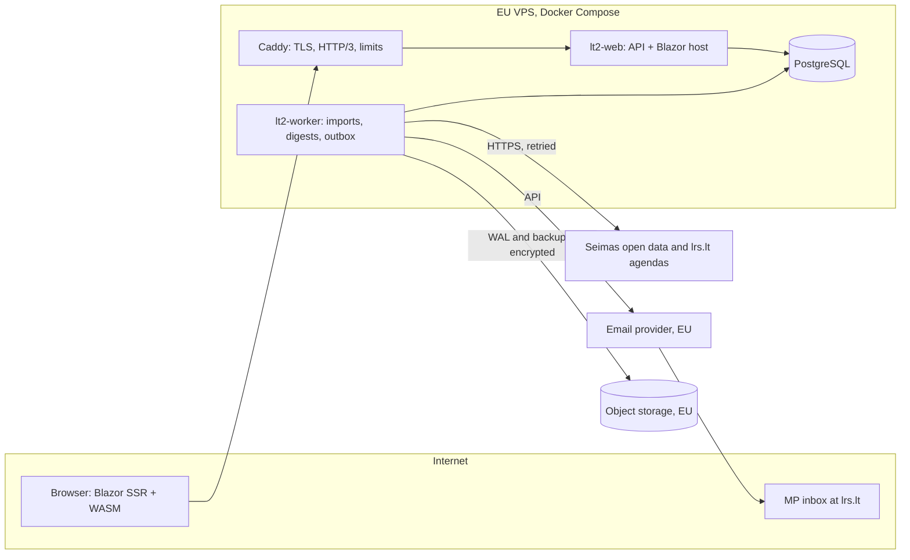

# LT2 system design

Detailed design for building Lietuva 2.0 as a production system. Written 2026-11-12 from the concept pages and
`discovery/design-notes.md` on the `docs` branch and the owner's answers the same day. English, for the team; nothing
here is published.

This is the maintained copy. Paths such as `../docs/` and `design-notes.md`, and the rules and fictional example data
this document cites from the documents-era `AGENTS.md`, are on the `docs` branch, where the concept website and the
discovery notes live.

**Status: agreed with the owner on 2026-11-12** as the basis for implementation; decisions made that day are marked
**[decided]**. Section 12 lists what is still to be chosen before the stage that needs it. All names, bills and numbers in
examples are the fictional ones from `AGENTS.md`.

## 1. Scope and build order

### 1.1 What changes compared with the public concept

The public pages describe a first version (voting with delegation) and a second version (posts, topics, answers).
This design builds in a different order **[decided]**:

| Stage | What | Source in the concept |
|---|---|---|
| **0. Foundation** | Solution skeleton, sign-in, security plumbing, deployment, monitoring. | – |
| **1. MP profiles** | Every MP of the current term imported from Seimas open data: mandate, faction, committees, contacts, voting record, statistics. | Chapter 06, the "unjoined MP" profile |
| **2. Appeals** | People take a side on a Seimas bill and give reasons; MPs receive summary emails instead of hundreds of separate ones; MPs can answer once for everyone. | A trimmed second version, section 1.2 |
| **3. Voting and delegation** | Bill pages with AI summaries, delegation, LT2 result, analytics, election mode. | The documented first version |

Stage 3 is not designed here. Stage 2 is shaped so that stage 3 extends it: a person's side on a bill is stored so that it
can become their direct LT2 vote, and an MP's published position can become the MP's LT2 vote with its explanation.

The public pages still say "first version = voting". They are **not** changed by this document; section 12 lists what
would need rewording once this order is agreed.

### 1.2 The problem stage 2 solves

Before a contested vote, people send MPs large numbers of near-identical emails. For the senders it is slow and they never
learn whether anyone read them; MPs and their offices cannot tell how many distinct people stand behind the flood, and the
other side of the argument is invisible.

Stage 2 replaces the flood with one object per bill, an **appeal** (*kreipimasis*):

- it is always tied to one Seimas bill **[decided]**;
- it has two sides: "asks to vote for" and "asks to vote against";
- a person joins one side (their **position**) and may add or endorse **reasons**;
- every sitting MP receives a **summary email** with the numbers for both sides and the most endorsed reasons
  **[decided: all MPs, automatically; nobody picks recipients]**;
- an MP (or the MP's office) can publish one **response** that everyone who took a side is told about.

One published appeal per bill, not one per author: until a moderator publishes one, several members may propose an appeal
on the bill; the moderator publishes one proposal, the others close, and everyone after joins the published appeal
**[decided 2026-11-13]**. This is the same rule as "one vote per bill" in chapter 04 of the concept, and it is what makes
one summary per bill possible.

### 1.3 What is kept from the second version and what is trimmed

| Second-version feature | In stage 2 | Why |
|---|---|---|
| Free-form posts and questions | **Trimmed** to a short *reason* attached to a bill and a side | Free text with no bill needs AI grouping into topics and heavy moderation. |
| Tagging an MP, delegate or bill (`@`, `#`) | **Dropped** | The bill is chosen when the appeal is opened; the addressee is every MP. |
| "Man svarbu" | **Adapted**: joining a side is the main action; "Man svarbu" marks the reasons that matter to you | Keeps the term for what it means. |
| AI grouping into topics and questions | **Trimmed** to "this reason looks like an existing one" within one bill and side | The bill already is the topic. |
| Topic page | **Becomes** the appeal page of a bill | Same layout idea: counts, grouped reasons, answers. |
| Answer once for everyone | **Kept**: one response per MP per bill | The core of the value for MPs. |
| Work statuses (Atsakė, Rengia projektą, Įregistruotas, Nepritariu) | **Trimmed** to a stance: will vote for / will vote against / undecided, plus text | The bill already exists, so "preparing a bill" has no meaning here. |
| "Mano temos" | **Replaced** by the summary email and a plain list "appeals addressed to me" | The email is the inbox. |
| Public response rate (shown at ≥ 70 %) | **Later** | Data is collected from day one; showing it is a tone decision to take with MPs. |
| Personal feed | **Dropped** | Email notifications and "my appeals" are enough at this size. |
| Comments and discussion threads | **Dropped** | Moderation cost; reasons carry the content. |
| Petitions from topics, MPs' draft bills | **Dropped** | Not needed for the problem. |
| Moderation (AI helper plus moderators) | **Kept, required** | Anything that reaches 141 inboxes must pass a human. |

## 2. Architecture

A **modular monolith**: one deployable web application, one background worker, one PostgreSQL database. The team is small,
the load is modest (hundreds of thousands of rows a year, traffic in bursts from social networks), and the hard parts are
correctness, privacy and trust, not scale. Module boundaries are enforced in code so a module can be split out later if
that ever becomes necessary.



Modules and what each owns:

| Module | Owns | Database schema |
|---|---|---|
| **Identity** | Accounts, sign-in, verification level, roles, consents, sessions, data export and deletion, the link between an account and a politician. | `identity` |
| **Parliament** | Terms, sessions, sittings, MPs, mandates, factions, committees, bills, agenda items, votes and ballots, derived statistics, the open-data import. | `parliament` |
| **Appeals** | Appeals, positions, reasons, endorsements, MP responses, reports, moderation. | `appeals` |
| **Notifications** | Outbox, email transport, templates, digests, MP email preferences, suppression list, user notification settings. | `notify` |
| **Audit** | Append-only log of administrative and moderation actions. | `audit` |

Rules between modules: a module exposes a small public interface (queries and commands) and integration events; nobody
reads another module's tables. Cross-module reads for pages go through query interfaces, cross-module effects through
events written to the outbox in the same transaction as the change that caused them.

## 3. Technology choices

| Concern | Choice | Notes |
|---|---|---|
| Runtime | **.NET 10 (LTS)**, C# 14 | Supported until November 2028, which covers the 2028 Seimas election. |
| Database | **PostgreSQL** (17 or newer) | The owner's suggestion, confirmed. `jsonb` for snapshots, full-text search with the `lithuanian` configuration, `pg_trgm` and `unaccent` for name search, `SKIP LOCKED` for the outbox. |
| ORM | **EF Core 10** with **Npgsql**, `EFCore.NamingConventions` (snake_case) | One `DbContext` per module, each on its own schema. Raw SQL only for aggregate queries and materialised statistics. Migrations run as an EF migration bundle. |
| Web API | ASP.NET Core **Minimal APIs**, one endpoint per file, `/api/v1`, built-in OpenAPI document, RFC 9457 problem details | The API is complete from the start **[decided]**; the UI uses nothing else. |
| UI | **Blazor Web App**: static server rendering for public pages, **Interactive WebAssembly** for signed-in features | See 3.1. |
| Request handling | Plain handler classes injected into endpoints | No mediator library: MediatR and MassTransit are now commercial, and the indirection buys little here. |
| Validation | **FluentValidation**, validators in the shared contracts project | Same rules run in the browser and on the server. |
| Mapping | Hand-written or **Mapperly** (source generator) | AutoMapper is now commercial. |
| Sign-in | **ASP.NET Core Identity** on EF Core: email one-time code, passkeys, no passwords | See 6.2. |
| Background jobs | **Hangfire** with PostgreSQL storage for scheduled and retried jobs; own **transactional outbox** table for emails and events | The Hangfire dashboard (admin-only) shows failed imports and digests. |
| HTTP to Seimas | `HttpClientFactory` + `Microsoft.Extensions.Http.Resilience` (retry, timeout, circuit breaker) | The service is slow at times and drops connections (`design-notes.md`). |
| Caching | ASP.NET Core output caching and `HybridCache` in memory | No Redis until there is a second web instance. |
| Time | `TimeProvider`, UTC in the database (`timestamptz`), `Europe/Vilnius` for schedules and display | |
| Identifiers | UUID v7 for our own rows; Seimas identifiers kept as natural keys; public URLs use slugs (`/p/jonas-petraitis`) and bill numbers (`/seimas/XVP-0412`) | |
| Logging and telemetry | **Serilog** to console, **OpenTelemetry** traces, metrics and logs over OTLP | Backend chosen in 9.4. No personal data in logs. |
| Email | Provider with EU processing behind `IEmailTransport` | Shortlist in section 12. |
| SMS | None at the start **[decided]**: registration is by email only (6.2). `ISmsTransport` is added if phone verification is chosen later. | |
| Bot check | **ALTCHA** (self-hosted proof of work, no third party) on registration and code requests | Fallback: Friendly Captcha. |
| AI | One interface, `IAiAssistant`, used only for moderation pre-screening and duplicate-reason hints in stage 2 | No personal data is sent. Prompts are kept in the repository so they can be published, as the concept promises. Provider chosen in stage 2. |
| Reverse proxy | **Caddy** | Automatic certificates, HTTP/3, simple configuration. |
| Tests | xUnit, **Testcontainers** (real PostgreSQL), **Playwright** for end-to-end, `NetArchTest` for module boundaries | |

### 3.1 Why Blazor, and which Blazor

The owner prefers a client application over a full API and knows Blazor **[decided: SPA over the API; Blazor or another SPA
if it weighs better]**. The options:

| | Blazor Web App (SSR + WASM) | Standalone Blazor WASM | React / SvelteKit + API |
|---|---|---|---|
| Public pages indexable, with share previews | Yes, server-rendered | No: empty shell until WASM loads | Yes, with a Node SSR server |
| First load from a social link on a phone | Fast: HTML first, WASM only where needed | Slow: several MB before anything shows | Fast |
| Uses the API for everything | Yes in the browser; in-process on the server (same handlers) | Yes | Yes |
| One language, shared DTOs and validators | Yes | Yes | No |
| Team familiarity | Yes | Yes | No |
| Extra moving parts | None | None | Node runtime, second build, token or BFF layer |
| Ecosystem and hiring | Smaller | Smaller | Largest |

**Recommendation: Blazor Web App on .NET 10 with per-page render modes.** Most visitors arrive from social networks on a
phone and only read (the old platform's lesson: "people bring people"), so MP profiles, bill pages and appeal pages are
static server-rendered HTML with proper Open Graph tags and no WebAssembly download. Everything a signed-in person does
(taking a side, writing a reason, settings, moderation, administration) is an Interactive WebAssembly component that talks
only to `/api/v1`. Until such an island has started, everything in it is disabled (fields, choices and buttons alike):
what was typed would be emptied when the island takes over, and a form sent natively would reload the page. Without
JavaScript the island never starts, and the page says so in one note. An end-to-end test loads every page with islands
with the WebAssembly runtime blocked and fails on any control left usable.

How "full API from the start" holds with server rendering: every component depends on a typed client interface from
`Lt2.Api.Contracts` (`IParliamentApi`, `IAppealsApi`, …). In the browser the implementation is an `HttpClient` call; on the
server it calls the same application handler the endpoint calls. Integration tests exercise the HTTP path for every
operation, so the API cannot fall behind the UI.

React would be the choice if a large front-end team or a native mobile app were planned. Neither is, and the cost is a
second stack for a team of one or two.

UI components: no heavy component library. MudBlazor and similar need interactivity for most controls, which defeats
static rendering. The mockups in `../docs/` already define the visual language (`--slate`, `--leaf`, `--brand`, the
chips, the result card), so stage 0 ports those into a small set of Razor components and one stylesheet. The seat map and
charts are SVG rendered by Razor on the server, with no JavaScript; `lt2-logo-spin.js` is reused as it is.

## 4. Solution layout

```
LT2.sln
Directory.Build.props          nullable, warnings as errors, analyzers, deterministic builds
Directory.Packages.props       central package versions
global.json                    pinned SDK
src/
  Lt2.Web/                     ASP.NET Core host: endpoints, Blazor server rendering, auth, security middleware
    Endpoints/                 one file per endpoint, grouped by module
    Components/                layouts, static pages (MP profile, bill, appeal, digest archive)
    Security/                  headers, antiforgery filter, rate-limit policies, authorization handlers
  Lt2.Web.Client/              Blazor WebAssembly: interactive components, HTTP implementations of the API clients
  Lt2.Api.Contracts/           DTOs, route constants, client interfaces, FluentValidation validators
  Lt2.SharedKernel/            Result type, clock, identifiers, domain and integration event base types
  Modules/
    Lt2.Identity/              Domain/ Application/ Infrastructure/ (internal), public IIdentityModule
    Lt2.Parliament/            + Import/ (open-data client, parsers, upserts) and Statistics/
    Lt2.Appeals/
    Lt2.Notifications/         + Digests/, Templates/, Transports/
    Lt2.Audit/
  Lt2.Worker/                  Hangfire server: recurring jobs, outbox dispatcher
  Lt2.Migrator/                applies migrations for every module, creates roles and grants; run once per deploy
tests/
  Lt2.UnitTests/               domain rules: statistics, digest eligibility, thresholds
  Lt2.IntegrationTests/        API over a real PostgreSQL (Testcontainers), one fixture per module
  Lt2.Parliament.ImportTests/  parsers against recorded Seimas XML and agenda HTML
  Lt2.ArchitectureTests/       module boundaries, no direct cross-schema access
  Lt2.E2E/                     Playwright: sign-up, take a side, moderation, digest preview; 1280 px and 390 px
deploy/
  compose.yaml  compose.staging.yaml  Caddyfile  backup/  runbooks/
.github/workflows/             ci.yml (build, test, scan), deploy.yml (manual approval for production)
```

Conventions:

- Inside a module everything is `internal` except the module interface, its DTOs and its events.
- A feature is a folder with its endpoint contract, validator, handler and tests: a vertical slice, not layers by type.
- Domain rules that people will argue about (the two-thirds faction rule, participation, digest eligibility, the ≥ 20
  rule) are pure functions with unit tests whose names read as the rule.
- Every user-facing string goes through `IStringLocalizer`; the only language at launch is Lithuanian.
- Code lives on `master`, which is empty today, through pull requests with merge commits; `docs` keeps the website and
  `discovery/`. **[decided]**

## 5. Data model

Schemas match the modules. Only the tables that carry design decisions are listed.

### 5.1 `parliament`

| Table | Key columns | Notes |
|---|---|---|
| `term`, `session`, `sitting` | Seimas identifiers as keys | `kadencijos_id = 10` is 2024–2028. |
| `person` | `id`, `seimas_person_id` (unique), names, `slug`, `gender`, photo reference, biography link | `asmens_id` is stable across terms, so one person has one profile for life. |
| `mandate` | `person_id`, `term_id`, `from`, `to`, nominating party, how elected (list or constituency), constituency | `to` not null means the mandate ended; the profile becomes "former MP". |
| `body` | `id`, `kind` (faction, committee, commission, group), `seimas_id`, `term_id`, name | |
| `membership` | `person_id`, `body_id`, `role`, `from`, `to` | With dates, so "faction at the time of the vote" can be answered. |
| `contact` | `person_id`, `kind`, `value` | Official email and phone from open data: public data about a public office. |
| `bill` | `id`, `number` (`XVP-0412`), official title, registered date, proposer, e-seimas link, status, `lead_committee_id` | Created from agenda items; enriched from e-seimas. |
| `agenda_item` | `sitting_id`, Seimas item id, `bill_id`, stage, title | Items of sittings that have started (open data). |
| `planned_item` | `bill_id`, planned date, stage, source link, `first_seen`, `last_seen`, `gone_at`, `confirmed_by` | Upcoming agenda, scraped from lrs.lt; moves often. A moderator can correct or confirm a row. |
| `vote` | Seimas vote id, `agenda_item_id`, `bill_id`, time, wording, `kind`, stage, totals, official note, `is_consensus` | `kind`: stage result, amendment, procedural, other. Consensus votes have no ballots. |
| `ballot` | `vote_id`, `person_id`, `faction_id`, `choice` | About 141 rows per vote; a few million rows per term. |
| `faction_position` | `vote_id`, `faction_id`, position or "free", counts | Derived: the option chosen by at least two thirds of the faction's members who voted. Only for factions: the mixed group and MPs outside a faction have no row. |
| `mp_stat` | `person_id`, `term_id`, votes held, votes taken part in, with-faction count, free-vote count | Derived, recomputed after each import. |
| `import_run`, `raw_document` | source address, fetch time, hash, compressed body | Every response is kept, so parsing can be re-run and any number traced to its source. |

### 5.2 `identity`

ASP.NET Core Identity tables (users, roles, claims, tokens, passkeys), plus:

| Table | Notes |
|---|---|
| `profile` | Display name, created date, normalised email (for the one-account-per-address rule), `verification_level` (`email` at the start; `phone` and the EU wallet can be added), invitation used. While the account is pending (6.2) it holds only the normalised address and the invitation code that was entered. |
| `invitation` | Code (and its look-up form without dashes or spaces), kind (`team` or `personal`), who issued it (for a personal code: its member), uses left and expiry (team codes), completed registrations (a counter that never drops), level, switched off (when, by an administrator), replaced (when). Registration is by invitation during the closed trial. A use is counted when the registration is completed (6.2), not when it is started. |
| `invitation_daily` | Per code and Vilnius day: registrations completed. For the administrators' chart; no per-person history. |
| `feedback` | Kind (`bug`, `idea`, `unclear`, `other` or none), text (up to 2 000 characters), page path and browser (each only if the member left them in), status (`new`, `seen`, `done`), internal note, replies, the day it came, and the account **only if** the member ticked "Galite man atsakyti". An item without that tick has no account, a random id and only the day, so nothing leads back to its author. Kept 12 months (a setting); linked items go with the account (8.10). |
| `sign_in_code` | Account, hashed code, expiry, failed attempts, used time, and the known device it was issued to (empty for a code any browser may use). |
| `known_device` | Account, hashed identifier of the browser's cookie, first and last seen. Built before registration opens (M2b). |
| `role_activation` | Account, role, hashed one-time code, who issued it, expiry, used time. Using it marks the passkey of that session as the staff passkey. |
| `party_support` | `user_id`, `party_id`. Private and optional; used only for group statistics of at least 20 people. |
| `consent` | Kind, text version, given and withdrawn times. Positions need explicit consent (GDPR Art. 9). |
| `politician_link` | `user_id`, `person_id`, role (the MP, or an office member), how and when verified. |

### 5.3 `appeals`

| Table | Key columns | Notes |
|---|---|---|
| `appeal` | `id`, `bill_id`, `initiator_user_id`, neutral description, status, opened and closed times, `closing_vote_id`, `sending` (automatic or held), `threshold`, `threshold_set_by` (initiator or moderator), `first_summarised_at` | A row is a proposal until a moderator publishes it. Status: pending review (or returned) → open → closed; rejected (hidden by a moderator); superseded (closed because another proposal on the bill was published, 8.1). At most one open or closed appeal per bill, and at most one pending or returned proposal per person per bill: both are unique partial indexes. `threshold` is the initiator's choice (8.4). `first_summarised_at` is set by the first summary really sent to MPs, not by a dry run (8.4). |
| `description_change` | `id`, `appeal_id`, proposed text, status (pending, approved, returned), note, created and decided times | The initiator's proposed change to the description of a published appeal (8.1); at most one pending per appeal. An approved one is copied into the appeal and recorded in `revision`. |
| `position` | (`appeal_id`, `user_id`) primary key, `side` (for or against), created and changed times | One row per person per bill. Becomes the direct LT2 vote in stage 3. |
| `daily_stat` | `appeal_id`, date, counts per side, counts for accounts older than 30 days, share of new accounts | For the trend chart and surge detection. **No per-person history of opinion changes is stored.** |
| `reason` | `id`, `appeal_id`, `side`, `author_user_id`, text (up to 500 characters), status, `merged_into_id` | Status: pending, published, hidden, merged. `side` is the side the argument supports, chosen by its author, whatever the author's own position (8.2). |
| `endorsement` | (`reason_id`, `user_id`) | "Man svarbu" on a reason; only on your own side; how many per bill is a setting, no limit by default (8.2). |
| `response` | `appeal_id`, `person_id`, stance, text, published and edited times, `written_by_user_id` | One per MP per bill; edits keep history. |
| `report` | target, reporter, ground, status | Notice-and-action under the Digital Services Act. |
| `moderation_action` | moderator, target, action, statement of reasons, time | The statement is sent to the author. |
| `writing_restriction` | `id`, `user_id`, `ends_at` (null = until lifted), statement, set by and when, lifted by, when and why | A moderator's restriction on writing (8.3). Lives with the writing rules in this module; deleted with the account; never shown to anyone but the person and staff. |
| `revision` | entity, field, old and new value, who, when | Edit history for descriptions, reasons, responses. |

### 5.4 `notify`

| Table | Notes |
|---|---|
| `outbox` | Kind, `jsonb` payload, due time, attempts, error. Written in the same transaction as the change; dispatched with `FOR UPDATE SKIP LOCKED`. |
| `digest_run` | Kind (weekly, before-vote, urgent, introduction), scheduled time, status, who approved. |
| `digest_item` | Per run and appeal: counts per side, counts for accounts older than 30 days, top reasons (text and "Man svarbu" count, without the author's name), planned date and stage. A frozen snapshot: what MPs were told. |
| `digest_delivery` | Per run and MP: sent, skipped by preference, suppressed, bounced; the MP-specific numbers. |
| `mp_email_pref` | Per MP: frequency (default, weekly only, before votes only, stopped), confirmed extra recipient. |
| `suppression` | Hashed addresses that bounced or asked to stop. |
| `email_message` | Template, subject, provider message id, status. Bodies of digests are reproducible from the snapshot; other bodies are not stored. |

### 5.5 `audit`

`event`: time, actor, role, action, target, details, hashed IP. The application role may only insert.

### 5.6 Settings

`config.setting`: key, `jsonb` value, who changed it and when. Holds every number an administrator may need to tune
without a deploy: the summary rules in 8.4 (default and minimum threshold, the weekly and before-vote times, the ceiling
per MP, and the share of change that counts as "changed notably", `Digest:NotableChange`), the reasons and "Man svarbu"
marks a person may give per bill in 8.2 (`Appeals:ReasonsPerPerson`, `Appeals:EndorsementsPerPerson`, 0 = no limit,
the default), the surge thresholds in 6.6,
the code limits and the life of a pending account in 6.2, whether registration needs an invitation, uses per personal invitation code (`Registration:PersonalCodeUses`, 0 = no limit, the default), how long feedback is kept (`Feedback:KeepMonths`, 12). Each
change is written to `audit`, and the current values of the rules that affect what MPs receive are shown on the public
methodology page.

The administrator's settings screen groups them under headings (registration and sign-in; appeals; summaries; surge
note; feedback), with a separate "Saugumo ribos" group for the ones rarely changed (codes per hour and per day, days a
pending account is kept), which says so. Each setting shows a plain Lithuanian label, one sentence on what it does and
when to change it, its unit, the default, and the key in small type. The minimum threshold's 50 is a placeholder until
the owner sets a number, and the screen says so.

Database roles: `lt2_migrator` owns the schemas and runs migrations; `lt2_app` has data access only; `lt2_worker` the same
plus the Hangfire schema; `lt2_readonly` for ad-hoc analysis has no access to `identity` or `appeals.position`.

## 6. Security and privacy

### 6.1 What we protect

1. **Who took which side.** A position on a bill is a political opinion: special-category data under GDPR Art. 9. Leaking
   it is the worst realistic incident.
2. **The integrity of the numbers.** MPs and journalists must be able to trust that 4 280 means 4 280 distinct verified
   accounts.
3. **The sending channel.** A system that can email every MP is a target: if it is abused once, the summaries get
   filtered and the product stops working.
4. **Politician accounts.** A hijacked MP account publishes in the MP's name.

### 6.2 Sign-in and accounts

- **No passwords.** Sign-in is a six-digit code sent by email (ten minutes, five attempts, single use), or a **passkey**
  (built into ASP.NET Core Identity in .NET 10). Nothing to leak, reuse or stuff.
- **A code belongs to the address, not to a browser.** It can be read on any device and typed into any browser, so a
  person can register on someone else's computer with the mail open on a phone, and later ask for a new code on their
  own device. A new code replaces the earlier one; the email and the page say to use the newest.
- **How many codes [decided 2026-11-12].** For one address, all browsers that have not signed in to that account before
  share five codes an hour and ten a day (both are settings). The daily limit is what bounds guessing: at most 50 tries
  a day against one account, about a 2 % chance over a year of constant attack, against about 20 % with the hourly
  limit alone.
- **Known devices [decided 2026-11-12; built before registration opens, M2b].** The shared limit can be used up by
  anyone who knows an address, which would keep that person from signing in by code. So a browser that has signed in
  to an account keeps a one-year `__Host-` cookie with a random identifier (stored hashed, tied to that account; it
  gives no access by itself). Such a browser has its own five codes an hour. A code it asked for is accepted only
  from it, so requests and wrong guesses from elsewhere cannot cancel or exhaust it. Codes asked for from any other
  browser stay usable anywhere, as above. A stranger can then block sign-in only from browsers the person has never
  used; the usual browser and a passkey keep working. Until this is built the lockout is an accepted risk of the
  closed trial (section 12).
- **Registration = email only at the start [decided 2026-11-12].** The concept says email and phone, but SMS
  verification is a paid service (charged per message, and a target for SMS-pumping fraud), so it waits until there is a
  budget and a need. Each account has a **verification level**: `email` now, `phone` or the EU Digital Identity Wallet
  later. A stronger check can then be added as an upgrade existing people complete, and counts can be reported by level.
- Email alone lets one person create many accounts for nothing. What stands in for the phone:
  - the closed trial is **by invitation** (a code from the team or from a participant), so there is no open registration
    while the flow is being proven;
  - one account per **normalised address** (lower case, the `+tag` part removed, dots ignored where the provider ignores
    them), and addresses at disposable-mail domains are refused;
  - the bot check and per-IP limits on registration;
  - the 30-day count beside every number, and the surge note (6.6).
- **Before registration opens to everyone and real summaries go to MPs (M2b), decide again:** add phone verification, or
  stay with email and label every number as coming from email-confirmed accounts. See section 12.
- **An account is pending until its address is proven [decided 2026-11-12].** Registration takes the address and the
  invitation code and creates a pending account: no name, no declarations, no role, nothing it can do. The first
  correct code proves the address. Only then is the person asked for the display name and the declaration of being 18
  or older, only then is the invitation use counted (if it has run out by then, the person is told so and can enter
  another), and with the declaration the account becomes a member. So nobody can attach a name or an age declaration
  to someone else's address, or use up an invitation with addresses they do not control.
  - Asking for a sign-in code for a pending account works like any other and completes the registration, on any
    device.
- **Personal invitation codes [decided 2026-11-13].** Every member has one personal code, made at completed
  registration (for earlier members when first needed), shown on the account page as a link to the registration form
  with the code filled in and as a short code with a copy button. Format: eight characters from 29 that cannot be
  mistaken for one another (`23456789ABCDEFGHJKMNPQRSTVWXYZ`: no 0, 1, I, L, O, U), shown as `XXXX-XXXX`; case,
  dashes and spaces do not matter when typed; about 5 × 10¹¹ codes, and guessing stays under the registration rate
  limits. Codes are never written to logs.
  - Uses per personal code are a runtime setting, `Registration:PersonalCodeUses`, 0 = no limit, the default. Team codes
    keep their own uses and expiry.
  - The member can replace the code: a new one is made, the old one stops working, and the member's count (the sum of
    their codes) carries over.
  - A use is counted when registration completes, as before, on a counter on the code and in daily totals per code; the
    count never drops when an invited person deletes their account. The profile keeps which code it registered with,
    and that goes with the account.
  - When the inviter deletes their account, their codes are switched off and lose their owner: nothing of the person
    stays on them; their counts, levels and daily totals stay as anonymous numbers.
  - The member sees only how many people completed registration with their code and whether it is on; no names, dates
    or list. The registration form says plainly that whoever gave the code sees that it was used, not by whom.
  - Administrators (staff-passkey session) get a page: completed registrations per day, in total and for the codes that
    brought the most people, as a server-rendered chart with the numbers also as a table; those codes (team codes by
    their code, personal codes by the member's display name); and the numbers per level (level 1: by team codes or with
    no code; level 2: by codes of level-1 people; and so on). No who-invited-whom tree and no list of who used a code.
    An administrator can switch any code off and on again, with a statement, audited; a member whose code was switched
    off sees that on the account page, with the contact address, and cannot replace it meanwhile.
  - A code that does not work gets one message on the registration form, whatever the reason (unknown, switched off,
    replaced, expired, used up): ask whoever invited you for a new one.
  - Never combined with sides: no screen, API answer, export or query joins invitations with positions, marks or
    arguments. No ranking shown to members, no rewards, nothing public. An account restricted from writing (8.3) keeps
    its code; switching a code off is a separate action.
  - If the address already has an account, registration only sends a sign-in code to the address on the account; what
    was typed is discarded.
  - Accounts still pending after seven days (a setting) are deleted by the maintenance job that also removes old codes
    and expired sessions, so an address typed by a stranger is not kept.
- Reading needs no account. Taking a side, writing a reason and endorsing need a confirmed email and the age
  declaration.
- **Minimum age: 18, self-declared when the address has been confirmed [decided].** The signal is compared with a
  parliament elected by adults; the EU Digital Identity Wallet could later confirm it.
- Session: `__Host-` cookie, `Secure`, `HttpOnly`, `SameSite=Lax`, sliding 30 days; a person can see and end their
  sessions. No tokens in the browser: the WASM client uses the same cookie (same origin).
- **Staff** (moderator, administrator) **[decided 2026-11-12].** A staff role works only in a session signed in with a
  **staff passkey**. A session signed in by email code is an ordinary member session, whatever roles the account has,
  so getting into a staff member's mailbox is not enough.
  - *Activation.* An administrator grants the role; the system shows a one-time activation code on the administrator's
    screen (valid 24 hours, never sent by email), and the administrator passes it to the person directly. The person
    signs in with a passkey and enters the code: that passkey becomes the staff passkey, and any other passkey on the
    account is removed.
  - *Afterwards.* Adding or removing a passkey on a staff account needs a staff-passkey session and a fresh passkey
    confirmation (within the last ten minutes). Sensitive actions (approving a send, changing roles, verifying a
    politician) ask for the same fresh confirmation.
  - *Lost passkey.* An administrator resets the account: its passkeys are removed and the role is inactive until a new
    activation code is used. The first administrator, and a lost last one, are activated from the server: the migrator
    command grants the role and prints the activation code.
  - Every grant, activation, reset and passkey change is audited, and the person is told by email.
- **Politicians** (verified MP, office member) need a passkey as well. Their proof of identity is the official
  `@lrs.lt` mailbox, so the take-over link plays the part of the activation code: the passkey is created while using
  the link, and later changes need that passkey or a new link. The details are designed with M2b.
- **Other members:** a passkey is a convenience. The mailbox is what proves who they are, and a code still signs them
  in. They are told by email when a passkey is added or removed.
- No authenticator app: one way in to secure. It can be added if an MP's office cannot use passkeys.
- Responses never reveal whether an email is registered.
- **Local development only: a fixed sign-in code [decided 2026-11-13].** For the owner's hand testing on the local
  stack, one configured six-digit code may be typed in place of the emailed one, for any account. Guards, all of them:
  it is configuration only (an environment variable in `deploy/.env`), never a runtime setting and never on the
  settings screen, so no administrator can switch it on; the web host refuses to start when it is set and the site's
  own address (`Site:Address`, from the same `LT2_SITE_ADDRESS` Caddy serves) is not `localhost` or a `.localhost`
  host, and each request must also come to such a host; unset by default, and then it is refused like any wrong code.
  The real code is still generated, emailed and accepted. The fixed code works only where an emailed code does
  (registration and sign-in, a code requested and not yet used, expired or exhausted) and gives an ordinary member
  session; it never activates a staff role and has nothing to do with activation codes or passkeys. The sign-in page
  says plainly that it is on, and start-up logs one warning line (without the code). Locally the per-address rate limits
  and the code limits are raised through the same `.env`; the defaults in code and in production stay.
  **Not built yet:** the change to the code check was stopped by the coding session's permission checks (an
  authentication bypass needs the owner's own go-ahead in that session); the raised local limits are built.

### 6.3 Authorization

Policy-based, with resource handlers where ownership matters.

| Role or claim | Can |
|---|---|
| Visitor | Read all public pages and public API. |
| Member (confirmed email; invited during the trial) | Open an appeal, take a side, write and endorse reasons, report content. |
| Verified MP / office member (`politician_link`) | Publish and edit that MP's response; manage that MP's email preferences. |
| Moderator | Review appeals and reasons, merge, hide, correct planned dates, hold a send, approve an urgent send, restrict an account from writing and lift that. |
| Administrator | Roles, politician verification, configuration, import and digest dashboards; every moderator action, restricting an account from writing and lifting that included. Cannot read individual positions through any screen. |

No screen and no API returns another person's position. Group numbers are published only for groups of at least 20.

### 6.4 Web hardening

- TLS only, HSTS with preload, HTTP/3.
- Content Security Policy: `default-src 'self'`; `script-src 'self' 'wasm-unsafe-eval'` (required by WebAssembly), no
  inline scripts; `frame-ancestors 'none'` everywhere except future embed endpoints; `Referrer-Policy`,
  `Permissions-Policy`, `X-Content-Type-Options`.
- Every state-changing API call needs the antiforgery token header and passes an `Origin` check; CORS is off.
- Rate limits at two layers: Caddy per IP, and ASP.NET Core policies per account and per IP for code requests, registration,
  opening appeals, writing reasons and reports.
- All input validated by the shared validators on the server; user text is stored as plain text and encoded on output,
  no HTML or Markdown from users in stage 2.
- Outbound requests go only to a fixed allowlist of hosts (Seimas, email, AI, storage).

### 6.5 Data protection

- **Explicit consent** before the first position, with the consent text versioned and stored. Withdrawing deletes the
  positions.
- **Minimisation.** No personal code, address or document number (as the concept promises). No phone number is
  collected at the start; if phone verification is added, only a keyed hash is kept. No per-person history of changed
  positions.
- **Deletion and export.** A person can download everything they gave us and delete the account; positions are removed
  and counts fall. Frozen digest snapshots keep their totals: they are aggregates and a record of what was sent.
- **Encryption.** Disk encryption on the VPS volume, TLS to the database inside the Docker network, encrypted backups.
  ASP.NET Core data-protection keys are stored in PostgreSQL, wrapped with a key supplied as a secret.
- **Logs** carry request ids, never emails or sides; IPs are hashed with a rotating key and kept 30 days.
- **Secrets** live outside the repository and outside images: encrypted with SOPS and age in a private operations
  repository, mounted as files at deploy, rotated on a schedule and after any staff change.
- **Before launch:** a data protection impact assessment (required for large-scale processing of special-category data), a
  privacy notice, a processing record, processor agreements with the email, AI and storage providers. The old
  platform held a permit from the State Data Protection Inspectorate; the current rules need checking with a lawyer.

### 6.6 Integrity of the numbers

- One account per normalised email address (6.2); one position per account per bill. This is weaker than a phone check,
  which is why the 30-day count is always shown and why every number is described as a signal.
- Every published count comes with the count for **accounts older than 30 days** (the concept's filter).
- **Surge detection:** when a large share of recent positions on a bill come from accounts created in the last days
  (default: at least 30 % of the last 72 hours' positions and at least 50 accounts; both are settings), the appeal page and the summary say
  so in neutral words, and a moderator is asked whether to hold the send.
- Counts in a summary are frozen in `digest_item` and published at a public address, so anyone can check what MPs were
  told (section 8.7).

### 6.7 Supply chain and delivery

Central package versions and lock files, NuGet audit in CI, Dependabot, CodeQL, secret scanning, container image scan,
SBOM per release, images signed and pulled by digest. Containers run as non-root on chiselled .NET images with a read-only
file system and dropped capabilities. A `security.txt` and a disclosure address. An external penetration test before the
first real summary is sent.

## 7. Stage 1: MP profiles

### 7.1 Sources

Everything below comes from the Seimas open data service (`https://apps.lrs.lt/sip/`, CC BY 4.0, attribution on every
page). Endpoints marked ✔ were checked in September 2026 (`design-notes.md`); the service did not answer from this
machine on 2026-11-12, so nothing could be re-checked today, and the rest must be confirmed against live responses as the
first task of stage 1.

| Data | Endpoint | Status |
|---|---|---|
| Terms | `p2b.ad_seimo_kadencijos` | ✔ |
| MPs: person id, names, mandate dates, nominating party, how elected, number of terms, memberships with dates (`Pareigos`), contacts (`Kontaktai`, including the `@lrs.lt` address) | `p2b.ad_seimo_nariai?kadencijos_id=` | ✔ |
| Sessions, sittings | `p2b.ad_seimo_sesijos?kadencijos_id=`, `p2b.ad_seimo_posedziai?sesijos_id=` | ✔ |
| Agenda items with bill number, stage, e-seimas link | `p2b.ad_sp_darbotvarke?posedzio_id=` | ✔ |
| Votes of an agenda item | `p2b.ad_sp_klausimo_svarstymo_eiga` | ✔ (parameter name to confirm) |
| Each MP's vote with faction | `p2b.ad_sp_balsavimo_rezultatai?balsavimo_id=` | ✔ |
| Lists of factions, committees, commissions, groups | separate services listed at `portal.show?p_r=35391` | To confirm; memberships already come with the MP record. |
| Gender, birth date, biography link, photo | MP record and the MP's page on lrs.lt | To confirm field by field. |

Other official sources, used as **links first** and imported only where a stage needs them:

| Source | What it adds | Stage 1 use |
|---|---|---|
| MP's page on lrs.lt | Photo, biography, assistants, office contacts | Link; photo shown only if the reuse terms allow it (to check), otherwise initials as in the mockups. |
| e-seimas bill pages | Registration date, proposer, status, lead committee, documents | Parsed per bill (no API). Bills an MP proposed: later. |
| Central Electoral Commission (VRK) | Election results, constituency, list position, candidate questionnaire | Link to the candidate page; data needed for stage 3's election mode. |
| Chief Official Ethics Commission (VTEK) | Declarations of private interests | Link only. |

Deliberately not shown: parliamentary expenses and anything else that reads as a scorecard. The concept's tone is
connection and explanation, and the profile shows what the MP did, not a ranking.

### 7.2 Import

- **Backfill** once for term 10: terms → sessions → sittings → agenda items → votes → ballots. A few thousand requests,
  throttled to about one per second, resumable.
- **Recurring:** MPs and memberships daily; sittings, agenda items and votes every 15 minutes on sitting days and hourly
  otherwise; statistics recomputed after each run that changed anything.
- Every response is stored in `raw_document` with its hash; parsing is a separate, repeatable step. Upserts are keyed by
  Seimas identifiers, so re-running any step changes nothing.
- **Vote classification.** One agenda item can have many votes (amendments, procedure, the stage result). A rule set over
  the vote wording marks the stage results; anything the rules cannot classify is "other" and shown without a stage. The
  rules are tested against recorded real items, and a moderator can correct a classification.
- Data quirks from `design-notes.md` are first-class: consensus votes are stored with `is_consensus` and no ballots; the
  official "per-MP votes do not match the protocol" note is stored and shown next to the result.
- Failures retry with backoff, then raise an alert; the pages keep showing the last good data with its import time.

### 7.3 What a profile shows

Matches the "unjoined MP" mockup in chapter 06, minus everything that needs voting or delegation.

- Name, faction, nominating party, how elected (and constituency), terms served, mandate dates; "former MP" when the
  mandate has ended.
- Committees, commissions and groups with role and dates.
- Official contacts and links to the official pages (Seimas, VRK, VTEK).
- **Dalyvavimas balsavimuose:** of the recorded votes held during the MP's mandate, the share in which the MP voted for,
  against or abstained.
- **Balsavo kaip frakcija:** of the votes the MP took part in where the MP's faction had a position (at least two thirds
  of its members who voted chose the same option), the share where the MP chose that option. The number of free votes is
  shown beside it. Votes the MP missed are not counted here: an absence already shows in the participation figure
  **[decided 2026-11-12]**. The mixed group of MPs is not a faction and has no position: its members, and MPs outside
  any faction at the time of a vote, have no figure for those votes **[decided 2026-11-12]**.
- Recent votes: bill, stage, date, the MP's choice, the faction's split, a link to the vote page.
- The line "Profilis sudarytas automatiškai iš Seimo atvirųjų duomenų" with the time of the last import.
- From stage 2: appeals in progress and the MP's responses.

Also in stage 1: the list of MPs (search by name, filter by faction and committee), faction and committee pages, a vote
page with the seat map (the hemicycle prototype, rendered as SVG on the server), a bill page with its stages and votes,
and a public methodology page that states each formula above in plain language.

### 7.4 API (all public, cached, with ETags)

```
GET /api/v1/terms/current
GET /api/v1/mps?faction=&committee=&q=&cursor=
GET /api/v1/mps/{slug}
GET /api/v1/mps/{slug}/votes?cursor=
GET /api/v1/factions            GET /api/v1/factions/{slug}
GET /api/v1/committees          GET /api/v1/committees/{slug}
GET /api/v1/bills?status=&q=&cursor=
GET /api/v1/bills/{number}
GET /api/v1/votes/{id}                      totals, wording, notes, faction positions, every ballot
GET /api/v1/meta/imports                    last successful import per source
```

### 7.5 Done when

- Every sitting MP of term 10 has a profile whose facts match lrs.lt on a checked sample of 20.
- For 30 sampled votes, per-MP ballots sum to the official totals, or the official mismatch note is shown.
- The two statistics match a hand calculation for five MPs.
- Pages pass at 1280 px and 390 px, render without JavaScript, and score at least 90 on Lighthouse for performance and
  accessibility.
- An import outage of a day leaves the site up and clearly dated.

## 8. Stage 2: appeals

### 8.1 Life of an appeal

1. **Propose.** A member picks a bill from the list of active bills and proposes its appeal: writes a short **neutral
   description** of what the bill changes and sets the **threshold**: how many participants the appeal should have
   before MPs hear about it (8.4). Nothing else: no side and no first reason **[decided 2026-11-13]**, so proposing needs
   no positions consent and a new appeal has no participants. **Several proposals per bill [decided 2026-11-13]:**
   - While the bill has a published appeal (open or closed), nobody can propose another; the person is taken to it.
   - Until one is published, any member who may write (8.3) can send a proposal. A person has at most one waiting or
     returned proposal per bill; trying again takes them to their own. Someone else's proposal never blocks anyone.
   - The opening form says, before the person writes, how many proposals already wait for this bill and that a
     moderator will publish one of them. The number only: no names, no texts. It comes from its own public answer,
     never from one that carries anything about the person, so it can be cached.
   - There is no cap on proposals per bill; the hourly limit on openings per account (6.4) and writing restrictions
     (8.3) apply as before.
   - If two members send at the same moment, both proposals stand; no text is lost.
2. **Review.** AI pre-screening flags insults, spam and personal data. A moderator checks the neutral description and
   publishes the appeal; a returned proposal is corrected by editing the description. Until then a proposal is visible
   only to its author, and nobody writes reasons on it.
   - The queue shows a bill's proposals together, oldest first, with a note for the moderator: publish the earliest
     proposal that meets the rules. This is guidance on the screen, not enforced in code.
   - **Publishing one proposal closes every other waiting or returned proposal on that bill** in the same transaction
     (status `superseded`), each recorded as a moderation action and in `audit`. Each of their authors is emailed:
     another appeal on this bill has been published, with the link to it, and this is not a judgement of their text.
     The email names nobody.
   - The initiator of record is the author of the published proposal. Sides and reasons exist only on a published
     appeal, so nothing moves from a closed proposal.
   - "One published appeal per bill" holds under concurrency: publishing takes the bill's lock and checks again, and a
     unique partial index allows one open or closed appeal per bill.
3. **Collect.** On the published appeal people, the initiator like anyone else, take a side (or never do), endorse
   reasons on their side, or add one for either side. The notice that the appeal was published invites the initiator
   to add reasons. A new reason similar to an existing one is offered the existing one first. Positions can be changed
   until the appeal closes.
4. **Summarise.** Once the appeal reaches its threshold it enters the summaries sent to MPs (8.4).
5. **Answer.** MPs publish responses; participants are told (8.6).
6. **Close.** When the Seimas takes the final vote on the bill (or rejects or withdraws it at any stage) the appeal
   closes, the counts are frozen, and the page shows the Seimas result and how each MP voted beside the frozen counts.
   Participants get one closing email.

A bill passes several stages. The appeal and the positions stay the same through all of them; when a committee changes
the bill, participants are told so they can reconsider (as agreed for votes in `design-notes.md`: notify, do not reset).

**Changing the description of a published appeal [decided 2026-11-13].** The initiator can propose a new text for the
neutral description of an open appeal (not a closed one):
- the change is a proposal: the page keeps showing the approved text until a moderator approves the new one;
- one pending proposal at a time; a returned one does not block a new one;
- the moderators' queue shows the old and the new text side by side, with "publish" or "return with a note"; the
  initiator is told either way, with the note;
- an approved change is recorded in `revision`, and the public history page lists each one;
- proposing is writing, so a writing restriction (8.3) blocks it; pre-screening flags it for the moderator as for any
  description;
- telling participants about the change is M2b (8.6).
- On the page the initiator's control reads "Redaguoti aprašymą" and opens this proposal; a waiting proposal (before
  publishing) is likewise edited behind "Redaguoti aprašymą", while a returned one shows its form at once
  **[decided 2026-11-13]**.

**A moderator corrects the description directly [decided 2026-11-13].** A moderator or an administrator, in a
staff-passkey session, can correct the description of an open appeal (not a proposal, which is returned to its author;
not a closed appeal). The corrected text is shown at once, enters `revision` and the public history page like an
approved change, and clears the description's pre-screening flags. A statement is required: it is recorded with the
action, audited and emailed to the initiator, who can propose another change in the usual way. A proposed change
still waiting stays in the queue, compared with the corrected text.

### 8.2 Rules

- One published appeal per bill (proposals before it, 8.1); one position per person per bill; sides are "for" and
  "against". Abstaining is not a request to
  an MP, so it is not offered here; stage 3 adds it as a vote option.
- Positions are private. Reasons are public with their author's display name; the initiator's name is public.
- A reason belongs to one side and is at most 500 characters of plain text.
- **No limit per person by default [decided 2026-11-13].** How many reasons a person may write on a bill, and how many
  "Man svarbu" marks they may give on a bill, are two runtime settings for all appeals (`Appeals:ReasonsPerPerson`,
  `Appeals:EndorsementsPerPerson`); 0 means no limit, and both start at 0. Nobody knows yet whether people will write
  reasons at all, and a limit mostly produces support questions; a limit is switched on when the need shows. While a
  setting is 0 the pages show no counters and no "you have N left". A limit switched on later applies to new reasons and
  marks only: nothing already written or marked is removed, and a person over the limit cannot add until they are under
  it. Only reasons that are shown or waiting for a moderator count; hidden, merged and withdrawn ones do not. The
  hourly per-account rate limits (6.4) stay as they are.
- **An author can withdraw their own reason [decided 2026-11-13]** while the appeal is open: it is deleted with its
  "Man svarbu" marks and disappears from the page; open reports on it are closed; a summary already made keeps its
  frozen text, which carries no name. The audit log records the withdrawal without the text or the side. On a closed
  appeal a reason cannot be withdrawn (the page there is the record beside the Seimas vote); a moderator can still hide
  it, and deleting the account removes it. **[The closed-appeal case decided 2026-11-13.]**
- **A reason may be written for either side, whatever the author's own position [decided 2026-11-13].** The writing
  box asks for the side: it preselects the author's own side when they have taken one (read only from their own,
  never-cached answer), and preselects nothing when they have not, so they must choose. A person who has not taken a
  side may write reasons for either side or for both. Writing a reason never creates or changes a position, and nothing
  public (page, API, cached appeal, summary) tells whether a reason is on its author's side, so a reason does not reveal
  its author's position.
- Writing a reason does not need the positions consent (6.5), because no position is stored: writing a reason is the
  author's own deliberate publication. The writing box says plainly that the reason is public with the author's name
  and the side chosen, the author can withdraw it, and the privacy and methodology texts say the same. **[decided
  2026-11-13; to be read by a lawyer together with the consent texts before registration opens]**
- No reason is marked as the initiator's: nothing ties a reason's side, or the initiator, to a side. Reasons written as
  "first reasons" before 2026-11-13 stay as ordinary reasons.
- "Man svarbu" stays on one's own side only, within the setting above; a person without a side cannot mark. Changing or
  clearing a side drops the marks, never the person's reasons; withdrawing the consent deletes positions and marks,
  not reasons.
- Pages, summaries and emails head reasons as "argumentai už / prieš" (reasons to vote for or against), never as the
  reasons of the people on that side.
- Published numbers: both sides, always together, always with the count for accounts older than 30 days. Group numbers
  (for example supporters of a party) only when the group has at least 20 people.
- Wording follows `AGENTS.md`: numbers are "Lietuva 2.0 naudotojai", never "the public" or "voters"; differences are
  shown neutrally.
- The neutral description is written by the initiator and approved by a moderator, is labelled as such, and keeps its
  edit history. On a published appeal it changes only through a proposal a moderator approves, or a moderator's own
correction with a statement to the initiator (8.1). AI summaries of bills arrive with stage 3 and will carry the "Sukurta DI · taisė žmonės" label.

### 8.3 Moderation

- Queue: new proposals (always; a bill's proposals together, 8.1), proposed description changes (8.1), reasons flagged
  by pre-screening or by reports, requests to correct a date or send urgently, and appeals still under their threshold
  whose bill has reached the agenda. Each note on an item says what happened and what the moderator can do (for example:
  the bill is on the Seimas agenda, planned for a date; the appeal has n of its threshold's participants and so will not
  enter a summary; the moderator may approve one urgent summary, or do nothing).
- Actions: publish, return with a note, hide, restore a hidden appeal or reason (below), merge a reason into another
  (endorsements move with it), correct the planned date or stage, change an appeal's threshold, hold or release sending
  for a bill, approve one urgent summary, approve or return a description change, correct an open appeal's description
  (8.1), restrict an account from writing or lift that (below).
- **On the appeal page [decided 2026-11-13].** A moderator or an administrator in a staff-passkey session sees, on an
  open appeal's own page, a "Moderavimas" panel with the same actions as the queue offers for it in its state
  ("Palikti" only while a report or date flag is open). The state comes from a moderators-only answer
  (`GET /api/v1/moderation/appeals/{id}`); nobody else sees the panel or anything from that answer. After an action the
  page reloads to show the result.
- **The screen [decided 2026-11-13].** Each action is its own control. Choosing one opens only its own fields, with one
  sentence on what it does; one action is open at a time per item; only the actions that apply to the item's state are
  offered; the confirmation stays visible after the action closes. The fields: publish, an optional note; return, a
  required note; hide, a required statement; threshold, the number and a statement; planned date, the date, the stage
  and a statement (the stage is asked only here); hold or release, a statement (while held, the appeal enters no summary
  to MPs); urgent summary, a statement (one extra summary outside the schedule for this bill, used when the vote comes
  before the next regular summary; at most once per bill per week); for reasons: publish, hide, merge (choosing the
  target), restrict the author; correct description, the text (starting from the shown one) and a required statement.
- Hiding an appeal rejects it and frees the bill for a new appeal. The sides people took on the hidden appeal are
  **kept, for now [decided 2026-11-13, to be looked at again]**: nobody can see them, and deleting them on hide could
  not be undone if the hide was a mistake. Whether to delete them instead (data minimisation) will be looked at
  again.
- **Restoring [decided 2026-11-13].** Moderators have a list of hidden appeals (bill, the initiator's display name,
  when, who hid it, the statement). "Atkurti" brings an appeal back as it was: a published one as open (or closed, if
  it had closed) with its sides, reasons and marks; one hidden before publication as a waiting proposal. A statement is
  required, the action is audited, and the initiator is told.
  - It is refused while another appeal on the bill is published. **[Proposed, to be confirmed by the owner:]** if only
    proposals wait on the bill, restoring a published appeal counts as publishing and closes them as in 8.1; restoring
    one hidden before publication is refused while its author has another waiting or returned proposal on the bill.
  - Hidden reasons have the same list and "Atkurti", while their appeal is open. A restored reason comes back without
    its "Man svarbu" marks, which hiding deleted (they no longer count towards anyone's limit).
- **Restricting an account from writing [decided 2026-11-13].** With the per-person limits switched off (8.2), this is
  the tool for the one person who misuses that. A moderator restricts the author of a reason or the initiator of an
  appeal, reached from that item in the queue, either until a date (inclusive, Vilnius time) or until lifted; any
  moderator or administrator may set any length and lift it [decided 2026-11-13], each only in a staff-passkey session
  (6.2) and each with a written statement. A dated restriction ends by itself when it is checked on use; no job runs.
  - It blocks everything the person writes for others to read: writing a reason, opening an appeal, editing an
    appeal's description (a returned one included), and flags about planned dates. The API refuses
    these with `writing.restricted`; the pages show, in place of the writing box or form, that writing is restricted,
    until when, and the reason.
  - It does not touch signing in, taking or changing a side, "Man svarbu", reporting, consent, export, deleting the
    account or sessions, and never changes a count. The person's earlier reasons and appeals stay; hiding one is its own
    action, as before.
  - The person is told by email (outbox): the statement, the end date or "until lifted", and the moderators' contact
    address for objecting (there is no objection form in the product). Lifting early tells them too.
  - It is not public: no page, API answer or summary shows anyone else that an account is restricted, and the person's
    reasons look the same as everyone's.
  - When restricting, the moderator sees the display name, that person's reasons and appeals, and earlier moderation
    actions on them, earlier restrictions included; never the address, a side or a mark. The account is never named by
    its id: the moderator's screens reach it through the reason or appeal, and a restriction has its own id for lifting.
  - Setting and lifting are recorded like every moderation action (moderator, target, statement, end date) and in
    `audit`, with nothing about sides.
  - Deleting the account deletes its restrictions with everything else. **No hash of the address is kept [decided
    2026-11-13]**: a person can register with another address anyway.
  - Not built: a full lock that also stops signing in; left for later.
- Every action is logged in `audit`, and the author receives the statement of reasons. A report button is on every
  appeal and reason (Digital Services Act notice-and-action applies to any hosting service, however small).
- Only reasons a moderator has seen can appear in a summary email.
- Rules for moderators are public, like the statistics methodology.

### 8.4 Summary emails to MPs

**Who.** Every sitting MP with an official address in open data **[decided]**. No one chooses recipients, so all MPs
and factions are treated on equal terms. MPs who have not joined LT2 are included **[decided]**.

**When: automatic rules [decided], with corrections by people when the automation is off [decided].**

| Rule | Default | Setting |
|---|---|---|
| An appeal enters summaries when it reaches its own threshold | Set by the initiator for that appeal **[decided]**; the form offers the default (100 positions, both sides together) and refuses anything below the minimum | `Digest:ThresholdDefault`, `Digest:ThresholdMinimum` |
| **Weekly summary** | Monday 07:00 Vilnius time, in weeks when the Seimas sits. Lists eligible appeals that are on that week's agenda or changed notably since the last summary. No changes, no email. | `Digest:Weekly` |
| Changed notably | An appeal never yet in a summary, or one whose participants (both sides together) rose or fell by at least 10 % since the last summary that held it **[decided 2026-11-13]** | `Digest:NotableChange` |
| **Before-vote summary** | 12:00 on the working day before a sitting whose agenda has an eligible appeal's bill at a voting stage, unless that week's Monday summary already covered the same sitting. | `Digest:BeforeVote` |
| Ceiling per MP | Two summaries a week | `Digest:MaxPerWeek` |
| Re-sending after an item slips | Only in the next regular summary; never an extra email because a date moved | – |

**The threshold belongs to the appeal.** The initiator chooses it when opening the appeal, for example 1 000 to arrive
with weight, or the minimum to be heard early. The appeal page shows it with the progress ("612 iš 1 000"), which also
gives people a reason to share. Rules around it:

- It is **public**: everyone sees the number, who set it (the initiator or a moderator) and the progress towards it.
- It can never be below the administrator's minimum. If the minimum is raised later, appeals below it are lifted to it;
  appeals already in summaries stay in.
- The initiator can change it until the appeal first enters a summary that is really sent to MPs. After that it has
  done its job and is locked. A summary made in dry-run (M2a, before anything is sent) does not lock it **[decided
  2026-11-13]**.
- **Anyone can object to it, outside the application [decided].** The appeal covers both sides, so whoever opens it
  first could set a number the appeal will never reach and keep the other side's support from MPs. Because the number is
  public, people can see that and write to the moderators at the contact address; there is no objection form or queue
  in the product. A moderator keeps the number or changes it, and a change is shown on the appeal page with its reason.
- **A number set by a moderator stays [decided]:** the initiator can no longer change it.
- There is no automatic override before a vote. As a safety net, an appeal that is still under its threshold when its
  bill reaches the agenda appears in the moderators' queue, so a person looks at it even if nobody objected.

Every value in the Setting column is a runtime setting (5.6): an administrator changes it on the settings screen, with
no deploy. A change applies from the next summary run, never to one already frozen, is audited, and shows on the public
methodology page, because these numbers decide which appeals MPs hear about.

Plenary sittings are normally on Tuesdays and Thursdays, so in practice an MP gets one email on Monday and, when
something relevant is planned for Thursday, one on Wednesday.

**When something is off.** The planned date comes from scraping the upcoming agenda on lrs.lt, which is published about
10–12 days ahead and changes often; items are also added on the day. So:

- the initiator and any participant can flag "the date is wrong" or "this is being voted sooner", with a link to the
  source;
- a moderator can correct the planned date or stage, **hold** sending for a bill (for example while a surge is checked),
  or approve one **urgent summary** for a bill that reached the agenda at short notice. An urgent summary still goes to
  all MPs, still shows both sides, and may exceed the weekly ceiling by one.

People flag what is wrong and a moderator makes the change **[decided 2026-11-12]**, because a mistaken send to 141 MPs
cannot be recalled. The initiator has no direct control over timing.

**What an MP sees.** One email for all bills, most relevant first: bills where the MP's committee leads, then bills on
the agenda in the coming days, then the rest by participation. For each bill:

- number, official title, stage, "Planuojama …" (never a countdown);
- how many ask to vote for and how many against, with the counts for accounts older than 30 days;
- when at least 20 participants on a side said they support the MP's party: those numbers;
- the two most endorsed reasons per side, with their "Man svarbu" counts and without their authors' names **[decided
  2026-11-13]**: the same in the email, the public copy and the stored snapshot, so a summary holds no person;
- a surge note when one applies;
- the MP's own published stance, or a link to answer once for everyone;
- a link to the public page with the same numbers.

Every email ends with: what the numbers are and are not (self-selected users, not a poll), a link to the public copy of
the summary, and a link to change the frequency or stop. A sample is in appendix A.

**Deliverability and trust.**

- A dedicated sending subdomain with SPF, DKIM and DMARC at `reject`; MP summaries on a separate stream from sign-in
  codes, so a problem with one cannot block the other.
- Plain, light HTML with a text part. No tracking pixels and no click tracking: an MP's office must be able to trust the
  email, and we do not need to know who opened it.
- `List-Unsubscribe` with one-click, plus the preferences link.
- Bounces and complaints go to the suppression list automatically.
- Before the first summary ever, each MP receives one **introduction letter** written and signed by a person: what the
  summaries are, how often they come, how to stop them, how to take over the profile. Ideally it follows the stakeholder
  discussions in `AGENTS.md`, so the first email is not a surprise.
- Legal check before the first send: the summaries are citizens' appeals to office holders at their published official
  addresses, not marketing, but a lawyer should confirm this and the wording of the notice.

**Preferences without an account.** The link in each email opens a page for that MP: default (weekly and before votes),
weekly only, before votes only, or stopped; and an extra recipient such as an assistant, confirmed from the official
address. The link's token allows only this page. Whether an MP has stopped the summaries is not shown publicly; the
public copy says only how many MPs a summary was sent to.

### 8.5 MPs on the platform

- **Taking over a profile.** The MP (or office) asks for a confirmation link, which is sent only to the official
  `@lrs.lt` address from open data. Following it links the account to the person (`asmens_id`), as chapter 06 describes.
  The MP can then add office members who write on the MP's behalf; each such text is marked "Seimo narys arba jo biuras"
  as in the mockup.
- **Response.** One per bill: a stance (will vote for, will vote against, undecided) and an explanation. It can be
  edited until the vote; edits keep history. In stage 3 the stance becomes the MP's LT2 vote and the text its
  explanation.
- **"Appeals addressed to me".** The same list as the email, on a page.
- An MP who has not joined loses nothing visible: the profile shows the appeals in progress and the line that the MP has
  not joined LT2, without any count of unanswered appeals.

### 8.6 What participants hear

By email, each kind switchable in settings:

- your appeal or reason was published, returned or hidden (with the reason);
- the bill entered the Seimas agenda ("Planuojama …");
- the bill was changed between stages;
- MPs responded: at most one email per bill per day, listing the new responses;
- the Seimas voted: the result, how MPs voted, and the frozen counts.

### 8.7 Public record of what was sent

Every summary has a public page (`/suvestines/2026-11-16`) with the frozen numbers and reasons, without MP-specific
figures and without the reasons' authors (8.4). Participants can see that their appeal reached the Seimas, journalists
can cite it, and MPs know that the numbers in their inbox are the numbers everyone sees. The pages carry the same "not a representative poll" notice.

**From the appeal [decided 2026-11-13].** A published appeal's page lists, beside the threshold, the summaries that
held it, newest first: the day, the kind, and both sides as frozen there with the counts for accounts older than 30
days, each linking to that appeal's item on the summary's public page. Before the first it says the appeal has not been
in a summary yet. The summaries keep their own menu item and pages; each item there links back to its appeal.

**The front page [decided 2026-11-13, layout "B" chosen from three mockups].** The front page (`/`), public and
server-rendered, opens with the sign-in page's welcome: the turning logo (the page's only one), the title and
introduction, and beside it the same sign-in steps as `/prisijungti` (a short greeting with a link to the account once
signed in). Below it, one summary card per published appeal, the six with the most participants: the bill, its stage
and planned date, both sides with the counts for accounts older than 30 days, the bar, the threshold, and the most
endorsed reason on each side (shown with its "Man svarbu" count, without its author), each card linking to the appeal;
then links to all appeals and to the summaries, and the "not a representative poll" notice. It uses only the public
answers behind `/kreipimaisi` and the appeal pages.

### 8.8 API

```
GET    /api/v1/appeals?sort=&cursor=
GET    /api/v1/bills/{number}/appeal                     counts, reasons, responses, planned date
POST   /api/v1/bills/{number}/appeal                     propose: neutral description, threshold (no side, no first reason)
GET    /api/v1/bills/{number}/appeal/proposals           how many proposals wait (a number only; public, cacheable)
POST   /api/v1/bills/{number}/appeal/description-change  initiator of an open appeal: proposed text (one pending)
PUT    /api/v1/bills/{number}/appeal/threshold           initiator, until the first summary or a moderator's change
PUT    /api/v1/bills/{number}/appeal/position            take or change a side
DELETE /api/v1/bills/{number}/appeal/position
POST   /api/v1/bills/{number}/appeal/reasons             side (either), text
DELETE /api/v1/reasons/{id}                              the author withdraws their own reason, while the appeal is open
PUT    /api/v1/reasons/{id}/endorsement    DELETE /api/v1/reasons/{id}/endorsement
POST   /api/v1/bills/{number}/appeal/flags               "date is wrong", "voted sooner"
GET    /api/v1/me/writing-restriction                    the caller's own restriction, if any (never cached)
GET    /api/v1/moderation/reasons/{id}/author            name, their reasons, appeals, earlier actions and restrictions
GET    /api/v1/moderation/appeals/{id}/initiator         the same for an appeal's initiator
POST   /api/v1/moderation/reasons/{id}/restrict-author   statement, until (a date) or none = until lifted
POST   /api/v1/moderation/appeals/{id}/restrict-initiator
GET    /api/v1/moderation/restrictions                   current restrictions (moderator or administrator)
POST   /api/v1/moderation/restrictions/{id}/lift         statement (moderator or administrator)
POST   /api/v1/reports
GET    /api/v1/digests            GET /api/v1/digests/{date}
GET    /api/v1/bills/{number}/appeal/digests             the summaries that held the published appeal, as frozen (8.7)

POST   /api/v1/auth/code          POST /api/v1/auth/sign-in        POST /api/v1/auth/sign-out
POST   /api/v1/auth/register      (email, invitation code)         passkey registration and assertion
PUT    /api/v1/me/registration    (display name, 18 or older)      once the address is confirmed
POST   /api/v1/me/role-activation (activation code)                in a passkey session
GET    /api/v1/me                 PUT /api/v1/me                   GET /api/v1/me/appeals
PUT    /api/v1/me/party-support   PUT /api/v1/me/notifications
GET    /api/v1/me/export          DELETE /api/v1/me
GET    /api/v1/me/invitation      (own code, link, count, on or off)  POST /api/v1/me/invitation/replace
GET    /api/v1/admin/invitations  (daily totals, top codes, levels: numbers only)
POST   /api/v1/feedback           (text, kind, page path, browser, may reply)      a member; 10 a day
GET    /api/v1/moderation/feedback?kind=&status=   PUT /api/v1/moderation/feedback/{id}  (status, note)
POST   /api/v1/moderation/feedback/{id}/reply      (linked items only; sent through the outbox)
POST   /api/v1/admin/invitations/{id}/switch-off   POST /api/v1/admin/invitations/{id}/switch-on   (statement)

POST   /api/v1/mps/{slug}/claim
PUT    /api/v1/bills/{number}/appeal/responses/mine
GET    /api/v1/mp-preferences/{token}     PUT /api/v1/mp-preferences/{token}

/api/v1/moderation/…   queue, publish, return, hide, merge, planned dates, hold, urgent send
GET    /api/v1/moderation/hidden                         hidden appeals and reasons (who hid them, when, why)
POST   /api/v1/moderation/appeals/{id}/restore           POST /api/v1/moderation/reasons/{id}/restore   (statement)
POST   /api/v1/moderation/description-changes/{id}/approve   (optional note)
POST   /api/v1/moderation/description-changes/{id}/return    (required note)
GET    /api/v1/moderation/appeals/{id}                   the state the appeal page's moderator panel needs (no person, no side)
PUT    /api/v1/moderation/appeals/{id}/description       an open appeal's corrected text (required statement)
/api/v1/admin/…        roles (a grant returns the activation code once), passkey reset, politician links,
                       invitations, import and digest status
GET    /api/v1/admin/settings     PUT /api/v1/admin/settings/{key}
```

### 8.10 Feedback from members [decided 2026-11-13]

Members tell the team what is broken, unclear or missing, without leaving the page.

- **Entry.** A round speech-balloon button at the bottom corner of every page opens a panel with the form; the panel's
  heading says what it is, so it does not look like live chat. It is a disclosure (`<details>`), so it opens and closes
  without JavaScript; it is labelled "Atsiliepimai" for screen readers and on hover, reachable by keyboard, and its
  slide respects reduced motion. The button floats in the bottom corner at every width, phones included; every page
  ends with room for it, so nothing at the end of a page lies under it (while scrolling it passes over the page, as any
  floating button does). The open panel lies over the page at a readable width (24rem; on a phone the full width less
  the margins), never wider or taller than the window, scrolling inside itself when the form is longer than the
  screen; covering the page while it is open is expected. Without JavaScript the button, which shows a close mark while
  open, closes it; with the script there is also a "Uždaryti" button in the panel and Escape, focus moves into the panel
  when the person opens it (the text field, or the heading for a visitor) and back to the button when it closes
  [corrected 2026-11-13: "never covers text or controls" was meant for the closed button, not the open panel]. A plain
  page `/atsiliepimai` has the same content, for linking.
- **A member's form**: one text up to 2 000 characters; an optional kind (klaida, pasiūlymas, neaišku, kita); the page
  they are on (path only) and the browser's name and version, both shown before sending and each removable; and a tick
  box "Galite man atsakyti". Ticked, the item is linked to the account; unticked, it is stored with no link to the
  account at all. A hint asks not to write which side one took on a bill. The form is server-rendered and posts back to
  the page, so it needs no WebAssembly and works without JavaScript.
- **A visitor** sees no form: the moderators' contact address and "Nepavyksta prisijungti? Parašykite mums."; the same
  line is on the sign-in page.
- **GitHub issues**: the panels and `/atsiliepimai` link to the repository's issues (`Feedback:IssuesUrl`; nothing when
  unset), saying plainly that an issue there is public and appears under the person's GitHub name. A link only: no
  script from GitHub, no request to it, nothing forwarded.
- **Staff** (moderators and administrators, staff passkey): a list filtered by kind and status (new, seen, done), an
  internal note per item (for example the issue's address), and for linked items a reply sent through the outbox to the
  member's address, which staff never see, with the display name shown; unlinked items show no author and have no reply.
- **Notice**: at most one email a day to the team address (`Feedback:TeamAddress`) with the number of new items and the
  staff page's address, never the text; nothing when there is nothing new.
- **Rules**: ten items a day per account (counted in memory, so an unlinked item gets no link through the counter); an
  account restricted from writing (8.3) can still send feedback; kept for `Feedback:KeepMonths` months (12), then
  deleted by the daily clean-up; linked items are in the export and go with the account; never in logs; never combined
  with sides; not public and not moderated. It lives in the Identity module, beside the account it may be linked to, the
  address replies go to, the export, the deletion and the daily clean-up.

### 8.9 Done when

- A person can register, take a side and see it counted in under two minutes on a phone.
- No API response, page, log line or email reveals another person's position (tested, and reviewed in the penetration
  test).
- A dry-run mode renders every MP's summary to a preview without sending; a moderator can read any of them before the
  real send.
- Summaries respect preferences, the suppression list, the weekly ceiling and each appeal's threshold (never below the
  administrator's minimum) under test with a simulated month of agenda changes.
- The agenda watcher survives a changed page layout by alerting and falling back to moderator-entered dates, not by
  sending on wrong ones.
- Deleting an account removes its positions and lowers the live counts.

## 9. Hosting and operations

### 9.1 Layout

One EU VPS **[decided: the owner's Hostinger VPS]** running Docker Compose. At least 2 vCPU and 8 GB RAM; 4 vCPU and
16 GB is comfortable. Choose a data-centre location inside the EU (the concept promises EU storage).

| Container | Role |
|---|---|
| `caddy` | Ports 80 and 443, certificates, compression, per-IP limits, static assets. |
| `web` | API and Blazor host. Two instances behind Caddy so a deploy does not drop requests. |
| `worker` | Hangfire server: imports, agenda watcher, digests, outbox. One instance. |
| `postgres` | Database, reachable only on the internal network. |
| `backup` | pgBackRest: continuous WAL archiving and scheduled full backups to EU object storage, encrypted. |
| `otel-collector` | Receives telemetry and forwards it. |

Host: SSH by key only on a non-default port for a named deploy user, firewall closed except 80 and 443, automatic
security updates, CrowdSec or fail2ban, Docker with user namespaces.

A single VPS is a single point of failure. That is acceptable for this product if recovery is rehearsed: the target is to
lose at most a few minutes of data (WAL archiving) and to be back on a fresh VPS within a few hours from backups and the
compose files. A CDN with DDoS protection in front of Caddy is recommended before the first public campaign (section 12).

### 9.2 Environments

`local` (Docker Compose with a seeded database and recorded Seimas responses), `staging` (same compose on a separate small
VPS or an isolated project, synthetic data only, emails captured and never delivered), `production`. Staging never
receives production data.

### 9.3 Delivery

GitHub Actions: build, unit and integration tests, architecture tests, scans, then an image per commit in the container
registry. Deploy is a manual, approved step: pull by digest, run `Lt2.Migrator`, start the new `web` instances, check
health, stop the old ones. Schema changes follow expand-then-contract so the old and new versions can run side by side.
The migrator holds a PostgreSQL advisory lock from its first step to its last, so a second copy started at the same
time (a hand run during a deploy) waits for the first instead of changing roles and grants alongside it.

### 9.4 Watching it

- Health endpoints for liveness and readiness; an external uptime check.
- Telemetry over OTLP to one backend with EU storage (a hosted free tier or a self-hosted single-node stack; decide with
  the budget). Dashboards: request errors, import freshness, outbox age, digest runs, email bounces, registrations per day.
- Alerts: import older than expected, agenda watcher failing, outbox stuck, bounce rate up, backup missed, certificate
  near expiry, an unusual jump in registrations.
- Runbooks in `deploy/runbooks/`: restore from backup, rotate secrets, stop all outgoing email, respond to a data
  incident (including the 72-hour notification duty).
- A restore drill before launch and every quarter.

### 9.5 Database connections

PostgreSQL allows a fixed number of connections; when the pools of all parts together ask for more, it refuses new ones
and every part fails at once. So the pools have a budget, set explicitly and checked by a test
(`tests/Lt2.ArchitectureTests/ConnectionBudgetTests.cs`):

| Who | Pool | Where it is set |
|---|---|---|
| PostgreSQL `max_connections` | 150, of which 3 are kept for superusers | `deploy/compose.yaml` (`command`) |
| `web`, per instance | 25; up to four instances at once (two, plus two new ones during a deploy) = 100 | `src/Lt2.Web/appsettings.json` `Database:MaxPoolSize` |
| `worker` (modules, outbox, jobs) | 10 | `src/Lt2.Worker/appsettings.json` `Database:MaxPoolSize` |
| Hangfire inside the worker | 10 (its own pool) | `src/Lt2.Worker/appsettings.json` `Database:HangfireMaxPoolSize` |
| `migrator` | 5 | `src/Lt2.Migrator/appsettings.json` `Database:MaxPoolSize` |
| Left for psql, backups, the read-only role | 22 (the test requires at least 20) | |

A host that does not set a size gets 10, never Npgsql's default of 100. Each pool names its connections
(`lt2-web`, `lt2-worker`, `lt2-hangfire`, `lt2-migrator`) so `pg_stat_activity` shows who holds what. A burst larger
than a pool waits for a free connection (up to Npgsql's 15-second timeout) instead of opening more.

Static files (the WebAssembly runtime, styles, scripts, images) are answered straight after routing, before
authentication, so a signed-in browser's start (dozens of parallel downloads) never looks up the session in the
database. Pages and the API still check the session on every request, so an ended session stops working at once. A
server error is sent with `Cache-Control: no-store`, so no browser or proxy keeps it; Caddy caches nothing.

## 10. Quality

- Unit tests for every counted rule; integration tests for every endpoint against real PostgreSQL; import tests against
  recorded Seimas data including the awkward cases (consensus votes, mismatch notes, an MP changing faction mid-term, a
  mandate ending).
- End-to-end tests of the main paths at 1280 px and 390 px, as the pages in `../docs/` are checked today.
- Accessibility: WCAG 2.2 AA as the target; public pages work without JavaScript.
- Load test before launch at the size of a campaign shared widely: thousands of people joining one appeal within an
  hour, mostly on phones.
- Lithuanian copy read by a native speaker before anything is shown externally (`AGENTS.md`).

## 11. Milestones

No dates, in line with the rule that release dates are not promised. Each milestone ends in something that can be shown.

| Milestone | Contents | Exit |
|---|---|---|
| **M0 Foundation** | Solution skeleton, CI, compose, Caddy, PostgreSQL with roles and backups, sign-in with email codes and passkeys, security headers, telemetry, design tokens and base components. | A signed-in "hello" page on staging, restored once from backup. |
| **M1 MP profiles** | Open-data client and import, backfill, statistics, MP, faction, committee, bill and vote pages, methodology page, public API. | Section 7.5. Can be shown to MPs and journalists as a first, useful, uncontroversial product. |
| **M2a Appeals without sending** | Registration by invitation, settings screen, appeals, positions, reasons, moderation, agenda watcher, digest generation in dry-run with public previews. | A closed group runs real bills end to end; summaries are read by people, not sent. |
| **M2b Sending** | Introduction letter, MP preferences, real summaries, profile take-over, MP responses, participant notifications, known devices for sign-in (6.2). | Section 8.9, the impact assessment, the legal check and the penetration test are done. |
| **M3** | Stage 3 design: voting, delegation, AI summaries. | Separate document. |

Splitting M2 means the risky step (emailing every MP) happens only after the whole flow has been watched working.

## 12. Open decisions and risks

**Confirmed by the owner on 2026-11-12**

- Code on `master`; documents stay on `docs` (section 4).
- Minimum age 18, self-declared (6.2).
- Registration by email only at the start; phone verification is a later decision (6.2).
- Each appeal has its own public threshold, set by the initiator, never below the administrator's minimum. Objections
  reach moderators by email, not through the product; a moderator's number is final for the initiator (8.4).
- Timing of a summary is changed by a moderator, on flags from people (8.4).
- An account is pending until its address is proven; the display name and the age declaration are asked after the
  code, and the invitation use is counted then (6.2).
- A sign-in code belongs to the address and can be typed into any browser. Ten codes a day per address from browsers
  that have not signed in before; known devices are built before registration opens (6.2).
- A staff role works only with a staff passkey, activated by a code the administrator passes on directly. No
  authenticator app (6.2).
- "Balsavo kaip frakcija" counts only votes the MP took part in; an absence shows in the participation figure only, so
  the same absence is not marked twice (7.3).
- The mixed group of MPs is not a faction and has no position; its members, and MPs outside any faction at the time of
  a vote, have no "Balsavo kaip frakcija" figure for those votes (7.3).

**Confirmed by the owner on 2026-11-13**

- The sides taken on a hidden (rejected) appeal are kept, for now; to be looked at again (8.3).
- A dry-run summary does not lock the initiator's threshold; only the first summary really sent does (8.4).
- Summaries carry no authors' names beside the reasons: the email, the public copy and the stored snapshot (8.4, 8.7).
- "Changed notably" for the weekly summary is a runtime setting, `Digest:NotableChange`, default 10 % (8.4, 5.6).
- A reason may be written for either side, whatever the author's own; the author's side is only the preselected
  choice, and a person without a side may write too (8.2). Writing a reason needs no positions consent: the author's
  own deliberate publication, public with name and side and withdrawable (8.2); a lawyer reads this with the consent
  texts before registration opens (below).
- Opening an appeal asks only for the neutral description and the threshold: no side, no first reason, no positions
  consent. The initiator writes reasons and takes a side on the published appeal like anyone else, or never (8.1).
  Earlier first reasons stay as ordinary reasons; nothing marks a reason as the initiator's.
- Reasons and "Man svarbu" marks per person per bill are runtime settings, both 0 (no limit) at the start; a limit
  switched on later counts only shown or waiting reasons and removes nothing (8.2, 5.6).
- An author can withdraw their own reason while the appeal is open, and not once it is closed (8.2, 8.8).
- Administrators set and lift writing restrictions like moderators (8.3, 6.3).
- Feedback from members: a balloon on every page and `/atsiliepimai`; linked to the account only if the member allows a
  reply; staff list, note and reply; one notice a day to the team; kept 12 months (8.10).
- Personal invitation codes: one per member, unlimited by default (`Registration:PersonalCodeUses`), replaceable,
  counted at completed registration on the code and per day; members see only their count; administrators see numbers
  per day, per code and per level, never who invited whom, and can switch codes off and on (6.2).
- A moderator can restrict an account from writing, until a date or until lifted, with a statement emailed to the
  person; it is not public, touches no side, mark or count, and goes with the account; no hash of the address is kept.
  A full lock that stops sign-in is left for later (8.3).
- Several proposals per bill until one is published: one waiting or returned proposal per person per bill, no cap per
  bill; the opening form says how many wait (a number only), which closes the earlier open question whether the page
  says an appeal waits; a moderator publishes one (guidance: the earliest that meets the rules), the others close and
  their authors are emailed without names (8.1).
- The initiator may propose a change to the description of an open appeal; it shows only once a moderator approves it,
  and the history page lists each approved change. Telling participants about it is M2b (8.1).
- Moderators can restore a hidden appeal or reason, with a statement, audited, the author told (8.3). Not decided by
  the owner yet: restoring while only proposals wait counts as publishing and closes them (8.3, proposed).
- Moderation actions are separate controls, each with its own fields and one sentence on what it does (8.3).
- Dates typed into a form are a text field in the form yyyy-MM-dd; dates shown as numbers are yyyy-MM-dd (with HH:mm,
  Vilnius time); dates written in words in sentences stay as they are (`AGENTS.md`).

**Decisions needed before the stage that uses them**

| Decision | Options | Needed by |
|---|---|---|
| Email provider | An EU-owned service (for example Brevo or Scaleway) or Amazon SES in an EU region. Compare deliverability to `lrs.lt`, price, processor terms. | M0 |
| How accounts are verified once registration is open | **Stay with email** and label numbers as email-confirmed accounts; or add **phone verification** (an EU provider such as Infobip or Sinch, or a Lithuanian bulk-SMS service; paid per message; Lithuanian numbers only would exclude people abroad); or wait for the EU Digital Identity Wallet. The public pages promise one account per confirmed phone number, so staying with email also means rewording them. | Before M2b |
| CDN and DDoS protection | Bunny (EU) or Cloudflare. | Before M2b |
| Legal reading of the consent texts | A lawyer reads the positions consent texts together with the rule that writing a reason needs no consent (8.2): a reason is the author's own deliberate publication, public with name and chosen side, and withdrawable. | Before registration opens, at the latest before M2b |
| AI provider for pre-screening | Any provider with EU data terms; no personal data is sent either way. | M2a |
| Telemetry backend | Hosted free tier with EU storage, or self-hosted. | M0 |
| MP photos | Use the Seimas photos if their terms allow, otherwise initials. | M1 |
| Lithuanian terms for the new objects | Proposal: *kreipimasis*, *prašo balsuoti už / prieš*, *argumentas* (chosen by the owner on 2026-11-12 in place of *priežastis*), *suvestinė*, *atsakymas*. | M2a |

**Risks**

| Risk | Mitigation |
|---|---|
| MPs' mail system filters the summaries, or MPs see them as spam | Introduction letter, low and capped frequency, both sides in every email, one-click stop, no tracking, discussions with offices before the first send. |
| A campaign registers many accounts to inflate one side. With email-only registration this costs nothing, so it is the main weakness of the numbers | Invitation-only trial, one account per normalised address, disposable domains refused, the 30-day count beside every number, surge note, moderator hold; phone verification stays available as an upgrade. The numbers stay a signal, and say so. |
| The upcoming-agenda page changes layout or is late | Watcher alerts, moderator-entered dates, "Planuojama …" wording, no extra emails when dates move. |
| Open-data service outages (seen today) | Raw responses stored, retries, pages show the last import time, imports resume. |
| Someone who knows a person's address uses up its daily codes, so the person cannot sign in by code, or cannot finish registering | Accepted for the closed trial: addresses are not public, nothing leaks, and passkeys are not affected. Known devices (6.2) are built before registration opens. Keeping a new address from registering stays possible after that. |
| A leak of positions | Minimised data, no position in logs or admin screens, encrypted backups, impact assessment, penetration test, incident runbook. |
| Moderation load for a volunteer team | One published appeal per bill (competing proposals are shown together and close when one is published), short plain-text reasons, no comments, AI pre-screening, hourly rate limits per account, and limits per person per bill ready to switch on (off at the start, 8.2). |
| Running costs outlive enthusiasm (the old platform's fate) | One VPS, no paid infrastructure beyond email and backup storage. |
| Stage 2 ships before stage 3 and the public pages say otherwise | Update the pages when this order is agreed (below). |

**If this order is agreed, the public pages need:** the scope paragraph in `AGENTS.md` ("first version = voting",
"second version = posts"); chapter 09 of `koncepcija.html` and all of `antroji-versija.html` (appeals on bills instead of
free topics); the "many unrelated emails" passage in chapter 01, which already states this problem and could introduce the
summaries; `politikams.html`, where the summary email becomes the first concrete thing an MP receives. To be discussed
in chat before any page is edited, as `AGENTS.md` requires.

## Appendix A. Sample summary email

Draft wording, to be read by a native speaker. All names and numbers are fictional.

```
Tema: Lietuva 2.0 suvestinė: 2 projektai šios savaitės Seimo darbotvarkėje

Laba diena,

šią savaitę Seimo darbotvarkėje – 2 projektai, dėl kurių į Seimo narius kreipiasi Lietuva 2.0 naudotojai.

XVP-0412 · Gyventojų pajamų mokesčio įstatymo pataisa
Priėmimas · planuojama rugsėjo 24 d.

  Prašo balsuoti už:     6 800   (iš jų 6 150 – paskyros senesnės nei 30 d.)
  Prašo balsuoti prieš:  4 280   (iš jų 3 900 – paskyros senesnės nei 30 d.)

  Iš nurodžiusių, kad palaiko Reformų partiją: 410 prašo balsuoti už, 520 – prieš.

  Dažniausi argumentai už:
  · Didžiausias pajamas gaunantys dabar moka mažesnį efektyvųjį tarifą nei samdomi darbuotojai. (1 920)
  · Gynyba finansuojama nekeliant PVM. (1 310)
  Dažniausi argumentai prieš:
  · Akcijų pardavimo įskaičiavimas paliečia vienkartinius įvykius, pvz., šeimos verslo pardavimą. (1 480)
  · Skatina įmonių steigėjus keisti mokestinę rezidavimo vietą. (970)

  Jūsų paskelbta pozicija: balsuosiu prieš. Keisti arba papildyti: https://lietuva2.lt/…
  Visi skaičiai ir argumentai: https://lietuva2.lt/seimas/XVP-0412

XVP-1811 · …

Tai nėra reprezentatyvi apklausa: skaičiai rodo savanoriškai dalyvaujančių Lietuva 2.0 naudotojų nuomonę.
Ta pati suvestinė viešai: https://lietuva2.lt/suvestines/2026-09-21
Keisti suvestinių dažnumą arba jų atsisakyti: https://lietuva2.lt/…
```

## Appendix B. Terms

| English (this document) | Lithuanian (proposal) | Meaning |
|---|---|---|
| appeal | kreipimasis | The one object per bill where people take sides. |
| position | pozicija | A person's side on a bill: for or against. Private. |
| reason | argumentas | A short public text supporting one side. |
| response | atsakymas | An MP's stance and explanation, published once for everyone. |
| summary | suvestinė | The email to MPs and its public copy. |
| initiator | iniciatorius | The person who opened the appeal. |
| delegate | patikėtinis | Unchanged from `AGENTS.md`; not used before stage 3. |
