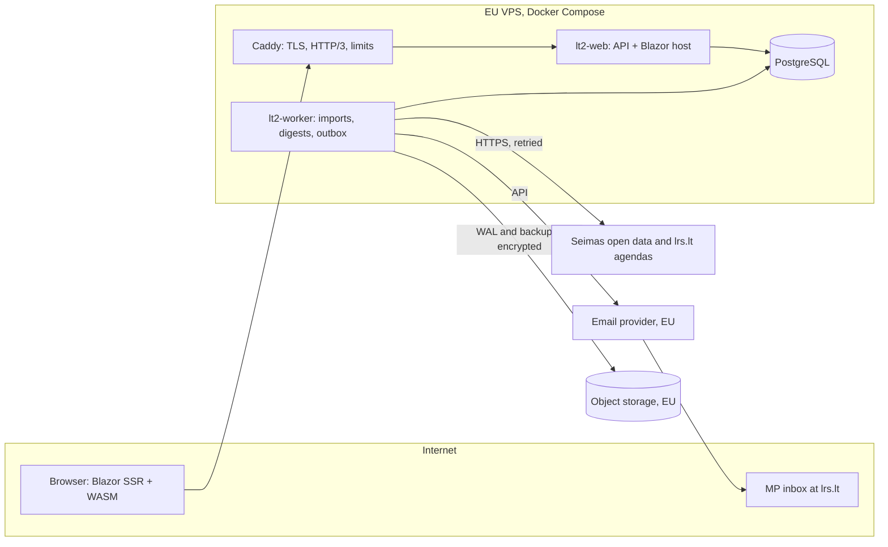

# LT2 system design

Detailed design for building Lietuva 2.0 as a production system. Written 2026-11-12 from the concept pages and
`discovery/design-notes.md` on the `docs` branch and the owner's answers the same day. English, for the team; nothing
here is published.

This is the maintained copy. Paths such as `../docs/` and `design-notes.md`, and the rules and fictional example data
this document cites from the documents-era `AGENTS.md`, are on the `docs` branch, where the concept website and the
discovery notes live.

**Status: agreed with the owner on 2026-11-12** as the basis for implementation; decisions made that day are marked
**[decided]**. Section 12 lists what is still to be chosen before the stage that needs it. All names, bills and numbers in
examples are the fictional ones from `AGENTS.md`.

## 1. Scope and build order

### 1.1 What changes compared with the public concept

The public pages describe a first version (voting with delegation) and a second version (posts, topics, answers).
This design builds in a different order **[decided]**:

| Stage | What | Source in the concept |
|---|---|---|
| **0. Foundation** | Solution skeleton, sign-in, security plumbing, deployment, monitoring. | – |
| **1. MP profiles** | Every MP of the current term imported from Seimas open data: mandate, faction, committees, contacts, voting record, statistics. | Chapter 06, the "unjoined MP" profile |
| **2. Appeals** | People take a side on a Seimas bill and give reasons; MPs receive summary emails instead of hundreds of separate ones; MPs can answer once for everyone. | A trimmed second version, section 1.2 |
| **3. Voting and delegation** | Bill pages with AI summaries, delegation, LT2 result, analytics, election mode. | The documented first version |

Stage 3 is not designed here. Stage 2 is shaped so that stage 3 extends it: a person's side on a bill is stored so that it
can become their direct LT2 vote, and an MP's published position can become the MP's LT2 vote with its explanation.

The public pages still say "first version = voting". They are **not** changed by this document; section 12 lists what
would need rewording once this order is agreed.

### 1.2 The problem stage 2 solves

Before a contested vote, people send MPs large numbers of near-identical emails. For the senders it is slow and they never
learn whether anyone read them; MPs and their offices cannot tell how many distinct people stand behind the flood, and the
other side of the argument is invisible.

Stage 2 replaces the flood with one object per bill, an **appeal** (*kreipimasis*):

- it is always tied to one Seimas bill **[decided]**;
- it has two sides: "asks to vote for" and "asks to vote against";
- a person joins one side (their **position**) and may add or endorse **reasons**;
- every sitting MP receives a **summary email** with the numbers for both sides and the most endorsed reasons
  **[decided: all MPs, automatically; nobody picks recipients]**;
- an MP (or the MP's office) can publish one **response** that everyone who took a side is told about.

One appeal per bill, not one per author: every active bill is open on its own page, and nobody proposes, opens or approves
an appeal first; everyone who takes part on a bill joins the same one **[decided by the owner on 2026-11-14, 8.12; it
replaced several proposals per bill, decided 2026-11-13]**. This is the same rule as "one vote per bill" in chapter 04 of
the concept, and it is what makes one summary per bill possible.

### 1.3 What is kept from the second version and what is trimmed

| Second-version feature | In stage 2 | Why |
|---|---|---|
| Free-form posts and questions | **Trimmed** to a short *reason* attached to a bill and a side | Free text with no bill needs AI grouping into topics and heavy moderation. |
| Tagging an MP, delegate or bill (`@`, `#`) | **Dropped** | Every appeal belongs to its bill's page; the addressee is every MP. |
| "Man svarbu" | **Adapted**: joining a side is the main action; "Man svarbu" marks the reasons that matter to you | Keeps the term for what it means. |
| AI grouping into topics and questions | **Trimmed** to "this reason looks like an existing one" within one bill and side | The bill already is the topic. |
| Topic page | **Becomes** the bill's page (8.12.1) | Same layout idea: counts, grouped reasons, answers. |
| Answer once for everyone | **Kept**: one response per MP per bill | The core of the value for MPs. |
| Work statuses (Atsakė, Rengia projektą, Įregistruotas, Nepritariu) | **Trimmed** to a stance: will vote for / will vote against / undecided, plus text | The bill already exists, so "preparing a bill" has no meaning here. |
| "Mano temos" | **Replaced** by the summary email and a plain list "appeals addressed to me" | The email is the inbox. |
| Public response rate (shown at ≥ 70 %) | **Later** | Data is collected from day one; showing it is a tone decision to take with MPs. |
| Personal feed | **Dropped** | Email notifications and "my appeals" are enough at this size. |
| Comments and discussion threads | **Dropped** | Moderation cost; reasons carry the content. |
| Petitions from topics, MPs' draft bills | **Dropped** | Not needed for the problem. |
| Moderation (AI helper plus moderators) | **Kept, required** | Anything that reaches 141 inboxes must pass a human. |

## 2. Architecture

A **modular monolith**: one deployable web application, one background worker, one PostgreSQL database. The team is small,
the load is modest (hundreds of thousands of rows a year, traffic in bursts from social networks), and the hard parts are
correctness, privacy and trust, not scale. Module boundaries are enforced in code so a module can be split out later if
that ever becomes necessary.



Modules and what each owns:

| Module | Owns | Database schema |
|---|---|---|
| **Identity** | Accounts, sign-in, verification level, roles, consents, sessions, data export and deletion, the link between an account and a politician. | `identity` |
| **Parliament** | Terms, sessions, sittings, MPs, mandates, factions, committees, bills, agenda items, votes and ballots, derived statistics, the open-data import. | `parliament` |
| **Appeals** | Appeals, positions, reasons, endorsements, MP responses, reports, moderation. | `appeals` |
| **Notifications** | Outbox, email transport, templates, digests, MP email preferences, suppression list, user notification settings. | `notify` |
| **Audit** | Append-only log of administrative and moderation actions. | `audit` |

Rules between modules: a module exposes a small public interface (queries and commands) and integration events; nobody
reads another module's tables. Cross-module reads for pages go through query interfaces, cross-module effects through
events written to the outbox in the same transaction as the change that caused them.

## 3. Technology choices

| Concern | Choice | Notes |
|---|---|---|
| Runtime | **.NET 10 (LTS)**, C# 14 | Supported until November 2028, which covers the 2028 Seimas election. |
| Database | **PostgreSQL** (17 or newer) | The owner's suggestion, confirmed. `jsonb` for snapshots, full-text search with the `lithuanian` configuration, `pg_trgm` and `unaccent` for name search, `SKIP LOCKED` for the outbox. |
| ORM | **EF Core 10** with **Npgsql**, `EFCore.NamingConventions` (snake_case) | One `DbContext` per module, each on its own schema. Raw SQL only for aggregate queries and materialised statistics. Migrations run as an EF migration bundle. |
| Web API | ASP.NET Core **Minimal APIs**, one endpoint per file, `/api/v1`, built-in OpenAPI document, RFC 9457 problem details | The API is complete from the start **[decided]**; the UI uses nothing else. |
| UI | **Blazor Web App**: static server rendering for public pages, **Interactive WebAssembly** for signed-in features | See 3.1. |
| Request handling | Plain handler classes injected into endpoints | No mediator library: MediatR and MassTransit are now commercial, and the indirection buys little here. |
| Validation | **FluentValidation**, validators in the shared contracts project | Same rules run in the browser and on the server. |
| Mapping | Hand-written or **Mapperly** (source generator) | AutoMapper is now commercial. |
| Sign-in | **ASP.NET Core Identity** on EF Core: email one-time code, passkeys, no passwords | See 6.2. |
| Background jobs | **Hangfire** with PostgreSQL storage for scheduled and retried jobs; own **transactional outbox** table for emails and events | The Hangfire dashboard (admin-only) shows failed imports and digests. |
| HTTP to Seimas | `HttpClientFactory` + `Microsoft.Extensions.Http.Resilience` (retry, timeout, circuit breaker) | The service is slow at times and drops connections (`design-notes.md`). |
| Caching | ASP.NET Core output caching and `HybridCache` in memory | No Redis until there is a second web instance. |
| Time | `TimeProvider`, UTC in the database (`timestamptz`), `Europe/Vilnius` for schedules and display | |
| Identifiers | UUID v7 for our own rows; Seimas identifiers kept as natural keys; public URLs use slugs (`/p/jonas-petraitis`) and bill numbers (`/seimas/XVP-0412`) | |
| Logging and telemetry | **Serilog** to console, **OpenTelemetry** traces, metrics and logs over OTLP | Backend chosen in 9.4. No personal data in logs. |
| Email | Provider with EU processing behind `IEmailTransport` | Shortlist in section 12. |
| SMS | None at the start **[decided]**: registration is by email only (6.2). `ISmsTransport` is added if phone verification is chosen later. | |
| Bot check | **ALTCHA** (self-hosted proof of work, no third party) on registration and code requests | Fallback: Friendly Captcha. |
| AI | One interface, `IAiAssistant`; in stage 2 used only for the draft of an appeal's description in a moderator's hands (8.11.4) **[decided 2026-11-13: the Claude API, first-party; model the setting `Ai:DraftModel`, default `claude-sonnet-5-5`]**. Pre-screening and duplicate-reason hints stay rule-based: users' texts can hold personal data and this API has no EU-only processing. | No personal data is sent. Prompts are kept in the repository so they can be published, as the concept promises. Provider chosen in stage 2; until then only a "not configured" implementation exists. |
| Reverse proxy | **Caddy** | Automatic certificates, HTTP/3, simple configuration. |
| Tests | xUnit, **Testcontainers** (real PostgreSQL), **Playwright** for end-to-end, `NetArchTest` for module boundaries | |

### 3.1 Why Blazor, and which Blazor

The owner prefers a client application over a full API and knows Blazor **[decided: SPA over the API; Blazor or another SPA
if it weighs better]**. The options:

| | Blazor Web App (SSR + WASM) | Standalone Blazor WASM | React / SvelteKit + API |
|---|---|---|---|
| Public pages indexable, with share previews | Yes, server-rendered | No: empty shell until WASM loads | Yes, with a Node SSR server |
| First load from a social link on a phone | Fast: HTML first, WASM only where needed | Slow: several MB before anything shows | Fast |
| Uses the API for everything | Yes in the browser; in-process on the server (same handlers) | Yes | Yes |
| One language, shared DTOs and validators | Yes | Yes | No |
| Team familiarity | Yes | Yes | No |
| Extra moving parts | None | None | Node runtime, second build, token or BFF layer |
| Ecosystem and hiring | Smaller | Smaller | Largest |

**Recommendation: Blazor Web App on .NET 10 with per-page render modes.** Most visitors arrive from social networks on a
phone and only read (the old platform's lesson: "people bring people"), so MP profiles and bill pages are
static server-rendered HTML with proper Open Graph tags and no WebAssembly download. Everything a signed-in person does
(taking a side, writing a reason, settings, moderation, administration) is an Interactive WebAssembly component that talks
only to `/api/v1`. Until such an island has started, everything in it is disabled (fields, choices and buttons alike):
what was typed would be emptied when the island takes over, and a form sent natively would reload the page. Without
JavaScript the island never starts, and the page says so in one note. An end-to-end test loads every page with islands
with the WebAssembly runtime blocked and fails on any control left usable.

How "full API from the start" holds with server rendering: every component depends on a typed client interface from
`Lt2.Api.Contracts` (`IParliamentApi`, `IAppealsApi`, …). In the browser the implementation is an `HttpClient` call; on the
server it calls the same application handler the endpoint calls. Integration tests exercise the HTTP path for every
operation, so the API cannot fall behind the UI.

React would be the choice if a large front-end team or a native mobile app were planned. Neither is, and the cost is a
second stack for a team of one or two.

UI components: no heavy component library. MudBlazor and similar need interactivity for most controls, which defeats
static rendering. The mockups in `../docs/` already define the visual language (`--slate`, `--leaf`, `--brand`, the
chips, the result card), so stage 0 ports those into a small set of Razor components and one stylesheet. The seat map and
charts are SVG rendered by Razor on the server, with no JavaScript; `lt2-logo-spin.js` is reused as it is.

## 4. Solution layout

```
LT2.sln
Directory.Build.props          nullable, warnings as errors, analyzers, deterministic builds
Directory.Packages.props       central package versions
global.json                    pinned SDK
src/
  Lt2.Web/                     ASP.NET Core host: endpoints, Blazor server rendering, auth, security middleware
    Endpoints/                 one file per endpoint, grouped by module
    Components/                layouts, static pages (MP profile, bill, appeal, digest archive)
    Security/                  headers, antiforgery filter, rate-limit policies, authorization handlers
  Lt2.Web.Client/              Blazor WebAssembly: interactive components, HTTP implementations of the API clients
  Lt2.Api.Contracts/           DTOs, route constants, client interfaces, FluentValidation validators
  Lt2.SharedKernel/            Result type, clock, identifiers, domain and integration event base types
  Modules/
    Lt2.Identity/              Domain/ Application/ Infrastructure/ (internal), public IIdentityModule
    Lt2.Parliament/            + Import/ (open-data client, parsers, upserts) and Statistics/
    Lt2.Appeals/
    Lt2.Notifications/         + Digests/, Templates/, Transports/
    Lt2.Audit/
  Lt2.Worker/                  Hangfire server: recurring jobs, outbox dispatcher
  Lt2.Migrator/                applies migrations for every module, creates roles and grants; run once per deploy
tests/
  Lt2.UnitTests/               domain rules: statistics, digest eligibility, thresholds
  Lt2.IntegrationTests/        API over a real PostgreSQL (Testcontainers), one fixture per module
  Lt2.Parliament.ImportTests/  parsers against recorded Seimas XML and agenda HTML
  Lt2.ArchitectureTests/       module boundaries, no direct cross-schema access
  Lt2.E2E/                     Playwright: sign-up, take a side, moderation, digest preview; 1280 px and 390 px
deploy/
  compose.yaml  compose.staging.yaml  Caddyfile  backup/  runbooks/
.github/workflows/             ci.yml (build, test, scan), deploy.yml (manual approval for production)
```

Conventions:

- Inside a module everything is `internal` except the module interface, its DTOs and its events.
- A feature is a folder with its endpoint contract, validator, handler and tests: a vertical slice, not layers by type.
- Domain rules that people will argue about (the two-thirds faction rule, participation, digest eligibility, the ≥ 20
  rule) are pure functions with unit tests whose names read as the rule.
- Every user-facing string goes through `IStringLocalizer`; the only language at launch is Lithuanian.
- Code lives on `master`, which is empty today, through pull requests with merge commits; `docs` keeps the website and
  `discovery/`. **[decided]**

## 5. Data model

Schemas match the modules. Only the tables that carry design decisions are listed.

### 5.1 `parliament`

| Table | Key columns | Notes |
|---|---|---|
| `term`, `session`, `sitting` | Seimas identifiers as keys | `kadencijos_id = 10` is 2024–2028. |
| `person` | `id`, `seimas_person_id` (unique), names, `slug`, `gender`, photo reference, biography link | `asmens_id` is stable across terms, so one person has one profile for life. |
| `mandate` | `person_id`, `term_id`, `from`, `to`, nominating party, how elected (list or constituency), constituency | `to` not null means the mandate ended; the profile becomes "former MP". |
| `body` | `id`, `kind` (faction, committee, commission, group), `seimas_id`, `term_id`, name | |
| `membership` | `person_id`, `body_id`, `role`, `from`, `to` | With dates, so "faction at the time of the vote" can be answered. |
| `contact` | `person_id`, `kind`, `value` | Official email and phone from open data: public data about a public office. |
| `bill` | `id`, `number` (`XVP-0412`), official title, registered date, proposer, e-seimas link, status, `lead_committee_id` | Created from agenda items; enriched from e-seimas. |
| `agenda_item` | `sitting_id`, Seimas item id, `bill_id`, stage, title | Items of sittings that have started (open data). |
| `planned_item` | `bill_id`, planned date, stage, source link, `first_seen`, `last_seen`, `gone_at`, `confirmed_by` | Upcoming agenda, scraped from lrs.lt; moves often. A moderator can correct or confirm a row. |
| `vote` | Seimas vote id, `agenda_item_id`, `bill_id`, time, wording, `kind`, stage, totals, official note, `is_consensus` | `kind`: stage result, amendment, procedural, other. Consensus votes have no ballots. |
| `ballot` | `vote_id`, `person_id`, `faction_id`, `choice` | About 141 rows per vote; a few million rows per term. |
| `faction_position` | `vote_id`, `faction_id`, position or "free", counts | Derived: the option chosen by at least two thirds of the faction's members who voted. Only for factions: the mixed group and MPs outside a faction have no row. |
| `mp_stat` | `person_id`, `term_id`, votes held, votes taken part in, with-faction count, free-vote count | Derived, recomputed after each import. |
| `import_run`, `raw_document` | source address, fetch time, hash, compressed body | Every response is kept, so parsing can be re-run and any number traced to its source. |

### 5.2 `identity`

ASP.NET Core Identity tables (users, roles, claims, tokens, passkeys), plus:

| Table | Notes |
|---|---|
| `profile` | Display name, created date, normalised email (for the one-account-per-address rule), `verification_level` (`email` at the start; `phone` and the EU wallet can be added), invitation used. While the account is pending (6.2) it holds only the normalised address and the invitation code that was entered. [changed while building (8.14.14, stage B): never an organisation's code, which the browser keeps until completion; `invitation_level` holds the level of the code the registration was completed with, and for an organisation's code it is all that is kept: `invitation_id` and `invitation_code` stay empty.] |
| `invitation` | Code (and its look-up form without dashes or spaces), kind (`team` or `personal`), who issued it (for a personal code: its member), uses left and expiry (team codes), completed registrations (a counter that never drops), level, switched off (when, by an administrator), replaced (when). Registration is by invitation during the closed trial. A use is counted when the registration is completed (6.2), not when it is started. [changed while building (8.14.14, stage B): the kind `organisation`, one current code per organisation, with `organisation_id` (the Appeals module's id) and no account; `organisation_off` (`blocked` or `closed`) follows the organisation, separate from an administrator's switch-off.] |
| `invitation_daily` | Per code and Vilnius day: registrations completed. For the administrators' chart; no per-person history. |
| `feedback` | Kind (`bug`, `idea`, `unclear`, `other` or none), text (up to 2 000 characters), page path and browser (each only if the member left them in), status (`new`, `seen`, `done`), internal note, replies, the day it came, and the account **only if** the member ticked "Galite man atsakyti". An item without that tick has no account, a random id and only the day, so nothing leads back to its author. Kept 12 months (a setting); linked items go with the account (8.10). |
| `sign_in_code` | Account, hashed code, expiry, failed attempts, used time, and the known device it was issued to (empty for a code any browser may use). |
| `known_device` | Account, hashed identifier of the browser's cookie, first and last seen. Built before registration opens (M2b). |
| `role_activation` | Account, role, hashed one-time code, who issued it, expiry, used time. Using it marks the passkey of that session as the staff passkey. |
| `party_support` | `user_id`, `party_id`. Private and optional; used only for group statistics of at least 20 people. |
| `consent` | Kind, text version, given and withdrawn times. Positions need explicit consent (GDPR Art. 9). |
| `politician_link` | `user_id`, `person_id`, role (the MP, or an office member), how and when verified. |

### 5.3 `appeals`

| Table | Key columns | Notes |
|---|---|---|
| `bill_record` | `id`, `bill_number`, description, `description_source`, `description_url`, `description_at`, status, opened, published and closed times, `closing_vote_id`, frozen counts, `sending` (automatic or held), `threshold`, `threshold_set_by` (default or moderator), `threshold_note`, `first_summarised_at`, `initiator_user_id` (old rows only) | The bill's record (8.12.1): the Appeals module's own record of what people did on one bill, created when first needed (the first side, argument or description, or a moderator's action), never proposed or approved. One per bill: a unique partial index over the statuses open, closed and rejected (hidden by a moderator, 8.12.3). Status `superseded` marks only rows from before 2026-11-14 that are no longer a bill's record (proposals closed when the proposals went, older hidden appeals). The description is empty until a moderator writes one or the summary job makes one; `description_source` (`initiator`, `moderator`, `ai-draft`, `ai`, 8.13) is null without one. [changed while building (8.13): `description_url` is the official text it was made from when known (set by the summary job, kept when a moderator confirms or corrects that text, cleared on removal) and `description_at` when its text was made or last changed.] [changed while building (8.13, the owner's
last block): a moderator who writes or corrects a description sets `description_url` from the form's "Oficialaus teksto
adresas" (https on `lrs.lt` or under it, at most 500 characters), filled in advance with the current one; empty clears it.] `threshold` is null for the default of all bills, or a moderator's number for this bill (8.12.2). `first_summarised_at` is set by the first summary really sent to MPs, not by a dry run (8.4). `initiator_user_id` is set only on records from before 2026-11-14 and only names the author beside a description they wrote. [changed while building: `return_note` and the description's `screening_flags` were dropped with the proposals] |
| `position` | (`record_id`, `user_id`) primary key, `side` (for or against), created and changed times | One row per person per bill. Becomes the direct LT2 vote in stage 3. |
| `daily_stat` | `record_id`, date, counts per side, counts for accounts older than 30 days, share of new accounts | For the trend chart and surge detection. **No per-person history of opinion changes is stored.** |
| `reason` | `id`, `record_id`, `side`, `author_user_id`, text (up to 500 characters), status, `merged_into_id` | Status: pending, published, hidden, merged. `side` is the side the argument supports, chosen by its author, whatever the author's own position (8.2). |
| `endorsement` | (`reason_id`, `user_id`) | "Man svarbu" on a reason; only on your own side; how many per bill is a setting, no limit by default (8.2). |
| `response` | `record_id`, `person_id`, stance, text, published and edited times, `written_by_user_id` | One per MP per bill; edits keep history. |
| `report` | target, reporter, ground, status | Notice-and-action under the Digital Services Act. |
| `moderation_action` | moderator, target, action, statement of reasons, time | The statement is sent to the author. |
| `writing_restriction` | `id`, `user_id`, `ends_at` (null = until lifted), statement, set by and when, lifted by, when and why | A moderator's restriction on writing (8.3). Lives with the writing rules in this module; deleted with the account; never shown to anyone but the person and staff. |
| `revision` | entity, field, old and new value, who, when | Edit history for descriptions, reasons, responses. "Who" is empty for a summary the job made (8.13); a description a person ever wrote, corrected or removed is recognised by a row with a person, and the job never writes it again. |
| `summary_attempt` | `bill_number` (key), tried time, outcome (`made`, `unavailable`, `insufficient`, `failed`, `overtaken`), whether the provider was asked, `retry_after` | [changed while building (8.13)] The summary job's last try per bill, also for a bill without a record; never a text and no person. Serves the daily number (tries that asked the provider since Vilnius midnight) and the wait before the next try. |

| `ai_draft_request` | `id`, moderator, `bill_number`, requested time | [changed while building] That a moderator asked for an AI draft (8.11.4): never a text. For the hourly limit and to accept a description as started from a draft (8.12.3). Exported and deleted with the moderator's account. |
| `organisation` | `id`, `slug`, `name`, `name_key`, `description`, `website`, `legal_code`, `declared_lobbyist`, `registered_by_user_id`, `status`, confirmation and block columns, `seen_at` | [changed while building (8.14.14, stage A)] An organisation's public profile; the columns are listed in 8.14.10. Who registered it is never public and is emptied with the account. Hidden from `lt2_readonly`. |
| `organisation_representative` | `id`, `organisation_id`, `user_id`, `granted_by_user_id`, `granted_at`, `ended_at` | [changed while building] Who acts for an organisation; seen only by its other representatives. Deleted with the account; the last representative's deletion closes the organisation. Hidden from `lt2_readonly`. |
| `organisation_invite` | `id`, `organisation_id`, `token_hash`, `created_by_user_id`, `created_at`, `expires_at`, `used_at` | [changed while building] A representative's one-time link (seven days). Hidden from `lt2_readonly`. |
| `organisation_code` | `id`, `organisation_id`, `domain`, `code_hash`, `created_at`, `expires_at`, `failed_attempts`, `consumed_at`, `requested_by_user_id` | [changed while building] Confirmation by email domain, under the sign-in codes' rules; never the mailbox. Hidden from `lt2_readonly`. |
| `organisation_statement` | `id`, `organisation_id`, `bill_number`, `stance`, `text`, `link`, `goal`, `status`, `screening_flags`, `seen_at`, `published_at`, `edited_at`, `withdrawn_at`, `written_by_user_id` | [changed while building] One per organisation per bill (8.14.3); never counted. Earlier versions in `revision` without a person. `written_by_user_id` is never public and is emptied with the account. Hidden from `lt2_readonly`. [changed while building (stage B): `first_public_at`, when it first became public, for the follow emails.] |

### 5.4 `notify`

| Table | Notes |
|---|---|
| `outbox` | Kind, `jsonb` payload, due time, attempts, error. Written in the same transaction as the change; dispatched with `FOR UPDATE SKIP LOCKED`. |
| `digest_run` | Kind (weekly, before-vote, urgent, introduction), scheduled time, status, who approved. |
| `digest_item` | Per run and bill's record (`record_id`): counts per side, counts for accounts older than 30 days, top reasons (text and "Man svarbu" count, without the author's name), planned date and stage. A frozen snapshot: what MPs were told. |
| `digest_delivery` | Per run and MP: sent, skipped by preference, suppressed, bounced; the MP-specific numbers. |
| `mp_email_pref` | Per MP: frequency (default, weekly only, before votes only, stopped), confirmed extra recipient. |
| `suppression` | Hashed addresses that bounced or asked to stop. |
| `email_message` | Template, subject, provider message id, status. Bodies of digests are reproducible from the snapshot; other bodies are not stored. |
| `follow` | (`user_id`, `kind`, `key`) primary key, created time. `kind`: bill (key: the number) or mp (key: the Seimas person id). Private: shown to nobody but the person; exported and deleted with the account (8.11.2). [changed while building (8.14.14, stage B): or `organisation` (key: the organisation's id); `kind` up to 16 characters.] |
| `notice_setting` | Per account: which follow emails are on (`planned`, `voted`); no row means both on. [changed while building (8.14.14, stage B): and `statements` (a followed organisation's statement became public); no row means all three on.] |
| `bill_event` | (`bill_number`, `kind`, `key`) primary key, first seen, sent time, outcome. `kind`: planned (key: the date) or voted (key: the vote id). What followers are told about, recorded once (8.11.2). No person in it. [changed while building: an `outcome` column (`waiting`, `sent`, `skipped`, `superseded`) tells an event never to be sent from one waiting for the next day] [changed while building (8.14.14, stage B): `kind` `statement` (key: the statement's id) records, under its bill, that a followed organisation's statement became public; no person and no text in it] |

### 5.5 `audit`

`event`: time, actor, role, action, target, details, hashed IP. The application role may only insert.

### 5.6 Settings

`config.setting`: key, `jsonb` value, who changed it and when. Holds every number an administrator may need to tune
without a deploy: the summary rules in 8.4 (the threshold of all bills, `Digest:ThresholdDefault`, read whenever it is used, and the minimum no threshold goes below, 8.12.2; the weekly and before-vote times, the ceiling
per MP, and the share of change that counts as "changed notably", `Digest:NotableChange`), the reasons and "Man svarbu"
marks a person may give per bill in 8.2 (`Appeals:ReasonsPerPerson`, `Appeals:EndorsementsPerPerson`, 0 = no limit,
the default), the surge thresholds in 6.6,
the code limits and the life of a pending account in 6.2, whether registration needs an invitation, uses per personal invitation code (`Registration:PersonalCodeUses`, 0 = no limit, the default), uses per organisation's invitation code (`Registration:OrganisationCodeUses`, 0 = no limit, the default; 8.14.14 stage B, on the settings screen under registration), how long feedback is kept (`Feedback:KeepMonths`, 12), how many organisations an account may
register (`Organisations:PerAccount`, 3; closed ones do not count, 8.14.14; on the settings screen under
"Organizacijos"), the Claude model of the description draft and of the AI summaries (`Ai:DraftModel`, `claude-sonnet-5-5`, 8.11.4, 8.13), how many AI summaries the job may ask for a day (`Ai:SummariesPerDay`, 30; 0 = off, 8.13). Each
change is written to `audit`, and the current values of the rules that affect what MPs receive are shown on the public
methodology page.

The site's own address is not one of them **[decided by the owner on 2026-11-14]**: `Site:Address` is deployment
configuration, which compose builds for the web and the worker from `LT2_SITE_ADDRESS` and the https port (the address
Caddy serves), so no administrator can point emails at another site. It must be empty or an https address of a host
and nothing more; a host refuses to start otherwise. Links in every email and in the summary's text start with it;
when it is empty they stay the site's paths.

The administrator's settings screen groups them under headings (registration and sign-in; appeals; summaries; surge
note; feedback), with a separate "Saugumo ribos" group for the ones rarely changed (codes per hour and per day, days a
pending account is kept), which says so. Each setting shows a plain Lithuanian label, one sentence on what it does and
when to change it, its unit, the default, and the key in small type. The minimum threshold's 50 is a placeholder until
the owner sets a number, and the screen says so.

Database roles: `lt2_migrator` owns the schemas and runs migrations; `lt2_app` has data access only; `lt2_worker` the same
plus the Hangfire schema; `lt2_readonly` for ad-hoc analysis has no access to `identity` or `appeals.position`. [changed
while building (8.14.14): nor to the five organisation tables, which hold an account beside an organisation.]

## 6. Security and privacy

### 6.1 What we protect

1. **Who took which side.** A position on a bill is a political opinion: special-category data under GDPR Art. 9. Leaking
   it is the worst realistic incident.
2. **The integrity of the numbers.** MPs and journalists must be able to trust that 4 280 means 4 280 distinct verified
   accounts.
3. **The sending channel.** A system that can email every MP is a target: if it is abused once, the summaries get
   filtered and the product stops working.
4. **Politician accounts.** A hijacked MP account publishes in the MP's name.

### 6.2 Sign-in and accounts

- **No passwords.** Sign-in is a six-digit code sent by email (ten minutes, five attempts, single use), or a **passkey**
  (built into ASP.NET Core Identity in .NET 10). Nothing to leak, reuse or stuff.
- **A code belongs to the address, not to a browser.** It can be read on any device and typed into any browser, so a
  person can register on someone else's computer with the mail open on a phone, and later ask for a new code on their
  own device. A new code replaces the earlier one; the email and the page say to use the newest.
- **How many codes [decided 2026-11-12].** For one address, all browsers that have not signed in to that account before
  share five codes an hour and ten a day (both are settings). The daily limit is what bounds guessing: at most 50 tries
  a day against one account, about a 2 % chance over a year of constant attack, against about 20 % with the hourly
  limit alone.
- **Known devices [decided 2026-11-12; built before registration opens, M2b].** The shared limit can be used up by
  anyone who knows an address, which would keep that person from signing in by code. So a browser that has signed in
  to an account keeps a one-year `__Host-` cookie with a random identifier (stored hashed, tied to that account; it
  gives no access by itself). Such a browser has its own five codes an hour. A code it asked for is accepted only
  from it, so requests and wrong guesses from elsewhere cannot cancel or exhaust it. Codes asked for from any other
  browser stay usable anywhere, as above. A stranger can then block sign-in only from browsers the person has never
  used; the usual browser and a passkey keep working. Until this is built the lockout is an accepted risk of the
  closed trial (section 12).
- **Registration = email only at the start [decided 2026-11-12].** The concept says email and phone, but SMS
  verification is a paid service (charged per message, and a target for SMS-pumping fraud), so it waits until there is a
  budget and a need. Each account has a **verification level**: `email` now, `phone` or the EU Digital Identity Wallet
  later. A stronger check can then be added as an upgrade existing people complete, and counts can be reported by level.
- Email alone lets one person create many accounts for nothing. What stands in for the phone:
  - the closed trial is **by invitation** (a code from the team or from a participant), so there is no open registration
    while the flow is being proven;
  - one account per **normalised address** (lower case, the `+tag` part removed, dots ignored where the provider ignores
    them), and addresses at disposable-mail domains are refused;
  - the bot check and per-IP limits on registration;
  - the 30-day count beside every number, and the surge note (6.6).
- **Before registration opens to everyone and real summaries go to MPs (M2b), decide again:** add phone verification, or
  stay with email and label every number as coming from email-confirmed accounts. See section 12.
- **An account is pending until its address is proven [decided 2026-11-12].** Registration takes the address and the
  invitation code and creates a pending account: no name, no declarations, no role, nothing it can do. The first
  correct code proves the address. Only then is the person asked for the display name and the declaration of being 18
  or older, only then is the invitation use counted (if it has run out by then, the person is told so and can enter
  another), and with the declaration the account becomes a member. So nobody can attach a name or an age declaration
  to someone else's address, or use up an invitation with addresses they do not control.
  - Asking for a sign-in code for a pending account works like any other and completes the registration, on any
    device.
- **Personal invitation codes [decided 2026-11-13].** Every member has one personal code, made at completed
  registration (for earlier members when first needed), shown on the account page as a link to the registration form
  with the code filled in and as a short code with a copy button. Format: eight characters from 29 that cannot be
  mistaken for one another (`23456789ABCDEFGHJKMNPQRSTVWXYZ`: no 0, 1, I, L, O, U), shown as `XXXX-XXXX`; case,
  dashes and spaces do not matter when typed; about 5 × 10¹¹ codes, and guessing stays under the registration rate
  limits. Codes are never written to logs.
  - Uses per personal code are a runtime setting, `Registration:PersonalCodeUses`, 0 = no limit, the default. Team codes
    keep their own uses and expiry.
  - The member can replace the code: a new one is made, the old one stops working, and the member's count (the sum of
    their codes) carries over.
  - A use is counted when registration completes, as before, on a counter on the code and in daily totals per code; the
    count never drops when an invited person deletes their account. The profile keeps which code it registered with,
    and that goes with the account.
  - When the inviter deletes their account, their codes are switched off and lose their owner: nothing of the person
    stays on them; their counts, levels and daily totals stay as anonymous numbers.
  - The member sees only how many people completed registration with their code and whether it is on; no names, dates
    or list. The registration form says plainly that whoever gave the code sees that it was used, not by whom.
  - Administrators (staff-passkey session) get a page: completed registrations per day, in total and for the codes that
    brought the most people, as a server-rendered chart with the numbers also as a table; those codes (team codes by
    their code, personal codes by the member's display name); and the numbers per level (level 1: by team codes or with
    no code; level 2: by codes of level-1 people; and so on). No who-invited-whom tree and no list of who used a code.
    An administrator can switch any code off and on again, with a statement, audited; a member whose code was switched
    off sees that on the account page, with the contact address, and cannot replace it meanwhile.
  - A code that does not work gets one message on the registration form, whatever the reason (unknown, switched off,
    replaced, expired, used up): ask whoever invited you for a new one.
  - Never combined with sides: no screen, API answer, export or query joins invitations with positions, marks or
    arguments. No ranking shown to members, no rewards, nothing public. An account restricted from writing (8.3) keeps
    its code; switching a code off is a separate action.
  - If the address already has an account, registration only sends a sign-in code to the address on the account; what
    was typed is discarded.
  - Accounts still pending after seven days (a setting) are deleted by the maintenance job that also removes old codes
    and expired sessions, so an address typed by a stranger is not kept.
- Reading needs no account. Taking a side, writing a reason and endorsing need a confirmed email and the age
  declaration.
- **Minimum age: 18, self-declared when the address has been confirmed [decided].** The signal is compared with a
  parliament elected by adults; the EU Digital Identity Wallet could later confirm it.
- Session: `__Host-` cookie, `Secure`, `HttpOnly`, `SameSite=Lax`, sliding 30 days; a person can see and end their
  sessions. No tokens in the browser: the WASM client uses the same cookie (same origin).
- **Staff** (moderator, administrator) **[decided 2026-11-12].** A staff role works only in a session signed in with a
  **staff passkey**. A session signed in by email code is an ordinary member session, whatever roles the account has,
  so getting into a staff member's mailbox is not enough.
  - *Activation.* An administrator grants the role; the system shows a one-time activation code on the administrator's
    screen (valid 24 hours, never sent by email), and the administrator passes it to the person directly. The person
    signs in with a passkey and enters the code: that passkey becomes the staff passkey, and any other passkey on the
    account is removed.
  - *Afterwards.* Adding or removing a passkey on a staff account needs a staff-passkey session and a fresh passkey
    confirmation (within the last ten minutes). Sensitive actions (approving a send, changing roles, verifying a
    politician) ask for the same fresh confirmation.
  - *Lost passkey.* An administrator resets the account: its passkeys are removed and the role is inactive until a new
    activation code is used. The first administrator, and a lost last one, are activated from the server: the migrator
    command grants the role and prints the activation code.
  - Every grant, activation, reset and passkey change is audited, and the person is told by email.
- **Politicians** (verified MP, office member) need a passkey as well. Their proof of identity is the official
  `@lrs.lt` mailbox, so the take-over link plays the part of the activation code: the passkey is created while using
  the link, and later changes need that passkey or a new link. The details are designed with M2b.
- **Other members:** a passkey is a convenience. The mailbox is what proves who they are, and a code still signs them
  in. They are told by email when a passkey is added or removed.
- No authenticator app: one way in to secure. It can be added if an MP's office cannot use passkeys.
- Responses never reveal whether an email is registered.
- **Local development only: a fixed sign-in code [decided 2026-11-13].** For the owner's hand testing on the local
  stack, one configured six-digit code may be typed in place of the emailed one, for any account. Guards, all of them:
  it is configuration only (an environment variable in `deploy/.env`), never a runtime setting and never on the
  settings screen, so no administrator can switch it on; the web host refuses to start when it is set and the site's
  own address (`Site:Address`, from the same `LT2_SITE_ADDRESS` Caddy serves) is not `localhost` or a `.localhost`
  host, and each request must also come to such a host; unset by default, and then it is refused like any wrong code.
  The real code is still generated, emailed and accepted. The fixed code works only where an emailed code does
  (registration and sign-in, a code requested and not yet used, expired or exhausted) and gives an ordinary member
  session; it never activates a staff role and has nothing to do with activation codes or passkeys. The sign-in page
  says plainly that it is on, and start-up logs one warning line (without the code). Locally the per-address rate limits
  and the code limits are raised through the same `.env`; the defaults in code and in production stay.
  **Not built yet:** the change to the code check was stopped by the coding session's permission checks (an
  authentication bypass needs the owner's own go-ahead in that session); the raised local limits are built.

### 6.3 Authorization

Policy-based, with resource handlers where ownership matters.

| Role or claim | Can |
|---|---|
| Visitor | Read all public pages and public API. |
| Member (confirmed email; invited during the trial) | Open an appeal, take a side, write and endorse reasons, report content. |
| Verified MP / office member (`politician_link`) | Publish and edit that MP's response; manage that MP's email preferences. |
| Moderator | Review appeals and reasons, merge, hide, correct planned dates, hold a send, approve an urgent send, restrict an account from writing and lift that. |
| Administrator | Roles, politician verification, configuration, import and digest dashboards; every moderator action, restricting an account from writing and lifting that included. Cannot read individual positions through any screen. |

No screen and no API returns another person's position. Group numbers are published only for groups of at least 20.

### 6.4 Web hardening

- TLS only, HSTS with preload, HTTP/3.
- Content Security Policy: `default-src 'self'`; `script-src 'self' 'wasm-unsafe-eval'` (required by WebAssembly), no
  inline scripts; `frame-ancestors 'none'` everywhere except future embed endpoints; `Referrer-Policy`,
  `Permissions-Policy`, `X-Content-Type-Options`.
- Every state-changing API call needs the antiforgery token header and passes an `Origin` check; CORS is off.
- Rate limits at two layers: Caddy per IP, and ASP.NET Core policies per account and per IP for code requests, registration,
  writing reasons and reports.
- All input validated by the shared validators on the server; user text is stored as plain text and encoded on output,
  no HTML or Markdown from users in stage 2.
- Outbound requests go only to a fixed allowlist of hosts (Seimas, email, AI, storage). The AI host (`api.anthropic.com`,
  8.11.4) is on the web host's list only while the provider is configured, and on the worker's (the summary job, 8.13)
  on the same condition.

### 6.5 Data protection

- **Explicit consent** before the first position, with the consent text versioned and stored. Withdrawing deletes the
  positions.
- **Minimisation.** No personal code, address or document number (as the concept promises). No phone number is
  collected at the start; if phone verification is added, only a keyed hash is kept. No per-person history of changed
  positions.
- **Deletion and export.** A person can download everything they gave us and delete the account; positions are removed
  and counts fall. Frozen digest snapshots keep their totals: they are aggregates and a record of what was sent.
- **Encryption.** Disk encryption on the VPS volume, TLS to the database inside the Docker network, encrypted backups.
  ASP.NET Core data-protection keys are stored in PostgreSQL, wrapped with a key supplied as a secret.
- **Logs** carry request ids, never emails or sides; IPs are hashed with a rotating key and kept 30 days.
- **Secrets** live outside the repository and outside images: encrypted with SOPS and age in a private operations
  repository, mounted as files at deploy, rotated on a schedule and after any staff change.
- **Before launch:** a data protection impact assessment (required for large-scale processing of special-category data), a
  privacy notice, a processing record, processor agreements with the email, AI (Anthropic, for the description draft and the AI summaries only: the bill's
  number, title and official text, no personal data; 8.11.4, 8.13) and storage providers. The old
  platform held a permit from the State Data Protection Inspectorate; the current rules need checking with a lawyer.

### 6.6 Integrity of the numbers

- One account per normalised email address (6.2); one position per account per bill. This is weaker than a phone check,
  which is why the 30-day count is always shown and why every number is described as a signal.
- Every published count comes with the count for **accounts older than 30 days** (the concept's filter).
- **Surge detection:** when a large share of recent positions on a bill come from accounts created in the last days
  (default: at least 30 % of the last 72 hours' positions and at least 50 accounts; both are settings), the bill's page and the summary say
  so in neutral words, and a moderator is asked whether to hold the send.
- Counts in a summary are frozen in `digest_item` and published at a public address, so anyone can check what MPs were
  told (section 8.7).

### 6.7 Supply chain and delivery

Central package versions and lock files, NuGet audit in CI, Dependabot, CodeQL, secret scanning, container image scan,
SBOM per release, images signed and pulled by digest. Containers run as non-root on chiselled .NET images with a read-only
file system and dropped capabilities. A `security.txt` and a disclosure address. An external penetration test before the
first real summary is sent.

### 6.8 Rules made explicit after the code review of 2026-11-15

**[Designer's reading of rules this document already has, written down so the code can be checked against them. None
changes what a person can do on the site; the questions that do are in section 12.]**

- **Nothing held back becomes public through history.** A text that pre-screening held and no moderator published was
  never public, and no history shows it: an organisation statement's "earlier versions" (8.14.14) are only the
  versions that were public.
- **A flagged change is looked at.** When an organisation changes its description and pre-screening flags the new
  text, the organisation returns to the moderators' queue, as it does for a new name or website (8.14.14).
- **A report is closed only by an action that answers it.** Keeping, hiding, restoring, publishing, describing and
  confirming answer a report on their target; setting a threshold or a planned date, holding and releasing do not.
- **A finished bill is finished for everyone at the same moment.** Once the bill's final vote is recorded, taking part
  (a side, an argument, "Man svarbu", a withdrawal) is refused, as an organisation's statement already is, whether or
  not the hourly job has closed the record yet.
- **Writes to one bill's record are serialised.** A moderator's description and the summary job's text cannot
  overwrite each other, and a description a person wrote is never written over by the job (8.13).
- **A reset ends sessions.** When an administrator resets a staff account or a role is activated, the sessions that
  were signed in with the removed passkeys end in the same step (6.2).
- **One current code.** A member has at most one personal invitation code that works, enforced by the database, as
  an organisation has (6.2, 8.14.6).
- **Limits hold under parallel requests.** Sign-in codes per address, "one urgent summary a week" and the summary
  ceilings are counted under a lock (6.2, 8.4).
- **Rules are checked where the data is written.** A rule checked only by the HTTP validators does not hold for
  callers inside the server: the explicit consent for party support, the display name's length and a moderation
  statement's presence and length are checked by the module that stores them.
- **The outbox forgets.** Deleting an account, and purging an unfinished registration, delete the outbox rows
  addressed to that person that were not sent. Rows that failed are deleted after 30 days. An error stored or logged
  for a failed email holds the error's type and the server's status code, never its text, which can quote the address.
- **Sign-in codes go first.** The dispatcher sends sign-in and confirmation codes before any other waiting email, so
  a large batch of follow emails cannot delay a code past its lifetime (8.4 separates the streams by sender address;
  this is the order within the queue).
- **Redirects stay inside the allowlist.** An outbound request does not follow a redirect to a host that is not on
  the allowlist (6.4).
- **Codes and tokens are not sent in addresses.** A link the site makes carries its secret after the `#`: the
  invitation code of a registration link (`/prisijungti#kodas=…`, with `tikslas` beside it) and the token of a
  representative's invitation. The browser never sends that part, so no proxy and no application log can hold it,
  on a shared server included (9.2). The page reads it in the browser and passes it to the API in a request body,
  never in a path or a query. A link in the old form (`?kodas=…`) still works, and the proxy's filter that drops
  `kodas` from the logged address stays for those (6.2).
- **Forwarded addresses are believed only from the proxy itself.** On a shared Docker network the proxy's
  neighbours are not the proxy: the application believes the forwarding headers only from the proxy's own address,
  named in its configuration, not from a whole network.
- **A signed-in page is not stored.** HTML pages answered to a signed-in session carry `Cache-Control: no-store`,
  as `/api` already does: such a page can hold the person's own side or invitation code (6.4). Today visitors'
  pages are not stored either, because a page with an island issues an antiforgery token; making them cacheable
  would be its own change.
- **A page that parses to nothing changes nothing.** When the agenda watcher finds sitting dates but no bill at all
  while planned items exist, it keeps the items, records the run as failed and alerts (8.9), until the owner decides
  otherwise (section 12).
### 6.9 Decisions after the code review of 2026-11-15

**[Decided by the owner on 2026-11-15, on the questions the review raised. Each line says where it applies.]**

- **Reports after the final vote (8.3, 8.12).** A report about an argument or a description on a closed bill reaches
  the moderators' queue like any other. On a closed record a moderator can hide and restore an argument, correct or
  remove the description, and answer the report with "Palikti", each with a statement, audited, the author told, as
  on an open one. The frozen counts and the summaries already made do not change. Everything else on a closed record
  stays refused.
  [as built] Hiding the whole record of a closed bill was possible before this decision and stays possible.
- **Party numbers (8.2).** They stay as built: each party's number is shown when that party has at least 20 people.
  That a smaller group can sometimes be worked out by subtraction is accepted.
- **A statement still waiting when the bill closes (8.14.14).** It can no longer be published: it was not public when
  the bill closed, and what is public then is frozen. The queue still shows it, with "Palikti" and hiding only.
- **A moderator's or administrator's actions outlive the account (6.5).** When a staff member's account is deleted,
  the records of what they did as staff (moderation actions, statements, restrictions, confirmations) keep the
  account's id, for accountability; the id then leads to no person, name or address. The page that says what is
  stored and what is deleted says so.
  [as built] The code already kept these ids; the methodology page and a staff account's delete confirmation now say
  so. Where a screen names who hid something, a deleted account reads "paslėpė moderatorius". A moderator's AI draft
  requests (a rate-limit table, each also audited) still go with the account (8.11.4).
- **The read-only database role sees only what is listed (5.5).** `lt2_readonly` is granted the tables on a list,
  never "every table but". A new table is invisible to it until someone adds it, and a test fails when a table is on
  neither the granted list nor the withheld list, so each new table gets a decision.
- **Deleting a staff account needs the staff passkey (6.2).** An account that holds a staff role can be deleted only
  from a session signed in with its staff passkey; a session from an email code is told so. Ordinary accounts and the
  data export are unchanged.
  [as built] "Holds a staff role" means a role that was activated: a role granted but never activated, or an account
  an administrator has reset, has no staff passkey to sign in with and is deleted like an ordinary account.
- **Changing a setting asks for the passkey again (6.2).** Saving a runtime setting needs the same fresh passkey
  confirmation as changing roles. Switching an invitation code off or on does not.
- **Feedback handling is audited (8.10).** A change of a feedback item's status or note leaves an audit entry with
  the item, the old and new status and who did it, without the note's or the feedback's text.
- **Signing in from a bill brings the person back to it (8.11.5).** The sign-in links on a bill's page (taking a
  side, following, reporting) carry the page as `tikslas`, after the `#` like every such link (6.8), so signing in or
  registering ends on that bill, not on the account page.
## 7. Stage 1: MP profiles

### 7.1 Sources

Everything below comes from the Seimas open data service (`https://apps.lrs.lt/sip/`, CC BY 4.0, attribution on every
page). Endpoints marked ✔ were checked in September 2026 (`design-notes.md`); the service did not answer from this
machine on 2026-11-12, so nothing could be re-checked today, and the rest must be confirmed against live responses as the
first task of stage 1.

| Data | Endpoint | Status |
|---|---|---|
| Terms | `p2b.ad_seimo_kadencijos` | ✔ |
| MPs: person id, names, mandate dates, nominating party, how elected, number of terms, memberships with dates (`Pareigos`), contacts (`Kontaktai`, including the `@lrs.lt` address) | `p2b.ad_seimo_nariai?kadencijos_id=` | ✔ |
| Sessions, sittings | `p2b.ad_seimo_sesijos?kadencijos_id=`, `p2b.ad_seimo_posedziai?sesijos_id=` | ✔ |
| Agenda items with bill number, stage, e-seimas link | `p2b.ad_sp_darbotvarke?posedzio_id=` | ✔ |
| Votes of an agenda item | `p2b.ad_sp_klausimo_svarstymo_eiga` | ✔ (parameter name to confirm) |
| Each MP's vote with faction | `p2b.ad_sp_balsavimo_rezultatai?balsavimo_id=` | ✔ |
| Lists of factions, committees, commissions, groups | separate services listed at `portal.show?p_r=35391` | To confirm; memberships already come with the MP record. |
| Gender, birth date, biography link, photo | MP record and the MP's page on lrs.lt | To confirm field by field. |

Other official sources, used as **links first** and imported only where a stage needs them:

| Source | What it adds | Stage 1 use |
|---|---|---|
| MP's page on lrs.lt | Photo, biography, assistants, office contacts | Link; photo shown only if the reuse terms allow it (to check), otherwise initials as in the mockups. |
| e-seimas bill pages | Registration date, proposer, status, lead committee, documents | Parsed per bill (no API). Bills an MP proposed: later. |
| Central Electoral Commission (VRK) | Election results, constituency, list position, candidate questionnaire | Link to the candidate page; data needed for stage 3's election mode. |
| Chief Official Ethics Commission (VTEK) | Declarations of private interests | Link only. |

Deliberately not shown: parliamentary expenses and anything else that reads as a scorecard. The concept's tone is
connection and explanation, and the profile shows what the MP did, not a ranking.

### 7.2 Import

- **Backfill** once for term 10: terms → sessions → sittings → agenda items → votes → ballots. A few thousand requests,
  throttled to about one per second, resumable.
- **Recurring:** MPs and memberships daily; sittings, agenda items and votes every 15 minutes on sitting days and hourly
  otherwise; statistics recomputed after each run that changed anything.
- Every response is stored in `raw_document` with its hash; parsing is a separate, repeatable step. Upserts are keyed by
  Seimas identifiers, so re-running any step changes nothing.
- **Vote classification.** One agenda item can have many votes (amendments, procedure, the stage result). A rule set over
  the vote wording marks the stage results; anything the rules cannot classify is "other" and shown without a stage. The
  rules are tested against recorded real items, and a moderator can correct a classification.
- Data quirks from `design-notes.md` are first-class: consensus votes are stored with `is_consensus` and no ballots; the
  official "per-MP votes do not match the protocol" note is stored and shown next to the result.
- Failures retry with backoff, then raise an alert; the pages keep showing the last good data with its import time.

### 7.3 What a profile shows

Matches the "unjoined MP" mockup in chapter 06, minus everything that needs voting or delegation.

- Name, faction, nominating party, how elected (and constituency), terms served, mandate dates; "former MP" when the
  mandate has ended.
- Committees, commissions and groups with role and dates.
- Official contacts and links to the official pages (Seimas, VRK, VTEK).
- **Dalyvavimas balsavimuose:** of the recorded votes held during the MP's mandate, the share in which the MP voted for,
  against or abstained.
- **Balsavo kaip frakcija:** of the votes the MP took part in where the MP's faction had a position (at least two thirds
  of its members who voted chose the same option), the share where the MP chose that option. The number of free votes is
  shown beside it. Votes the MP missed are not counted here: an absence already shows in the participation figure
  **[decided 2026-11-12]**. The mixed group of MPs is not a faction and has no position: its members, and MPs outside
  any faction at the time of a vote, have no figure for those votes **[decided 2026-11-12]**.
- Recent votes: bill, stage, date, the MP's choice, the faction's split, a link to the vote page.
- The line "Profilis sudarytas automatiškai iš Seimo atvirųjų duomenų" with the time of the last import.
- From stage 2: appeals in progress and the MP's responses.

Also in stage 1: the list of MPs (search by name, filter by faction and committee), faction and committee pages, a vote
page with the seat map (the hemicycle prototype, rendered as SVG on the server), a bill page with its stages and votes,
and a public methodology page that states each formula above in plain language.

### 7.4 API (all public, cached, with ETags)

```
GET /api/v1/terms/current
GET /api/v1/mps?faction=&committee=&q=&cursor=
GET /api/v1/mps/{slug}
GET /api/v1/mps/{slug}/votes?cursor=
GET /api/v1/factions            GET /api/v1/factions/{slug}
GET /api/v1/committees          GET /api/v1/committees/{slug}
GET /api/v1/bills?status=&q=&cursor=
GET /api/v1/bills/{number}
GET /api/v1/votes/{id}                      totals, wording, notes, faction positions, every ballot
GET /api/v1/meta/imports                    last successful import per source
```

### 7.5 Done when

- Every sitting MP of term 10 has a profile whose facts match lrs.lt on a checked sample of 20.
- For 30 sampled votes, per-MP ballots sum to the official totals, or the official mismatch note is shown.
- The two statistics match a hand calculation for five MPs.
- Pages pass at 1280 px and 390 px, render without JavaScript, and score at least 90 on Lighthouse for performance and
  accessibility.
- An import outage of a day leaves the site up and clearly dated.

## 8. Stage 2: appeals

### 8.1 Life of an appeal

**[Rewritten on 2026-11-14 for 8.12: there is no proposal, no review before publication and no initiator.]** For the
user the bill and the appeal are one thing: the bill's page (`/seimas/{number}`). "Kreipimasis" is the word for what
people on a bill ask of MPs; the Appeals module keeps it as the bill's record (5.3, 8.12.1).

1. **Take part.** On any active bill (8.12.1) a member takes a side (or never does), endorses arguments on their side, or
   writes one for either side, at once. The first side or argument creates the bill's record; nobody proposes, opens or
   approves anything, and nothing public says who was first. A new argument similar to an existing one is offered the
   existing one first. Positions can be changed until the bill closes.
2. **Describe.** A moderator writes or corrects what the bill is about (8.13) on any active bill, with a statement; the
   text is shown at once and enters the public history. Members do not write or propose descriptions.
3. **Moderate after the fact.** Nothing waits for a moderator before it is shown, except arguments that pre-screening or
   a report flags (8.3, 8.12.3).
4. **Summarise.** Once the bill reaches its threshold it enters the summaries sent to MPs (8.4).
5. **Answer.** MPs publish responses; participants are told (8.6).
6. **Close.** When the Seimas takes the final vote on the bill (or rejects or withdraws it at any stage) the record
   closes, the counts are frozen, and the page shows the Seimas result and how each MP voted beside the frozen counts.
   Participants get one closing email.

A bill passes several stages. The record and the positions stay the same through all of them; when a committee changes
the bill, participants are told so they can reconsider (as agreed for votes in `design-notes.md`: notify, do not reset).

**What went on 2026-11-14 (8.12.4).** Proposing an appeal, several proposals per bill and publishing one of them, an
initiator choosing the threshold and proposing description changes, and a moderator's correction emailed to the initiator
(all decided 2026-11-13) were removed. A description an initiator wrote and a moderator approved before then stays on its
bill's record, shown with "Aprašymą parašė …" while the text is theirs; it gives them no rights. A moderator's
correction makes it a moderator's text (8.12.3).

### 8.2 Rules

- One appeal per bill: the bill's record, one per bill, created when first needed (8.12.1); one position per person per
  bill; sides are "for" and "against". Abstaining is not a request to an MP, so it is not offered here; stage 3 adds it
  as a vote option.
- Positions are private. Arguments are public with their author's display name. Nothing public says who took part first
  on a bill.
- A reason belongs to one side and is at most 500 characters of plain text.
- **No limit per person by default [decided 2026-11-13].** How many reasons a person may write on a bill, and how many
  "Man svarbu" marks they may give on a bill, are two runtime settings for all bills (`Appeals:ReasonsPerPerson`,
  `Appeals:EndorsementsPerPerson`); 0 means no limit, and both start at 0. Nobody knows yet whether people will write
  reasons at all, and a limit mostly produces support questions; a limit is switched on when the need shows. While a
  setting is 0 the pages show no counters and no "you have N left". A limit switched on later applies to new reasons and
  marks only: nothing already written or marked is removed, and a person over the limit cannot add until they are under
  it. Only reasons that are shown or waiting for a moderator count; hidden, merged and withdrawn ones do not. The
  hourly per-account rate limits (6.4) stay as they are.
- **An author can withdraw their own reason [decided 2026-11-13]** while the bill is open: it is deleted with its
  "Man svarbu" marks and disappears from the page; open reports on it are closed; a summary already made keeps its
  frozen text, which carries no name. The audit log records the withdrawal without the text or the side. On a closed
  bill a reason cannot be withdrawn (the page there is the record beside the Seimas vote); a moderator can still hide
  it, and deleting the account removes it. **[The closed case decided 2026-11-13.]**
- **A reason may be written for either side, whatever the author's own position [decided 2026-11-13].** The writing
  box asks for the side: it preselects the author's own side when they have taken one (read only from their own,
  never-cached answer), and preselects nothing when they have not, so they must choose. A person who has not taken a
  side may write reasons for either side or for both. Writing a reason never creates or changes a position, and nothing
  public (page, API, cached answer, summary) tells whether a reason is on its author's side, so a reason does not reveal
  its author's position.
- Writing a reason does not need the positions consent (6.5), because no position is stored: writing a reason is the
  author's own deliberate publication. The writing box says plainly that the reason is public with the author's name
  and the side chosen, the author can withdraw it, and the privacy and methodology texts say the same. **[decided
  2026-11-13; to be read by a lawyer together with the consent texts before registration opens]**
- No reason is marked as anyone's but its author's: nothing ties a reason's side to its author's side. Reasons written
  as "first reasons" before 2026-11-13 stay as ordinary reasons.
- "Man svarbu" stays on one's own side only, within the setting above; a person without a side cannot mark. Changing or
  clearing a side drops the marks, never the person's reasons; withdrawing the consent deletes positions and marks,
  not reasons.
- Pages, summaries and emails head reasons as "argumentai už / prieš" (reasons to vote for or against), never as the
  reasons of the people on that side.
- Published numbers: both sides, always together, always with the count for accounts older than 30 days. Group numbers
  (for example supporters of a party) only when the group has at least 20 people.
- Wording follows `AGENTS.md`: numbers are "Lietuva 2.0 naudotojai", never "the public" or "voters"; differences are
  shown neutrally.
- What the bill is about is one description per bill, written or corrected by a moderator with a statement (8.12.3,
  8.13) or made by the summary job from official text, labelled by its source ("Sukurta DI · žmonių neperžiūrėta",
  "Parašė moderatorius", "Sukurta DI · taisė žmonės", or "Aprašymą parašė …" for an initiator's text from before
  2026-11-14) and kept with its public edit history. A bill without one shows its official title and the link to the
  Seimas page.

### 8.3 Moderation

**[Rewritten on 2026-11-14 for 8.12.3: moderation after the fact.]** Nothing waits for approval before it is shown,
except arguments that pre-screening flags or people report.

- Queue: arguments flagged by pre-screening or by reports, or not yet seen; bills' records that were reported (a report
  on a bill is about its description, 8.13), flagged about their date, surging (6.6) or held; requests for an urgent
  summary; and bills under their threshold whose bill has reached the agenda, only when they have at least one
  participant (8.12.2). Each note on an item says what happened and what the moderator can do (for example: the bill is
  on the Seimas agenda, planned for a date; it has n of its threshold's participants and so will not enter a summary;
  the moderator may approve one urgent summary, or do nothing).
- Actions on a bill, each with a statement and audited: write or correct the description (on any active bill, 8.13),
  confirm an AI summary nobody has read (an optional note) or remove a description (8.13), set the bill's own threshold, correct the planned date or stage, hold or release sending, approve one urgent summary,
  keep a reported or flagged bill as it is ("Palikti"), hide and restore. On arguments: publish, hide, restore, merge
  into another (endorsements move with it), restrict the author from writing or lift that (below).
- **On the bill's page [decided 2026-11-13, moved to the bill's page by 8.12].** A moderator or an administrator in a
  staff-passkey session sees, on an open bill's page, a "Moderavimas" panel with the same actions as the queue offers for
  it in its state ("Palikti" only while a report or date flag is open), also on a bill nobody has taken part in. The state
  comes from a moderators-only answer (`GET /api/v1/moderation/bills/{number}`); nobody else sees the panel or anything
  from that answer. After an action the page reloads to show the result.
- **The screen [decided 2026-11-13].** Each action is its own control. Choosing one opens only its own fields, with one
  sentence on what it does; one action is open at a time per item; only the actions that apply to the item's state are
  offered; the confirmation stays visible after the action closes. The fields: keep, an optional note; hide, a required
  statement; threshold, the number and a statement; planned date, the date, the stage and a statement (the stage is asked
  only here); hold or release, a statement (while held, the bill enters no summary to MPs); urgent summary, a statement
  (one extra summary outside the schedule for this bill, used when the vote comes before the next regular summary; at
  most once per bill per week); description, the text (starting from the shown one), the AI draft from pasted official
  text when a provider is configured (8.11.4), and a required statement; confirm (only an AI summary nobody has read), an
  optional note; remove the description, a required statement; for reasons: publish, hide, merge (choosing the
  target), restrict the author.
- **Hiding a bill's record closes taking part on it [8.12.3; confirmed by the owner on 2026-11-14].** The page shows the bill
  and says that taking part is closed by the moderators, with the statement. The sides and arguments are **kept, for now
  [decided 2026-11-13, to be looked at again]**: nobody can see them, and deleting them on hide could not be undone if the
  hide was a mistake. Whether to delete them instead (data minimisation) will be looked at again. Hiding no longer frees
  the bill for a new appeal: there is one record per bill.
- **Restoring [decided 2026-11-13].** Moderators have a list of hidden bills (bill, when, who hid it, the statement) and
  of hidden reasons. "Atkurti" brings a bill's record back as it was, open (or closed, if it had closed) with its sides,
  reasons and marks. A statement is required and the action is audited. There is one record per bill, so nothing else on
  the bill can block a restore.
  - Hidden reasons have the same list and "Atkurti", while their bill is open. A restored reason comes back without
    its "Man svarbu" marks, which hiding deleted (they no longer count towards anyone's limit), and its author is told.
- **Restricting an account from writing [decided 2026-11-13].** With the per-person limits switched off (8.2), this is
  the tool for the one person who misuses that. A moderator restricts the author of a reason, reached from that reason
  in the queue, either until a date (inclusive, Vilnius time) or until lifted; any moderator or administrator may set
  any length and lift it [decided 2026-11-13], each only in a staff-passkey session (6.2) and each with a written
  statement. A dated restriction ends by itself when it is checked on use; no job runs.
  - It blocks everything the person writes for others to read: writing a reason and flags about planned dates. The API
    refuses these with `writing.restricted`; the pages show, in place of the writing box or form, that writing is
    restricted, until when, and the reason.
  - It does not touch signing in, taking or changing a side, "Man svarbu", reporting, consent, export, deleting the
    account or sessions, and never changes a count. The person's earlier reasons stay; hiding one is its own action, as
    before.
  - The person is told by email (outbox): the statement, the end date or "until lifted", and the moderators' contact
    address for objecting (there is no objection form in the product). Lifting early tells them too.
  - It is not public: no page, API answer or summary shows anyone else that an account is restricted, and the person's
    reasons look the same as everyone's.
  - When restricting, the moderator sees the display name, that person's reasons, and earlier moderation actions on
    them, earlier restrictions included; never the address, a side or a mark. The account is never named by its id: the
    moderator's screens reach it through the reason, and a restriction has its own id for lifting.
  - Setting and lifting are recorded like every moderation action (moderator, target, statement, end date) and in
    `audit`, with nothing about sides.
  - Deleting the account deletes its restrictions with everything else. **No hash of the address is kept [decided
    2026-11-13]**: a person can register with another address anyway.
  - Not built: a full lock that also stops signing in; left for later.
- Every action is logged in `audit`. An argument's author receives the statement of reasons by email; a bill's record has
  no author, so actions on it are emailed to nobody (8.12.3).
- A report button is on every argument and on a bill's description (Digital Services Act notice-and-action applies to any
  hosting service, however small).
- Only reasons a moderator has seen can appear in a summary email.
- Rules for moderators are public, like the statistics methodology.

### 8.4 Summary emails to MPs

**Who.** Every sitting MP with an official address in open data **[decided]**. No one chooses recipients, so all MPs
and factions are treated on equal terms. MPs who have not joined LT2 are included **[decided]**.

**When: automatic rules [decided], with corrections by people when the automation is off [decided].**

| Rule | Default | Setting |
|---|---|---|
| A bill enters summaries when it reaches its threshold | The same for all bills, 100 participants (both sides together), read when a summary is made; a moderator may set a bill's own number, never below the minimum **[8.12.2]** | `Digest:ThresholdDefault`, `Digest:ThresholdMinimum` |
| **Weekly summary** | Monday 07:00 Vilnius time, in weeks when the Seimas sits. Lists eligible bills that are on that week's agenda or changed notably since the last summary. No changes, no email. | `Digest:Weekly` |
| Changed notably | A bill never yet in a summary, or one whose participants (both sides together) rose or fell by at least 10 % since the last summary that held it **[decided 2026-11-13]** | `Digest:NotableChange` |
| **Before-vote summary** | 12:00 on the working day before a sitting whose agenda has an eligible bill at a voting stage, unless that week's Monday summary already covered the same sitting. | `Digest:BeforeVote` |
| Ceiling per MP | Two summaries a week | `Digest:MaxPerWeek` |
| Re-sending after an item slips | Only in the next regular summary; never an extra email because a date moved | – |

**The threshold [rewritten on 2026-11-14 for 8.12.2].** One number for all bills, `Digest:ThresholdDefault`, read when
a summary is made and never below the administrator's minimum. The bill's page shows it with the progress ("612 iš
100"), which also gives people a reason to share. Rules around it:

- It is **public**: everyone sees the number, who set it (`default` or `moderator`) and the progress towards it.
- It can never be below the administrator's minimum. If the minimum is raised later, bills below it are lifted to it.
- A bill that has been in a summary really sent to MPs stays eligible. A summary made in dry-run (M2a, before anything is
  sent) does not count **[decided 2026-11-13]**.
- **A moderator may set a bill's own number [8.12.2]**, with a public statement shown on the bill's page; it then stays
  until a moderator changes it.
- **Anyone can object to it, outside the application [decided].** Because the number is public, people can write to the
  moderators at the contact address when it keeps one side or the other from MPs; there is no objection form or queue in
  the product. A moderator keeps the number or sets the bill's own, and a change is shown on the page with its reason.
- There is no automatic override before a vote. As a safety net, a bill with participants that is still under its
  threshold when it reaches the agenda appears in the moderators' queue, so a person looks at it even if nobody
  objected.

The threshold chosen by an initiator before 2026-11-14 became the default (8.12.4); a number set by a moderator stays.

Every value in the Setting column is a runtime setting (5.6): an administrator changes it on the settings screen, with
no deploy. A change applies from the next summary run, never to one already frozen, is audited, and shows on the public
methodology page, because these numbers decide which bills MPs hear about.

Plenary sittings are normally on Tuesdays and Thursdays, so in practice an MP gets one email on Monday and, when
something relevant is planned for Thursday, one on Wednesday.

**When something is off.** The planned date comes from scraping the upcoming agenda on lrs.lt, which is published about
10–12 days ahead and changes often; items are also added on the day. So:

- any participant (someone with a side on the bill) can flag "the date is wrong" or "this is being voted sooner", with a link to the
  source;
- a moderator can correct the planned date or stage, **hold** sending for a bill (for example while a surge is checked),
  or approve one **urgent summary** for a bill that reached the agenda at short notice. An urgent summary still goes to
  all MPs, still shows both sides, and may exceed the weekly ceiling by one.

People flag what is wrong and a moderator makes the change **[decided 2026-11-12]**, because a mistaken send to 141 MPs
cannot be recalled. Nobody but a moderator controls timing.

**What an MP sees.** One email for all bills, most relevant first: bills where the MP's committee leads, then bills on
the agenda in the coming days, then the rest by participation. For each bill:

- number, official title, stage, "Planuojama …" (never a countdown);
- how many ask to vote for and how many against, with the counts for accounts older than 30 days;
- when at least 20 participants on a side said they support the MP's party: those numbers;
- the two most endorsed reasons per side, with their "Man svarbu" counts and without their authors' names **[decided
  2026-11-13]**: the same in the email, the public copy and the stored snapshot, so a summary holds no person;
- a surge note when one applies;
- the MP's own published stance, or a link to answer once for everyone;
- a link to the public page with the same numbers.

Every email ends with: what the numbers are and are not (self-selected users, not a poll), a link to the public copy of
the summary, and a link to change the frequency or stop. A sample is in appendix A.

**Deliverability and trust.**

- A dedicated sending subdomain with SPF, DKIM and DMARC at `reject`; MP summaries on a separate stream from sign-in
  codes, so a problem with one cannot block the other.
- Plain, light HTML with a text part. No tracking pixels and no click tracking: an MP's office must be able to trust the
  email, and we do not need to know who opened it.
- `List-Unsubscribe` with one-click, plus the preferences link.
- Bounces and complaints go to the suppression list automatically.
- Before the first summary ever, each MP receives one **introduction letter** written and signed by a person: what the
  summaries are, how often they come, how to stop them, how to take over the profile. Ideally it follows the stakeholder
  discussions in `AGENTS.md`, so the first email is not a surprise.
- Legal check before the first send: the summaries are citizens' appeals to office holders at their published official
  addresses, not marketing, but a lawyer should confirm this and the wording of the notice.

**Preferences without an account.** The link in each email opens a page for that MP: default (weekly and before votes),
weekly only, before votes only, or stopped; and an extra recipient such as an assistant, confirmed from the official
address. The link's token allows only this page. Whether an MP has stopped the summaries is not shown publicly; the
public copy says only how many MPs a summary was sent to.

### 8.5 MPs on the platform

- **Taking over a profile.** The MP (or office) asks for a confirmation link, which is sent only to the official
  `@lrs.lt` address from open data. Following it links the account to the person (`asmens_id`), as chapter 06 describes.
  The MP can then add office members who write on the MP's behalf; each such text is marked "Seimo narys arba jo biuras"
  as in the mockup.
- **Response.** One per bill: a stance (will vote for, will vote against, undecided) and an explanation. It can be
  edited until the vote; edits keep history. In stage 3 the stance becomes the MP's LT2 vote and the text its
  explanation.
- **"Appeals addressed to me".** The same list as the email, on a page.
- An MP who has not joined loses nothing visible: the profile shows the appeals in progress and the line that the MP has
  not joined LT2, without any count of unanswered appeals.

### 8.6 What participants hear

By email, each kind switchable in settings:

- your argument was published, hidden, merged or restored (with the reason);
- the bill entered the Seimas agenda ("Planuojama …");
- the bill was changed between stages;
- MPs responded: at most one email per bill per day, listing the new responses;
- the Seimas voted: the result, how MPs voted, and the frozen counts.

### 8.7 Public record of what was sent

Every summary has a public page (`/suvestines/2026-11-16`) with the frozen numbers and reasons, without MP-specific
figures and without the reasons' authors (8.4). Participants can see that their appeal reached the Seimas, journalists
can cite it, and MPs know that the numbers in their inbox are the numbers everyone sees. The pages carry the same "not a representative poll" notice.

**From the bill [decided 2026-11-13; on the bill's page since 8.12].** The bill's page lists the summaries that held
it, newest first: the day, the kind, and both sides as frozen there with the counts for accounts older than 30 days, each
linking to that bill's item on the summary's public page. Before the first it says the bill has not been in a summary
yet. The summaries keep their own menu item and pages; each item there links back to the bill's page.

**The front page [decided 2026-11-13, layout "B" chosen from three mockups; superseded on 2026-11-15 by the reworked
page below, kept here as history].** The front page (`/`), public and
server-rendered, opens with the sign-in page's welcome: the turning logo (the page's only one), the title and
introduction, and beside it the same sign-in steps as `/prisijungti` (a short greeting with a link to the account once
signed in). Below it "Artimiausiu metu Seime" (8.11.1), then one card for each of the six bills with the most
participants, left out while no bill has any (8.12.5): the bill, its stage and planned date, both sides with the counts
for accounts older than 30 days, the bar, the threshold, and the most endorsed reason on each side (shown with its "Man
svarbu" count, without its author), each card linking to the bill's page; then links to all bills and to the summaries,
and the "not a representative poll" notice. It uses only the public answers behind `/projektai` and the bill pages.

**The front page, reworked [decided by the owner on 2026-11-15: led by the agenda, not by summary-style cards; variant
"A" chosen from three mockups, with the member's panel of variant "C"; it replaces the layout above].** The page is the agenda with what a person can do about it. The chosen mockup is kept under `design/ui/`.

- **A visitor** sees, in this order: the logo, "Lietuva 2.0" and one line of lead text; the trial note with two links,
  to register with an invitation code and to sign in (no sign-in form on the page: the form stays on `/prisijungti`);
  "Kaip tai veikia", four numbered steps (the Seimas plans; you say what you ask; you explain why; MPs learn of it,
  with the note that in the trial nothing is sent), and one paragraph on following and on what stays private, linking
  to "Kas matoma viešai, o kas ne" on the methodology page; then the agenda. This introduction is the one place where
  the short-texts rule of 8.15 does not apply: a new person must learn what the site is.
- **The agenda** ("Artimiausiu metu Seime", with a link to the whole agenda and the line on where it comes from and
  when it was last read) is a timeline: one block per sitting day, "Planuojama" with the date and the weekday, at
  most eight coming items in all as today, then "Balsuota" for the votes of the last seven days. Each coming bill
  shows its number, stage and title; both sides with the counts for accounts older than 30 days, the bar and the
  threshold, or "Dar niekas nenurodė, ko prašo"; the organisations that have a public statement on it, as names with
  their stance, each linking to its profile (an unconfirmed one keeps the short tag "Nepatvirtinta" after its name,
  so nobody takes an unconfirmed name for a checked one; the full label is on the bill's page and the profile); and
  the two sides to take, right in the row (see "Taking a side in the row" below; until 2026-11-15 the row had one
  action, "Nurodyti, ko prašote", leading to the bill's page). A
  voted bill shows the result and "Kaip balsavo Seimo nariai", leading to the vote's page. An item that is not in the
  open data yet shows what the agenda says and a link to the source, as today. The notes that explain the brackets
  and that this is not a representative poll sit directly under the timeline.
- **Taking a side in the row [decided by the owner on 2026-11-15, on the built page: "someone may have a position
  without going to details, and could vote at once"; the title is the way to the details].** Under a coming bill's
  numbers the row says "Prašau balsuoti" and offers two buttons, "už" and "prieš".
  - A member presses one and the side is saved at once: the same request and the same rules as on the bill's page
    (8.12.1: the consent, one position per person per bill, the limits). The pressed button shows their side; pressing
    the other one changes it; "Atsiimti" withdraws it. Once they have a side the row also links to "Argumentai ir
    pozicijos" on the bill's page, where the reasons are written.
  - The first side a member ever takes needs the positions consent (6.5). It is asked right in the row, across the
    row's width, with the same text, checkbox and buttons as on the bill's page (one shared component, not a copy);
    nothing is saved before it is given, and "Atšaukti" leaves the row as it was.
  - After the member's own action the row shows that bill's live numbers, read from the bill's public answer, not the
    front page's copy that may be a minute old: a person who has just pressed "už" sees the count they are part of.
    The other rows stay as they were.
  - A visitor's two buttons are links to sign in that come back to the bill's page (6.9), as the side buttons on the
    bill's page are. The side is not carried through signing in: it is taken on the bill's page after it.
  - Before the island has started, and with JavaScript off, a member's buttons are disabled; the title leads to the
    bill's page.
  - A closed or hidden record and a bill the open data does not know have no buttons, as before. The votes of the last
    week keep "Kaip balsavo Seimo nariai".
  - Nothing changes in what is private: the member's side is only in their own answer, filled in the browser, and the
    page's HTML stays the same for every member. `GET /me/bills` also says whether the caller has given the positions
    consent, so the row knows whether to ask.
- **Organisations** have one plain block below the agenda (a heading, the text and the links on the ground, no sheet:
  8.16): what they are, that their statements are shown apart and
  not counted, and links to the list and to registration. In the timeline they are ordered as on the bill's page (for,
  against, remarks; within each, in the order published), never by size, and never counted.
- **A signed-in member** sees no introduction: "Sveiki sugrįžę" with links to "Kaip tai veikia" and the account; then
  "Jūsų projektai", a panel of the bills they follow or took a side on that are on the agenda or were voted on in
  the last week, each with its planned date, their own side or "Dar nenurodėte, ko prašote", the last vote's result,
  and the share link when they have taken a side; then the same timeline, where their bills carry "Sekate" and their
  own side, and on a bill where they took a side the pressed button shows it, with "Atsiimti" and a link "Argumentai
  ir pozicijos" to the bill's page. The trial note about
  summaries stays at the foot.
- **Privacy.** The page the server renders is the same public page for everyone. Everything that is the member's own
  (the panel, the marks in the rows) is filled in the browser from the member's own answers and is never rendered on
  the server or cached. Nothing shows who took which side or who follows what.
- **Data.** The agenda's public answer gains, for each bill, the organisations with a public statement on it (address,
  name, label, stance), so the page still needs one public answer. The member's own side for the bills shown comes in
  one request, not one per bill. No new rule about what is stored or shown.
- **Cached [decided by the owner on 2026-11-15].** The public answer the page is built from (the agenda with its
  counts and organisations) is the same for everyone, so the server keeps it in memory for 60 seconds and builds the
  page from that: the most visited page costs the database one read a minute, not one per visitor. The numbers on
  the front page can therefore be up to a minute behind the bill's own page, which stays live.
  **A side taken, changed or withdrawn marks the copy as out of date [decided by the owner on 2026-11-15]:** the next
  request for the page reads the agenda again, so a person who takes a side and reloads sees the count they are part
  of. To keep the cache worth having when many people take sides at once, a copy is never replaced within two seconds
  of being made: the page then costs the database at most one read every two seconds, however many sides are taken.
  Other changes (an organisation's statement, a moderator's action, a new planned date) still wait for the minute.
  A member who has just
  taken a side is not told "Dar niekas nenurodė, ko prašo" on that bill meanwhile: their own answer, which is live,
  takes that line away for them. Nothing of a member's
  own is in that answer or in the cache. The HTML itself is still answered `no-store`, because a page with an island
  carries a per-visitor antiforgery token (6.8); letting a proxy or a CDN cache visitors' pages needs that token moved
  out of the page first and is left for when a CDN goes in front of the site (9.1, section 12).
- **Gone from the page:** the sign-in form, the six cards "Aktyviausi projektai" with their arguments (the list at
  `/projektai` is sorted by activity and shows the same bills), and the three introductory paragraphs.

**Done when:** a member who has given the consent takes a side from a row with one press, changes it and withdraws it
there, and the row then shows the bill's live numbers; a member who has not is asked for the consent in the row and
nothing is saved before it; a visitor's buttons lead to sign-in and back to the bill;
a visitor sees the introduction and the agenda and no form; a member sees their own bills first and no
introduction; with JavaScript off the public page is complete and nothing of a member's own is in it; the page's HTML
is identical for two different signed-in members; an agenda with no participants and no organisations still reads
well; no sideways scroll at 390 px; the first screen at 1280 px shows the agenda's heading.
### 8.8 API

Since 8.12 the answers about a bill are keyed by its number and return the empty open state (no record id, zero counts)
for an active bill nobody has taken part in, not "not found"; a finished bill nobody took part in is "not found".

```
GET    /api/v1/appeals?q=&planned=&tab=&sort=&cursor=    active bills, by activity (default), participants, arguments or
                                                         planned date; q searches number and title, planned=true those
                                                         planned soon, tab=closed the closed ones (8.12.5)
GET    /api/v1/bills/{number}/record                     counts, threshold, description, reasons, planned date
GET    /api/v1/bills/{number}/record/mine                the caller's own side, marks and reasons (never cached)
GET    /api/v1/bills/{number}/record/history             the description's public edit history
PUT    /api/v1/bills/{number}/record/position            take or change a side (creates the bill's record if needed)
DELETE /api/v1/bills/{number}/record/position
POST   /api/v1/bills/{number}/record/reasons             side (either), text (creates the bill's record if needed)
POST   /api/v1/bills/{number}/record/reasons/similar     similar existing reasons, offered first
DELETE /api/v1/reasons/{id}                              the author withdraws their own reason, while the bill is open
PUT    /api/v1/reasons/{id}/endorsement    DELETE /api/v1/reasons/{id}/endorsement
POST   /api/v1/bills/{number}/record/flags               "date is wrong", "voted sooner" (participants)
GET    /api/v1/me/writing-restriction                    the caller's own restriction, if any (never cached)
GET    /api/v1/moderation/reasons/{id}/author            name, their reasons, earlier actions and restrictions
POST   /api/v1/moderation/reasons/{id}/restrict-author   statement, until (a date) or none = until lifted
GET    /api/v1/moderation/restrictions                   current restrictions (moderator or administrator)
POST   /api/v1/moderation/restrictions/{id}/lift         statement (moderator or administrator)
POST   /api/v1/reports                                   on a reason, or on a bill's description (target record; it may
                                                         also give the ground "inaccurate", 8.13)
GET    /api/v1/digests            GET /api/v1/digests/{date}
GET    /api/v1/bills/{number}/record/digests             the summaries that held the bill, as frozen (8.7)
GET    /api/v1/agenda                                    coming planned items by day and last week's stage results, each
                                                         with the bill's public numbers (8.11.1, 8.12.5) and the
                                                         organisations with a public statement on it (8.7)
GET    /api/v1/me/follows                                the caller's followed bills and MPs (never cached)
GET    /api/v1/me/bills?numbers=A,B                      the caller's own side and follow for up to 30 bills, in one
                                                         request (8.7, the front page; never cached; nothing else)
PUT    /api/v1/bills/{number}/follow            DELETE /api/v1/bills/{number}/follow
PUT    /api/v1/mps/{slug}/follow                DELETE /api/v1/mps/{slug}/follow
GET    /api/v1/me/notices                       PUT /api/v1/me/notices     which follow emails are on (8.11.2)

POST   /api/v1/auth/code          POST /api/v1/auth/sign-in        POST /api/v1/auth/sign-out
POST   /api/v1/auth/register      (email, invitation code)         passkey registration and assertion
PUT    /api/v1/me/registration    (display name, 18 or older)      once the address is confirmed
POST   /api/v1/me/role-activation (activation code)                in a passkey session
GET    /api/v1/me                 PUT /api/v1/me                   GET /api/v1/me/appeals
PUT    /api/v1/me/party-support   PUT /api/v1/me/notifications
GET    /api/v1/me/export          DELETE /api/v1/me
GET    /api/v1/me/invitation      (own code, link, count, on or off)  POST /api/v1/me/invitation/replace
GET    /api/v1/admin/invitations  (daily totals, top codes, levels: numbers only)
POST   /api/v1/feedback           (text, kind, page path, browser, may reply)      a member; 10 a day
GET    /api/v1/moderation/feedback?kind=&status=   PUT /api/v1/moderation/feedback/{id}  (status, note)
POST   /api/v1/moderation/feedback/{id}/reply      (linked items only; sent through the outbox)
POST   /api/v1/admin/invitations/{id}/switch-off   POST /api/v1/admin/invitations/{id}/switch-on   (statement)

POST   /api/v1/mps/{slug}/claim
PUT    /api/v1/bills/{number}/record/responses/mine
GET    /api/v1/mp-preferences/{token}     PUT /api/v1/mp-preferences/{token}

GET    /api/v1/moderation/queue                          bills' records and reasons that need a look (8.12.3)
POST   /api/v1/moderation/reasons/{id}/publish  …/hide  …/merge  …/restore
POST   /api/v1/moderation/records/{id}/keep              "Palikti": a reported or flagged bill stays as it is
POST   /api/v1/moderation/records/{id}/hide              taking part on the bill closes (statement)
POST   /api/v1/moderation/records/{id}/restore           (statement)
PUT    /api/v1/moderation/records/{id}/threshold         the bill's own number (statement)
PUT    /api/v1/moderation/records/{id}/planned           date, stage (statement)
POST   /api/v1/moderation/records/{id}/hold     …/release     …/urgent        (statement)
GET    /api/v1/moderation/hidden                         hidden bills and reasons (who hid them, when, why)
GET    /api/v1/moderation/bills/{number}                 the state the bill page's panel needs, also without a record, and the bill's arguments with what the queue shows for each
POST   /api/v1/moderation/bills/{number}/record          the bill's record for an action, created if needed (8.12.1)
PUT    /api/v1/moderation/bills/{number}/description     write or correct the description of an active bill: text,
                                                         statement, whether it started from a draft (8.12.3, 8.13)
POST   /api/v1/moderation/bills/{number}/description/confirm   an AI summary nobody has read becomes ai-draft (optional note; 8.13)
POST   /api/v1/moderation/bills/{number}/description/remove    removes the description (statement; 8.13)
GET    /api/v1/moderation/ai                             whether a draft can be asked for (a provider is configured)
POST   /api/v1/moderation/bills/{number}/description-draft   source text → draft (8.11.4); refused when not configured
/api/v1/admin/…        roles (a grant returns the activation code once), passkey reset, politician links,
                       invitations, import and digest status
GET    /api/v1/admin/settings     PUT /api/v1/admin/settings/{key}
```

### 8.10 Feedback from members [decided 2026-11-13]

Members tell the team what is broken, unclear or missing, without leaving the page.

- **Entry.** A round speech-balloon button at the bottom corner of every page opens a panel with the form; the panel's
  heading says what it is, so it does not look like live chat. It is a disclosure (`<details>`), so it opens and closes
  without JavaScript; it is labelled "Atsiliepimai" for screen readers and on hover, reachable by keyboard, and its
  slide respects reduced motion. The button floats in the bottom corner at every width, phones included; every page
  ends with room for it, so nothing at the end of a page lies under it (while scrolling it passes over the page, as any
  floating button does). The open panel lies over the page at a readable width (24rem; on a phone the full width less
  the margins), never wider or taller than the window, scrolling inside itself when the form is longer than the
  screen; covering the page while it is open is expected. Without JavaScript the button, which shows a close mark while
  open, closes it; with the script there is also a "Uždaryti" button in the panel and Escape, focus moves into the panel
  when the person opens it (the text field, or the heading for a visitor) and back to the button when it closes
  [corrected 2026-11-13: "never covers text or controls" was meant for the closed button, not the open panel]. A plain
  page `/atsiliepimai` has the same content, for linking.
- **A member's form**: one text up to 2 000 characters; an optional kind (klaida, pasiūlymas, neaišku, kita); the page
  they are on (path only) and the browser's name and version, both shown before sending and each removable; and a tick
  box "Galite man atsakyti". Ticked, the item is linked to the account; unticked, it is stored with no link to the
  account at all. A hint asks not to write which side one took on a bill. The form is server-rendered and posts back to
  the page, so it needs no WebAssembly and works without JavaScript.
- **A visitor** sees no form: the moderators' contact address and "Nepavyksta prisijungti? Parašykite mums."; the same
  line is on the sign-in page.
- **GitHub issues**: the panels and `/atsiliepimai` link to the repository's issues (`Feedback:IssuesUrl`; nothing when
  unset), saying plainly that an issue there is public and appears under the person's GitHub name. A link only: no
  script from GitHub, no request to it, nothing forwarded.
- **Staff** (moderators and administrators, staff passkey): a list filtered by kind and status (new, seen, done), an
  internal note per item (for example the issue's address), and for linked items a reply sent through the outbox to the
  member's address, which staff never see, with the display name shown; unlinked items show no author and have no reply.
- **Notice**: at most one email a day to the team address (`Feedback:TeamAddress`) with the number of new items and the
  staff page's address, never the text; nothing when there is nothing new.
- **Rules**: ten items a day per account (counted in memory, so an unlinked item gets no link through the counter); an
  account restricted from writing (8.3) can still send feedback; kept for `Feedback:KeepMonths` months (12), then
  deleted by the daily clean-up; linked items are in the export and go with the account; never in logs; never combined
  with sides; not public and not moderated. It lives in the Identity module, beside the account it may be linked to, the
  address replies go to, the export, the deletion and the daily clean-up.

### 8.11 Reasons to come before an appeal exists

**[Direction agreed by the owner on 2026-11-13; the details below are proposed and are confirmed on the built result.]**

Everything in 8.1–8.7 has value only once other people are there: a new visitor finds few appeals, and (before 8.12) a
new member could do nothing until somebody had written a description and a moderator had approved it. This section gives
the site a use for one person alone. In one line, for the texts: find out what the Seimas will vote on, tell every MP what
you ask for, and see how they voted. **[Since 2026-11-14 every active bill is open (8.12); asking for an appeal and
appeals opened by moderators went, see 8.11.3.]**

#### 8.11.1 The agenda page

A public page, `/darbotvarke` ("Seimo darbotvarkė"), server-rendered, readable without JavaScript, first in the menu.

- **Coming up.** Every current planned item (5.1 `planned_item`, a moderator's row first) from today on, grouped by
  day, earliest first. Per bill: number, title, stage, both sides with the counts for accounts older than 30 days and the
  progress to the threshold, and a link to the bill's page; a bill nobody took part in says so and links to its page
  (8.12.5). [changed while building: a bill whose record is hidden says "Dalyvavimas uždarytas" with a link to it]
- **Recently voted.** The stage results of the last seven days from open data: bill, stage, day, the result (or
  "bendru sutarimu"), linking to the vote page; beside it the bill's counts.
- Dates are "Planuojama …", never a countdown; the page says that the agenda comes from lrs.lt about 10–12 days ahead
  and changes often, with the source link and the time it was last read. Without any planned item it says so and still
  shows the recent votes.
- Every number of users carries the "not a representative poll" notice.
- One public, cacheable answer feeds it (`GET /api/v1/agenda`), composed by the host from the Parliament and Appeals
  modules' interfaces; it holds nothing about the caller.
- [changed while building: the agenda page lists bills the open data does not know yet] Such a bill (for example one
  presented for the first time) has no title and no page here: its row shows the number, says the bill is not in the
  open data yet, and links to the agenda source instead of the bill page. Nobody can take part on it or follow it
  until the import knows it.

**The bill page** (`/seimas/{number}`) is the one page of 8.12.1, with the planned date and the "Sekti" control
(8.11.2).

**The front page** (8.7) changes: under the welcome it first shows "Artimiausiu metu Seime", up to eight coming planned
items in the same form as the agenda rows, with a link to the whole agenda; the cards of the six bills with the most
participants follow, and are left out while no bill has any (no empty heading, 8.12.5).

#### 8.11.2 Following a bill or an MP

A member can follow a bill and an MP ("Sekti" / "Nebesekti"), from the bill page and the MP's profile.
A visitor sees a link to sign in instead.

- **What a follower gets**, by email through the outbox, each kind switchable on the account page (both on at first):
  - **planned:** a followed bill has a planned date: number, title, stage, "Planuojama …", that dates move, and a link
    to the bill;
  - **voted:** the Seimas held a stage vote on a followed bill: stage, day, the result with the official note if any,
    a link to the vote page, and how each MP the person follows voted (or did not take part).
- **Rules** (pure functions with unit tests):
  - an event is a bill with a current planned date (key: the date) or a stage-result vote (key: the vote); it is
    recorded once, when the job first sees it;
  - it is sent to members who followed the bill before it was first seen; a planned date already in the past and a
    vote held more than three days ago are recorded and never sent (so a backfill sends nothing);
  - at most one "planned" email per bill per Vilnius day: a date that moves again the same day is sent the next day,
    with the date current then;
  - one email per event per person; nothing about the person's side, the appeal's counts or other people is in it.
  - [changed while building: 8.11.7 says nobody is told about an event from before they followed] a vote is sent only
    to those who followed the bill before the vote was held as well as before it was first seen (an import runs some
    minutes after a vote, and someone who follows in between would otherwise be told about a vote from before they
    followed). A planned date's moment is when it is first seen.
- **Taking a side follows the bill [decided by the owner on 2026-11-15: "Sekti" and a bill appearing among "Jūsų
  projektai" after taking a side overlapped and it was not clear which does what].** There is one notion: a bill a
  person follows is theirs, on their list, and they hear about it. Taking a side is one way to start following it.
  - When a member takes a side on a bill they do not follow, the bill is followed for them in the same action, on the
    bill's page and in a row of the front page alike. The page shows it at once: the button reads "Nebesekti" and the
    row carries "Sekate". Changing the side changes nothing about the follow.
  - "Sekti" stays for following without a side. "Nebesekti" stops the emails and keeps the side: the two are undone
    separately, and withdrawing a side does not unfollow (the person may still want to hear; one press unfollows).
  - The side is never refused or delayed because of the follow: if following fails, the side is saved and the bill is
    simply not followed.
  - What they then get is the two emails above under the same rules and the same two switches: from that moment on,
    never about an event from before. This delivers, for a person with a side, the "planned" and "voted" notices of
    8.6 without a second mechanism.
  - Sides taken before this was built are left as they are: no follow is made for them afterwards.
  - "Jūsų projektai" (8.7) still lists bills the member follows or has a side on, so a person who unfollowed keeps
    seeing the bill they have a side on, without "Sekate".
- **The account page** lists the followed bills (planned date or last stage result) and MPs, with "Nebesekti", and the
  two switches. Each email ends with a link there (`/sveiki#sekami`); there is no token link in this round.
  Links in these and all other emails are full addresses built from `Site:Address` (5.6) [decided by the owner on
  2026-11-14].
- **Private.** Who follows what is shown to nobody: no page, API answer, admin screen or log, and no public follower
  count. A follow holds nothing about a side, also when taking a side made it, and follows are never combined with
  sides or invitations on any screen or in any answer about other people (the person's own answer, `/me/bills`, gives
  them both); they are in the person's export and go with the
  account. **There is no limit on how much a person follows [decided by the owner on 2026-11-15: "no one will do what
  we guard for"; the setting `Follows:MaxPerAccount` (200) and the refusal `follow.limit` are removed].** What stays
  is a plain request limit against a runaway script, which no person meets and which is not a rule of the product:
  taking, changing or withdrawing a side, following and unfollowing, and "Man svarbu" share one limit of 60 requests a
  minute per account (`RateLimits`, like the others in 6.4); until now these had none.
- It lives in the Notifications module (user notification settings, section 2): tables `follow` and `bill_event` (5.4).
  A worker job runs it every 15 minutes, after the import and the agenda watcher.
- The participant notices of 8.6 (M2b) will be sent through the same events, so a person who both follows a bill and
  took a side on it gets one email per event, not two.

#### 8.11.3 Asking for an appeal, and appeals opened by moderators

**[Removed on 2026-11-14 by 8.12.4.]** "Noriu kreipimosi" (requests, the number asking, the moderators' list "Prašomi
kreipimaisi", `Appeals:RequestsToQueue`, the email to those who asked) and a moderator opening and publishing an appeal
were built on 2026-11-13 and taken out the next day: every active bill is open, so there is nothing to ask for or to open,
and seeding before launch is no longer needed. What remains is the moderator's "write or correct the description" on any
active bill, with the AI draft in that form (8.11.4, 8.12.3); the moderator who writes it also saves it, and no second
moderator has to approve **[decided by the owner on 2026-11-14]**.

#### 8.11.4 The AI draft of a description

Only in the moderator's form "write or correct the description" on any active bill (8.12.3). It drafts; a person decides.

- The moderator pastes the relevant part of the bill's explanatory note (aiškinamasis raštas) into "Šaltinio tekstas"
  (up to 20 000 characters; the e-seimas link is beside the field) and presses "Parengti juodraštį". The draft fills the
  description field, which the moderator edits and saves with a statement. Without a source text there is no draft: the
  assistant never writes from the title alone.
- What is sent to the provider: the bill's number and title and the pasted official text. No personal data; the form
  says to paste official text only.
- The prompt is a file in the repository and is public, as the concept promises. It asks for two to four plain
  Lithuanian sentences on what the text says the bill changes: no evaluation, no arguments for or against, nothing
  that is not in the source, and to say so when the source is not enough.
- A description that started from a draft says "Sukurta DI · taisė žmonės" beside it for its whole life, also after a
  moderator corrects it. `bill_record.description_source` holds `initiator`, `moderator`, `ai-draft` or `ai` (the summary
  job's text nobody has read, 8.13) (5.3).
- Asking for a draft is audited (who, which bill, when; not the text), at most 20 an hour per moderator.
- **The provider [decided by the owner on 2026-11-13]: the Claude API (Anthropic, first-party), for the draft only.**
  [changed while building (8.13): and for the summary job, which sends the same request through the same assistant, with
  the official text from `IBillTextSource` as the user message; the worker is configured the same way as the web host.]
  The model is the runtime setting `Ai:DraftModel` (default `claude-sonnet-5-5`, 5.6). The request sends only the
  number, the title and the pasted text (the public prompt is the system prompt, the source the user message, whole;
  over 20 000 characters is a validation error in the form, never a silent cut); effort `low`, no thinking setting,
  no sampling parameters, no forced tool choice, no prefill, and the server-side refusal fallback (`fallbacks:
  "default"`) on. A refusal or a cut-off answer is a failure the moderator is told about ("juodraščio parengti
  nepavyko"), never half a text; provider errors become the same plain refusal and a log line without the text or the
  key. It is configured by `Ai:Provider` = `claude` and a key from a secret file (`deploy/secrets/ai_api_key`);
  without both, `IAiAssistant` is the "not configured" one: the button is not shown and everything else in this
  section works. `api.anthropic.com` is added to the web host's outbound allowlist only when configured. Tests use a
  fake; nothing in the tests calls the real API. Pre-screening of users' texts stays rule-based: those texts can hold
  personal data, and this API has no EU-only processing (inference is global or US-only, storage in the US); if AI
  pre-screening is wanted later, an EU-region route must be chosen first.
- [changed while building: a moderator's claim that a description started from a draft must be checkable] Every draft
  request is a row in `appeals.ai_draft_request` (moderator, bill, time; never a text) besides the audit entry; it
  serves the hourly limit, and a description is saved as `ai-draft` only when the same moderator asked for a draft on
  that bill within the last 24 hours (otherwise `draft.none`). The rows go with the moderator's account and are in
  their export.

Not AI, on purpose: reasons for either side. They stay people's own (8.2); that is what the numbers and texts sent to
MPs stand on.

#### 8.11.5 Sharing towards the threshold

- On an open bill a member sees, with the threshold right below the side buttons: "Iki ribos trūksta N dalyvių" (or
  "Riba pasiekta"), their personal invitation link that lands on the bill's page, and "Kopijuoti nuorodą".
  [changed while building (8.12): the threshold panel and "right after taking a side" are now the same place, so the
  line appears once]
- The link is the personal invitation link (6.2) with the page to land on:
  `/prisijungti?kodas=…&tikslas=/seimas/XVP-0412`. After registering or signing in, the person lands on that page
  instead of `/sveiki`.
- `tikslas` is accepted only as a path on this site under `/seimas/` (one leading slash, no scheme, host or
  backslash); anything else is ignored. It stays in the browser through the sign-in steps and is never stored on the
  server, so nothing ties an invitation to a bill. The link is the same whichever side the sharer took, and nothing
  about a side is in it (6.2: invitations are never combined with sides).
- A member whose code is switched off or used up sees the line without a link.
- [changed while building: the line needs script anyway (copying)] It is filled in once the island runs in the browser,
  not while the server prerenders the page, where the other islands use the same request's account context.

#### 8.11.6 Left for later

- Reading explanatory notes from e-seimas automatically: its pages have no API and their structure must first be
  confirmed against live responses (7.1).
- Summaries of official positions with their source named (the proposers' reasons, the Legal Department's and the
  committee's remarks): they need the same documents.
- AI summaries on every bill page: accepted without a person's review by the owner on 2026-11-14 (section 12);
  designed and built in 8.13 (the label, reports, the moderator's actions, the job); they appear once the explanatory
  notes can be read (the reader above) and a provider key is configured.
- A stop link in the follow emails that works without signing in; a weekly email about followed MPs.

#### 8.11.7 Done when

- A visitor with no account sees what the Seimas plans to vote on and what it voted on last week, at 1280 px and
  390 px, without JavaScript.
- A member alone on the site follows a bill and gets one email when it is planned and one when it is voted, and none
  about events from before they followed.
- [Superseded on 2026-11-14 by 8.12.6: asking for an appeal and moderators opening one went.] ~~A member asks for an
  appeal in one click; a moderator opens it; the member is emailed; the number asking is public and who asked is not.~~
- No page, API answer, log line or email shows who follows what.
- With no AI provider configured, nothing in the product mentions a draft, and every other path works.
- The share link lands a new member on the bill's page, and a `tikslas` pointing off the site is ignored.

### 8.12 One object: every bill is open, nobody starts an appeal

**[Direction decided by the owner on 2026-11-14; the details below are proposed and are confirmed on the built
result.]** Where 8.1–8.11 say otherwise, this section holds; those sections are brought into line with it when it is
built.

The steps before anyone can take a side (a proposal, its description, a moderator's approval, or a request and a
moderator opening the appeal) kept the site empty. They go. For the user the bill and the appeal are one thing: the
bill's page. "Kreipimasis" stays the word for what people on a bill ask of MPs and for what the summaries carry.

#### 8.12.1 What a bill offers

- **Every active bill is open.** On any bill in the catalogue that the Seimas has not finished (no final vote, not
  rejected, not withdrawn: the rule 8.1 step 6 closes an appeal by) a member can take a side, write and mark arguments,
  follow, share and report, at once. Nobody proposes, starts or approves anything first.
- **One page.** `/seimas/{number}` shows, in this order: number, official title, stage and "Planuojama …"; what the
  bill is about (8.13) with its label; both sides with the counts for accounts older than 30 days, the threshold and
  the share line (8.11.5); arguments for and against; MPs' responses; the summaries that held the bill (8.7); the
  Seimas votes and documents as before. `/seimas/{number}/kreipimasis` and its history page redirect permanently to
  the bill's page and to `/seimas/{number}/istorija`.
- **Before anyone has taken part** the page shows the same controls with zero counts and one line saying nobody has
  taken a side yet. The public answers for such a bill return this empty open state, not "not found".
- **A finished bill** nobody took part in shows the bill only. One with participants is closed as in 8.1: frozen
  counts beside the Seimas result.
- **Its name [decided by the owner on 2026-11-15].** Since nobody starts an appeal, the code calls the per-bill row
  what it is, the bill's record: the entity `BillRecord`, the table `appeals.bill_record`, columns and names that
  pointed at an "appeal" pointing at a record. "Appeal" in the singular no longer names an object in the code. The
  module stays `Appeals` and its schema `appeals`: "kreipimasis" (appeal) remains the word for what people on a bill
  ask of MPs and for what the summaries carry (Appendix B), and the settings keys under `Appeals:` stay. A bill is
  never called a record and a record never a "project": the bill is the `parliament.bill` row. Where sections 5 to 8
  still say "the `appeal` row" or "an appeal's …" of the object, they mean the record.
- **The record.** The Appeals module keeps its `bill_record` row per bill as its own record of what people did on the bill
  (the `parliament` tables stay the import's). It is created when first needed: the first side, argument or
  description, or a moderator's action on the bill. Creation takes the bill's lock and the unique index, as publishing
  did, so two people arriving together make one row. The row has no initiator and nothing public says who was first.
- **Rules that stay as they are:** the positions consent, one position per person per bill, arguments for either
  side, "Man svarbu", withdrawal, the per-person limits, reports, writing restrictions, pre-screening of arguments, what
  is public and what is private (8.2, 8.3, 6.x).
- [changed while building: the details of 8.12.1 as built]
  - Taking a side checks the positions consent before the record is created, so a refused attempt creates nothing; the
    bill's lock is taken only when the record is created, so taking part on a bill that has its record is never
    serialised per bill.
  - A finished bill nobody took part in: the public answer is "not found" (`record.not-found`) and the page shows the
    bill only.
  - Status codes stay `open`, `closed` and `rejected` (hidden by a moderator). Rows from before 2026-11-14 that are no
    longer a bill's record are `superseded` (5.3).
  - The old addresses redirect permanently (301): `/seimas/{number}/kreipimasis` to `/seimas/{number}`,
    `/seimas/{number}/kreipimasis/istorija` to `/seimas/{number}/istorija`, and `/kreipimaisi/naujas` to the list,
    `/projektai` (8.12.5).
  - The share line (8.11.5) appears once, under the threshold in the sides section right below the side buttons.

#### 8.12.2 The threshold and what MPs receive

- **One threshold for all bills:** `Digest:ThresholdDefault`, read when a summary is made, never below
  `Digest:ThresholdMinimum`. The page shows it with the progress, as before.
- A moderator can set a bill's own number, with a public statement (8.4); it then stays until a moderator changes it.
  Who set it is `default` or `moderator`.
- A bill that has been in a summary really sent to MPs stays eligible, as before.
- [Confirmed by the owner on 2026-11-14, on the built result: one threshold for all bills with a moderator's override,
  and that a bill once sent stays eligible.]
- Everything else in 8.4 stays: the schedule, the ceiling, "changed notably", hold and release, the urgent summary,
  the dry run, the public copies, and that only arguments a moderator has seen appear in a summary.
- A bill enters the moderators' queue as "under its threshold and on the agenda" only when it has at least one
  participant.

- [changed while building: "stays eligible"] Once a bill has been in a summary really sent to MPs it counts as having
  reached its threshold, whatever the threshold or the participants do later (`first_summarised_at`; never set in M2a,
  which sends nothing).

#### 8.12.3 Moderation after the fact

Nothing waits for approval before it is shown, except what pre-screening or a report flags (arguments, as before).

- **Gone from the queue:** proposals, proposed description changes, bills asked for.
- **Stays:** flagged and reported arguments, reports about a bill's description (8.13), flags about dates, requests
  for an urgent summary, bills under the threshold on the agenda.
- **Actions on a bill**, from the queue and from the "Moderavimas" panel on the bill's page, each with a statement and
  audited as before: write or correct the description (on any active bill; 8.13), confirm an AI summary or remove a
  description (8.13), set the threshold, correct the planned
  date or stage, hold or release sending, approve an urgent summary, hide and restore.
- **Hiding a bill's record** closes taking part on it: the page shows the bill only and says that taking part is
  closed by the moderators, with the statement. Sides and arguments are kept unseen, as decided in 8.3, and restoring
  brings them back. Hiding no longer "frees the bill for a new appeal": there is one record per bill.
- The same moderator writes and publishes a description; no second moderator (decided 2026-11-14).
- **Arguments are moderated on the bill's page too [decided by the owner on 2026-11-14].** In a staff-passkey session a
  moderator or an administrator sees, on every argument on the bill's page, the actions the queue offers for that
  argument in its state: hide (a required statement), merge into another argument on the same side (choosing the target;
  marks move with it), publish one that waits, and restrict its author; each opens only its own fields, as on the
  queue's screen (8.3). The "Moderavimas" panel also lists the bill's arguments that wait or are flagged, which other
  visitors do not see, with the same actions. What the controls need comes from a moderators-only answer; nobody else
  sees a control or anything from that answer. Each action is recorded, audited and told to the author exactly as from
  the queue, and the page then shows the result. Restoring a hidden argument stays on the list of hidden items.
  [changed while building: the moderators-only answer is the panel's `GET /moderation/bills/{number}`, which now also
  carries the bill's waiting and published arguments with what the queue shows for each (flags, reports, whether seen,
  merge candidates); the actions are the queue's own endpoints and controls. The argument list asks for it only once it
  runs in the browser, so prerendering stays as before; on each argument the actions sit behind "Moderuoti". The panel
  lists the arguments that wait, carry a pre-screening flag or have an open report.]

- [changed while building: the details of 8.12.3 as built]
  - The panel on the bill's page reads `GET /moderation/bills/{number}`, which answers for a bill without a record too.
    Before an action that needs the record's id, the page calls `POST /moderation/bills/{number}/record`, which finds or
    creates the record; creating it alone shows nothing new, is not an action and is not audited. The description is
    written by bill number: `PUT /moderation/bills/{number}/description`.
  - "Palikti" is `POST /moderation/records/{id}/keep` (it was `/publish`).
  - A hidden record: the public answer has the status `rejected` with only the latest hide statement, no counts and no
    arguments; the caller's own answer is empty; `/projektai` leaves the bill out; the agenda says "Dalyvavimas
    uždarytas" with a link to the bill.
  - A moderator's correction of a description an initiator wrote makes its source `moderator`, so "Aprašymą parašė …"
    is no longer shown for that text; an `ai-draft` description stays `ai-draft` when corrected, and an `ai` one becomes
    `ai-draft` when a moderator confirms or corrects it (8.13).
  - Nothing done to a record is emailed (hide, restore, threshold, description): it has no author. Only an argument's
    author is emailed, and those emails link to `/seimas/{number}`.
  - A report on the target `record` is a report about the bill's description and is accepted only while the record has
    one.
  - Date flags: participants only (someone with a side on the bill).
  - The moderators' author screen lists the person's arguments only, and restricting an appeal's initiator is gone; a
    writing restriction blocks writing arguments and date flags.

#### 8.12.4 What goes

- Proposing an appeal: the form `/kreipimaisi/naujas`, proposals and their statuses, the proposals count, publishing
  and returning, `superseded`, the initiator's role (choosing the threshold, proposing description changes, the
  initiator's emails), the hourly limit on openings.
- "Noriu kreipimosi" (8.11.3): requests, their number, the moderators' list "Prašomi kreipimaisi",
  `Appeals:RequestsToQueue`, the email to those who asked, the share line after a request.
- A moderator opening an appeal (8.11.3). What remains of it is "write or correct the description" on any bill, with
  the AI draft from pasted official text in that form (8.11.4, 8.13).
- Seeding before launch (8.11.3) is no longer needed: every bill on the agenda is open.

Existing data: published appeals (open or closed) stay as their bills' records, with their descriptions, thresholds set
by a moderator, sides, arguments and summaries. An initiator's name stays shown beside a description they wrote, as
"Aprašymą parašė …", and gives them no rights. A threshold an initiator chose becomes the default. Proposals still
waiting or returned are closed without emails, and requests are deleted: the site has not been opened to anyone but
the team, so no notice is owed.

[changed while building: what the change did to existing data and the API]
- The migration (Appeals, `OneRecordPerBill`) closes waiting and returned proposals as `superseded` without emails, and
  so too appeals hidden before publication and older hidden appeals on a bill that has another record; drops the
  requests and the proposed description changes with their tables; turns thresholds an initiator chose into the
  default; keeps thresholds a moderator set.
- Removed from the API besides the routes: the caller's `isInitiator`, `mayChangeThreshold` and `descriptionChange`;
  `requestedBills` in `/me/follows`; `asking` in the agenda. The record id in the list and the agenda is null for a bill
  without a record. `GET /appeals` takes `q`, `planned`, `tab`, `sort` and `cursor`.
- The demonstration data: the record on XVP-0412 has a moderator's description, no initiator and the default threshold;
  a re-run recognises it by the first invented participant's side.

#### 8.12.5 Lists

- **`/projektai`** lists active bills, with a search by number or title over all active bills and a filter
  "Planuojami artimiausiu metu". Closed ones are on their own tab as before. **It can be sorted [decided by the owner on
  2026-11-14]:** by activity (the default), by participants, by arguments, or by planned date (soonest first). Activity
  is the bill's participants on both sides together plus its published arguments [confirmed by the owner on 2026-11-14: a plain sum; marks
  and reports do not count]; bills with none come last, by planned date. The sort is a query parameter, so the page works
  without JavaScript and its answer stays public and cacheable; each row shows the participants and the number of
  arguments it was sorted by. **The menu item and the page's heading and title are "Projektai" [decided by the owner on
  2026-11-14; they were "Kreipimaisi"].** The page's address follows the name: `/projektai`, and `/kreipimaisi`
  answers 301 to it with its query kept [the designer's choice: the site is not open yet, so the old address is in
  nobody's bookmarks]. The API's names do not change.
  [changed while building: the ties. Each sort breaks ties by activity, then by planned date (soonest first, none last),
  then by number; by planned date, bills without one come last. The parameter is `sort` = `activity`, `participants`,
  `arguments` or `planned` in the API and `rikiuoti` = `aktyvumas`, `dalyviai`, `argumentai`, `data` on the page; the
  closed tab keeps its own order.]
- **The agenda (8.11.1)** shows both sides for every bill; a bill nobody took part in says so and links to its page.
  "Kreipimosi prašo N" is gone.
- **The front page (8.7, 8.11.1)** keeps "Artimiausiu metu Seime"; the cards below are the six bills with the most
  activity, left out while no bill has any.
- **The menu** must fit one line at 1280 px for a signed-in member (it wraps since "Darbotvarkė" was added).

- [changed while building: the list's details] "Planuojami artimiausiu metu" means a planned date within 14 days from
  today (Vilnius time), a fixed number in the code, not a setting. The search keeps bills with every word of the query,
  ignoring case, in the number or the title. The closed tab lists closed records, latest closed first, with their frozen
  counts.
- [changed while building: the menu] From 54rem (864 px) up, the menu's items are in the secondary type size (15 px instead of 17) with tighter gaps, and no item breaks inside; nothing is dropped or shortened. At 1280 px the signed-in menu (seven items and the theme switch) then sits on one line beside the brand. Nothing forces one line: a narrower window wraps the menu under the brand as before, so no width scrolls sideways; at 390 px it wraps as it did. An end-to-end test checks both (`LayoutTests`).

#### 8.12.6 Done when

- A member opens any active bill, takes a side and writes an argument without anyone having started or approved
  anything; a second member arriving at the same moment lands on the same record.
- No page, API answer or text mentions proposing, starting or asking for an appeal.
- The old addresses redirect; the summaries, their public pages and their links to bills still work for the existing
  appeals.
- Nothing shows who took part first on a bill, and the privacy tests of 8.9 and 8.11.7 pass unchanged in what they
  protect.
- The signed-in menu is on one line at 1280 px and the pages have no horizontal scroll at 390 px.

### 8.13 What the bill is about: the description and its AI summary

**[Decided by the owner on 2026-11-14: an AI summary may be shown without a person reading it first, labelled so.
The details below are proposed.]**

- **One description per bill**, on the bill's page under "Apie ką projektas", kept on the bill's record (8.12.1) with
  its history (`revision`) as before. Its source decides the label:

  | `description_source` | How it came about | Label on the page |
  |---|---|---|
  | `ai` | Made by the summary job from official text; no person has read it | "Sukurta DI · žmonių neperžiūrėta" |
  | `ai-draft` | Started from AI text; a moderator confirmed or corrected it | "Sukurta DI · taisė žmonės" |
  | `moderator` | Written by a moderator | "Parašė moderatorius" |
  | `initiator` | Written by an initiator and approved, before 2026-11-14 | "Aprašymą parašė …" |

  A bill without one shows its official title and the link to the Seimas page, and says no description has been made
  yet.
- **Always beside it:** the link to the official text it was made from, the day it was made, and "Pranešti apie
  klaidą". A report goes to the moderators' queue like any report (8.3); a moderator confirms the text (it becomes
  `ai-draft`), corrects it, or removes it. After a moderator has touched a description the job never writes over it,
  a removed one included.
- **What an AI summary is:** two to four plain Lithuanian sentences on what the official text says the bill changes.
  No evaluation, no arguments for or against, nothing that is not in the source; when the source is not enough, no
  summary is stored. The prompt is the public file of 8.11.4; the model is `Ai:DraftModel`.
- **What is sent to the provider:** the bill's number and title and the official text. No personal data, nothing
  users wrote.
- **The summary job** (worker), when a provider is configured:
  - takes bills without a description, those with a planned date first (soonest first), then those with the most
    participants; at most `Ai:SummariesPerDay` a day (default 30; 0 switches the job off);
  - gets the official text through one interface, `IBillTextSource` (the bill's explanatory note and its address).
    **No reader exists yet:** e-seimas has no API, is closed for maintenance until about 2026-11-16, and its page
    structure must be confirmed against live responses first (7.1). Until then the interface has only an "unavailable"
    implementation and the job makes nothing; the moderator's form (pasted official text, 8.11.4) is the way to a
    description;
  - a bill whose text is unavailable or not enough is tried again after seven days, not sooner;
  - every summary made is audited (the bill, the model, when; never the text) with the system as the actor.
- **Not in what MPs receive.** A summary to MPs and its public copy carry the number and the official title, never
  a description (8.4); if that ever changes, an `ai` text stays out until a person has confirmed it.
- **The methodology page** says how descriptions are made, what the labels mean and how to report an error.
- **Locally**, the demonstration data (stand-in only, as the demonstration appeal) gives one bill an invented
  description with the source `ai`, so the label, the report and the moderator's actions can be seen without a provider
  key. It is refused wherever the demonstration appeal is refused.

Done when: with no provider configured nothing offers or promises a summary and every other path works; with a fake
provider and a fake text source in tests, the job fills descriptions in the order above, respects the daily number,
never overwrites a person's text, and a reported summary reaches the queue and can be confirmed, corrected or removed.

[changed while building: the details of 8.13 as built, on 2026-11-14]
- **Beside the description:** the label; "Parengta …" with the day its text was made or last changed
  (`bill_record.description_at`); "Oficialus tekstas, iš kurio parengta" when the address is known (`bill_record.description_url`:
  set by the job, kept when a moderator confirms or corrects that text, cleared on removal; a moderator's own text has
  none, and the bill's e-seimas link stays beside it as before); the history; and "Pranešti apie klaidą" right under it
  (it was below the arguments). A report on a description may give the ground "Aprašymas netikslus ar klaidingas"
  (`inaccurate`), offered first; an argument cannot be reported so, being its author's own opinion.
- **Confirm** is offered only for an `ai` description, with an optional note (it publishes nothing new, like "Palikti");
  **remove** works on any description, with a required statement, and writes the removal into the public history
  ("aprašymas pašalintas"). Both act by bill number (`POST …/description/confirm`, `…/remove`), close the open reports on
  the description, are recorded and audited (`moderation.record.confirm`, `moderation.record.undescribe`; entries written before 2026-11-15 keep `moderation.appeal.…`, as the audit log is append-only) and emailed to
  nobody. A moderator's correction of an `ai` text makes it `ai-draft`.
- **"Touched by a person"** is read from the public history: a description revision with a person on it (written,
  corrected or removed). The job writes its revision without a person. Confirming changes no text, but a confirmed text
  is a description, so the job leaves it anyway.
- **The job** (`DescriptionSummaryJob`, worker) runs hourly at :40 and once at start-up; "a day" is the Vilnius day, and
  the daily number counts the tries that asked the provider (an unavailable text costs nothing). One row per bill in
  `appeals.summary_attempt` (5.3) holds the last try and when the next may come. A text longer than the moderator's
  limit (20 000 characters) is not sent and not cut: it waits seven days like an unavailable one. The answer "Iš
  pateikto teksto neaišku, ką projektas keičia." (the prompt's own sentence) means not enough, and nothing is stored. A
  refusal, a cut-off answer or a provider error is retried the next day, not after seven days: the text may be fine. If a
  person writes or removes the description while the provider is answering, the summary is dropped. The job creates the
  bill's record when it stores a summary on a bill without one (8.12.1); an unavailable or insufficient text creates
  nothing.
- **Off and silent:** the job checks, in this order, `Ai:SummariesPerDay` = 0, no reader (`IBillTextSource.CanRead`
  false), no provider; it then makes nothing and logs the reason once, again only when the reason changes. The
  methodology page says how AI summaries are made only while all three allow them (`AiSummaries` in
  `GET /appeals/rules`); the labels and the reporting are explained always.
- **Audit:** `description.summary.made`, actor empty with the role `system`, target the bill, details the bill and the
  model; never the text. Each made summary is also a log line with the bill and the model.
- **The worker** gets `Ai__Provider` and the `ai_api_key` secret in compose, off by default; when both are set the
  provider's host joins the worker's allowlist, as on the web host (6.4).
- **The demonstration data** (`--demo-appeal`) gives XVP-0533 an invented `ai` description (not made by any AI) with the
  bill's e-seimas address, under the same refusals as XVP-0412; a bill whose description a person has touched is left as
  it is.
- **Not in what MPs receive:** checked, not changed: `DigestCandidate` and the summary snapshot carry no description; a
  test makes a summary of a bill with an AI summary and finds its text in neither the snapshot, the public copy (page and
  API) nor an MP's preview.

**[Decided by the owner on 2026-11-14, after seeing 8.13 built. These three replace what is said above where they
differ.]**

- **The job has its own prompt.** The summary job no longer sends the moderator's draft prompt (8.11.4), which speaks
  of helping a moderator: nobody reads the job's answer before it is shown. Its prompt is a second public file beside
  the first, published wherever the first is, with the same placeholders, the same rules and the same one-sentence
  "not enough" answer (so the job recognises it as before), and two differences:
  - the opening says what the text is for: "Esi pagalbininkas, rengiantis trumpą neutralų Seimo teisės akto projekto
    aprašymą svetainei „Lietuva 2.0“. Aprašymas bus rodomas lankytojams iš karto, žmogaus neperžiūrėtas.";
  - one more rule: "Jei abejoji, ar iš teksto aišku, ką projektas keičia, rašyk tik tą vieną sakinį: geriau jokio
    aprašymo negu netikslus."

  The moderator's draft prompt and what it does stay as they are. The methodology page names both.
- **The "Moderavimas" panel on the bill's page shows the open reports about the description**, not only that there
  are some: for each one what the queue's screen shows for that report (its ground, the reporter's text, when) and
  nothing the queue does not show, with confirm, correct and remove beside them. It comes from the moderators-only
  answer `GET /moderation/bills/{number}`; nobody else receives it. Reports on arguments stay with their arguments, as
  built.
- **A moderator may record the official text's address** for a description they write or correct: an optional field
  "Oficialaus teksto adresas" in the description form (in the panel and in the queue), filled in advance with the
  address the record already has. Accepted: empty, or an `https` address whose host is `lrs.lt` or under it
  (`e-seimas.lrs.lt`, `www.lrs.lt`), at most 500 characters, with no user name or password in it; anything else is
  refused with a message at the field, and the same rule is checked on the server. It is saved with the description:
  what the field holds becomes the record's `description_url`, and an empty field clears it. So a moderator correcting
  an AI summary keeps its address by leaving the field alone. It is shown as "Oficialus tekstas, iš kurio parengta",
  like the job's. Confirming and removing work as built (confirm keeps the address, remove clears it). The address is
  not personal data and may be in the audit details.

[changed while building: the three above as built, on 2026-11-14]
- **The job's prompt** is `src/Modules/Lt2.Appeals/Ai/description-summary.prompt.md`, embedded in the module like the
  draft's (neither has a route of its own: "public" means in the repository). A request carries its purpose
  (`DraftSource.Purpose`: the moderator's draft or the summary), which picks the file; the job sends the summary's, the
  moderator's form the draft's. The new rule stands right after the "not enough" rule it refers to. The methodology page
  (`#aprasymai`) names both files by their paths in the repository, always, like the labels.
- **The reports in the panel** come in the moderators' answer as `descriptionReports` (ground, the reporter's text, when),
  listed above the actions. The queue's screen did not show *when* before; both now show it (`yyyy-MM-dd HH:mm`), from the
  one list component, so the panel shows no more than the queue. The answer also carries `descriptionUrl`, for the form.
- **The address:** both forms check it in the browser with the same validator as `PUT …/description`; the module checks
  the same rule again (a copy, held to the validator by a unit test), so no other way of saving skips it. It is stored
  trimmed; empty or only spaces clears it, and so does a request without the field. Changing only the address (the same
  text) is accepted as a correction: it adds no text revision and keeps the day, and an `ai` text becomes `ai-draft` as
  with any correction; the same text with the same address is still "unchanged". The audit details carry it as
  `descriptionUrl`. No schema change was needed.

### 8.14 Organisations on a bill: a voice, not control

**[Direction agreed by the owner on 2026-11-14: organisations get a voice on a bill, not control of it. Later that day
the owner decided who may register and what moderators may do (8.14.2, 8.14.9, 8.14.12); the rest is proposed. That evening
the owner decided to build it now, on the site only, in two stages (8.14.14).]**

#### 8.14.1 Why a voice and not control

Some bills have organisations that have worked on the issue for years: associations, unions, business and patient
groups. They bring knowledge, and they bring their members, which the site needs. The first idea was to let such an
organisation manage a bill as an initiator once did: set the threshold, decide the timing.

That is not proposed, for three reasons:

- An organisation engaged in an issue is on one side of it. The threshold and the timing decide what MPs hear about
  **both** sides (8.4). An initiator's threshold already had this conflict, which is why a moderator could override
  it, and 8.12 removed the initiator.
- Several organisations care about the same bill, often on opposite sides. Control has no answer to who decides. A
  voice works for any number of them.
- MPs and the public must be able to trust that no participant shapes the numbers. "All MPs and factions are treated
  on equal terms" (8.4) has to hold for organisations too.

So an organisation speaks in its own name, in its own place on the bill's page, and can bring people. It decides
nothing about the bill's record.

#### 8.14.2 What an organisation is

**[Decided by the owner on 2026-11-14: no list of who qualifies and nobody approves an organisation before it appears.
Whoever wants in is in; limits come only if there turn out to be too many. Moderators act afterwards (8.14.9).]**

- **A public profile** (`/o/{slug}`): name, website, a short description in its own words, whether it declares itself
  a registered lobbyist, its legal entity code if it gives one, and the bills it has statements on. Any kind:
  associations, companies, parties, communities, groups without legal form.
- **Registered by a member, shown at once.** A signed-in member registers an organisation and is its first
  representative. A small number per account [proposed: three] keeps one person from flooding the list.
- **Confirmed or not, and the page says which [accepted by the owner on 2026-11-14].**
  - An organisation starts as "Nepatvirtinta".
  - It is confirmed without anyone's approval when a representative proves an email address on the domain of the
    organisation's website, with a code sent there as at sign-in. The profile then says "Patvirtinta per el. pašto
    adresą @domenas" and names the domain, so a reader sees exactly what was confirmed. Addresses of public mail
    services confirm nothing.
  - An organisation without a domain of its own can ask a moderator, who confirms it by hand and records what was
    checked. Audited.
  - Confirmation changes the label, and whether the organisation can be named to MPs (8.14.4). An unconfirmed
    organisation can do everything else.
  - It proves control of a domain, not that the organisation is who it says. A look-alike name or domain is
    impersonation: a ground for a report and for blocking (8.14.9).
- **Representatives.** A representative can add other members as representatives and remove them.
  A representative acts for it in an ordinary signed-in session [changed on 2026-11-14 with open registration: a
  passkey is not required while organisations are on the site only; to be looked at again before they are named to
  MPs]. Their own side on any bill
  stays private and separate; nothing ties it to the organisation. Representatives' names are not public: a statement
  is the organisation's.
- **Nothing is sold.** No payment buys a profile, a place, an order or a mention. Organisations appear on equal terms.

#### 8.14.3 The statement on a bill

- **One statement per organisation per bill**, the same shape as an MP's response (5.3 `response`):
  - a stance: asks to vote for, asks to vote against, or remarks without a side [confirmed by the owner on 2026-11-14: "remarks" is
    offered];
  - a text of up to 1 500 characters of plain text, and one link to the organisation's full position;
  - published at once, like an argument: pre-screening flags it, anyone can report it, a moderator can hide it with a
    statement (8.12.3);
  - edits keep their history; it can be withdrawn while the bill is open and is frozen when the bill closes.
- **Where it shows.** On the bill's page in its own section, "Organizacijų pozicijos", after the arguments: for and
  against side by side, remarks below, each in the order published. Both sides are always shown together, including
  an empty side.
- **Never mixed into the numbers.** A statement is not a position, is not counted among participants, and does not
  bring a bill closer to its threshold. Statements carry no "Man svarbu" and no count of their own, so there is no
  second popularity number beside the users' counts.
- An organisation writes no arguments (8.2) in its name. Its representative may write arguments as a person, like any
  member.

#### 8.14.4 What MPs receive

**[Decided by the owner on 2026-11-14: organisations appear on the site first. The line below joins the summaries
later, by its own decision, once confirmation and moderation have worked in practice. When it does, it names only
confirmed organisations that a moderator has not kept out of summaries (8.14.9).]**

- In the summary (8.4), each bill gets one more line after the arguments: which organisations ask to vote for, which
  against, and which sent remarks. Names only, each linking to the statement on the public page; no statement text in
  the email.
- Only statements a moderator has seen appear, the same rule as for arguments (8.3).
- The line is frozen in the summary's snapshot and shown on its public copy (8.7).
- A statement alone never makes a bill eligible for a summary: eligibility counts users only.

#### 8.14.5 A goal to share towards

- An organisation with a stance for or against may set one public goal on that bill: a number of participants, shown
  in its statement with the progress, for example "Siekiame 1 000 dalyvių".
- It counts participants on the organisation's side [confirmed by the owner on 2026-11-14]. Both sides' counts
  stay on the same page above it, as always.
- It is the organisation's own target for its members and supporters. It does not change the threshold, the timing or
  anything MPs receive, and it does not appear in summaries.

#### 8.14.6 Bringing members

- **An organisation's invitation link** (6.2), which lands a new member on the bill (8.11.5 `tikslas`).
- **No record ties a person to the organisation.** A registration through an organisation's link raises that link's
  counter and stores nothing else about where the account came from. The organisation sees the counter: how many
  registered through its link, nothing more.
  **[Owner, 2026-11-14, on the built result]** The administrators' invitations page shows registrations per day for
  organisations' codes as for every other code. On a day with few registrations an administrator could match a new
  account to a code by its registration date; the owner judged this gap too small to change, and it stays.
- **Following.** A member can follow an organisation (8.11.2) and is emailed when it publishes a statement. Private
  like every follow; no follower count is shown, to the organisation either.

#### 8.14.7 What an organisation does not get

- The threshold, the timing of summaries, holding or releasing, an urgent summary. It can flag a date or ask for an
  urgent summary as any member can (8.4).
- The bill's description. It can report an error like anyone (8.13).
- Any moderation right.
- Any data about people: no list of members or supporters, no count of "its" members on either side, no group
  numbers. The rule that group numbers need at least 20 people (8.2) is **not** extended to organisations: membership
  of a union, a religious community or a political organisation is special-category data, and the site does not
  collect it.

#### 8.14.8 Several organisations on one bill

- Any number, on either side, each with its own statement and goal. No organisation leads, owns or closes a bill,
  and none can keep another out.
- Organisations acting together each publish their own statement and may link to the same joint text.
- The page and the summary treat all of them alike: same size, same order rule, no highlighting.

#### 8.14.9 Keeping it honest

- Statements are moderated after the fact, by the same rules as arguments. The public moderation rules (8.3) gain a
  part for organisations.
- **What a moderator can do [decided by the owner on 2026-11-14].** Not refuse a registration: there is none to
  refuse. Afterwards, each with a statement, audited and undoable:
  - **block an organisation:** its profile says so, its statements are hidden and its representatives cannot publish;
    lifting the block brings the statements back;
  - **keep it out of summaries to MPs:** it stays on the site as it was; its representatives are told, with the
    statement;
  - **hide one statement**, as an argument is hidden (8.12.3).
- A new organisation and each statement not yet seen appear in the moderators' queue to be looked at, not approved,
  like arguments (8.3). Reports gain the ground "Apsimeta kita organizacija".
- **Is the name on its website? [decided by the owner on 2026-11-14]** The moderator's look at a new organisation
  includes its website: the queue shows the link, and the moderator opens it. This catches a real but unrelated domain
  given for someone else's name, which the email check passes. It is not an automatic gate: names appear abbreviated,
  in other grammatical cases, inside a logo or on pages built by scripts, so a gate would fail honest organisations,
  and whoever owns a look-alike domain puts the name there anyway. **Later, only if there are too many to look at:** an
  automatic check that fetches the page and flags "pavadinimas svetainėje nerastas" in the queue, deciding nothing,
  like pre-screening. It would make the servers fetch addresses users give, so it needs its own protection and an
  exception to the outbound allowlist (6.4); not built now.
- The methodology page explains what a statement is, that it is not counted, what "Patvirtinta" does and does not mean, and
  that nothing is paid for.

#### 8.14.10 Data, in outline

| Table | Holds |
|---|---|
| `organisation` | slug, name, website, description, legal entity code (optional), declared lobbyist (yes or no), registered by and when, confirmed (by domain or by a moderator, the domain, when, who), blocked and kept out of summaries (each: statement, who, when) |
| `organisation_representative` | organisation, user, granted by and when, ended when |
| `organisation_statement` | organisation, bill, stance, text, link, goal (optional), status, published and edited times, written by (never public) |

`follow` (5.4) gains the kind `organisation`. Invitation codes (5.2) gain the kind `organisation` with a counter and no
link from the account. ~~Statements live in the Appeals module beside `response`; organisations and representatives
live with accounts and roles in Identity **[to decide when scheduled]**.~~ [Decided by 8.14.14: all of them are tables of
the Appeals module.]

[changed while building (stage A, 2026-11-14): the tables as built, all in `appeals` (5.3)]

| Table | Holds |
|---|---|
| `organisation` | `id`, `slug` (unique, never changes or is reused), `name`, `name_key` (the name without case and extra spaces; unique among `active` ones), `description`, `website`, `legal_code`, `declared_lobbyist`, `registered_by_user_id` (emptied with the account; never public), `registered_at`, `status` (`active`, `blocked`, `closed`), `confirmed_by` (`domain`, `moderator` or null), `confirmed_domain`, `confirmed_at`, `confirmed_by_user_id` and `confirmation_note` (a moderator's hand), `domain_barred` (a moderator withdrew a confirmation: only a moderator confirms it now), `blocked_at`, `blocked_by_user_id`, `block_statement`, `closed_at`, `seen_at` (null while new or changed: in the queue), `screening_flags`, `changed_at`. "Kept out of summaries" is not built (stage A). |
| `organisation_representative` | `id`, `organisation_id`, `user_id`, `granted_by_user_id` (whose link brought them), `granted_at`, `ended_at`; one current row per person and organisation. Deleted with the account. |
| `organisation_invite` | `id`, `organisation_id`, `token_hash` (SHA-256 of the one-time link's token; the token itself is shown once), `created_by_user_id`, `created_at`, `expires_at` (seven days), `used_at`. |
| `organisation_code` | `id`, `organisation_id`, `domain` (the website's host), `code_hash`, `created_at`, `expires_at`, `failed_attempts`, `consumed_at`, `requested_by_user_id`. Never the mailbox: it exists only in the outbox row until the email is sent. |
| `organisation_statement` | `id`, `organisation_id`, `bill_number` (a statement never creates the bill's record), `stance` (`for`, `against`, `remarks`), `text`, `link`, `goal` (1 to 1 000 000, not with remarks), `status` (`pending`, `published`, `hidden`, `withdrawn`; one `pending`, `published` or `hidden` row per organisation and bill), `screening_flags`, `seen_at`, `published_at`, `edited_at`, `withdrawn_at`, `written_by_user_id` (the writer or last changer; never public; emptied with the account). |

[changed while building (stage B, 2026-11-14)] `organisation_statement` gains `first_public_at` (when it first became
public; the follow emails go by it). The organisation's invitation code is an `identity.invitation` of the kind
`organisation` (`organisation_id`, `organisation_off`; 5.2) and a follow of an organisation a `notify.follow` of the kind
`organisation` (5.4); nothing in `appeals` refers to either.

Earlier names and websites, and earlier versions of a statement, are rows of `revision` (entity `organisation`, fields
`name` and `website`; entity `statement`, field `version` holding the replaced version as JSON), all without a person.
Reports (`report`) take the targets `organisation` and `statement` (its `record_id` is then empty), and moderation actions
(`moderation_action`) the same target kinds.

#### 8.14.11 Before organisations are named to MPs, and before the site opens

Built now by the owner's decision of 2026-11-14, for the closed trial and on the site only. Still owed:

- **A legal reading of the Law on Lobbying Activities**, before the site opens to the public and again before the line
  joins the summaries: whether an organisation's statement addressed to MPs through the site, and the site passing it
  on in a summary, counts as lobbying for the organisation or makes the site an intermediary, and what must then be
  declared and by whom.
- **The data-protection impact assessment** (section 11, M2b) covers representatives, the confirmation by email and
  the invitation counter.
- **Talks with a few organisations** on both sides of one real bill, as with MPs (`AGENTS.md`), now with something to
  show them.
#### 8.14.12 Decided, and what is still open

Decided by the owner on 2026-11-14:

1. Who qualifies: everyone who wants in; no list of kinds, no approval beforehand (8.14.2).
2. Moderators cannot refuse a registration; they can block an organisation or keep it out of summaries (8.14.9).
3. The stance "remarks without a side" is offered (8.14.3).
4. The goal counts the organisation's own side (8.14.5).
5. Organisations appear on the site first; summaries to MPs later (8.14.4).
6. Whether a person may delegate their vote to an organisation is a stage 3 question. Nothing here assumes it, and
   nothing here prevents it.

7. Confirmation by email domain, with a moderator's hand for organisations without a domain, and a moderator's look
   at the website in place of an automatic check of the name (8.14.2, 8.14.9).
8. Build it now, on the site only (8.14.14).

Still for the owner, on the built result: the details marked "designer's choice" in 8.14.14.
#### 8.14.13 Done when

- A member registers an organisation and publishes its statement on a bill with nobody approving either; it shows in its own section with both sides together; no
  count on the page changes.
- Two organisations on opposite sides of one bill are shown alike, and neither can affect the other's statement, the
  threshold or the sending.
- A blocked organisation's statements disappear and come back when the block is lifted.
- Once the line joins the summaries: a summary lists the organisations by side with links, only confirmed ones not kept
  out by a moderator, and only for statements a moderator has seen.
- No page, API answer, log line or email shows who registered through an organisation's link, who follows it, or how
  "its" members took sides.

#### 8.14.14 The build, in two stages

**[Decided by the owner on 2026-11-14: build now. The split and the details below are the designer's choices where
8.14.2 to 8.14.9 leave them open; each can be changed on the built result.]**

**Stage A: organisations and their statements.**

- **Where it lives.** Organisations, representatives, statements and the confirmation codes are tables of the Appeals
  module (`appeals`), beside the moderation actions, reports and revisions they use. Emails go through the outbox.
- **Registering** (`/organizacijos/nauja`, a signed-in member): name (3 to 120 characters; no other organisation that
  is not blocked or closed has the same name, compared without case), description (up to 500 characters of plain text,
  optional), website (optional; `https`, at most 200 characters), legal entity code (optional; 7 to 9 digits), "Esame
  registruoti lobistai" (a tick, the organisation's own declaration). The address `/o/{slug}` is made from the name and
  does not change when the name does. At most `Organisations:PerAccount` (3) organisations registered per account. A
  person under a writing restriction (8.3) cannot register an organisation or publish for one. Pre-screening reads the
  name, the description and every statement as it reads arguments.
- **Changing the profile.** Any representative. The earlier names and websites stay in a public history on the profile.
  A new name or website puts the organisation back in the moderators' queue to be looked at; a new website removes a
  confirmation by domain unless the new host is the confirmed domain.
- **Confirmation by domain.** A representative gives an email address; it must be on the website's host (without
  `www.`) or a name under it, and not on the fixed list of public mail services kept in the code. A code is sent there
  (the rules of sign-in codes: hashed, short-lived, a few attempts, a few an hour). Entering it confirms the
  organisation and stores the domain and the time. The mailbox is not stored: only the domain. A moderator may
  **confirm by hand** (a required note of what was checked; the profile then says "Patvirtino moderatorius") and may
  **withdraw** any confirmation with a statement; after a withdrawal only a moderator can confirm that organisation.
- **Representatives.** A representative makes a one-time link, valid seven days, and gives it to a colleague; a signed-in
  member who opens it and agrees becomes a representative. Nobody is looked up by email. Representatives see each
  other's display names; nobody else does, staff included, except that a moderator reaches a statement's writer to
  restrict them, as with an argument (8.3). At most ten per organisation. A representative can remove another or leave;
  the last one cannot leave and can only **close** the organisation: its statements on open bills are withdrawn, those
  on closed bills stay as they were, and the profile says it is closed. Deleting the account of the last representative
  closes it the same way. The account page (`/sveiki`) lists "Mano organizacijos"; the export has the person's
  representative roles and the statements they wrote; `written by` is emptied when the account goes.
- **Statements.** On an active bill whose record is not hidden or closed, a representative publishes the organisation's
  one statement from the "Organizacijų pozicijos" section of the bill's page: stance (`for`, `against`, `remarks`), text
  (1 to 1 500 characters), one link (optional; `https`, at most 500 characters, shown with its host), and with `for` or
  `against` an optional goal (1 to 1 000 000 participants). It behaves as an argument does: shown at once unless
  pre-screening flags it, then it waits for a moderator; "not yet seen" until a moderator looks. It can be changed
  (every earlier version is public, under the statement on the organisation's profile) and withdrawn while the bill is
  open, and is frozen when the bill closes. The goal shows as "Siekiame {N} dalyvių · dabar {n}", where n is the
  participants on that side as counted on the page. A blocked, closed or hidden organisation's statements are shown
  nowhere. The section says that statements are not counted among participants, and each statement carries the
  organisation's label ("Nepatvirtinta", "Patvirtinta per el. pašto adresą @domenas" or "Patvirtino moderatorius").
- **Pages.** `/organizacijos`: the public list with a search by name, in the order of the alphabet, each with its
  label. `/o/{slug}`: the profile with its statements by bill. No new item in the menu; the list is linked from the
  section on the bill's page, the account page and the methodology page.
- **Moderation.** The queue lists new and changed organisations and statements that wait, are flagged, reported or not
  yet seen. Actions, each with a statement, recorded, audited and emailed to the organisation's representatives with
  the moderators' contact address: block and lift the block; hide and restore a statement; publish a waiting one;
  confirm by hand; withdraw a confirmation; "Palikti". Blocked organisations and hidden statements are on the list of
  hidden items with "Atkurti". Anyone signed in can report an organisation or a statement; the grounds add "Apsimeta
  kita organizacija". The "Moderavimas" panel on the bill's page lists the bill's statements that wait or are flagged,
  as it lists arguments. **"Keep out of summaries" is not built in this stage:** no summary names an organisation yet,
  and a control that changes nothing would mislead; it is built with the line of 8.14.4.
- **Public pages of rules.** The methodology page and the moderation rules gain their parts (8.14.9).

**Stage B: bringing people (8.14.6), after stage A.** [Details are the designer's choices, as above.]

- **The organisation's invitation code.** One per active organisation, made when a representative first asks for it:
  an invitation of the kind `organisation` (5.2, 6.2), in the format and under the rules of personal codes, with its
  own uses setting (`Registration:OrganisationCodeUses`, 0 = no limit, the default). Representatives see, in their
  part of the profile, the link to the registration form, a link for each bill the organisation has a statement on
  (the same code with `tikslas` set to that bill, 8.11.5), "Kopijuoti nuorodą", and one number: how many people
  completed registration with the code. A representative can replace the code; the count carries over.
  - **Nothing ties the new account to the organisation.** The profile of a person who registered with an
    organisation's code keeps no code, unlike a personal one: only the level number it would have had. The code's
    counter and daily totals rise, and that is all. The registration form says that whoever gave the code sees that it
    was used, not by whom, as it does now.
  - The code works only while the organisation is active: blocking switches it off and lifting the block switches it
    on; closing switches it off for good. It belongs to the organisation, not to the representative who made it, and
    stays when that person leaves or deletes their account.
  - The administrators' invitations page lists organisations' codes by the organisation's name among the codes that
    brought the most people, and can switch one off and on like any code.
  - The number is not public and is never broken down: not by bill, not by day for the organisation, not by side.
- **Following an organisation.** "Sekti" / "Nebesekti" on the profile, for a member; a visitor sees the link to sign
  in. `follow` gains the kind `organisation`; it is listed on the account page
  with the bills and MPs, is in the export and goes with the account.
  - A follower is emailed once when the organisation's statement on a bill first becomes public (not for changes, and
    for a statement that waited, when a moderator publishes it): the organisation, its label, the bill's number and
    title, the stance, and a link to the bill's page; never the statement's text, the follower's side or any count.
    Only those who followed before that moment are told, and nobody is told about a statement older than three days
    when the job first sees it (8.11.2). The account page gets a third switch for these emails.
  - Private like every follow: no page, answer, email or log shows who follows an organisation, and no number of
    followers is shown to anyone, the organisation included.

**Done when (stage B):** registering with an organisation's code leaves nothing on the new account that names the code
or the organisation; the representatives' number rises by one; a blocked organisation's code is refused with the usual
one message; a follower gets one email for a new statement and none for a change; the privacy tests of 8.11.7 hold
for the new kind of follow.

[changed while building: stage B as built, on 2026-11-14. Each point is a detail stage B left open, or a reading of it;
each can be changed on the built result.]
- **Where and how.** The code is an `identity.invitation` of the kind `organisation` with the organisation's id
  (`organisation_id`, an id the Identity module only stores) and no account (`issued_by_user_id` stays empty). The host
  composes the representatives' answer: the Appeals module says whether the caller represents the organisation, whether it
  is active and which bills it has public statements on (`IOrganisations.CodeAccessAsync`), the Identity module keeps the
  code (`IOrganisationInvitations`). API: `GET /api/v1/organisations/{slug}/invitation` (never cached) and
  `POST …/invitation/replace`. The Appeals module switches the codes with the organisation through
  `IOrganisationCodeSwitch` (SharedKernel, implemented by Identity) inside its own transaction: block, lift, close, and
  the closing by deleting the last representative's account. Following reads organisations through
  `IOrganisationDirectory` (SharedKernel, implemented by Appeals). Migrations: one new one per module
  (`OrganisationInvitations` in Identity, `OrganisationFollows` in Appeals and in Notifications); stage A's
  `Organisations` is unchanged.
- **The pending account holds no organisation's code.** 6.2 keeps the code entered on the pending account until
  completion; for an organisation's code that would tie an address to the organisation for up to seven days, so the
  server checks the code, keeps nothing of it, and the registration form keeps the typed code in the tab's session
  storage (`lt2.kodas`) and sends it again with the completion. Completing on another device asks for the code again
  (the form's existing "enter another code" step). Team and personal codes work as before.
- **What the completed account keeps.** `invitation_id` and `invitation_code` stay empty; the new column
  `profile.invitation_level` holds the level, and is now filled for every code (backfilled for completed profiles), so
  levels and the new member's own code come from it. "Registered without a code" counts profiles without a level.
- **The level** of an organisation's code is that of a personal code of the representative who first asked for it
  (their level plus one); a replacement keeps it. Nothing of that person is kept on the code.
- **One code, made on the first look.** The code is made when a representative first opens their part of the profile
  in the browser while the organisation is active (a unique index allows one current code per organisation); a blocked
  organisation that never had one gets it once the block is lifted.
- **Two switches.** `invitation.organisation_off` (null, `blocked` or `closed`) follows the organisation and is separate
  from the administrator's `switched_off_at`: lifting a block clears only `blocked`, so an administrator's switch-off
  stays, and a closed organisation's code never comes back. An administrator may switch an organisation's code on again
  unless it was replaced; while the organisation is blocked it still does not work. Either way a registration gets the
  usual one message (`invitation.invalid`).
- **Replacing** is refused while the organisation is blocked or closed (`invitation.organisation-inactive`) or the
  administrator has the code off (`invitation.organisation-switched-off`). `Registration:OrganisationCodeUses` limits
  each code, as `Registration:PersonalCodeUses` does, so a replacement starts a new allowance; the number carries over.
- **The representatives' part.** Title "Organizacijos kvietimo nuoroda": the registration link, one link per bill with
  a published statement (newest first, `tikslas` as in 8.11.5), each with "Kopijuoti nuorodą", the number ("Su
  organizacijos kodu užsiregistravo: N", all its codes together) and "Pakeisti kodą nauju". Without a usable code the
  part says why instead of showing links. It is filled in only once the island runs in the browser, never prerendered.
- **The administrators' page** names an organisation's code by the organisation's name (looked up by the host), shows
  its kind as "organizacijos kodas" and, while its organisation is blocked or closed, says so. Like every code it has its
  per-day bars there; the organisation itself sees only the one number.
- **Following.** `notify.follow` gains the kind `organisation` with the organisation's id as the key (the column `kind`
  is widened to 16 characters). Only an active organisation can be followed (`organisation.not-found` otherwise, as for an
  unknown one); one already followed stays in the account page's list, marked "Užblokuota" or "Uždaryta", until unfollowed.
  The profile shows "Sekti" only while the organisation is active.
- **When a statement becomes public.** `appeals.organisation_statement.first_public_at`: set when it is published at
  once, when a moderator publishes it after it waited, or when a hidden one that was never public is restored; changes
  never move it (statements shown or hidden before the column existed got their `published_at`). A statement withdrawn
  and published anew is a new statement and is told again.
- **The event** is a `notify.bill_event` of the kind `statement` under its bill, keyed by the statement's id: recorded
  when the job first sees it, sent to followers whose follow is older than both that moment and `first_public_at`,
  skipped when `first_public_at` is more than three days before the moment it was first seen, and skipped when, by the
  time it would be sent, the statement is no longer public or its organisation is blocked or closed. The job looks back
  seven days, as for votes.
- **The email** names the organisation with its label in brackets, the bill's number and title, the stance in words
  ("prašo balsuoti už", "prašo balsuoti prieš", "pastabos, be prašymo balsuoti už ar prieš"), the bill's page and the
  account page, both full addresses (`SiteLinks.Absolute`). The third switch is `notice_setting.statements` (on unless
  turned off; existing rows start on).

**Not in either stage:** the line in summaries to MPs and "keep out of summaries" (8.14.4), and the automatic check of
the website (8.14.9).

**Done when (stage A):** 8.14.13 without its lines about summaries and invitation links, and:

- a visitor, a member and a moderator get no answer, page, email or log line that names an organisation's
  representatives or ties a representative's own side to it;
- a code sent to an address outside the website's domain, or to a public mail service, confirms nothing;
- a blocked organisation cannot publish, and lifting the block returns exactly what was hidden;
- the bill's counts, threshold progress, lists, agenda and summaries are the same with and without statements.

[changed while building: stage A as built, on 2026-11-14. Each point is a detail 8.14.2 to 8.14.14 left open, or a
reading of them; each can be changed on the built result.]
- **Where and how.** All in the Appeals module (`IOrganisations`, `IOrganisationModeration`), tables in 8.14.10, one
  migration (`Organisations`). A statement refers to its bill by number and never creates the bill's record, so it cannot
  change anything the record counts. The API is under `/api/v1/organisations`, `/api/v1/bills/{number}/organisations`,
  `/api/v1/organisation-invites/{token}`, `/api/v1/me/organisations` and `/api/v1/moderation/organisations`,
  `/moderation/statements/{id}/…`, `/moderation/bills/{number}/statements`.
- **The confirmed domain** stored and shown ("@domenas") is the website's host without `www.`, also when the address
  was on a name under it (`info@mail.lgs.lt` confirms `lgs.lt`). Hosts are compared in their IDN (punycode) form in lower
  case. An address must be one plain mailbox: one `@`, no quoting, comments, routing (`%`, `!`) or address literals.
- **Shared platforms.** Beside the fixed list of public mail services, the code keeps a fixed list of shared platforms
  (social networks, site builders, blog and code hosts such as `facebook.com`, `wordpress.com`, `github.io`,
  `sites.google.com`). A website on either list, or on a host without a dot, cannot be confirmed by domain; the
  representative is told to ask the moderators.
- **Code limits.** `SignIn:CodesPerHour` and `SignIn:CodesPerDay` count per organisation (the endpoint also has the
  per-address-of-the-request limit of sign-in codes). Unlike sign-in, a representative over the limit is told so
  (`confirm.too-many`): they are a known member, and nothing about an address is revealed. A new code replaces the
  earlier one; a code sent for an earlier website, or before a moderator withdrew a confirmation, confirms nothing. An
  organisation already confirmed (either way) is not offered a code.
- **Pre-screening of the name and the description** flags, never hides: an organisation is shown at once (8.14.2), and
  its flags are shown in the moderators' queue. A flagged statement waits, as an argument does. A changed statement is
  screened again and is "not yet seen" again; if the change is flagged, the statement waits (its earlier version is not
  shown meanwhile).
- **Names.** "No other organisation with the same name" counts only active ones, so a blocked or closed one frees its
  name; lifting a block is refused (`organisation.name-taken`) when another took the name meanwhile.
- **The limit per account** (`Organisations:PerAccount`) counts the organisations the account registered that are not
  closed; a blocked one counts.
- **"A blocked, closed or hidden organisation"** is read as blocked or closed: there is no separate hiding of an
  organisation; the block is it.
- **Blocked** organisations: their representatives cannot publish, change, withdraw, make links, confirm or close;
  they can see their management controls, remove another and leave (not the last). The organisation is left out of
  `/organizacijos`; its profile says it is blocked, with the moderators' statement, and shows no statements.
- **Closed** organisations keep their representatives' rows, so "Mano organizacijos" says "Uždaryta"; codes and links
  stop working; the profile says when it closed and shows no statements; it is left out of `/organizacijos`. Deleting the
  last representative's account closes it the same way, also when it is blocked.
- **Representatives** are removed by the representative row's id, never an account id; a representative cannot remove
  themself (they leave). The one-time link is a random token whose hash only is stored; it works once, within seven
  days, while the organisation is active and has fewer than ten representatives.
- **Withdrawing a statement** keeps its row as `withdrawn`, shown nowhere, and a new statement may follow. A hidden
  statement cannot be changed or withdrawn by the organisation (`statement.hidden`): it is a moderator's to restore.
- **No person in histories or the audit log.** The public histories (`revision`) carry no person, since the read-only
  role reads that table. Members' actions on organisations (registering, changing, confirming, links, statements) are
  recorded in the module's own tables and not audited, so no audit row ties a person to an organisation; moderators'
  actions are audited as `moderation.organisation.*` and `moderation.statement.*`.
- **Moderation.** The queue lists active organisations never looked at since registration or a new name or website, any
  organisation with an open report, and statements of active organisations that wait, or are published and not yet seen
  or reported. "Palikti" on a statement is the queue's "publish" on a published one (seen, reports closed). Every action
  is emailed to each current representative separately, "Palikti" and a confirmation by hand included. The bill page's
  panel has its own moderators-only answer (`GET /moderation/bills/{number}/statements`) and lists the bill's statements
  that wait, are flagged, reported or not yet seen; the others are behind a fold. The queue's and the hidden list's
  organisation parts load in the browser only.
- **Hidden items**: a blocked organisation's "Atkurti" lifts the block (statement required); a hidden statement's
  restores it while its bill takes statements.
- **The read-only role** cannot read any of the five organisation tables: `organisation` and `organisation_statement`
  hold who registered and who wrote, beside the organisation.
- **Rate limits** (6.4): registering under the per-account limit of opening appeals (5 an hour), changes, statements and
  links under the limit of writing arguments (20 an hour).
- **`/organizacijos`** lists active organisations in Lithuanian alphabetical order, a search keeps names with every word
  of the query, at most 500 shown.
- **The goal's words**: "Siekiame {N} dalyvio · dabar {n}" after a number ending in 1 but not 11, otherwise
  "dalyvių"; the progress counts everyone on the organisation's side as the page does, its representatives like anyone.
- **On the bill's page** the section is shown with the open or closed record and on an active bill without one; a hidden
  record shows nothing of it, and a finished bill nobody took part in shows the bill only, so a statement on such a bill
  is seen only on the organisation's profile.
- **Users' links** are shown with their host, `rel="nofollow noopener ugc"`, in a new tab; never fetched.
- **The writing restriction email** now also says that registering organisations and publishing for them is restricted.

### 8.9 Done when
- A person can register, take a side and see it counted in under two minutes on a phone.
- No API response, page, log line or email reveals another person's position (tested, and reviewed in the penetration
  test).
- A dry-run mode renders every MP's summary to a preview without sending; a moderator can read any of them before the
  real send.
- Summaries respect preferences, the suppression list, the weekly ceiling and each bill's threshold (never below the
  administrator's minimum) under test with a simulated month of agenda changes.
- The agenda watcher survives a changed page layout by alerting and falling back to moderator-entered dates, not by
  sending on wrong ones.
- Deleting an account removes its positions and lowers the live counts.

### 8.15 Explanatory text on screens

**[Decided by the owner on 2026-11-15, on the built site: "too much explanatory texts, which add noise"; keep the first
paragraph inline, put the rest under a link or on the methodology page. The rule and the pattern are the designer's.]**

- **What a screen shows without being asked:** its title, at most one short paragraph that says what this is, the
  fields with their labels, and the action. Every other explanation is one click away.
- **One click away means one of two places.** On the same page, collapsed behind a short link that names what opens
  ("Kaip tai veikia", "Kas yra riba?"; a bare "Plačiau" only where it is the only one on the screen). Or on the
  methodology page (`/metodika`) or the moderation rules, reached by a short link to the part that says it. A text
  that explains how the site works in general belongs on the methodology page and is not repeated on screens.
- **What stays inline, always:** what becomes public and under whose name; what cannot be undone; a consent and what
  it covers; the notice that the data is invented; "this is not a representative poll" wherever the numbers are;
  that summaries are a trial and nothing is sent; status and error messages; labels; a field's hint when it is needed
  to fill the field (a format, a limit); and what this design requires beside a piece of data (a description's source
  label and date, the count of accounts older than 30 days, a moderator's statement).
- **One pattern for collapsed text:** the browser's own `<details>` with the class `more` and a link-looking summary.
  Opening it needs no script, so it works on server-rendered pages, with JavaScript off, and inside an island before
  it starts. An island never sets its open state from code. When an island starts it replaces the prerendered markup,
  which would close what the person had opened; one small script (`lt2-disclosures.js`) remembers which were opened
  and opens them again. The existing disclosures take the same class.
- **The methodology page takes what leaves the screens:** new parts "Planuojamos datos" and "Kas matoma viešai, o kas
  ne", two sentences more in "Organizacijų pozicijos", two rows more in the summary rules, an address for the row
  "Riba" (`/metodika#riba`), and a lead that describes the whole site, not only MP profiles.
- **Screen by screen:** `design/text-audit-2026-11-15.md` lists every explanatory text with what happens to it (keep,
  shorten, under a link, to the methodology page, delete) and the new wording. It is the specification for this
  change; its new Lithuanian texts are drafts until a native speaker has read them.
- **New screens follow the rule.** A text added later that explains instead of labels goes behind a link or to the
  methodology page from the start.
- **A hint: the short answer without leaving the page [decided by the owner on 2026-11-15: "Kas yra riba?" led to a
  row of the methodology page that gave a number and did not say what the threshold is; a short description should
  open in place, and the page be left only for more].** It is the third place an explanation can be, and the first
  to use for a term or a number:
  - **What it is:** a word or a short question on the screen ("Kas yra riba?") that opens a small panel beside it
    with the answer in one or two sentences and, only where there is more to say, a link "Plačiau" to the part of the
    methodology page or the rules. The answer says what the thing is and what it does first, and a number after it.
  - **How it opens:** on hover and on keyboard focus after a short delay, and on a press or a tap, which also keeps
    it open; it closes on Escape, on a press elsewhere and when the pointer and the focus have left both the word and
    the panel. The pointer can move into the panel and use its link. On a phone a tap opens it and a tap elsewhere
    closes it; the panel never reaches beyond the screen's edges.
  - **How it is built:** a button and the browser's own popover, so a press opens it with JavaScript off too (the
    panel then appears in the middle of the screen); one small script adds the hover, the delay and the place beside
    the word. One component for every hint; an island never opens it from code. A hint's trigger looks different from
    a link that leaves the page (a dotted underline), and screen readers are told it opens a description.
  - **What goes where now:** a term or a number whose answer fits two sentences gets a hint; a longer explanation, a
    list of steps or a form stays collapsed on the page (`details.more`); how the site works in general stays on the
    methodology page. A link that today leaves the page only to explain a term becomes a hint with "Plačiau". In a
    list, the hint is said once beside the list, not in every row.
  - **A number that is a setting is said as one.** A value an administrator or a moderator can change (the threshold
    above all) is worded as what holds now, never as a fixed fact: "Dabar – 100", and who can change it. A bill with
    its own threshold shows that bill's number in the hint.
  - **The threshold's answer** (a draft for the native reader): "Riba – dalyvių skaičius (abi pusės kartu), kurį
    pasiekęs projektas gali patekti į suvestines Seimo nariams. Dabar – {n}." [as built: "gali patekti", because
    reaching the threshold only makes a bill eligible; a summary holds it by the rules of 8.4, and a moderator's hold
    keeps it out] The methodology's row "Riba" starts with the
    same sentence, then says that the administrator can change the number and that a moderator can set another for a
    bill, not lower than the minimum.
- **One exception [decided by the owner on 2026-11-15]:** the front page's introduction for a visitor (8.7). A new
  person has to learn what the site is, so it may be as long as that takes, in short headed steps, not a wall of text.

**Done when:** the organisation registration form shows one sentence before its first field and the rest behind "Kaip
tai veikia"; every row of the annex is applied or listed as not applied with the reason; no screen lost a text from
"what stays inline"; every link to a methodology part lands on a part that exists; the collapsed texts open without
JavaScript; "Kas yra riba?" answers in place what the threshold is and what it does, with the number that holds now
for that bill; every hint opens by hover, focus, press and tap, closes on Escape, stays within a 390 px screen and
opens by a press with JavaScript off; no link is left that leaves the page only to explain a term.

### 8.16 Surfaces: what lies on a sheet and what on the ground

**[Decided by the owner on 2026-11-15, on the built start page: asked why some sections are white and others grey, and
that the answer be applied to the whole site. The rule is the designer's.]** The stylesheet has three surfaces. Until now
nothing said which is for what, and the start page had its main content on the ground and a lesser block on a sheet.

- **Ground** (`--ground`, the page itself) carries what frames the content: the page's title and lead, the way back,
  notices (`.note`), an introduction, a plain row of links, the footer.
- **Sheet** (`.sheet`, white) carries the content: what a person came to the page to read or to act on. A list, a
  table, the parts of a bill's page, a profile, a form, a panel of the person's own things, an item of a queue. One
  unit of content is one sheet; a sheet is never put inside a sheet.
- **Quiet sheet** (`.sheet--quiet`) is only ever inside a sheet: a part that opens within the content and steps back
  from it, such as the consent before a first side, a report form, a restriction form. It never stands by itself on
  the ground.
- **The test for a page:** its main content is on a sheet, and nothing lesser than the main content is on a sheet while
  the main content lies on the ground. Controls that only filter or sort a list lie on the ground directly above the
  list, and the list is on a sheet (or each of its items is), the same way on every list page.
- **Notices are not surfaces.** `.note` and `.note--quiet` keep their own colours wherever they stand.
- **One exception:** the start page's introduction for a visitor ("Kaip tai veikia", 8.7) stays on the ground: it
  frames the agenda, which is the page's content and is on a sheet.
- **The start page by this rule:** "Jūsų projektai" on a sheet, the agenda's timeline on a sheet, "Organizacijos" plain
  on the ground.
- **Pages of several parts** (a bill, an MP's profile, an organisation, a vote) give each part its own sheet; a text
  that is one document (the methodology, the moderation rules) is one sheet.
- **A control drawn in the sheet's own colour** (the "Man svarbu" mark) takes the tint when it stands on a sheet, so it
  keeps its shape.
- **Floating panels** (the feedback form, 8.10) are overlays above the page and not part of this.
- **Dark theme:** the quiet sheet's colour lies between the ground and the sheet, as in the light theme, so it steps
  back there too (until now it was the lightest of the three).

**Done when:** every page of the site (public, a member's, an organisation's, the moderators' and the staff's) has been
looked at in the light theme against the test, with the result listed page by page; no quiet sheet stands on the
ground; no sheet is inside a sheet.

### 8.17 The list of MPs' ballots on a vote

**[Decided by the owner on 2026-11-15: the list of up to 141 MPs must be searchable and shown a part at a time, "possibly
with a show more button". How is the designer's.]** Until now the vote's page listed every MP's ballot in full, and a
closed bill's page repeated the same list behind "Kaip balsavo kiekvienas Seimo narys".

- **One place.** The list lives on the vote's page (`/seimas/balsavimai/{id}`, part `#balsai`), in one component. A
  closed bill's page keeps the result, the seat map and a link to that part; it no longer carries its own copy.
- **What it shows:** MPs in the order of their last names (Lithuanian alphabet), each with the faction and the
  ballot; the first 20, and "Rodyti daugiau", which adds 40 each time, with "Rodoma {n} iš {m}" beside it.
- **By ballot:** a row of links above the list, "Visi", "Už", "Prieš", "Susilaikė" and the MPs who did not vote, each
  with its count. The counts are of the ballots listed, so they add up to the list even where the official totals
  differ (the official note stays beside the result).
- **Search:** one field that finds by first name or last name, ignoring case and Lithuanian diacritics
  ("zemaitaitis" finds "Žemaitaitis"). Nothing found says so and offers to clear.
- **By faction [decided by the owner on 2026-11-15: a separate list to choose from, not part of the text search]:** a
  dropdown beside the search, "Visos frakcijos" and then the factions that have a ballot in this vote, by name, with
  the MPs without a faction last; built and worded like the one on the MP list (`/seimo-nariai`). Search, faction and
  ballot combine, and the counts beside the ballots are those within the search and the faction chosen.
- **"Rodyti daugiau"** lands on the first newly shown row, so the reader keeps their place [as built].
- **How it works:** the page's own address carries the state (`?q=`, `?frakcija=`, `?balsas=`, `?rodyti=`), as the MP list does:
  the search is a GET form and the rest are links, all landing on `#balsai`. So it works with JavaScript off, a
  filtered list can be linked to, and no island, script or new API is needed; the site's enhanced navigation swaps the
  list in place. Unknown or oversized values fall back to the defaults, never to an error.
- **Surfaces (8.16):** the list with its controls is one sheet.
- Nothing about a signed-in member is on this page, so it stays the same public page for everyone.

**Done when:** a vote with 141 ballots shows 20 and grows by 40; each ballot link shows exactly the MPs with that
ballot and its count matches; a search without diacritics finds the MP; the faction chosen shows only its MPs; search,
faction and ballot combine; everything works
with JavaScript off; the closed bill's page links to the list and has no copy of it; a consensus vote and a vote
without ballots show no list and no controls.

## 9. Hosting and operations

### 9.1 Layout

One EU VPS **[decided: the owner's Hostinger VPS]** running Docker Compose. At least 2 vCPU and 8 GB RAM; 4 vCPU and
16 GB is comfortable. Choose a data-centre location inside the EU (the concept promises EU storage).

| Container | Role |
|---|---|
| `caddy` | Ports 80 and 443, certificates, compression, per-IP limits, static assets. |
| `web` | API and Blazor host. Two instances behind Caddy so a deploy does not drop requests. |
| `worker` | Hangfire server: imports, agenda watcher, digests, outbox. One instance. |
| `postgres` | Database, reachable only on the internal network. |
| `backup` | pgBackRest: continuous WAL archiving and scheduled full backups to EU object storage, encrypted. |
| `otel-collector` | Receives telemetry and forwards it. |

Host: SSH by key only on a non-default port for a named deploy user, firewall closed except 80 and 443, automatic
security updates, CrowdSec or fail2ban, Docker with user namespaces.

A single VPS is a single point of failure. That is acceptable for this product if recovery is rehearsed: the target is to
lose at most a few minutes of data (WAL archiving) and to be back on a fresh VPS within a few hours from backups and the
compose files. A CDN with DDoS protection in front of Caddy is recommended before the first public campaign (section 12).

### 9.2 Environments

`local` (Docker Compose with a seeded database and recorded Seimas responses), `staging` (same compose on a separate small
VPS or an isolated project, synthetic data only, emails captured and never delivered), `production`. Staging never
receives production data.

**The trial on the owner's VPS [decided by the owner on 2026-11-14: deploy `master` there, leaving everything else on
the server as it is].** It is a staging environment, an isolated Compose project (`lt2`) on the Hostinger VPS, which
also runs the owner's other sites:

- **Data and emails.** The parliament data is the stand-in's, invented, and every page says so; the demonstration
  record and organisations are seeded; emails are caught by Mailpit and never delivered. Registration needs an invitation code made for this
  server, not the one in `deploy/.env`. The request limits are the code's defaults.
- **Behind the server's proxy.** Ports 80 and 443 belong to the Caddy that already serves the other sites. LT2 does
  not start its own Caddy there: that Caddy gets one site block for LT2's hostname and reaches `web` over its Docker
  network (`deploy/compose.shared-proxy.yaml`, `deploy/shared-proxy.Caddyfile`). The block keeps what LT2's own
  Caddyfile does (compression, the 1 MB request limit, no `Server` header, the forwarded scheme), writes no access log
  for the site, and adds `X-Robots-Tag: noindex, nofollow`, since a trial with invented data must not be indexed.
  Nothing else on the server is changed: no other site's block, container, volume, port or firewall rule.
- **Reading the caught emails [decided by the owner on 2026-11-15].** Whoever reads Mailpit reads every sign-in code
  and can sign in to any account (a staff account only as an ordinary member, 6.2), so it is never open. Its web
  interface has its own hostname, served by the server's Caddy over HTTPS only and marked `noindex`, and Mailpit
  itself asks for a name and password (its own password file, generated on the server). The password is in a
  root-only file on the server and in one copy that the owner keeps in their own private storage, to read the emails
  from another device. It is nowhere else: in no repository and on no developer's machine. Whoever changes the
  password replaces the owner's copy too. Its own hostname, not a path of the site: the viewer shows the HTML of
  emails and must not share the site's origin. No port is opened for it; the SMTP port stays on the internal network.
  Locally Mailpit stays without a password.
- **Delivery.** Images are built from the deployed commit on the developer's machine and copied to the server over
  SSH; nothing is pushed to a registry or to GitHub. The migrator runs once per deploy, as in 9.3.
- **Not there yet, owed before production:** the host hardening of 9.1 (a named deploy user, a non-default SSH port,
  user namespaces), two `web` instances, backups, telemetry and alerts (9.4), real email, the real Seimas data.

### 9.3 Delivery

GitHub Actions: build, unit and integration tests, architecture tests, scans, then an image per commit in the container
registry. Deploy is a manual, approved step: pull by digest, run `Lt2.Migrator`, start the new `web` instances, check
health, stop the old ones. Schema changes follow expand-then-contract so the old and new versions can run side by side.
The migrator holds a PostgreSQL advisory lock from its first step to its last, so a second copy started at the same
time (a hand run during a deploy) waits for the first instead of changing roles and grants alongside it.

### 9.4 Watching it

- Health endpoints for liveness and readiness; an external uptime check.
- Telemetry over OTLP to one backend with EU storage (a hosted free tier or a self-hosted single-node stack; decide with
  the budget). Dashboards: request errors, import freshness, outbox age, digest runs, email bounces, registrations per day.
- Alerts: import older than expected, agenda watcher failing, outbox stuck, bounce rate up, backup missed, certificate
  near expiry, an unusual jump in registrations.
- Runbooks in `deploy/runbooks/`: restore from backup, rotate secrets, stop all outgoing email, respond to a data
  incident (including the 72-hour notification duty).
- A restore drill before launch and every quarter.

### 9.5 Database connections

PostgreSQL allows a fixed number of connections; when the pools of all parts together ask for more, it refuses new ones
and every part fails at once. So the pools have a budget, set explicitly and checked by a test
(`tests/Lt2.ArchitectureTests/ConnectionBudgetTests.cs`):

| Who | Pool | Where it is set |
|---|---|---|
| PostgreSQL `max_connections` | 150, of which 3 are kept for superusers | `deploy/compose.yaml` (`command`) |
| `web`, per instance | 25; up to four instances at once (two, plus two new ones during a deploy) = 100 | `src/Lt2.Web/appsettings.json` `Database:MaxPoolSize` |
| `worker` (modules, outbox, jobs) | 10 | `src/Lt2.Worker/appsettings.json` `Database:MaxPoolSize` |
| Hangfire inside the worker | 10 (its own pool) | `src/Lt2.Worker/appsettings.json` `Database:HangfireMaxPoolSize` |
| `migrator` | 5 | `src/Lt2.Migrator/appsettings.json` `Database:MaxPoolSize` |
| Left for psql, backups, the read-only role | 22 (the test requires at least 20) | |

A host that does not set a size gets 10, never Npgsql's default of 100. Each pool names its connections
(`lt2-web`, `lt2-worker`, `lt2-hangfire`, `lt2-migrator`) so `pg_stat_activity` shows who holds what. A burst larger
than a pool waits for a free connection (up to Npgsql's 15-second timeout) instead of opening more.

Static files (the WebAssembly runtime, styles, scripts, images) are answered straight after routing, before
authentication, so a signed-in browser's start (dozens of parallel downloads) never looks up the session in the
database. Pages and the API still check the session on every request, so an ended session stops working at once. A
server error is sent with `Cache-Control: no-store`, so no browser or proxy keeps it; Caddy caches nothing.

## 10. Quality

- Unit tests for every counted rule; integration tests for every endpoint against real PostgreSQL; import tests against
  recorded Seimas data including the awkward cases (consensus votes, mismatch notes, an MP changing faction mid-term, a
  mandate ending).
- End-to-end tests of the main paths at 1280 px and 390 px, as the pages in `../docs/` are checked today.
- Accessibility: WCAG 2.2 AA as the target; public pages work without JavaScript.
- Load test before launch at the size of a campaign shared widely: thousands of people joining one appeal within an
  hour, mostly on phones.
- Lithuanian copy read by a native speaker before anything is shown externally (`AGENTS.md`).

## 11. Milestones

No dates, in line with the rule that release dates are not promised. Each milestone ends in something that can be shown.

| Milestone | Contents | Exit |
|---|---|---|
| **M0 Foundation** | Solution skeleton, CI, compose, Caddy, PostgreSQL with roles and backups, sign-in with email codes and passkeys, security headers, telemetry, design tokens and base components. | A signed-in "hello" page on staging, restored once from backup. |
| **M1 MP profiles** | Open-data client and import, backfill, statistics, MP, faction, committee, bill and vote pages, methodology page, public API. | Section 7.5. Can be shown to MPs and journalists as a first, useful, uncontroversial product. |
| **M2a Appeals without sending** | Registration by invitation, settings screen, appeals, positions, reasons, moderation, agenda watcher, digest generation in dry-run with public previews. | A closed group runs real bills end to end; summaries are read by people, not sent. |
| **M2a+ Reasons to come** | The agenda page and the front page built on it, following bills and MPs with emails, asking for an appeal, appeals opened by moderators, the AI draft behind `IAiAssistant` (the Claude API, off until a provider and a key are configured), the share line (8.11). Asking for an appeal and appeals opened by moderators were replaced by M2a++ on 2026-11-14. | Section 8.11.7. A new visitor has something to read and a member alone has a reason to sign in. |
| **M2a++ One object** | Every active bill open without proposals or approval; one page per bill; the lists and the agenda on participation; moderation after the fact (8.12). Then descriptions with their labels, the summary job and the text-source interface without a reader (8.13). | Sections 8.12.6 and 8.13. A member can act on any bill the day they register. |
| **M2a org. Organisations on the site** | Organisations registered by members, confirmed by email domain or by a moderator, their statements and goals on bills, moderation after the fact (8.14.14 stage A); then invitation links and following (stage B). Not in summaries to MPs. | Sections 8.14.13 and 8.14.14. |
| **M2b Sending** | Introduction letter, MP preferences, real summaries, profile take-over, MP responses, participant notifications, known devices for sign-in (6.2). | Section 8.9, the impact assessment, the legal check and the penetration test are done. |
| **M3** | Stage 3 design: voting, delegation, AI summaries. | Separate document. |

Splitting M2 means the risky step (emailing every MP) happens only after the whole flow has been watched working.

## 12. Open decisions and risks

**Confirmed by the owner on 2026-11-12**

- Code on `master`; documents stay on `docs` (section 4).
- Minimum age 18, self-declared (6.2).
- Registration by email only at the start; phone verification is a later decision (6.2).
- Each appeal has its own public threshold, set by the initiator, never below the administrator's minimum. Objections
  reach moderators by email, not through the product; a moderator's number is final for the initiator (8.4).
  **[Superseded on 2026-11-14 by 8.12.2: one threshold for all bills with a moderator's override; objections still reach
  moderators by email.]**
- Timing of a summary is changed by a moderator, on flags from people (8.4).
- An account is pending until its address is proven; the display name and the age declaration are asked after the
  code, and the invitation use is counted then (6.2).
- A sign-in code belongs to the address and can be typed into any browser. Ten codes a day per address from browsers
  that have not signed in before; known devices are built before registration opens (6.2).
- A staff role works only with a staff passkey, activated by a code the administrator passes on directly. No
  authenticator app (6.2).
- "Balsavo kaip frakcija" counts only votes the MP took part in; an absence shows in the participation figure only, so
  the same absence is not marked twice (7.3).
- The mixed group of MPs is not a faction and has no position; its members, and MPs outside any faction at the time of
  a vote, have no "Balsavo kaip frakcija" figure for those votes (7.3).

**Confirmed by the owner on 2026-11-13**

- The sides taken on a hidden (rejected) appeal are kept, for now; to be looked at again (8.3).
- A dry-run summary does not lock the initiator's threshold; only the first summary really sent does (8.4). **[The
  initiator's threshold went with 8.12; a dry run still does not count as a summary sent.]**
- Summaries carry no authors' names beside the reasons: the email, the public copy and the stored snapshot (8.4, 8.7).
- "Changed notably" for the weekly summary is a runtime setting, `Digest:NotableChange`, default 10 % (8.4, 5.6).
- A reason may be written for either side, whatever the author's own; the author's side is only the preselected
  choice, and a person without a side may write too (8.2). Writing a reason needs no positions consent: the author's
  own deliberate publication, public with name and side and withdrawable (8.2); a lawyer reads this with the consent
  texts before registration opens (below).
- Opening an appeal asks only for the neutral description and the threshold: no side, no first reason, no positions
  consent. The initiator writes reasons and takes a side on the published appeal like anyone else, or never (8.1).
  Earlier first reasons stay as ordinary reasons; nothing marks a reason as the initiator's. **[Superseded on 2026-11-14
  by 8.12: nobody opens an appeal.]**
- Reasons and "Man svarbu" marks per person per bill are runtime settings, both 0 (no limit) at the start; a limit
  switched on later counts only shown or waiting reasons and removes nothing (8.2, 5.6).
- An author can withdraw their own reason while the appeal is open, and not once it is closed (8.2, 8.8).
- Administrators set and lift writing restrictions like moderators (8.3, 6.3).
- Feedback from members: a balloon on every page and `/atsiliepimai`; linked to the account only if the member allows a
  reply; staff list, note and reply; one notice a day to the team; kept 12 months (8.10).
- Personal invitation codes: one per member, unlimited by default (`Registration:PersonalCodeUses`), replaceable,
  counted at completed registration on the code and per day; members see only their count; administrators see numbers
  per day, per code and per level, never who invited whom, and can switch codes off and on (6.2).
- A moderator can restrict an account from writing, until a date or until lifted, with a statement emailed to the
  person; it is not public, touches no side, mark or count, and goes with the account; no hash of the address is kept.
  A full lock that stops sign-in is left for later (8.3).
- Several proposals per bill until one is published: one waiting or returned proposal per person per bill, no cap per
  bill; the opening form says how many wait (a number only), which closes the earlier open question whether the page
  says an appeal waits; a moderator publishes one (guidance: the earliest that meets the rules), the others close and
  their authors are emailed without names (8.1).
- The initiator may propose a change to the description of an open appeal; it shows only once a moderator approves it,
  and the history page lists each approved change. Telling participants about it is M2b (8.1).
- Moderators can restore a hidden appeal or reason, with a statement, audited, the author told (8.3). Not decided by
  the owner yet: restoring while only proposals wait counts as publishing and closes them (8.3, proposed).
  **[Superseded on 2026-11-14 by 8.12.4: no proposals, no initiator's description changes; restoring a hidden record
  brings it back, one record per bill.]**
- Moderation actions are separate controls, each with its own fields and one sentence on what it does (8.3).
- Dates typed into a form are a text field in the form yyyy-MM-dd; dates shown as numbers are yyyy-MM-dd (with HH:mm,
  Vilnius time); dates written in words in sentences stay as they are (`AGENTS.md`).

**Direction agreed by the owner on 2026-11-13, details proposed (8.11)**

- The site must be worth visiting before appeals exist: an agenda page and a front page built on it; following a bill
  or an MP with emails; asking for an appeal in one click; appeals opened by moderators, also used to seed the site
  before inviting; an AI draft of the description for the moderator, from pasted official text; a share line tied to
  the threshold. No AI-written reasons. **[Asking for an appeal and appeals opened by moderators were superseded on
  2026-11-14 by 8.12.]**
- **AI provider for the description draft [decided by the owner on 2026-11-13]:** the Claude API (Anthropic, first-party),
  for the draft only; the model a setting (`Ai:DraftModel`, default `claude-sonnet-5-5`); only the bill's number and title
  and the pasted official text are sent. Pre-screening of users' texts stays rule-based: those texts can hold personal
  data and this API has no EU-only processing (inference global or US-only, storage in the US); AI pre-screening would
  need an EU-region route chosen first.
- To confirm on the built result: the menu item "Darbotvarkė"; that follower numbers are not shown at all; the wording
  of every new text.

**Decided by the owner on 2026-11-14**

- Organisations get a voice on a bill, not control of it (8.14): a verified profile, one statement per bill, a line
  in the summary to MPs, their own goal and invitation link; no threshold, timing, description or data about people.
  Later that day: anyone may register an organisation, nobody approves it beforehand, moderators may block it or keep
  it out of summaries, "remarks" is offered, the goal counts its own side, and it appears on the site before it appears
  in summaries. Confirmation is by email domain or by a moderator; moderators look at the website themselves, with no
  automatic check of the name. Built now, on the site only, in two stages (8.14.14).
- Emails carry full addresses: `Site:Address`, deployment configuration (5.6).
- A moderator who writes a bill's description also saves it; no second moderator (8.11.3, 8.12.3).
- A bill's AI summary may be shown on the bill's page without a person reading it first, labelled as not reviewed by
  people (8.13). It needs the bills' explanatory notes (e-seimas, closed for maintenance until about 2026-11-16) and
  the provider's key; until both exist only the moderator's form makes descriptions. Built on 2026-11-14 with no reader
  of the notes (8.13): the label, reports, the moderator's actions and the job are in place.
- After seeing the summaries built (8.13, the last block): the summary job gets its own public prompt; the
  "Moderavimas" panel on the bill's page shows the reports about the description; a moderator may record the official
  text's address for a description they write or correct.
- The bill and the appeal are one object: every active bill is open, nobody starts or approves an appeal, moderation
  acts afterwards (8.12). Confirmed on the built result on 2026-11-14: one threshold for all bills
  with a moderator's override, that hiding closes taking part on a bill, and that a bill once sent stays eligible. The
  list is "Projektai" at `/projektai` (it was "Kreipimaisi").
- Arguments are moderated on the bill's page too, with the queue's actions, from a moderators-only answer (8.12.3).
- `/projektai` can be sorted by activity (the default), participants, arguments or planned date; activity also picks the front page's six cards (8.12.5). Confirmed: activity is a plain sum of participants and published arguments.

**Decisions needed before the stage that uses them**

| Decision | Options | Needed by |
|---|---|---|
| Email provider | An EU-owned service (for example Brevo or Scaleway) or Amazon SES in an EU region. Compare deliverability to `lrs.lt`, price, processor terms. | M0 |
| How accounts are verified once registration is open | **Stay with email** and label numbers as email-confirmed accounts; or add **phone verification** (an EU provider such as Infobip or Sinch, or a Lithuanian bulk-SMS service; paid per message; Lithuanian numbers only would exclude people abroad); or wait for the EU Digital Identity Wallet. The public pages promise one account per confirmed phone number, so staying with email also means rewording them. | Before M2b |
| CDN and DDoS protection | Bunny (EU) or Cloudflare. | Before M2b |
| Legal reading of the consent texts | A lawyer reads the positions consent texts together with the rule that writing a reason needs no consent (8.2): a reason is the author's own deliberate publication, public with name and chosen side, and withdrawable. | Before registration opens, at the latest before M2b |
| AI provider for pre-screening | The description draft is decided (2026-11-13, in the confirmed list above). AI pre-screening of users' texts would need an EU-region route chosen first: the first-party Claude API has no EU-only processing. Until then pre-screening stays rule-based. | Before any AI pre-screening |
| Telemetry backend | Hosted free tier with EU storage, or self-hosted. | M0 |
| MP photos | Use the Seimas photos if their terms allow, otherwise initials. | M1 |
| Lithuanian terms for the new objects | Proposal: *kreipimasis*, *prašo balsuoti už / prieš*, *argumentas* (chosen by the owner on 2026-11-12 in place of *priežastis*), *suvestinė*, *atsakymas*. | M2a |

**Risks**

| Risk | Mitigation |
|---|---|
| MPs' mail system filters the summaries, or MPs see them as spam | Introduction letter, low and capped frequency, both sides in every email, one-click stop, no tracking, discussions with offices before the first send. |
| A campaign registers many accounts to inflate one side. With email-only registration this costs nothing, so it is the main weakness of the numbers | Invitation-only trial, one account per normalised address, disposable domains refused, the 30-day count beside every number, surge note, moderator hold; phone verification stays available as an upgrade. The numbers stay a signal, and say so. |
| The upcoming-agenda page changes layout or is late | Watcher alerts, moderator-entered dates, "Planuojama …" wording, no extra emails when dates move. |
| Open-data service outages (seen today) | Raw responses stored, retries, pages show the last import time, imports resume. |
| Someone who knows a person's address uses up its daily codes, so the person cannot sign in by code, or cannot finish registering | Accepted for the closed trial: addresses are not public, nothing leaks, and passkeys are not affected. Known devices (6.2) are built before registration opens. Keeping a new address from registering stays possible after that. |
| A leak of positions | Minimised data, no position in logs or admin screens, encrypted backups, impact assessment, penetration test, incident runbook. |
| Moderation load for a volunteer team | One record per bill and moderation after the fact (nothing waits for approval but flagged or reported arguments, 8.12.3), short plain-text reasons, no comments, AI pre-screening, hourly rate limits per account, and limits per person per bill ready to switch on (off at the start, 8.2). |
| Running costs outlive enthusiasm (the old platform's fate) | One VPS, no paid infrastructure beyond email and backup storage. |
| Stage 2 ships before stage 3 and the public pages say otherwise | Update the pages when this order is agreed (below). |

**If this order is agreed, the public pages need:** the scope paragraph in `AGENTS.md` ("first version = voting",
"second version = posts"); chapter 09 of `koncepcija.html` and all of `antroji-versija.html` (appeals on bills instead of
free topics); the "many unrelated emails" passage in chapter 01, which already states this problem and could introduce the
summaries; `politikams.html`, where the summary email becomes the first concrete thing an MP receives. To be discussed
in chat before any page is edited, as `AGENTS.md` requires.

## Appendix A. Sample summary email

Draft wording, to be read by a native speaker. All names and numbers are fictional.

```
Tema: Lietuva 2.0 suvestinė: 2 projektai šios savaitės Seimo darbotvarkėje

Laba diena,

šią savaitę Seimo darbotvarkėje – 2 projektai, dėl kurių į Seimo narius kreipiasi Lietuva 2.0 naudotojai.

XVP-0412 · Gyventojų pajamų mokesčio įstatymo pataisa
Priėmimas · planuojama rugsėjo 24 d.

  Prašo balsuoti už:     6 800   (iš jų 6 150 – paskyros senesnės nei 30 d.)
  Prašo balsuoti prieš:  4 280   (iš jų 3 900 – paskyros senesnės nei 30 d.)

  Iš nurodžiusių, kad palaiko Reformų partiją: 410 prašo balsuoti už, 520 – prieš.

  Dažniausi argumentai už:
  · Didžiausias pajamas gaunantys dabar moka mažesnį efektyvųjį tarifą nei samdomi darbuotojai. (1 920)
  · Gynyba finansuojama nekeliant PVM. (1 310)
  Dažniausi argumentai prieš:
  · Akcijų pardavimo įskaičiavimas paliečia vienkartinius įvykius, pvz., šeimos verslo pardavimą. (1 480)
  · Skatina įmonių steigėjus keisti mokestinę rezidavimo vietą. (970)

  Jūsų paskelbta pozicija: balsuosiu prieš. Keisti arba papildyti: https://lietuva2.lt/…
  Visi skaičiai ir argumentai: https://lietuva2.lt/seimas/XVP-0412

XVP-1811 · …

Tai nėra reprezentatyvi apklausa: skaičiai rodo savanoriškai dalyvaujančių Lietuva 2.0 naudotojų nuomonę.
Ta pati suvestinė viešai: https://lietuva2.lt/suvestines/2026-09-21
Keisti suvestinių dažnumą arba jų atsisakyti: https://lietuva2.lt/…
```

## Appendix B. Terms

| English (this document) | Lithuanian (proposal) | Meaning |
|---|---|---|
| appeal | kreipimasis | What people on a bill ask of MPs; kept on the bill's record, one per bill, on the bill's page (8.12). |
| position | pozicija | A person's side on a bill: for or against. Private. |
| reason | argumentas | A short public text supporting one side. |
| response | atsakymas | An MP's stance and explanation, published once for everyone. |
| summary | suvestinė | The email to MPs and its public copy. |
| initiator | iniciatorius | Only for appeals before 2026-11-14: the member whose proposal was published. Shown beside a description they wrote; no rights. |
| delegate | patikėtinis | Unchanged from `AGENTS.md`; not used before stage 3. |
